# 地磅称重管理系统 - 设计文档

## 1. 项目概述

### 1.1 项目背景
开发一款基于 Windows 平台的地磅称重管理软件，支持连接多种品牌地磅仪表（如梅特勒-托利多、
上海耀华、金钟、大华等）, 控制柜, 外设（光电开关，道闸，摄像机，车牌识别摄像机，读卡器，
现场LED显示屏等），实现称重数据采集、按预置的外设控制流程逻辑控制外设动作、采集刷卡信息和车牌
号码、显示现场实时监控画面、在现场LED显示屏显示文字提示信息、通过计算机音频输出播放提示语音信息
等功能，同时软件具有参数设置、用户管理、记录管理、磅单打印、历史查询统计、报表打印等管理功能。该
软件可配套地磅和现场外设使用。
### 1.2 常用术语
### 1.2.1 地磅
- 地磅是一种车辆称重的设备，可以获取重量（单位：kg）。设备由秤台、传感器和称重仪表组成。
- 秤台具有一个矩形的承重台面，可允许车辆在上面停留以便传感器采集信号，供称重仪表处理显示重量数据。
- 台面矩形由两个短边（上秤端、下秤端）和两个长边（A侧、B侧）组成。被称重车辆可从短边进入台面，从短边离开台面。

### 1.2.2 称重车辆
- 用于称重操作的货车为称重车辆，由车头和车厢组成。
- 每辆称重车辆在车头安装金属车牌，具有唯一的车牌号码。
- 对于一些车辆车型，车厢为可拆卸的挂车，安装金属车牌，具有唯一的挂车车牌号码。
- 称重记录至少包含车头车牌，可选包含挂车车牌。 

### 1.2.3 地磅系统
- 地磅系统由地磅、周边外设（道闸、交通信号灯、光电开关、车牌识别摄像机、读卡器、现场操作终端、监控摄像机、现场显示屏、现场喇叭等），控制柜，硬盘录像机，麦克风，功放和称重计算机组成。
- 控制柜连接现场外设信号（道闸、交通信号灯、光电开关），通过串口或网络（Ethernet）和控制计算机通信。
- 读卡器和现场显示屏可通过串口和控制计算机通信。
- 现场操作终端可选，通过网络和控制计算机通信。
- 车牌识别摄像机、监控摄像机、硬盘录像机和计算机组成局域网，软件可通过接口函数库获取车牌识别结果，获取实时监控视频流。
- 现场喇叭通过音频信号连接功放，计算机通过音频接口输出信号给功放，通过喇叭播放语音信息。

### 1.2.3.1 道闸
- 道闸安装地磅上秤端或下秤端，用于控制车辆上秤和下秤动作。
- 当道闸处于落杆状态，车辆无法上下秤。
- 当道闸处于抬杆状态，允许车辆上下秤。
- 道闸通过I/O信号和控制柜通信。

### 1.2.3.2 交通信号灯
- 交通信号灯安装地磅上秤端或下秤端，面向车辆方向，用于控制车辆上秤和下秤动作。
- 当交通信号灯处于红灯状态，车辆不允许上下秤。
- 当道闸处于绿灯状态，允许车辆上下秤。
- 交通信号灯通过I/O信号和控制柜通信。
- 单向上秤场景配置2台红绿灯，每个台面短边安装1台。1台安装在上秤端短边，1台安装在下秤端短边。
- 双向上秤场景配置4台红绿灯，每个台面短边安装2台。
- 单边上下秤场景配置2台红绿灯，每个台面短边安装1台。1台安装在上秤端短边，1台安装在下秤端短边。

### 1.2.3.3 光电开关
- 每台地磅默认配置2套光电开关，分别安装在地磅的上秤端，下秤端。
- 可选，每台地磅可额外安装2套光电开关，安装在地磅两侧长边（A侧，B侧）。
- 当车辆在上秤端未完全停在地磅上，上秤端光电开关输出遮挡信号。如果完全停在秤台上，光电开关输出不遮挡信号。
- 当车辆在下秤端未完全停在地磅上，下秤端光电开关输出遮挡信号。如果完全停在秤台上，光电开关输出不遮挡信号。
- 当车辆轮胎地磅长边A侧地面，长边A侧光电开关输出遮挡信号。如果完全停在秤台上，光电开关输出不遮挡信号。
- 当车辆轮胎地磅长边B侧地面，长边B侧光电开关输出遮挡信号。如果完全停在秤台上，光电开关输出不遮挡信号。
- 现场控制柜接入光电开关输出信号。控制柜和称重计算机通讯协议格式包含光电开关检测状态信号。

### 1.2.3.4 车牌识别摄像机
- 每台地磅可配置1套货或2套车牌识别摄像机，
- 车牌识别摄像机安装在地磅前方靠近上秤端（距离地磅台2m），面向即将上秤的车辆。
- 车牌识别摄像机可采集上秤车辆车头的实时画面，经过处理后可自动识别车辆车牌号码。车牌号码在注册操作时和车辆信息（货物、客户等）关联。
- 车牌识别摄像机通过网络和称重计算机通信。
- 单向上秤场景配置1台，安装在上秤端短边。
- 双向上秤场景配置2台，每个台面短边安装1台。
- 单边上下秤场景配置1台，安装在上秤端短边。

### 1.2.3.5 读卡器
- 每台地磅可配置1套货或2套读卡器，安装在地磅台面称重车辆司机一侧。
- 读卡器可安装在地磅前方靠近上秤端（距离地磅台面2m），面向即将上秤的车辆。
- 读卡器可自动识别车辆标签卡卡号。卡号可以在发卡操作时和车辆信息（车牌号、货物、客户等）关联。
- 读卡器通过串口和控制柜或称重计算机通信。
- 单向上秤场景配置1台，安装在上秤端短边。
- 双向上秤场景配置2台，每个台面短边安装1台。
- 单边上下秤场景配置1台，安装在上秤端短边。

### 1.2.3.6 监控摄像机
- 每台地磅可配置2套近景监控摄像机，安装在地磅前方靠近上秤端（距离地磅台面2m)。
- 每台地磅可配置1~2套远景监控摄像机，安装在地磅台面A侧或B侧，
- 近景监控摄像机可采集车头或车尾的实时活动画面。
- 远景摄像机可采集称重现场整体实时活动画面。
- 监控摄像机通过网络和称重计算机通信。

### 1.2.3.7 硬盘录像机
- 硬盘录像机通过网络和监控摄像机通信。
- 硬盘录像机可存储监控摄像机实时活动画面录像。

### 1.2.3.8 语音系统
- 语音系统由现场喇叭，功放和麦克风组成。
- 现场喇叭通过专用音频信号电缆和功放连接。
- 麦克风通过专业音频信号电缆和功放连接。
- 功放通过音频线缆和称重计算机的音频接口的左声道或右声道连接。

### 1.2.3.9 操作终端
- 操作终端具有键盘，读卡器，二维码扫码器、身份证阅读器、对讲分机、打印机和显示屏等人机交互设备。
- 操作终端通过网络和称重计算机通信。
- 司机可在操作终端上进行扫码操作，扫码单据二维码。单据二维码包含单据号码信息，软件可通过接口和第三方系统通信，查询信息（订单号、货物、客户、数量等）。软件可通过查询信息进行相关的业务逻辑处理。
- 司机可在操作终端上进行刷卡操作，读取卡号。卡号可在注册时和车辆信息（车牌号，货物，客户等）关联。软件可通过卡号自动关联称重车辆信息。
- 司机可在操作终端上进行打印操作，打印磅单。
- 司机可在操作终端通过对讲主机和控制室内管理人员对话。
- 操作终端的显示屏可显示当前秤台重量，关联的车辆信息，提示信息和其他需要的辅助信息。
- 司机可通过键盘按钮确认信息，取消称重操作或触发打印磅单。
- 每台地磅配置1台。

### 1.2.4 IO输入
包含秤前、秤后光电开关。

### 1.2.5 IO输出
包含A向秤前红绿灯、A向秤后红绿灯、B向秤前红绿灯、B向秤后红绿灯、A向栏杆机、B向栏杆机。

### 1.2.6 车辆过秤方式

### 1.2.6.1 单向过车
指仅支持车辆从秤的一端上秤，另一端下秤；不支持反向上、下秤。

### 1.2.6.2 双向过车
指支持车辆从秤的正、反向都可以上下秤。

### 1.2.6.3 单边上下秤 
车辆从地磅台面固定的一侧短边（上秤端）上秤，完成称重操作后从同一侧短边（上秤端）下秤。

### 1.2.7 称重模式

### 1.2.7.1 静态称重模式
称重仪表的默认称重模式。在此模式下，仪表通过串口或网络实时传输当前秤台重量读数。传输协议参见称重仪表通信协议部分。

### 1.2.7.2 动态称重
称重仪表可切换为动态称重模式。在此模式下，车辆上秤后停止输出重量。当车辆下秤后称重仪表根据采集的AD数据变化，自动计算车辆重量并通过串口或网络传输称重读数（直到下一次车辆上秤）。传输协议参见称重仪表通信协议部分的相关定义。

### 1.2.8 称重操作
称重操作可分为人工称重和自动称重两种形式。

### 1.2.8.1 人工称重
- 支持所有称重方式。
- 支持防作弊流程和无卡称重流程。
- 支持所有数据计算功能。
- 点击点击【继续】按钮清空数据输入区，开始一辆车的称重操作。
- 允许在数据输入区输入称重信息。
- 车辆满足“静态状态”后点击【读数】按钮读取重量。
- 确认数据输入区的称重数据正确完整，点击【保存】按钮后自动计算毛重、皮重、净重和货物净重。如果没有错误，保存称重数据到数据库中。
- 称重数据保存后，点击【打印】按钮可打印磅单。

### 1.2.8.2 自动称重
- 用于已配置外设的磅系统在无人情况下值守的称重操作形式，
- 在此操作模式下，按预定义的称重流程自动完成车辆称重操作。

### 1.2.9 称重流程
| 称重流程 | 功能 | 场景 |
|---|---|---|
|防作弊称重流程|光电开关判断车辆是否完全在秤上。如果没有禁止读取重量。| 秤的前后各有一对光电开关。可选，秤的四周均配置光电开关。|
|无卡过车流程| 手动控制称重过程中的IO输出设备。| 配置IO输入、IO输出设备。未启用读卡器或车牌识别摄像机。|
|称前识别过车流程| 车辆上秤之前车辆识别成功后允许车辆上秤。车辆完全上秤后进入静态，允许称重读数和保存数据。称重完成后允许车辆下秤。车辆下秤后自动恢复初始状态。| 配置IO输入、IO输出和秤前读卡器或/和车牌识别摄像机（单向上秤配1个，双向上秤配2个，单边上下秤配1个）。|
|秤前识别+秤中确认过车流程|车辆上秤之前车辆识别成功后允许车辆上秤。车辆完全上秤后进入静态，刷秤中确认操作且车辆信息正确后允许称重读数和保存数据。称重完成后允许车辆下秤。车辆下秤后自动恢复初始状态。|配置IO输入、IO输出、秤前读卡器或/和车牌识别摄像机（单向上秤配1个，双向上秤配2个，单边上下秤配1个）和秤中确认读卡器（配1个或2个）。|
|秤中识别过车流程| 初始允许车辆上秤。车辆完全上秤后车辆识别，成功后允许称重读数和保存数据。称重完成后允许车辆下秤。车辆下秤后自动恢复初始状态。| 配置·配置IO输入、IO输出和秤中读卡器或/和车牌识别摄像机（单向上秤配置1个，双向上秤配置2个，单边上下秤配置1个）。|
|动态秤前识别过车流程|车辆上秤之前车辆识别成功后允许车辆上秤。车辆完全过秤后输出重量，允许称重读数和保存数据。称重完成后自动恢复初始状态。| 配置IO输入、IO输出和秤前读卡器或/和车牌识别摄像机（单向上秤配1个，双向上秤配2个，单边上下秤配1个）。|

### 1.2.9.1 无卡过车流程
- 流程状态包括：初始状态、上秤状态、准备称重状态、下秤状态、保存错误状态。
- 流程变化如下图所示：
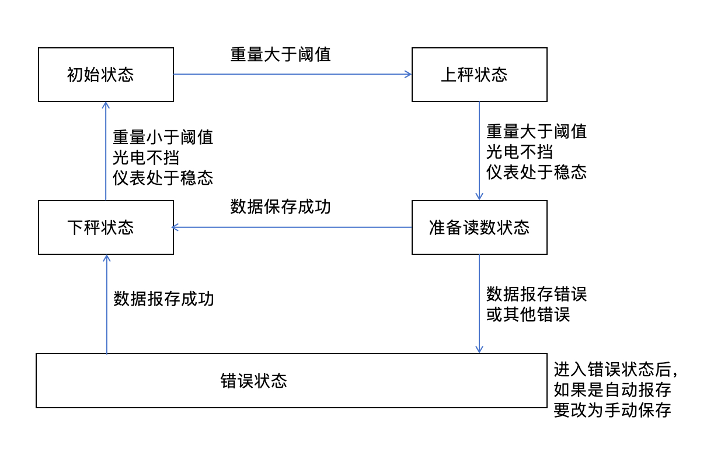

- 单向过秤配置下的外设状态

| 状态 | 秤前交通灯 | 秤后交通灯 | 秤前栏杆机 | 秤后栏杆机 |
|---|---|---|---|---|
| 初始状态     | 绿 | 红 | 开 | 关 |
| 上秤状态     | 红 | 红 | 开 | 关 |
| 准备读数状态 | 红 | 红 | 关 | 关 |
| 下秤状态 | 红 | 绿 | 关 | 开 |
| 错误状态 | 红 | 红 | 不变 | 不变 |

- 双向过秤配置下的外设状态(从A、B向过车时)

| 状态 | A向秤前交通灯 | A向秤后交通灯 | B向秤前交通灯 | B向秤后交通灯 | A向栏杆机 | B向栏杆机 |
|---|---|---|---|---|---|---|
| 初始状态     | 绿 | 红 | 绿 | 红 | 开 | 开 |
| 上秤状态     | 红 | 红 | 红 | 红 | 开 | 开 |
| 准备读数状态 | 红 | 红 | 红 | 红 | 关 | 关 |
| 下秤状态 | 红 | 绿 | 红 | 绿 | 开 | 开 |
| 错误状态 | 红 | 红 | 红 | 红 | 不变 | 不变 |

### 1.2.9.2 秤前识别过车流程
- 流程状态包括：初始状态、读到卡状态、未读到卡状态、上秤状态、准备读数状态、下秤状态、保存错误状态。
- 流程变化如下图所示：
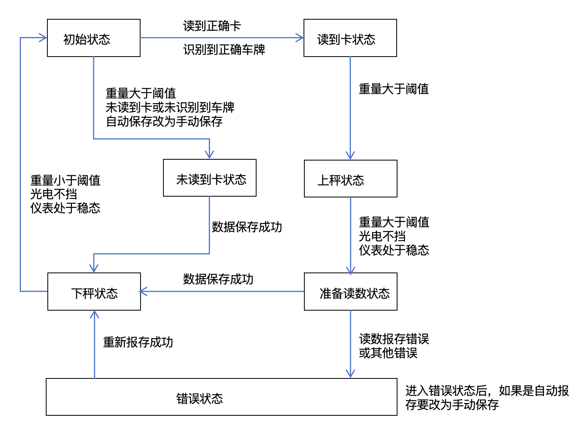

- 单向过秤配置下的外设状态

| 状态 | 秤前读卡器或秤前车牌识别 | 秤前交通灯 | 秤后交通灯 | 秤前栏杆机 | 秤后栏杆机 |
|---|---|---|---|---|---|
| 初始状态     | 开 | 绿 | 红 | 关 | 关 |
| 读到卡状态   | 关 | 绿 | 红 | 开 | 关 |
| 未读到卡状态 | 关 | 红 | 红 | 开 | 关 |
| 上秤状态     | 关 | 红 | 红 | 开 | 关 |
| 准备读数状态 | 关 | 红 | 红 | 关 | 关 |
| 下秤状态     | 关 | 红 | 绿 | 关 | 开 |
| 保存错误状态 | 关 | 红 | 红 | 不变 | 不变 |


- 双向过秤配置下的外设状态（从A向过车时）

| 状态 |A向读卡器或车牌识别 | B向读卡器或车牌识别 | A向秤前交通灯 | A向秤后交通灯 | B向秤前交通灯 | B向秤后交通灯 | A向栏杆机 | B向栏杆机 |
|---|---|---|---|---|---|---|---|---|
| 初始状态     | 开 | 开 | 绿 | 红 | 绿 | 红 | 关 | 关 |
| 读到卡状态   | 关 | 关 | 绿 | 红 | 红 | 红 | 开 | 关 |
| 未读到卡状态   | 关 | 关 | 红 | 红 | 红 | 红 | 开 | 关 |
| 上秤状态     | 关 | 关 | 红 | 红 | 红 | 红 | 开 | 关 |
| 准备读数状态 | 关 | 关 | 红 | 红 | 红 | 红 | 关 | 关 |
| 下秤状态     | 关 | 关 | 红 | 绿 | 红 | 红 | 关 | 开 |
| 错误状态     | 关 | 关 | 红 | 红 | 红 | 红 | 不变 | 不变 |

- 双向过秤配置下的外设状态（从B向过车时）

| 状态 |A向读卡器或车牌识别 | B向读卡器或车牌识别 | A向秤前交通灯 | A向秤后交通灯 | B向秤前交通灯 | B向秤后交通灯 | A向栏杆机 | B向栏杆机 |
|---|---|---|---|---|---|---|---|---|
| 初始状态     | 开 | 开 | 绿 | 红 | 绿 | 红 | 关 | 关 |
| 读到卡状态   | 关 | 关 | 红 | 红 | 绿 | 红 | 关 | 开 |
| 未读到卡状态   | 关 | 关 | 红 | 红 | 红 | 红 | 关 | 开 |
| 上秤状态     | 关 | 关 | 红 | 红 | 红 | 红 | 关 | 开 |
| 准备读数状态 | 关 | 关 | 红 | 红 | 红 | 红 | 关 | 关 |
| 下秤状态     | 关 | 关 | 红 | 红 | 红 | 绿 | 开 | 关 |
| 错误状态     | 关 | 关 | 红 | 红 | 红 | 红 | 不变 | 不变 |

- 初始状态下如果读的是错误卡或识别到的车牌无法匹配车辆登记信息，维持初始状态，外设的状态不变化。
- 行车方向根据读卡的位置或车牌识别的位置来判断（A向读卡器读到卡或A向车牌识别识别到车辆判断为A向，反之判断为B向）。如果没有读卡或识别到车牌，根据上秤是光电开关遮挡的位置来判断（初始上秤是A向光电遮挡判读为A向，反之为B向）。
- 如果即未读到卡，又无光电开关，无法判别方向。此时处于下秤状态的外设变化如下：

| 状态 |A向读卡器或车牌识别 | B向读卡器或车牌识别 | A向秤前交通灯 | A向秤后交通灯 | B向秤前交通灯 | B向秤后交通灯 | A向栏杆机 | B向栏杆机 |
|---|---|---|---|---|---|---|---|---|
| 下秤状态     | 关 | 关 | 红 | 绿 | 红 | 绿 | 开 | 开 |

### 1.2.9.3 秤前识别+秤中确认过车流程
- 流程状态包括：初始状态、读到卡状态、未读到卡状态、上秤状态、准备读数状态、确认状态、下秤状态、保存错误状态。
- 流程变化如下图所示：
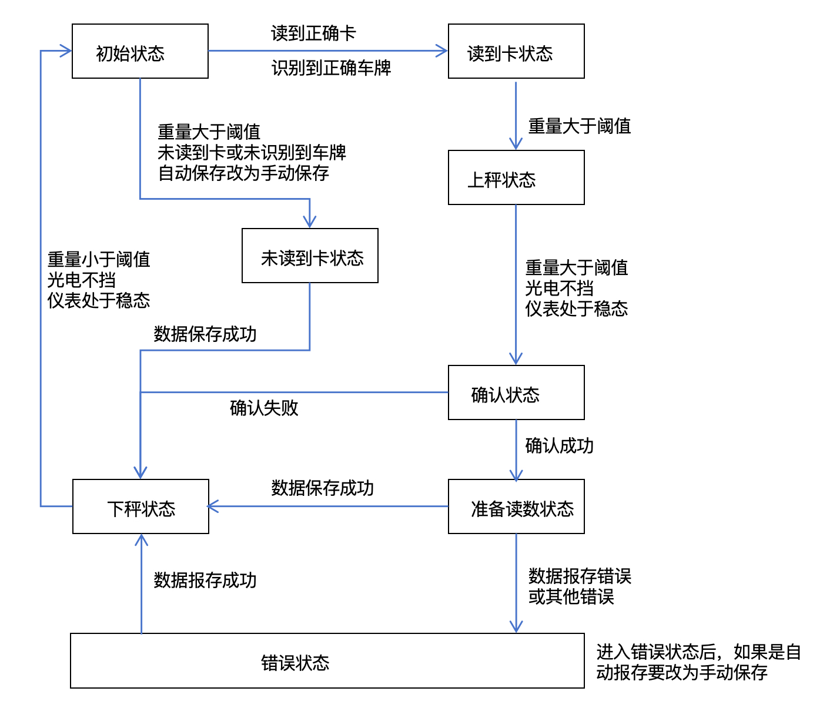


- 单向过秤配置下的外设状态

| 状态 | 秤前读卡器或秤前车牌识别 | 秤前交通灯 | 秤后交通灯 | 秤前栏杆机 | 秤后栏杆机 |
|---|---|---|---|---|---|
| 初始状态     | 开 | 绿 | 红 | 关 | 关 |
| 读到卡状态   | 关 | 绿 | 红 | 开 | 关 |
| 未读到卡状态 | 关 | 红 | 红 | 开 | 关 |
| 上秤状态     | 关 | 红 | 红 | 开 | 关 |
| 确认状态     | 关 | 红 | 红 | 关 | 关 |
| 准备读数状态 | 关 | 红 | 红 | 关 | 关 |
| 下秤状态     | 关 | 红 | 绿 | 关 | 开 |
| 保存错误状态 | 关 | 红 | 红 | 不变 | 不变 |


- 双向过秤配置下的外设状态（从A向过车时）

| 状态 |A向读卡器或车牌识别 | B向读卡器或车牌识别 | A向秤前交通灯 | A向秤后交通灯 | B向秤前交通灯 | B向秤后交通灯 | A向栏杆机 | B向栏杆机 |
|---|---|---|---|---|---|---|---|---|
| 初始状态     | 开 | 开 | 绿 | 红 | 绿 | 红 | 关 | 关 |
| 读到卡状态   | 关 | 关 | 绿 | 红 | 红 | 红 | 开 | 关 |
| 未读到卡状态   | 关 | 关 | 红 | 红 | 红 | 红 | 开 | 关 |
| 上秤状态     | 关 | 关 | 红 | 红 | 红 | 红 | 开 | 关 |
| 确认状态     | 关 | 关 | 红 | 红 | 红 | 红 | 关 | 关 |
| 准备读数状态 | 关 | 关 | 红 | 红 | 红 | 红 | 关 | 关 |
| 下秤状态     | 关 | 关 | 红 | 绿 | 红 | 红 | 关 | 开 |
| 错误状态     | 关 | 关 | 红 | 红 | 红 | 红 | 不变 | 不变 |

- 双向过秤配置下的外设状态（从B向过车时）

| 状态 |A向读卡器或车牌识别 | B向读卡器或车牌识别 | A向秤前交通灯 | A向秤后交通灯 | B向秤前交通灯 | B向秤后交通灯 | A向栏杆机 | B向栏杆机 |
|---|---|---|---|---|---|---|---|---|
| 初始状态     | 开 | 开 | 绿 | 红 | 绿 | 红 | 关 | 关 |
| 读到卡状态   | 关 | 关 | 红 | 红 | 绿 | 红 | 关 | 开 |
| 未读到卡状态   | 关 | 关 | 红 | 红 | 红 | 红 | 关 | 开 |
| 上秤状态     | 关 | 关 | 红 | 红 | 红 | 红 | 关 | 开 |
| 确认状态     | 关 | 关 | 红 | 红 | 红 | 红 | 关 | 关 |
| 准备读数状态 | 关 | 关 | 红 | 红 | 红 | 红 | 关 | 关 |
| 下秤状态     | 关 | 关 | 红 | 红 | 红 | 绿 | 开 | 关 |
| 错误状态     | 关 | 关 | 红 | 红 | 红 | 红 | 不变 | 不变 |

- 初始状态下如果读的是错误卡或识别到的车牌无法匹配车辆登记信息，维持初始状态，外设的状态不变化。
- 行车方向根据读卡的位置或车牌识别的位置来判断（A向读卡器读到卡或A向车牌识别识别到车辆判断为A向，反之判断为B向）。如果没有读卡或识别到车牌，根据上秤是光电开关遮挡的位置来判断（初始上秤是A向光电遮挡判读为A向，反之为B向）。
- 如果即未读到卡，又无光电开关，无法判别方向。此时处于下秤状态的外设变化如下：

| 状态 |A向读卡器或车牌识别 | B向读卡器或车牌识别 | A向秤前交通灯 | A向秤后交通灯 | B向秤前交通灯 | B向秤后交通灯 | A向栏杆机 | B向栏杆机 |
|---|---|---|---|---|---|---|---|---|
| 下秤状态     | 关 | 关 | 红 | 绿 | 红 | 绿 | 开 | 开 |
- 确认状态下系统等待司机刷确认读卡器读取卡号，根据卡号查询匹配车牌号码。如果车牌号码和上秤识别匹配的车牌号码一致则确认成功，否则，确认失败。
  如果确认成功，保存称重数据，状态切换为下秤状态。
  如果确认失败，在状态栏显示报警信息“确认失败，放行车辆下秤”。状态切换为下秤状态。

### 1.2.9.4 秤中识别过车流程
- 流程状态包括：初始状态、上秤状态、稳态、读到卡状态、准备读数状态、下秤状态、保存错误状态。
- 流程变化如下图所示：
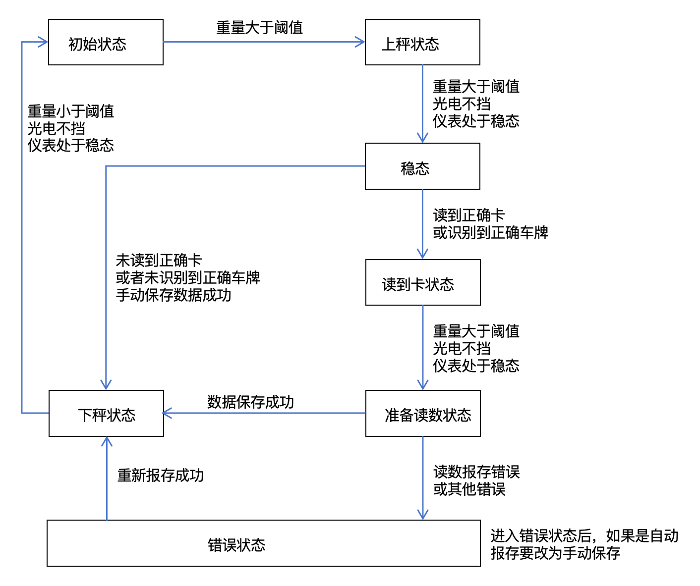


- 单向过秤配置下的外设状态

| 状态 | 秤中读卡器或秤中车牌识别 | 秤前交通灯 | 秤后交通灯 | 秤前栏杆机 | 秤后栏杆机 |
|---|---|---|---|---|---|
| 初始状态     | 关 | 绿 | 红 | 开 | 关 |
| 上秤状态     | 关 | 红 | 红 | 开 | 关 |
| 稳态         | 开 | 红 | 红 | 关 | 关 |
| 读到卡状态   | 关 | 红 | 红 | 关 | 关 |
| 准备读数状态 | 关 | 红 | 红 | 关 | 关 |
| 下秤状态     | 关 | 红 | 绿 | 关 | 开 |
| 保存错误状态 | 关 | 红 | 红 | 不变 | 不变 |

- 双向过秤配置下的外设状态（从A向或B向过车时）

| 状态 |A向读卡器或车牌识别 | B向读卡器或车牌识别 | A向秤前交通灯 | A向秤后交通灯 | B向秤前交通灯 | B向秤后交通灯 | A向栏杆机 | B向栏杆机 |
|---|---|---|---|---|---|---|---|---|
| 初始状态     | 关 | 关 | 绿 | 红 | 绿 | 红 | 开 | 开 |
| 上秤状态     | 关 | 关 | 红 | 红 | 红 | 红 | 开 | 开 |
|   稳态       | 开 | 关 | 红 | 红 | 红 | 红 | 关 | 关 |
| 读到卡状态   | 关 | 关 | 红 | 红 | 红 | 红 | 关 | 关 |
| 准备读数状态 | 关 | 关 | 红 | 红 | 红 | 红 | 关 | 关 |
| 下秤状态     | 关 | 关 | 红 | 绿 | 红 | 绿 | 开 | 开 |
| 错误状态     | 关 | 关 | 红 | 红 | 红 | 红 | 不变 | 不变 |

- 行车方向根据读卡的位置或车牌识别的位置来判断（A向读卡器读到卡或A向车牌识别识别到车辆判断为A向，反之判断为B向）。如果没有读卡或识别到车牌，根据上秤是光电开关遮挡的位置来判断（初始上秤是A向光电遮挡判读为A向，反之为B向）。

### 1.2.9.5 动态秤前识别过车流程
- 流程状态包括：初始状态、读到卡状态、上秤状态、准备读数状态、保存错误状态。
- 流程变化如下图所示：
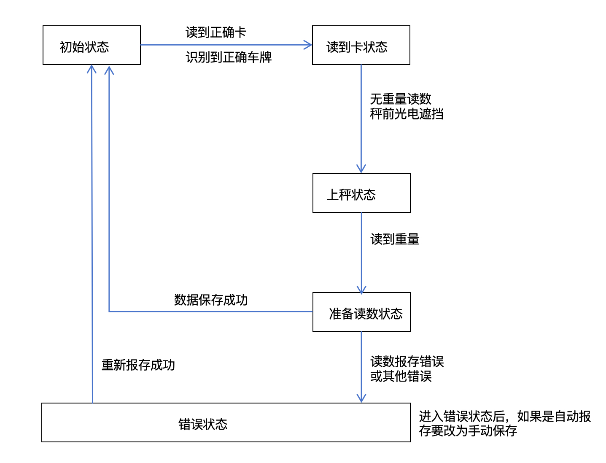

- 单向过秤配置下的外设状态

| 状态 | 秤前读卡器或秤前车牌识别 | 秤前交通灯 | 秤后交通灯 | 秤前栏杆机 | 秤后栏杆机 |
|---|---|---|---|---|---|
| 初始状态     | 开 | 绿 | 红 | 关 | 关 |
| 读到卡状态   | 关 | 绿 | 绿 | 开 | 开 |
| 上秤状态     | 关 | 红 | 绿 | 关 | 开 |
| 准备读数状态 | 关 | 红 | 红 | 关 | 关 |
| 保存错误状态 | 关 | 红 | 红 | 不变 | 不变 |


- 双向过秤配置下的外设状态（从A向过车时）

| 状态 |A向读卡器或车牌识别 | B向读卡器或车牌识别 | A向秤前交通灯 | A向秤后交通灯 | B向秤前交通灯 | B向秤后交通灯 | A向栏杆机 | B向栏杆机 |
|---|---|---|---|---|---|---|---|---|
| 初始状态     | 开 | 开 | 绿 | 红 | 绿 | 红 | 关 | 关 |
| 读到卡状态   | 关 | 关 | 绿 | 绿 | 绿 | 绿 | 开 | 开 |
| 上秤状态     | 关 | 关 | 红 | 绿 | 红 | 绿 | 关 | 开 |
| 准备读数状态 | 关 | 关 | 红 | 绿 | 红 | 绿 | 关 | 关 |
| 错误状态     | 关 | 关 | 红 | 红 | 红 | 红 | 不变 | 不变 |

- 双向过秤配置下的外设状态（从B向过车时）

| 状态 |A向读卡器或车牌识别 | B向读卡器或车牌识别 | A向秤前交通灯 | A向秤后交通灯 | B向秤前交通灯 | B向秤后交通灯 | A向栏杆机 | B向栏杆机 |
|---|---|---|---|---|---|---|---|---|
| 初始状态     | 开 | 开 | 绿 | 红 | 绿 | 红 | 关 | 关 |
| 读到卡状态   | 关 | 关 | 绿 | 绿 | 绿 | 绿 | 开 | 开 |
| 上秤状态     | 关 | 关 | 绿 | 红 | 绿 | 红 | 开 | 关 |
| 准备读数状态 | 关 | 关 | 红 | 红 | 红 | 红 | 关 | 关 |
| 错误状态     | 关 | 关 | 红 | 红 | 红 | 红 | 不变 | 不变 |

- 初始状态下如果读的是错误卡或识别到的车牌无法匹配车辆登记信息，维持初始状态，外设的状态不变化。
- 行车方向根据读卡的位置或车牌识别的位置来判断（A向读卡器读到卡或A向车牌识别识别到车辆判断为A向，反之判断为B向）。如果没有读卡或识别到车牌，根据上秤是光电开关遮挡的位置来判断（初始上秤是A向光电遮挡判读为A向，反之为B向）。

### 1.2.10 称重流程状态定义

### 1.2.10.1 初始状态
秤台上的重量小于阈值，且光电开关不挡。

### 1.2.10.2 上秤状态
秤台重量大于等于阈值（如果秤前读卡，则必须先读到卡；如果秤前识别车牌，则必须先识别到车牌号码）。

### 1.2.10.3 读到卡状态
指读到卡号并且卡号判断正确后进入的状态。
如果是配置车牌识别摄像机，指识别到车牌号码且车牌号码判断正确后进入的状态。

### 1.2.10.4 未读到卡状态
指系统还未获取到正确的卡号或识别到车牌号码，车辆就上秤了，此时就会进入未读卡状态。

### 1.2.10.5 完全上秤状态
指秤台上重量大于阈值，且光电开关都不被遮挡的情况。

### 1.2.10.6 静态状态
指当进入完全上秤状态后，重量处于稳定状体（是否稳定由软件判断）。

### 1.2.10.7 保存状态
指一切准备就绪，可以进行读数保存时的状态。

### 1.2.10.8 下秤状态
指称重完成，允许车辆下秤的状态。


### 1.2.11 称重方式
称重操作时对称重重量的处理方式，
### 1.2.11.1 标准称重（单次称重）

- 一辆车辆的称重操作由单次车辆过秤称重操作完成。在数据库中已有该车辆皮重的情况下，使用标准称重方式。
- 操作步骤如下：
按数据输入区的“手动继续”按钮，清空数据输入区内容，输入车号后，系统将车辆信息库中该车皮重及皮重时间读入到皮重栏和皮重时间项中，输入货名、规格、单位等信息，按“读数”按钮，将数据采集到毛重栏。若在备用数值字段设置了计算公式，系统会按照设置内容自动计算并显示计算结果。按“保存”按钮，系统将数据保存到交易数据库中。
在数据库中没有该车皮重的情况下，软件将不允许保存，操作员必须事先到皮重库中添加皮重信息

### 1.2.11.2 车号配对称重
- 车号配对称重时，系统不读取皮重库中已有的皮重值。称重过程分两次完成，具体如下：
1）第一次称量
按数据输入区的“继续”按钮，清空数据输入区内容，输入车号、货名、规格、单位等信息，按“读数”按钮，数据被录入到毛重栏。按“保存”按钮，系统将数据保存到临时数据库中。在数据输入区内，有三种方式可输入信息（在下列章节输入方式类同之处不再重复）。
2）第二次称量
输入车号信息，系统自动在临时数据库中查找该车信息，找到后将第一次称量的车辆信息显示在数据输入区相应栏中（这时可补充或修改信息栏中内容），按“读数”按钮，系统比较两次重量的大小，将大重量显示在毛重栏，小重量显示在皮重栏，自动计算出净重并显示在净重栏。若在备用数值字段设置了计算公式，系统会按照设置内容自动计算并显示计算结果。按“保存”按钮，系统将数据保存到交易数据库中，并删除临时数据库中该车的过车记录。
若该车从未在此系统出现过，系统将该车的车号、皮重信息自动保存到车辆信息库中。

### 1.2.11.3 多次称重
一般用于卸货称重。操作与配对称重类似，具体操作如下：
第一次称量
按数据输入区的“继续”按钮，清空数据输入区内容，输入车号、货名、规格、单位等信息，按“读数”按钮，将数据采集到毛重栏。按“保存”按钮，系统将数据保存到临时数据库中。
第二次称量
输入车号信息，系统自动在临时数据库中查找该车信息，并将第一次称重信息显示在数据输入区相应栏中（这时可补充或修改信息栏中内容），将上次称量的重量显示在毛重栏，按“读数”按钮，将本次已卸货后的重量显示在皮重栏，自动计算出净重并显示在净重栏。若在备用数值字段设置了计算公式，系统会按照设置内容自动计算并显示计算结果。按“保存”按钮，系统将数据保存到交易数据库中，与车号配对称重不同的是，此时系统会出现对话框，提示“是否还有货物没有称量完成？（如果没有将不会再自动生成一笔临时数据）”。
由用户判断当前车辆是否已经卸货完成，若尚未卸货完成，则选择“是”按钮，系统会将本次皮重作为下次称量的毛重值，更新原临时数据库中该车的过车记录；若选择“否”按钮，说明已完成卸货过程，系统会删除临时数据库中该车的过车记录。
因此，多次称量在未最终结束卸货前，临时数据库中始终有该车上一次的过车记录，即上一次的称量值，直到完成卸货时，系统才会删除临时数据库中该车的过车记录。

### 1.2.11.4 手工置皮称重
在车辆皮重必须要手工输入（如静态轨道衡称量）的情况下，使用手工置皮方式。该称重方式在汽车衡称量时不推荐使用，建议用户在系统设置时将其关闭。手工置皮称量的具体操作如下：
按数据输入区的“继续”按钮，清空数据输入区内容，输入车号、货名、规格、单位等信息。在皮重栏手工输入车辆皮重，按“读数”按钮，系统自动根据仪表传来的毛重计算出净重。若在备用数值字段设置了计算公式，系统会按照设置内容自动计算并显示计算结果。按“保存”按钮，系统将数据保存到交易数据库中。
注：当车辆在秤上停稳后，仪表发送重量稳定标志，司磅员方可采集数据。因此可在车辆上秤时输入收货单位、发货单位、车号等信息，一旦重量稳定，按“读数”按钮采集数据，按“保存”按钮保存信息。

### 1.2.11.5 公秤称重
该称重方式用在公用称重计量上，具体操作如下：
按信息录入区的“继续”按钮，清空信息录入区内容，输入车号、货名、规格等信息，按“读数”按钮，读取值计为毛重，同时也计为净重，按“保存”按钮，系统将数据保存到交易数据库中。

### 1.2.12 数据计算
### 1.2.12.1 扣包装
- 对于小包装货物，可根据需要扣除包装重量，计算货物净重。货物净重 = 净重 - 包装重量。
- 可根据设置的包装数量和包装规格重量自动计算包装重量： 包装重量 = 数量 * 包装规格重量。
- 包装数量和包装规格可预先设置到车辆信息中。
- 包装数量和包装规格可人工输入或选择。

### 1.2.12.2 扣水扣杂
- 对于煤炭、粮食等散货货物，可根据需要扣除水分和杂质重量，计算货物净重。货物净重 = 净重 - 扣水重量 - 扣杂重量。
- 扣水重量和扣杂重量可预先设置到车辆信息中。
- 扣水重量和扣杂重量可人工输入。
 
### 1.2.13 称重数据

### 1.2.13.1 毛重
空车+货物的总重量。

### 1.2.13.2 皮重
空车重量

### 1.2.13.3 净重
车辆装载货物的重量。

### 1.2.13.4 临时称重记录
车号配对称重中第一次称重后形成的称重记录，只包含毛重数据，不包含皮重，净重数据。

### 1.2.13.5 正式称重记录
标准称重后形成的称重记录，或者配对称重中第二次称重后形成的正式称重记录。包含毛重、皮重和净重数据。

### 1.2.13.6 称重记录
称重记录应该包括以下数据：
1）称重操作过程中根据输入或匹配的信息。如：车牌号、订单号、货物、货物规格、发货单位、收货单位、运输单位等
2）重量数据（毛重、皮重、净重）
3）计算数据(扣水重量、扣杂重量、扣包装重量、货物净重）
4) 记录状态 （临时记录，正式记录，已删除记录）
5）报警标志（防作弊报警标志、人工秤标志、授权称重标志、异常标志）
6）称重过程信息（第一次称重重量，第二次称重重量，第一次称重时间，第二次称重时间，第一次磅单号，第二次磅单号，第一次操作员，第二次操作员）
6）其他用户定义信息，如授权原因，用户自定义字段信息。
7）抓拍图片信息（抓拍图片路径）

### 1.2.13.7 日志记录
软件提供的操作日志记录赢包括：
1）操作类型
2）日志时间
3）改动前数据
4）改动后数据
5）日志备注

---
 
## 1.3 技术选型
| 项目 | 选型 |    |
|:---|:---|:---|
| 开发框架 | .NET Framework 4.8+ |
| UI 框架 | WinForms (C#) |
| 数据库 | Access (.mdb) | SQL Server 2012+ | 
| 报表 | FastReport OpenSource版本 |
| 通信 | 串口 (RS232/RS485) | 网络（TCP/IP） | 

## 1.4 需要实现的功能
### 1.4.1 主界面布局
- 主界面布局如下图：
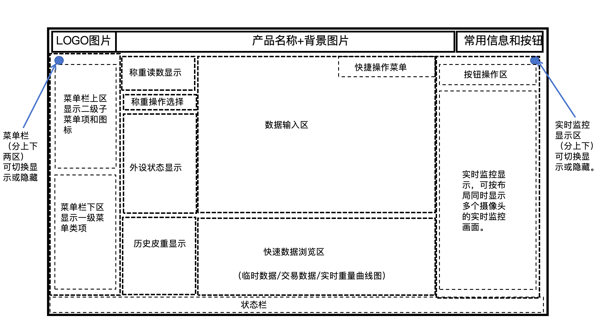

### 1.4.2 地磅读数显示
- 针对每一个连接的物理地磅，分别提供一个独立的地磅读数显示。显示效果参见


- 软件最多支持连接6个物理磅。软件可显示当前连接的所有地磅。
- 用户可通过鼠标点击方式切换当前选择的地磅。
- 地磅读数显示可显示当前选择的地磅的重量读数、重量单位。单位可选 “kg”或“t”。 单位默认为“kg”。重量显示和单位均采用粗体。
- 地磅读数显示可显示当前连接地磅的状态：
1）当无法打印对应的接口（串口或网络），显示“断开”。地磅连接状态为断开。
2）当接口打开，无法收到数据，显示“无数据”。地磅连接状态为无仪表。
3）当接收到数据，且识别到稳态标志，数据有效，读数显示为蓝色。如果数据波动或未识别到稳态标志，数据无效，读数显示为灰色。
4）当接收到数据，且识别到超载标志。数据超载，显示“^^^^^^”。
5）当接收到数据，且识别到欠载标志。数据欠载，显示“vvvvvv”。

### 1.4.3 外设状态监控
- 软件需要在界面上提供地磅外设显示区，可显示地磅、启用的外设、外设状态和地磅的相对位置。显示效果图如下：
1）未配置四周光电开关：

2）配置四周光电开关
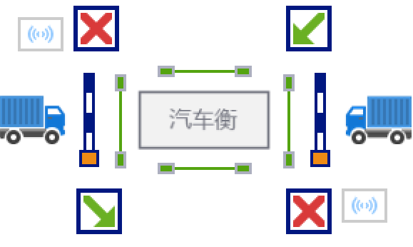

- 外设及状态采用图形方式显示。相关图片在【外设状态】目录下。

| 外设 | 类型 |位置 | 方向 | 状态 | 图片 |
|---|---|---|---|---|---|
|道闸| IO输出 | 秤前或秤后 | | 抬杆 |  |
|道闸| IO输出 | 秤前或秤后 | | 落杆 |  |
|读卡器| 车辆识别设备 | 秤前或秤后 | |  |   |
|短边光电| IO输入 | 秤前或秤后 |  |不挡 |  |
|短边光电| IO输入 | 秤前或秤后 |  |挡 |  |
|长边光电| IO输入 | 上侧或下侧 |  |不挡 |  |
|长边光电| IO输入 | 上侧或下侧 |  |挡 |  |
|红绿灯| IO输出 | 秤前或秤后 | A向 | 红灯 |  |
|红绿灯| IO输出 | 秤前或秤后 | B向 | 红灯 |  |
|红绿灯| IO输出 | 秤前或秤后 | A向 | 绿灯 |  |
|红绿灯| IO输出 | 秤前或秤后 | B向 | 绿灯 |  |

- 显示自动称重操作流程图，参见。
  其中：状态节点是当前状态显示蓝色，已完成状态显示绿色，未进入状态显示白色。
- 显示当前流程状态文字描述。
- 显示车辆识别结果。如果连接车牌识别摄像机，可以显示车牌识别识别结果(车牌号码）。如果连接了读卡器，显示读卡器的读卡结果（卡号）。
- 人工称重模式下，可以用鼠标点击IO输出外设图形（图标）切换外设输出状态。例如：
  1）可以切换道闸抬杆或落杆状态。
  2）可以切换红绿灯红灯或绿灯状态。

### 1.4.4 数据输入区
- 可显示和输入称重记录信息信息，参见下图
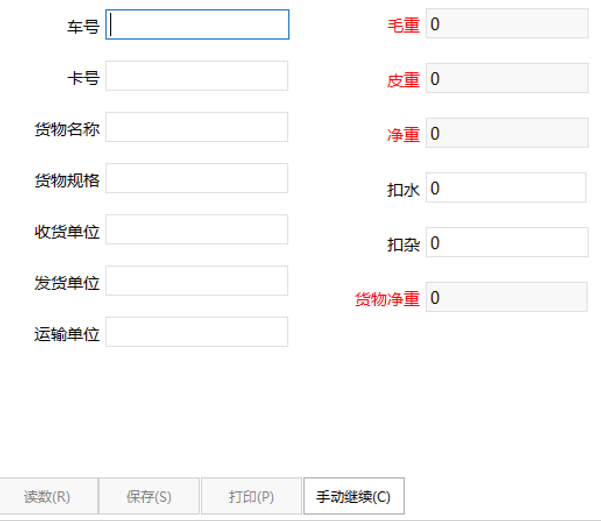
- 输入区可包括：车号、卡号、货物、货物规格、发货单位、收货单位、运输单位、毛重、皮重、净重、扣水、扣杂、扣包装重量、货物净重等字段。
- 输入区字段控件根据界面自定义设置自动加载和显示，
  1) 可根据主界面自定义设置在输入区显示字段控件。相关设置信息参见“主界面自定义信息表”定义。每个称重方式有不同的自定义设置。
  2) 可设置属性包括：加载的字段名和控件名，位置，字体，字体大小，斜体，粗体，背景色，字体色，标签信息，Tab顺序等。
  3) 如果字段控件属性为隐藏，则不显示改字段控件。
  4) 如果字段控件属性是只读属性，则字段控件不允许编辑输入。
  5) 如果字段控件属性是自动清屏，点击“手动继续”按钮时自动清空该字段输入框内容。
  6) 如果字段控件属性是必填项，保存数据时不允许该字段内容为空。
  7) 如果字段属性是存在性，需要检查输入内容在基础表中有相关内容。
  8) 默认，毛重、皮重、净重字段设置为只读属性。
- 车号字段输入操作。界面效果参见

  1) 支持快捷码输入：输入快捷代码，软件可根据快捷代码查询车皮表，获取对应的车牌号码和皮重并显示。
  2) 支持列表选择：用鼠标双击车号输入框，根据车皮表显示列表（车号、快捷代码）。用户可从列表中选择车牌号码和皮重并显示。
  3) 支持模糊快捷输入：输入部分车号信息和快捷代码信息，软件可根据信息模糊匹配车皮表中的信息并显示列表（车号、快捷代码）。用户可从列表中选择车牌号码和皮重并显示。
  4) 支持人工输入车号信息。
  5) 支持新车号输入操作：点击“新车号”按钮打开车号输入对话框，输入完整车号信息并加载到车号字段输入框。具体参见“输入新车号功能”的说明。
- 卡号字段输入操作。 
1) 支持输入列表选择：用鼠标双击卡号输入框，根据车辆信息表显示列表（卡号、车号）。用户可从列表中选择卡号，同时更新车号显示。
2) 支持模糊快捷输入：输入部分卡号信息，软件可根据信息模糊匹配车辆信息表中的信息并显示列表（卡号、车号）。用户可从列表中选择卡号并同时根据车辆信息表中设置的车号、货物、规格、发货单位、收货单位、运输单位等信息更新信息输入区对应字段的显示。
3) 支持人工直接输入。 
4) 支持快捷码输入：输入快捷代码，软件可根据快捷代码查询货物信息表，获取对应的货物名称和货物代码并显示。
- 货物字段输入操作。
1) 支持列表选择：用鼠标双击货物输入框，根据货物信息表显示列表（货物名称、货物代码和快捷代码）。用户可从列表中选择货物名称和货物代码并显示。
2) 支持模糊快捷输入：输入部分货物名称和快捷代码信息，软件可根据信息模糊匹配货物信息表中的信息并显示列表（货物名称、货物代码、快捷代码）。用户可从列表中选择货物名称和货物代码并显示。   
3) 支持快捷码输入：输入快捷代码，软件可根据快捷代码查询货物信息表，获取对应的货物名称并显示。
4) 支持人工直接输入。
- 货物规格字段输入
1) 支持列表选择：用鼠标双击货物规格输入框，根据货规格物信息表显示列表（货物规格和快捷代码）。用户可从列表中选择货物规格并显示。
2) 支持模糊快捷输入：输入部分货物规格和快捷代码信息，软件可根据信息模糊匹配货物规格信息表中的信息并显示列表（货物规格、快捷代码）。用户可从列表中选择货物规格并显示。
3) 支持人工直接输入。
4)  支持快捷码输入：输入快捷代码，软件可根据快捷代码查询货物规格信息表，获取对应的货物规格名称并显示。
- 发货单位字段输入
1) 支持快捷码输入：输入快捷代码，软件可根据快捷代码查询发货单位信息表，获取对应的发货单位名称并显示。
2) 支持列表选择：用鼠标双击发货单位输入框，根据发货单位信息表显示列表（发货单位和快捷代码）。用户可从列表中选择发货单位并显示。
3) 支持模糊快捷输入：输入部分发货单位名称和快捷代码信息，软件可根据信息模糊匹配发货单位信息表中的信息并显示列表（发货单位、快捷代码）。用户可从列表中选择发货单位并显示。
4) 支持人工直接输入。
- 收货单位字段输入
1) 支持快捷码输入：输入快捷代码，软件可根据快捷代码查询收货单位信息表，获取对应的收货单位名称并显示。
2) 支持列表选择：用鼠标双击收货单位输入框，根据收货单位信息表显示列表（收货单位和快捷代码）。用户可从列表中选择收货单位并显示。
3) 支持模糊快捷输入：输入部分收货单位和快捷代码信息，软件可根据信息模糊匹配收货单位信息表中的信息并显示列表（收货单位、快捷代码）。用户可从列表中选择收货单位并显示。
4) 支持人工直接输入。
- 运输单位字段输入
1) 支持快捷码输入：输入快捷代码，软件可根据快捷代码查询运输单位信息表，获取对应的运输单位名称并显示。
2) 支持列表选择：用鼠标双击运输单位输入框，根据运输单位信息表显示列表（运输单位和快捷代码）。用户可从列表中选择运输单位并显示。
3) 支持模糊快捷输入：输入部分运输单位和快捷代码信息，软件可根据信息模糊匹配运输单位信息表中的信息并显示列表（运输单位、快捷代码）。用户可从列表中选择运输单位并显示。
4) 支持人工直接输入。
- 【手动继续】按钮: 默认启用。如果启用自动称重点击后可清空数据输入区已输入的字段内容，开始新的车辆称重。如果某字段自定义属性“必须清空”为0， 则保留原来的输入内容。
- 【读数】按钮：默认禁用。当车辆上秤后满足称重条件（光电不遮挡），读数按钮激活。如果选择虚拟磅，人工输入重量后读数按钮激活，同时重量填入毛重字段输入框。点击后可读取当前选择秤的称重读数，重量填入毛重字段输入框。
- 【保存】按钮：默认禁用。当完成称重读数后激活。点击后可根据选择的称重方式进行毛重、皮重和净重计算，自动根据扣水、扣杂重量计算货物净重，生成磅单号，保存称重数据记录到数据库中。
- 【打印】按钮：默认禁用。当完成保存数据操作后激活。点击后可根据保存的称重记录打印磅单。如果启用临时磅单打印，临时称重记录可以打印磅单。如果启用自动打印磅单，保存数据成功后自动打印磅单。

### 1.4.5 快速数据浏览
- 软件主界面提供快速数据浏览区显示最近的称重数据和曲线，

- 数据浏览区提供3个独立的显示区，分别可显示交易称重记录，临时称重记录和当前秤的实时称重曲线图。如果未启用称重曲线功能，称重曲线图不显示。
- 数据浏览区提供切换操作功能，可切换显示正式称重记录，临时称重记录和称重曲线。
- 数据浏览区可显示最近N条临时称重记录（未完成称重）和N条正式称重记录（已完成称重）。默认按称重时间由近到远排序。（N可以在系统参数中设置）。
- 称重记录显示区包括：标签、称重数据网格和按钮区。标签显示称重记录数量。数据网格显示对应的称重记录。按钮区包括：【刷新】按钮、【详细记录】按钮、【放大】按钮、【缩小】按钮和【自定义显示字段】按钮。
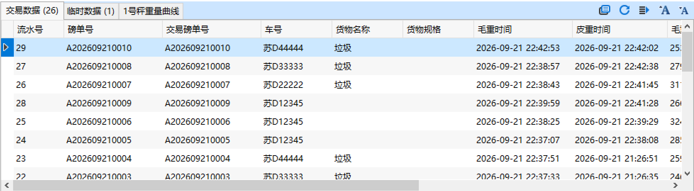

1) 具有作异常标志（皮重重量报警、皮重时间报警、称重时间间隔报警、手工补单标志、临时称重补单标记）的称重记录高亮显示（红色字体）。
  
2) 【刷新】按钮：点击后可强制刷新称重记录显示。同时恢复为默认排序。
  
3) 【加载选择行车号】按钮：点击后可将选中的称重记录中的车号信息填入输入区的车号字段输入框。。
  
4) 【放大】按钮：点击后可放大数据网格显示字体大小。

5) 【缩小】按钮：点击后可缩小数据网格显示字体大小。
  
6) 【自定义显示字段】按钮：点击后可提供字段设置界面（详见1.4.12），设置数据网格显示字段。显示字段可根据称重记录字段增加或减少。

7) 按字段名排序： 点击数据网格的字段名称可按对应字段名对网格内的数据记录进行排序操作。第一次点击按降序排序，在字段名标签上显示降序标志（▼）。第二次点击按升序排序，在字段名标签上显示升序序标志（▲）。第三次点击按默认排序（按称重时间有近到远排序），字段上不显示排序标志。
  
8) 快捷操作：选中一条称重记录，点击鼠标右键显示快捷菜单
  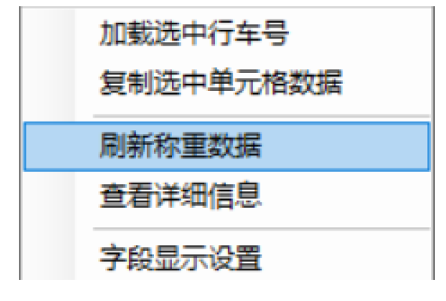
  支持如下操作：
     - “加载选中车号”： 将选中的称重记录中的车号信息填入输入区的车号字段输入框。
     - “复制选中单元格数据”：把鼠标所在网格单元格的数据复制到粘贴板。方便后续黏贴到输入区的相应字段输入框。
     - “刷新称重数据”：同【刷新】按钮操作功能。
     - “查看详细信息”：可显示打开称重记录的详细记录窗口显示当前选择的称重记录的详细信息（参见1.4.9）。

- 称重曲线显示区包括：标签，图表标题、纵轴单位、纵轴刻度、横轴单位、横轴刻度、图形区。
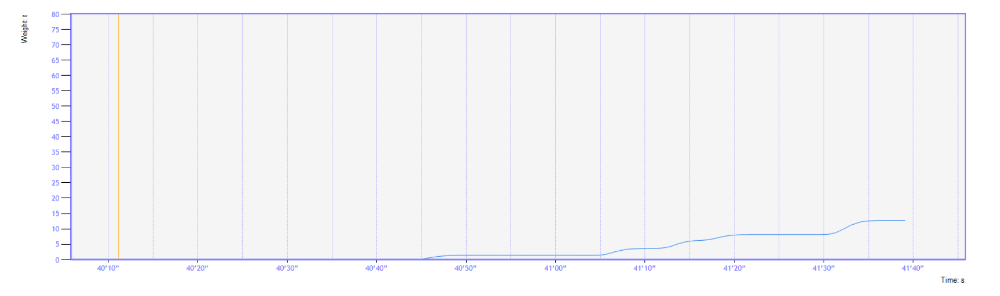
称重曲线功能参见相关说明。
1) 标签： 显示称重曲线信息，格式为：【磅秤号】称重曲线。
2) 图表标题： 显示“称重过秤过程重量曲线变化图”。
3) 纵轴单位： 显示“重量单位：吨”， 
4) 纵轴刻度： 最小值为0， 最大值根据重量曲线最大值设置（默认 80吨）。单位刻度根据显示自动适配。
5) 横轴单位： 显示“时间： 秒”。
6) 横轴刻度： 最小值为称重曲线起始时间点，最大值为称重曲线结束时间点。单位刻度根据显示自动适配。
7) 图形区：   
     在称重数据文件存储目录（参见称重曲线功能相关说明）中，根据磅单号+秤号+称重次数匹配称重数据文件，读取称重曲线数据。
     按X，Y线性图显示称重曲线图形。X轴位读数时间（单位为秒），Y轴位读数重量（单位为吨）。
     

### 1.4.6 历史皮重显示
- 软件主界面提供历史皮重显示，显示历史皮重信息。当系统参数设置中设置的显示历史皮重数量大于0是才会显示。
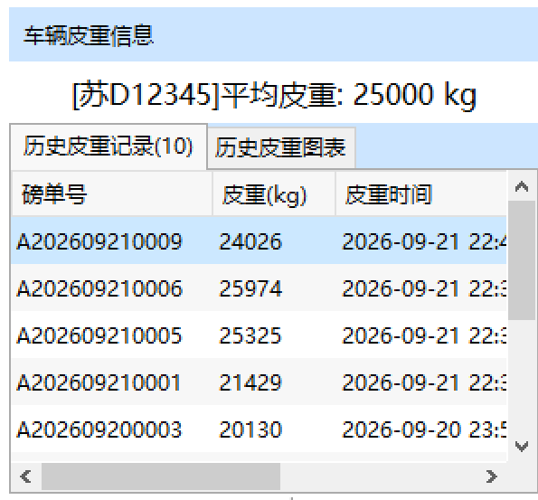

- 历史皮重显示包括：标签， 皮重信息显示和历史皮重列表。
1) 标签： 显示“车辆皮重信息”。
2) 皮重信息显示： 显示车牌号码和历史平均皮重值。
3) 历史皮重记录：显示最近N条历史皮重记录。包括：磅单号、皮重值和称重时间。按车牌号码从称重记录表中查询。N在系统参数设置中设置。如果N为0， 禁用历史皮重显示功能，历史皮重显示区不显示。

### 1.4.7 称重方式选择
- 主界面需要提供列表选择当前称重方式。
1) 自动称重支持的称重方式为：“标准称重”，“车号配对称重”。
2) 手动称重支持所有的称重方式：“标准称重”，“车号配对称重”，“多次称重”，“手工置皮”，“公秤称重”。
- 称重方式选择在称重读数显示区下方，设备状态显示区上方。

### 1.4.8 称重曲线图
- 如果启用称重曲线功能（基础防作弊设置界面勾选“称重曲线图”），软件在称重操作过程中按时间先后顺序定时自动采集称重重量读数。 每5秒中采集一次称重读数。称重读数转换成吨为单位。
- 称重数据文件：
   文件位置：根据【基础防作弊设置】中的“称重曲线图”设置的称重曲线存储目录，按年/月/日分级建立子目录，在日期子目录中每次称重自动生成称重曲线图数据文件。
   文件名：秤号（4位）+称重次数（2位， “01”--第一次称重，“02”第二次称重）+磅单号（一次磅单号）。后缀为txt。
   文件类型：txt文件。
   数据格式：采用ASCII码记录，每次称重读数记录占用一行，包括：采集时间（格式：YYYYMMDD HH:MM:SS），称重读数值(单位为吨）。
- 当识别到车辆上秤，开始采集称重读数。创建称重曲线图数据文件，开始记录称重读数数据。
- 当识别到车辆下秤，结束采集称重读数。
1) 在“曲线图数据表”中添加记录。登记：一次磅单号（“TicketNo1”字段）、称重次数（“ScaleTime”字段）、磅站号（“StationNo”字段）、秤号（“ScaleNo”字段）等信息。详见相关数据表定义。
2) 登记称重称重数据文件路径（“PictureName”字段）
3) 登记读数时间（“CaptureTime”字段）
4) 从称重数据文件读取所有称重曲线数据，记录称重曲线数据（“TrendLine”字段）。
     存储在“TrendLine”字段的称重曲线图数据可采用XML格式：
      示例：
      ···
      <WeighingCurveData>
          <record>
               <time>2026-10-08 08:30:00</time>
               <weight unit="t">12.35</weight>
          </record>
          <record>
               <time>2026-10-08 08:30:05</time>
               <weight unit="t">12.35</weight>
          </record>
          <record>
               <time>2026-10-08 08:30:10</time>
               <weight unit="t">12.35</weight>
          </record>
          ...
      </WeighingCurveData>
      ···
5) 登记上传标志（“UploadFlag”字段），默认设置为0（未上传）。
- 如果启用称重曲线功能，当前选择秤的称重曲线图可显示在主界面快速浏览数据显示区。
- 如果启用称重曲线功能，称重记录相关的称重曲线图可显示在详细记录显示窗口。


### 1.4.9 详细记录显示
- 软件提供称重记录详细信息显示窗口，可显示称重记录详细信息、重量曲线图、抓拍图片、称重日志四项内容。
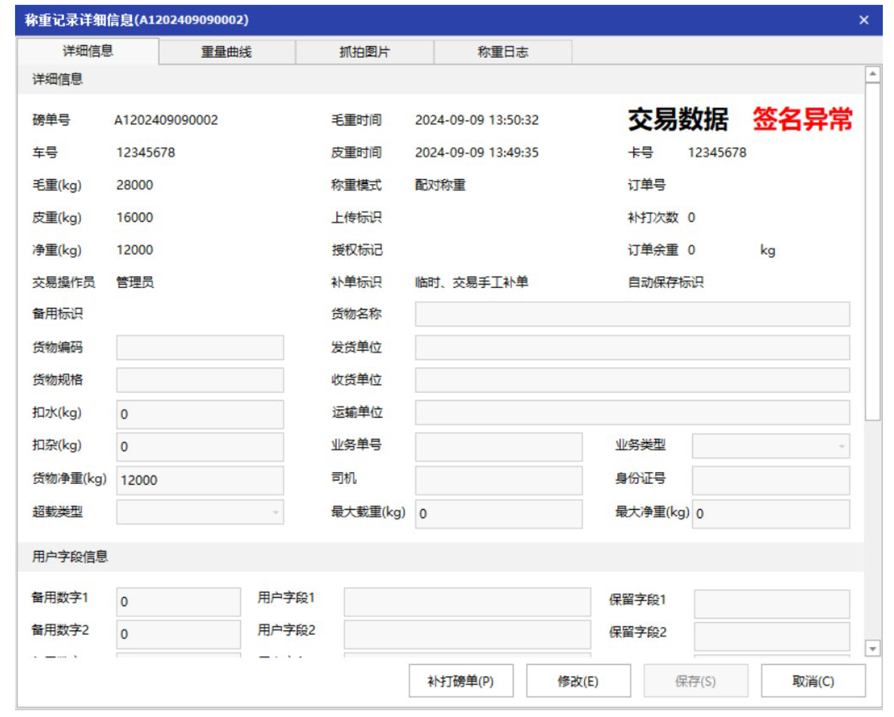
- 称重记录详细信息显示提供如下功能：
1) 显示称重记录字段信息: 分别显示称重记录字段和自定义用户字段。
2) 显示称重记录状态: 如果是正式称重记录，显示交易数据标志。如果是临时称重记录，显示临时数据标志。
3) 显示称重记录异常状态：如果是异常记录（手工补单标识、皮重重量报警、皮重时间报警、称重时间间隔报警），显示异常记录标志。
4) 【修改】按钮：默认激活。当点击【修改】按钮时开发修改权限，允许操作员修改相关字段内容。部分字段（货物名称、货物编码、货物规格、发货单位、收货单位、运输单位、扣水、扣杂、货物净重、业务单号、业务类型、司机、身份证号、超载类型、最大载重、最大净重）和用户字段（备用数字1~16，用户字段1~16）允许修改。激活【保存】按钮。
5)  【保存】按钮：默认禁用。修改完成后点击【保存】按钮更新修改内容到数据库中。
6) 【打印】按钮：点击后根据当前记录打印磅单。

- 重量曲线图显示：
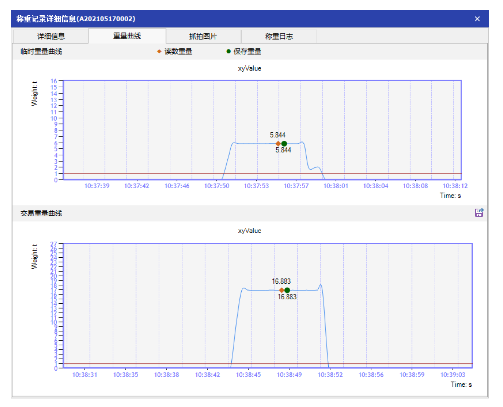
提供如下功能：
1) 重量曲线图显示区包括上下两部分，分别显示第一次称重重量曲线和第二次称重重量曲线。
2) 重量曲线图数据根据磅单号、磅站号从“曲线图数据表”中读取。称重次数为1时是第一次称重曲线，为2时是第二次称重曲线。
3) 每个称重曲线图显示区包括：标签，图表标题，纵轴单位，纵轴刻度，横轴单位，横轴刻度和图形区。
   标签：如果是第一次称重重量曲线提示“临时称重曲线”，否则提示“交易称重曲线”。显示读数重量标志图形和和保存重量图形标识。
   图表标题： 显示“称重过秤过程重量曲线变化图”。
   纵轴单位： 显示“重量单位：吨”， 
   纵轴刻度： 最小值为0， 最大值根据重量曲线最大值设置（默认 80吨）。单位刻度根据显示自动适配。
   横轴单位： 显示“时间： 秒”。
   横轴刻度： 最小值为称重曲线起始时间点，最大值为称重曲线结束时间点。单位刻度根据显示自动适配。
   图形区：   按称重曲线数值按线性图显示。读数时间点和保存数据时间点对应的数据点加粗显示并显示重量数值。
4) 称重曲线上可显示读数重量标志和对应的重量数值。读数时间为抓拍时间。
5) 称重曲线上可显示保存重量标志和对应的重量数值。保存时间为对应的称重时间（临时称重为临时称重时间，交易称重为交易称重时间）。
- 抓拍图片显示：可显示称重记录相关联的抓拍图片。
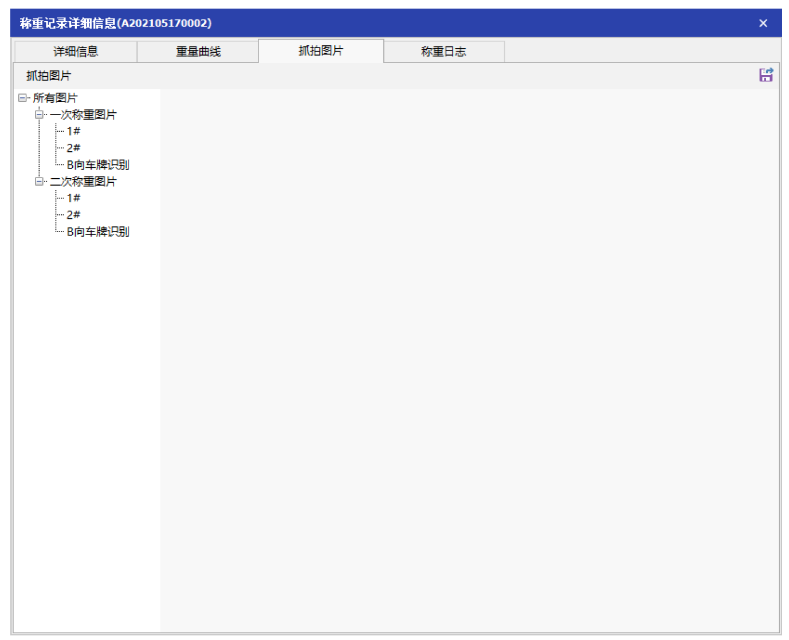
提供如下功能：
1) 显示区包括图片信息清单和图片显示区。
2) 图片信息清单：
   显示当前称重记录对应的所有抓拍图片信息记录，可通过“抓拍图片表”查询相关信息。
   每张抓拍图片对应一条信息记录。信息包括：磅单号、磅站号、秤号、通道号、抓拍时间。
   抓拍图片信息记录按第一次称重（临时称重）和第二次称重（交易称重）分组显示。
   每台秤最多可设置最大4个摄像视频通道，每次称重可最多对应4条记录。
   当选择抓拍图片后，根据图片信息（磅单号、磅站号、称重次数、秤号、通道号）查询抓拍图片并显示在图片显示区。
3) 图片显示区：
   显示当前选择的抓拍图片，如果采用本地数据库，可根据“图片信息表”中查询的抓拍图片路径读取图片文件并显示。如果采用网络数据库，可根据“图片信息表”的 PictureImg 字段读取原始图像数据并显示。
    当用鼠标双击抓拍图片，可弹出独立显示窗口显示对应的图片。显示窗口可扩大到全屏显示。
- 称重日志显示页面可显示称重记录相关联的称重日志记录。
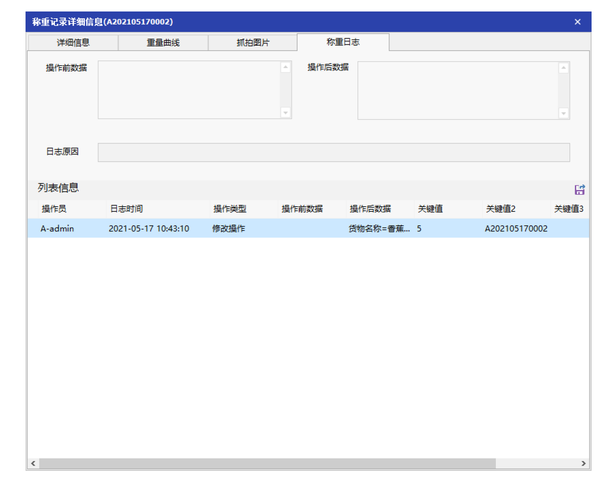
提供如下功能：
1) 称重日志显示包括：详细信息显示和日志记录网格。
2) 日志记录网格显示与当前称重记录关联的称重日志记录。可根据磅单号查询“软件操作日志表”。
3) 日志详细信息显示，显示内容包括：修改前内容，修改后内容，日志原因。从数据网格中选择日志记录时，可显示相对应的日志记录信息。

### 1.4.10 抓拍图片功能
- 软件支持称重过程中抓拍图片。
- 每台秤最多可设置最大4个摄像视频通道，
- 当读数时(点击【读数】按钮或自动称重按流程自动读取重量读数)从视频通道视频流数据中抓拍图片。
- 系统参数设置中的防作弊设置可启用或关闭抓拍功能。如果关闭抓拍功能，不执行抓拍操作。
- 如果启用抓拍功能，系统参数设置中的防作弊设置可设置抓拍时刻为保存数据时抓拍，还是读数时抓拍。默认为保存数据时抓拍。
- 抓拍的图片可以叠加数据记录字段信息。叠加的字段可在参数设置界面“视频抓拍设置”中设置。具体参见“视频抓拍设置”部分。
- 抓拍图片保存：根据“视频抓拍设置”，抓拍图片可保存到本地（不共享）、服务器或网络数据库。
1) 本地目录
   文件位置：根据【基础防作弊设置】中的“称重曲线图”设置的称重曲线存储目录，按年/月/日分级建立子目录，在日期子目录中每次抓拍自动生成抓拍图片文件。
   文件名：秤号（4位）+称重次数（2位， “01”--第一次称重，“02”第二次称重）+磅单号（一次磅单号）。
   文件类型：JPEG文件。
   在本地数据库的“抓拍图片表”生成一条新纪录。登记：一次磅单号（“TicketNo1”字段）、称重次数（“ScaleTime”字段）、磅站号（“StationNo”字段）、秤号（“ScaleNo”字段）等信息。详见相关数据表定义。
   登记抓拍时间（“CaptureTime”字段）
   登记抓拍图片文件路径名到照片路径（“PictureName”）字段。
   默认设置上传标识（“SendFlag”字段）为0（未上传）。
   默认设置远传标识（“UploadFlag”字段）为0（未上传）。

2) 服务器
   服务器开启共享目录，提供访问权限。
   文件位置：根据【视频抓拍设置】中的“抓拍图片路径”设置服务器共享的存储目录，按磅站号/年/月/日分级建立子目录，在日期子目录中每次抓拍自动生成抓拍图片文件。
   文件名：秤号（4位）+称重次数（2位， “01”--第一次称重，“02”第二次称重）+磅单号（一次磅单号）。
   文件类型：JPEG文件。
   在本地数据库的“抓拍图片表”生成一条新纪录。登记：一次磅单号（“TicketNo1”字段）、称重次数（“ScaleTime”字段）、磅站号（“StationNo”字段）、秤号（“ScaleNo”字段）等信息。详见相关数据表定义。
   登记抓拍时间（“CaptureTime”字段）
   登记抓拍图片文件路径名到照片路径（“PictureName”）字段。
   默认设置上传标识（“SendFlag”字段）为0（未上传）。
   默认设置远传标识（“UploadFlag”字段）为0（未上传）。

3) 网络数据库
   如果启用，每次抓拍是在网络数据库的“抓拍图片表”生成一条新纪录。登记：一次磅单号（“TicketNo1”字段）、称重次数（“ScaleTime”字段）、磅站号（“StationNo”字段）、秤号（“ScaleNo”字段）等信息。详见相关数据表定义。
   登记抓拍时间（“CaptureTime”字段）
   根据抓拍图片读取文件内容，转出字节流数据记录到图片信息（“PictureImg”）字段。
   默认设置上传标识（“SendFlag”字段）为0（未上传）。
   默认设置远传标识（“UploadFlag”字段）为0（未上传）。

### 1.4.11 软件操作日志功能
- 软件支持软件操作日志记录功能。
- 可触发日志记录的操作类型包括：启动软件、登录操作、新增记录、删除记录、修改记录、防作弊报警、手补单、补打磅单、数据清理、数据备份、读数授权。当上述操作类型发生时触发日志记录动作。
- 日志记录内容包括：关联值（“keyvalue”字段）、操作员（“operator”字段）、日志时间（“logtime”字段）、操作类型（“opttype”字段）、操作模块id（“moduleid”字段）、操作模块名称（“modulename”字段）、操作前数据（“logbeforedata”字段）、操作后数据（“logafterdata”字段）、日志原因（“reson”字段）、关键值2（“keyvalue2”字段）、关键值3（“keyvalue3”字段）等内容。其中：
   关联值（“keyvalue”字段）存储操作的数据表编号。如果是称重记录表（“Trade”），记录磅单号。
   关键值2（“keyvalue2”字段）存储称重记录id号。
   关键值3（“keyvalue3”字段）存储称重记录磅单号。
- 当新增记录时，修改前数据为空，修改后数据为“新增称重记录”。
- 当删除记录时，修改后数据为“删除称重记录”。
- 当更新称重记录某一字段内容时，修改前数据为修改前字段内容，修改后数据为修改后字段内容。
- 其他操作类型时修改前内容和修改后内容为空。
- 日志记录保存到数据库“软件操作日志表”中。
- 日志原因可记录与操作和时间相关的信息。参见下表：

| 操作类型 |  日志内容 |
|---|---|
| 启动软件 | 软件版本信息 |
| 登录操作 | 登录用户名   |
| 新增记录 | 磅单号      |
| 删除记录 | 磅单号      |
| 修改记录 | 磅单号，修改字段名      |
| 防作弊报警 | 报警原因  |
| 手工补单 | 磅单号    |
| 补打磅单 | 磅单号  |
| 数据清理 | 备份数据库文件路径 |
| 临时授权 | 授权原因 |

### 1.4.12 显示字段设置
- 软件提供数据网格中显示字段设置功能，
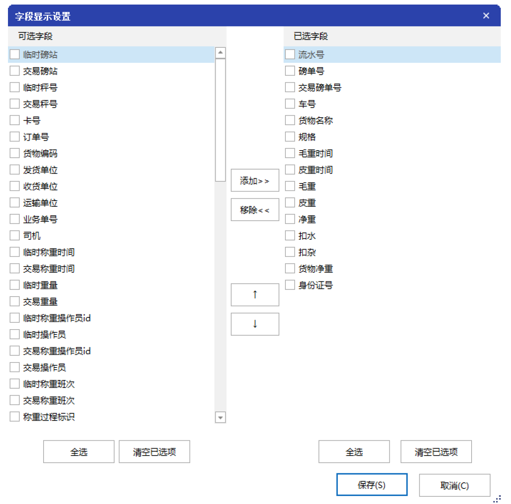
在数据网格中通过点击按钮或选择菜单执行“显示字段设置”功能时，打开显示字段设置窗口。
- 显示字段设置窗口包括：可选字段列表区，已选字段列表区、操作区、【保存】按钮和【取消】按钮。
- 可选字段列表区：
1) 提供列表显示所有称重记录字段（包括预定义字段和用户自定义字段）。每个字段显示一行，包括一个选择框和字段名标签。当勾选选择框时表示已选择该字段。
2) 提供【全选】按钮，点击后可自动勾选列表中所有字段选择框。
3) 提供【清空已选项】按钮，点击后可清除列表中所有字段选择框的勾选状态。
- 已选字段列表区：
1) 提供列表显示所有数据网格中的字段（包括预定义字段和用户自定义字段）。每个字段显示一行，包括一个选择框和字段名标签。当勾选选择框时表示已选择该字段。
2) 提供【全选】按钮，点击后可自动勾选列表中所有字段选择框。
3) 提供【清空已选项】按钮，点击后可清除列表中所有字段选择框的勾选状态。
- 操作区：包含【添加>>】按钮、【移除<<】按钮、【↑】按钮和【↓】按钮。
1) 【添加>>】按钮： 点击后将可选字段列表区中勾选的字段添加到已选字段列表区并更新可选字段列表和已选字段列表的显示。可选字段列表去除已添加到已选字段列表的字段。已选字段列表后面添加新增的字段。
2) 【移除<<】按钮： 点击后将已选字段列表区中勾选的字段添加到可选字段列表区并更新可选字段列表和已选字段列表的显示。已选字段列表去除已添加到可选字段列表的字段。可选字段列表后面添加新增的字段。
3) 【↑】按钮：点击后将已选字段列表区中勾选的字段前移一行位置。如果该字段已经在队首不操作。点击按钮前只允许勾选一个字段。
4) 【↓】按钮：点击后将已选字段列表区中勾选的字段后移一行位置。如果该字段已经在队尾不操作。点击按钮前只允许勾选一个字段。
- 【保存】按钮: 点击后关闭窗口，数据网格按可选字段列表的字段名和顺序显示称重记录数据。
- 【取消】按钮；点击后关闭窗口，数据网格不改变。

### 1.4.13 常用信息显示及操作
常用信息区可显示登录用户名、登录班次、切换用户按钮和退出按钮。


### 1.4.13.1 登录用户名
在软件主界面上需要显示当前登录用户名。

### 1.4.13.2 班次信息
在软件主界面上需要显示当前班次信息。

### 1.4.13.3 切换用户
- 软件主界面上显示【切换用户】按钮。
- 点击按钮后显示用户登录界面，重新输入登录用户信息、密码和班次，执行登录操作。登录成功后自动切换为新的登录用户，登录用户名和班次显示信息更新为变更后的用户和班次

### 1.4.13.4 退出程序
- 软件主界面上显示【退出】按钮，
- 点击按钮后关闭主界面，退出应用程序。

### 1.4.14 快捷操作菜单
在主界面提供快捷操作菜单。
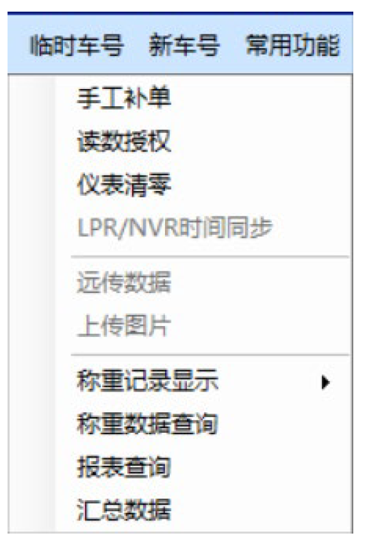
。
菜单可提供如下功能：

### 1.4.14.1 硬件控制功能
- 如果客户启用了车牌识别设备，手动发送识别车号的命令（抓拍A向车牌，抓拍B向车牌）。车牌识别结果显示到主界面外设状态显示区。
- 选择功能后可显示下拉菜单，选择【抓拍A向车牌】或【抓拍B向车牌】。
【抓拍A向车牌】：受手动触发A向车牌识别摄像机识别车牌号码，识别结果显示到外设状态信息区。显示信息包括：小图，识别结果。
【抓拍B向车牌】：受手动触发B向车牌识别摄像机识别车牌号码，识别结果显示到外设状态信息区。显示信息包括：小图，识别结果。
- C# WinForm 程序手动获取车牌识别的方法参见“手动获取车牌识别摄像机的识别结果”的说明。

### 1.4.14.2 临时车号功能
- 选择此功能后，软件会显示临时车号窗口。该窗口可显示所有完成一次称重的车号列表。操作员可以直接选择车号，软件根据车号加载对应的临时称重记录信息更新称重信息输入区。
- 窗口包括：临时车号记录列表、本地数据勾选框，【确认】按钮和【取消】按钮。

1) 临时车号记录列表：显示临时称重记录列表，显示内容包括：车号、称重时间。
2) “本地数据”勾选框：连接网络服务器时，如果勾选本地数据时，临时车号记录列表只显示本磅站的临时称重记录。
3) 【确认】按钮：双击临时车号记录或点击按钮后，关闭窗口，加载选择的临时称重记录信息到信息输入区。
4) 【取消】按钮：点击后关闭窗口，不做任何操作。

### 1.4.14.3 输入新车号功能
- 选择功能后显示专门车号录入窗口，方便操作员进行车号录入。
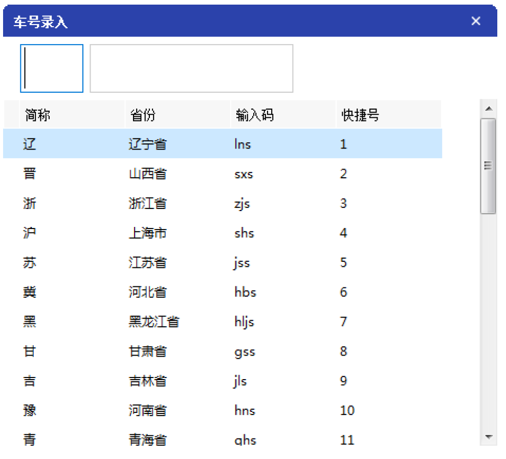
- 窗口包括：车号输入区，省份代码列表和信息提示说明区。
1) 车号输入区：包括省份代码输入框和其他字符输入框。
省份代码：输入省份代码。
支持直接人工输入省份简称。
支持输入码：输入输入码后自动替代成对应的省份简称。
支持快捷号：输入快捷号后自动替代成对应的省份简称。
支持省份代码区选择：省份代码区选择记录，用鼠标双击后自动加载对应的省份简称。
2) 省份代码输入区；显示省份代码列表。
   中国车牌号码由省份简称 + 1位字母 + 5位字母数字组合组成。
   省份代码列表可显示省份简称、省份全称、输入码和快捷号。包括：
| 省份简称 | 省份全称 | 输入码 | 快捷号 |
|---|---|---|---|
|辽|辽宁省|lns|1|
|晋|山西省|sxs|2|
|浙|浙江省|zjs|3|
|沪|上海市|shs|4|
|苏|江苏省|jss|5|
|冀|河北省|hbs|6|
|黑|黑龙江省|hljs|7|
|甘|甘肃省|gss|8|
|吉|吉林省|jls|9|
|豫|河南省|hns|10|
|青|青海省|qhs|11|
|鄂|湖北省|hbs|12|
|湘|湖南省|hns|13|
|赣|江西省|jxs|14|
|粤|广东省|gds|15|
|云|云南省|yns|16|
|闽|福建省|fjs|17|
|台|台湾省|tws|18|
|琼|海南省|hns|19|
|川|四川省|scs|20|
|陕|陕西省|sxs|21|
|贵|贵州省|gzs|22|
|皖|安徽省|ahs|23|
|鲁|山东省|sds|24|
|京|北京市|bjs|25|
|津|天津市|tjs|26|
|渝|重庆市|cqs|27|
|桂|广西壮族自治区|gxzzzzq|28|
|蒙|内蒙古自治区|nmgzzq|29|
|宁|宁夏自治区|nxzzq|30|
|藏|西藏自治区|xzzzq|31|
|新|新疆维吾尔自治区|xjwwezzq|32|
|港|香港特别行政区|xgtbxzq|33|
|澳|澳门特别行政区|amtbxzq|34|

- 省份简称和其他字符输入完成后按回车键关闭界面，自动将车号更新到输入区的车号输入框。

### 1.4.14.4 手工补单功能
- 称重读数显示区显示人工补单输入框和称重时间显示框，方便操作员直接输入称重读数。
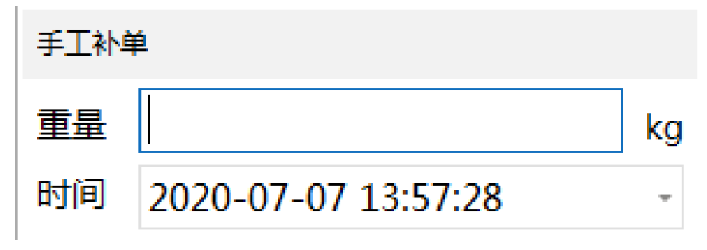
界面参见【其他图片】目录中的【手工补单.png】图片。
- 在人工补单输入框人工输入称重重量。
- 称重时间显示框显示当前时间。
- 点击【手动继续】按钮或恢复初始状态时称重读数显示区恢复初始状态。
- 手工补单操作记录到操作日志中。

### 1.4.14.5 读数授权功能
- 在车辆上秤时光电开关被遮挡。不允许读数操作（禁用‘读数“按钮）
- 在禁止读数场景下，如果需要允许读数操作，用户可选择读数授权功能临时开启读数操作权限。
- 选择读数授权功能时，显示临时授权窗口
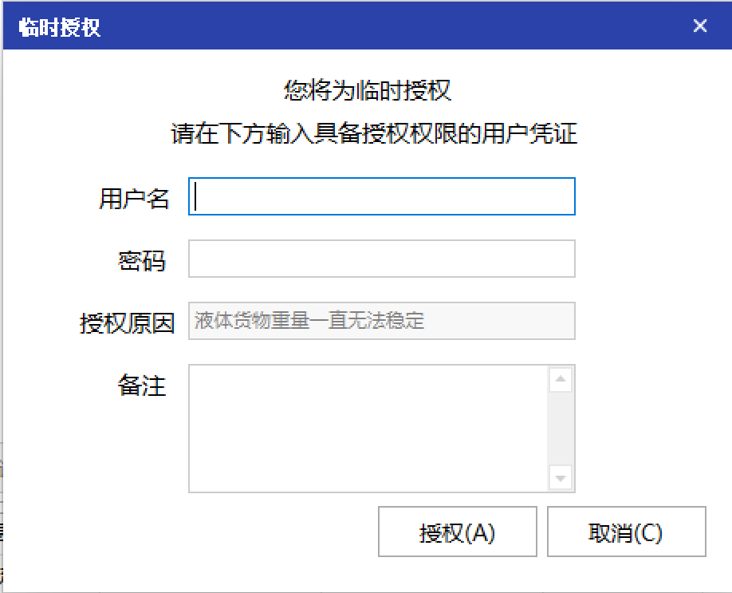
- 临时授权窗口具有用户名、密码、授权原因和备注信息输入框
   用户名：支持输入具有操作权限的用户名。
   密码：  支持输入用户密码。密码不显示明文。
   授权原因：支持输入授权原因描述。
   备注： 支持输入其他信息。
- 临时授权窗口提供“授权”按钮，点击后校验用户名和密码。如果校验成功关闭窗口，数据输入区的“读数”按钮激活允许点击操作。
- 临时授权窗口提供“放弃”按钮，点击后关闭窗口。
- 读数授权操作会记录到操作日志中。
- 读数授权后生成的称重记录需设置读数授权标志。

### 1.4.14.6 地磅清零功能
- 选择功能后，向当前选择的地磅的称重仪表发送清零指令。
- 如果直接连接METTLER TOLEDO 称重仪表，发生“Z”命令到仪表。（参见仪表通信协议的“CTPZ命令”部分的说明）。
- 如果采用IND9AE控制柜，采用6命令发送“Z”命令到仪表。参见“转发PC控制仪表命令（6号命令）”的说明。
- 如果采用IND9AX控制柜，称重仪表选择支持AW1000控制器，采用6命令发送“Z”命令到仪表。参见“转发PC控制仪表命令（6号命令）”的说明。

### 1.4.14.7 外设同步时间功能
- 如果选择功能，手动给车牌识别和摄像头设备发送命令同步当前计算机时间。
- 采用ISAPI方案同步计算机时间。详见“同步摄像机时间”的说明。

### 1.4.14.8 手动远传数据
- 如果选择此菜单功能，自动未上传的交易称重数据上传到目标数据表或XML文件中。具体远传数据功能参见“远传数据”说明。

### 1.4.14.9 手动上传图片
- 如果选择此菜单功能，自动将未上传的图片记录和图片数据上传到目标数据表。具体远传数据功能参见“远传数据”说明。

### 1.4.14.10 称重数据显示
- 本功能用于控制快速数据浏览区显示数据的类型。
- 如果选择【所有记录】，主界面数据浏览区显示所有记录（包括本磅站和其他磅站）。
- 如果选择【本地记录】，主界面数据浏览区只显示本磅站的记录。数据查询时需要按本地磅站号过滤显示数据。

### 1.4.14.11 称重数据查询
执行称重数据查询功能。具体功能参见“数据查询”部分的说明。

### 1.4.14.12 报表数据查询
执行报表查询功能。具体功能参见“报表查询”部分的说明。

### 1.4.14.13 称重数据统计
- 打开汇总数据窗口，显示当前的称重数据汇总信息。
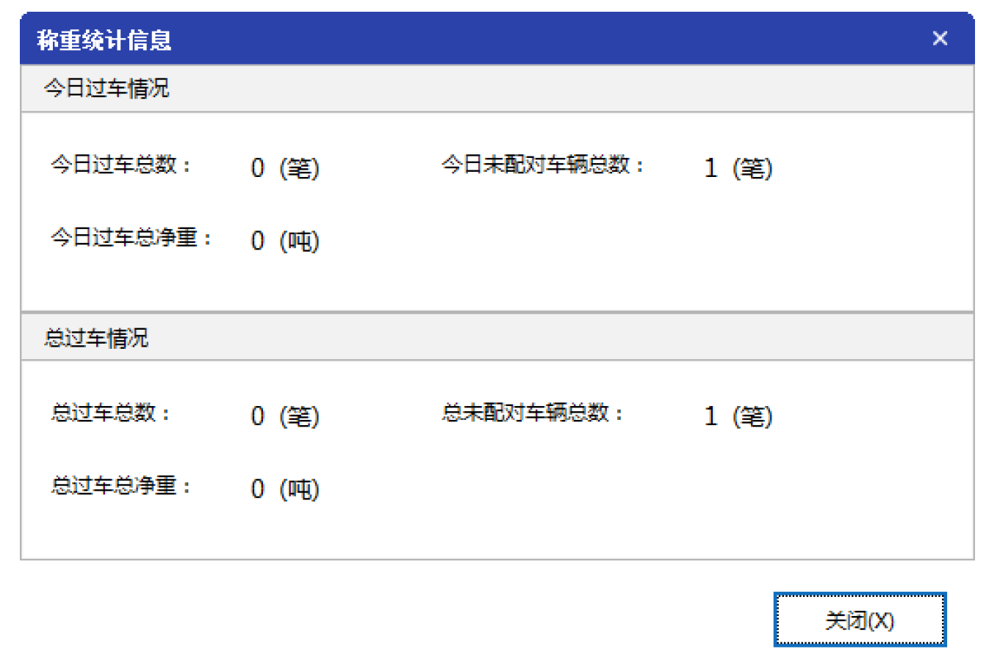
- 汇总数据窗口显示如下统计数据：
1）今日过车数据，
    过车总数： 当日到目前的称重记录数，显示格式：“{今日称重记录数} （笔）”。
    未配对车辆总数： 当日到目前的临时称重记录数， 显示格式：“{今日临时称重记录数} （笔）”。
    过车总净重； 当日到目前的总净重（换算成吨）。显示格式：“{今日总净重} （吨）”。
2）总过车数据，
    过车总数： 总称重记录数，显示格式：“{总称重记录数} （笔）”。
    未配对车辆总数： 总临时称重记录数， 显示格式：“{总临时称重记录数} （笔）”。
    过车总净重； 总净重（换算成吨）。显示格式：“{总净重} （吨）”。

### 1.4.15 状态栏
- 显示连接的数据库连接信息（本地数据还是网络数据库）。
- 显示软件版本号。
- 显示产品编号。
- 如果采用网络数据库，显示网络连接标志（如果网络连接显示连接图标， 如果网络中断显示中断图标）。
- C# 检测网络连接状态的方法汇总：
1) System.Net.NetworkInformation 命名空间下的 API 可以判断本机是否有已连接的网络接口。
2) System.Net.NetworkInformation.NetworkChange 可以订阅网络状态变化事件。
3) NetworkInterface.GetIsNetworkAvailable() 只表示有网卡 Up，不代表真能上网。要确认能访问互联网，可以 Ping 一个可靠的主机。
  建议 Ping 网络数据库服务器。
4) 在 WPF/WinForms 中可用 Windows.Networking.Connectivity（UWP）或 P/Invoke InternetGetConnectedState。
示例：
```
public static class NetworkHelper
{
    // 快速判断：有网卡且非回环
    public static bool IsNetworkAvailable()
        => NetworkInterface.GetIsNetworkAvailable();

    // 可靠判断：能访问外网
    public static async Task<bool> IsInternetReachableAsync()
    {
        try
        {
            using var ping = new Ping();
            var reply = await ping.SendPingAsync("223.5.5.5", 2000);
            if (reply.Status == IPStatus.Success) return true;
        }
        catch { }

        // Ping 失败时用 HTTP 兜底
        try
        {
            using var http = new HttpClient { Timeout = TimeSpan.FromSeconds(3) };
            using var resp = await http.GetAsync("https://www.baidu.com",
                HttpCompletionOption.ResponseHeadersRead);
            return resp.IsSuccessStatusCode;
        }
        catch { return false; }
    }
}

```

## 1.5 实时监控功能
- 如果启用和连接监控摄像机，可在界面上显示实时监控画面。

- 监控摄像机设置参见“视频设备设置”部分的说明。摄像机连接到硬盘录像机，软件通过对应的视频通道访问摄像机。视频设备和秤号关联。
- 主界面提供监控显示区显示当前选择地磅的监控画面。
- 当切换选择地磅时，自动切换监控画面显示。
- 当选择的地磅连接多个摄像头时，可同时显示多个摄像机监控画面。可选择显示布局。支持1格（1x1），2格（2x1，上下2格画面），三格（上面1个，下面2个画面），四格（2x2，2行显示，每行2个画面），四格（上面1个画面，下面3个画面） 等布局。
- 每一个监控画面对应一个连接的摄像头，监控画面上需要显示连接的摄像机编号或位置信息（秤前、程中或秤后）。
- 对于每一个监控画面，支持放大和缩小操作。将鼠标移动到显示区域的左边，当出现拖拉图标时，即可点击鼠标左键，向左或向右拖动，此时可以改变显示区域的大小，而且软件有自动记忆显示大小的功能。
- 对于每个实时监控画面，支持切换为全屏显示。当用鼠标双击画面时，弹出出全屏窗口显示该摄像头的监控画面。
- 采用海康威视网络设备SDK进行摄像机操作，具体参见“监控摄像机操作功能”的部分说明。

## 1.6 称重操作功能
### 1.6.1 自动称重
### 1.6.1.1 系统初始化
系统启动时自动连接外设、控制柜，确认自动称重流程。
### 1.6.1.2 自动手动切换
软件需要在界面上提供自动保存勾选框。如果启动自动称重模式，默认勾选。如果取消勾选，转为人工称重操作方式。
### 1.6.1.3 自动称重逻辑
- 如果启用自动称重，支持的称重流程包括：秤前车辆识别过车流程，秤前车辆识别+秤中确认过车流程， 秤中车辆识别过车流程、动态秤前车辆识别过车流程。
- 自动称重流程逻辑参见 1.2.9 “称重流程”部分相关说明：
- 读卡结果判断
如果读卡成功得到卡号，根据卡号查询“卡管理表”。如果查询到匹配的车辆信息，判断为“读卡正确”。否则为“读卡失败”。
如果“读卡正确”，根据匹配的车辆信息更新信息输入区的控件字段。如果是配对称重且为第二次称重，将第一次称重重量显示到皮重字段输入框中。根据当前流程逻辑继续下一步流程。
如果“读卡失败”，清空信息输入区，保持现有流程状态不变，继续等待读卡。
- 车牌识别结果判断
如果车牌识别成功得到车牌号码，根据车牌号查询“卡管理表”。如果查询到匹配的车辆信息，判断为“识别正确车牌”。否则为“识别失败”。
如果“识别正确车牌”，根据匹配的车辆信息更新信息输入区的控件字段。根据当前流程逻辑继续下一步流程。
如果“识别失败”，保持现有流程状态不变，继续等待识别结果。

- 车牌比对判断
1) 系统需要同时连接A向读卡器和A向车牌识别摄像机（或B向读卡器和B向车牌识别摄像机）。
2) 车牌识别摄像机识别到车牌号码。
3) 读卡器读卡正确并匹配到车牌号码。
4) 如果启用车牌比对功能，根据卡号匹配的车牌号码需要和识别到的车牌号码一致，如果一致，判断为“识别正确”，按流程继续。否则，判断为“识别失败”，语音提示车牌不一致。维持原流程状态。
5) 如果“识别正确”，根据匹配的车辆信息更新信息输入区的控件字段。根据当前流程逻辑继续下一步流程。
6) 如果“识别失败”，保持现有流程状态不变，继续等待识别结果。


### 1.6.1.4 流程监控
- 根据当前的自动称重流程，在外设状态显示区显示流程状态。

- 实时更新流程图中相关节点的状态。显示当前流程状态文字提示。
- 根据外设状态实时更新外设监控区的外设状态显示。
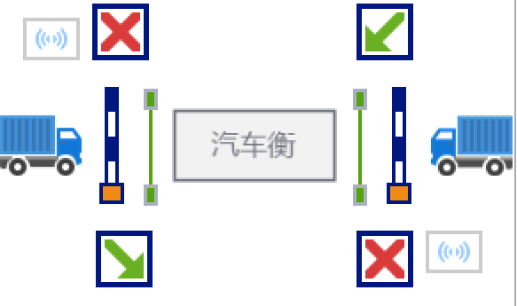

### 1.6.1.5 称重曲线自动记录
1) 支持称重曲线自动记录功能，参见 1.4.8 称重曲线图。 
2) 当识别到车辆上秤时，生成曲线文件，开始定时自动采集重量读数。在数据库“称重曲线表”新增称重曲线记录。
3) 当识别到车辆下秤回到初始状态，停止自动采集重量读数。更新数据库中”称重曲线表“当前称重曲线数据。

### 1.6.1.6 自动读数
- 完全上秤检测条件
1) 称量重量稳定。
2) 前后或四周光电不遮挡。
3)称重重量大于上秤阈值。

- 车辆自动称重读数
1) 当流程状态为“准备读数状态”，
2) 静态称重仪表：如果满足完全上秤条件，自动读取秤台重量。
3) 动态称重仪表：自动读取上一次动态称重重量。
4) 信息输入区更新：按称重方式和操作方式更新重量显示。

| 称重方式 | 操作方式 | 毛重字段 | 皮重字段 |
|---|---|---|---|
|配对|先毛后皮|第一次称重重量|第二次称重重量|
|配对|先皮后毛|第二次称重重量|第一次称重重量|
|配对|自动|第一次称重重量|第二次称重重量|
|标准| 任意 |第一次称重重量|车皮表读取的皮重|

### 1.6.1.7 自动抓拍图片
1) 如果启用监控抓拍，自动抓拍图片。具体参见 1.4.10 抓拍图片功能。
2) 根据叠加字段信息设置（参见1.10.5 视频抓拍设置）自动叠加称重数据字段信息到图片文件。
3) 抓拍图片保存在本地目录中。生成抓拍图片路径信息。抓拍图片路径信息和磅单号存储到抓拍图片表中。
4) 如果启用服务器保存抓拍图片， 抓拍图片数据存储到抓拍图片库中，
5) 摄像机抓拍操作代码实现参见“4.5.4 监控摄像机操作功能”中的相关描述。

### 1.6.1.8 称重重量计算
1) 如果完成自动称重读数操作，开始称重重量计算。
2) 根据选择的称重方式计算毛重、皮重和净重，更新数据输入区的相关数据显示（毛重、皮重和净重）。
2) 配对称重支持三种计算方式：
  净重 = 毛重 - 皮重。
  如果毛重小于皮重，交换毛重和皮重。

### 1.6.1.9 扣水扣杂计算
1) 如果完成重量计算操作，开始扣水扣杂计算。
2) 执行相关的数据计算（扣水，扣杂和扣包装），更新数据输入区的货物净重。
    货物净重 = 净重 - 扣水重量 - 扣杂重量


### 1.6.1.10 防作弊报警检查
如果启用防作弊检查，执行相关检查报警功能。具体参见“1.7 防作弊报警功能”。
- 防作弊报警设置响应标志（皮重报警、皮重时间、称重时间间隔报报警）。

### 1.6.1.11 生成称重记录并保存。
1) 完成称重重量计算、扣水扣杂计算和防作弊报警检查操作后，可生成称重记录并保存到数据库中。
2) 磅单号自动生成
车辆上秤时按磅单号生成规则自动生成磅单号。如果启用两次磅单号，称重方式“车号配对称重”中毛重称重和皮重称重分别生成不同的磅单号。
3) 根据当前时间生成称重时间。
a) 如果是第一次称重，重量为第一次称重重量，称重时间为第一次称重时间，磅单号为第一次磅单号。
b) 如果是第二次称重重量，重量为第二次称重重量，称重时间为第二次称重时间，磅单号为第二次磅单号。
4) 根据当前登录的用户名生成操作员。
5) 设置数据上传标识（uploadflag字段）为未上传（0）。设置数据状态（datastatus字段）为正常（1）。
6) 设置自动保存标志。
7) 如果是“手工补单”，设置手工补单标志。
8) 多次称重结束标识（finalflag字段）设置：
如果是第一次称重且为标准称重模式，设置为交易称重（1）。
如果是第一次称重且不是标准称重模式，设置为临时称重（0）。
如果是第二次称重且为配对称重，设置为交易称重（1）。 
9) 保存称重记录到数据库中的称重数据记录表中。

### 1.6.1.12 数据远传
- 如果启用数据远传功能，保存正式称重记录后自动远传称重记录到远传数据表。

### 1.6.1.13 磅单打印
- 如果启动磅单自动打印功能，保存正式称重记录后自动打印磅单。如果启用一次磅单打印功能，保存临时称重记录后自动打印磅单。在系统参数设置中启用或关闭自动磅单打印，启用或关闭临时记录磅单打印功能。


### 1.6.2 手动称重
### 1.6.2.1 系统初始化
- 系统启动时自动连接外设、控制柜，确认称重流程。如果没有连接控制柜，使用“防作弊称重流程”。如果连接控制柜，使用“无卡过车流程”。
- 如果是“防作弊称重流程”，无流程逻辑执行。
- 如果是“无卡过车流程”， 按流程逻辑执行。具体参见1.2.9.2 无卡过车流程的说明。
- 【手动继续】按钮激活，【读数】、【保存】和【打印】按钮禁用。
### 1.6.2.2 手动切换
软件需要在界面上提供自动保存勾选框。如果启动自动称重模式，默认勾选。如果取消勾选，转为人工称重操作方式。
### 1.6.2.3 外设状态监控
- 如果使用防作弊称重流程（无控制柜连接），可显示连接的光电开关状态。
- 如果使用无卡称重流程（控制柜连接），可显示所有连接的外设状态。
- 根据IO输入和IO输出设备状态实时更新外设状态显示。
### 1.6.2.4 车辆上秤检测
如果秤台重量大于上秤阈值，识别为车辆上秤。
### 1.6.2.5 车辆完全上秤检测
- 如果识别到“车辆上秤”，进行车辆到位检查。
- 检查光电开关输入状态。如果所有光电开关状态从“遮挡”变为为“未遮挡”状态，识别为车辆完全上秤。
- 如果是“完全上秤”，激活“读数”按钮，否则禁止“读数”按钮。如果车辆上秤后“读数”按钮未激活，可通过“授权读数”操作功能临时激活“读数”按钮。
### 1.6.2.6 界面操作 
- 点击【继续】按钮清空称重数据输入区，准备新的车辆称重操作。
- 数据输入区输入车号、货物、货物规格、发货单位、收货单位、运输单位、扣水重量、扣杂重量等相关信息。
  1）如果是标准称重方式，根据车号查询车皮表读取和更新皮重数据。
  2）如果是车号配对称重，根据车号查询临时记录。如果没有临时记录，为第一次称重。如果存在临时记录，为第二次称重，根据临时记录保存的第一次称重信息刷新数据输入区的内容。如果启用“先毛后皮”，第一次称重为毛重称重，第二次为皮重称重。如果启用“先皮后毛”，第一次称重为皮重称重，第二次称重为毛重称重。如果启用“自动识别”，第一次称重默认为毛重称重。
  3）如果是发卡车辆，根据卡号查询车辆信息表，根据查询到的车辆信息更新数据输入区相关字段内容。
- 点击【读数】按钮，执行
1）采集重量并更新输入区的显示。
2）根据称重方式自动计算毛重、皮重或净重。
3）执行数据计算功能，更新货物净重。
4）按磅单号生成规则自动生成磅单号。如果启用两次磅单号，称重方式“车号配对称重”中毛重称重和皮重称重分别生成不同的磅单号。
5）如果启用防作弊检查，执行相关检查报警功能。
6）生成称重记录。如果称重方式是车牌配对称重且为第一次称重，生成临时称重记录，否则，生成正式称重记录。
7）如果启用监控抓拍，自动抓拍图片，叠加称重数据到图片文件。如果启用本地保存抓拍图片，图片保存在本地目录中。生成抓拍图片路径信息。抓拍图片路径信息和磅单号存储到抓拍图片表中。如果启用服务器保存抓拍图片， 抓拍图片数据存储到抓拍图片库中，
- 点击【保存】按钮后，执行
1）如果称重记录已生成且允许称重记录保存，执行称重数据保存操作。
2）根据防作弊报警标志设置称重记录的异常记录标志。
3）如果是“手工补单”，设置手工补单标志。
4）如果称重方式是车牌配对称重且为第一次称重，生成临时称重记录，否则，生成正式称重记录。
5）保存称重记录到数据库中的称重数据记录表中。
- 称重记录保存后，点击【打印】按钮打印磅单。
- 称重记录保存后，如果启用数据远传功能，自动远传称重记录到远传数据表。
- 如果按“无卡称重流程”执行，秤后道闸抬杆，秤后绿灯，放行车辆下秤。

## 1.7 防作弊报警功能
软件需要提供防作弊报警功能，防止各种称重操作过程中的作弊行为。
### 1.7.1 皮重有效性检查
- 称重方式“标准称重”中使用。
- 称重时间与皮重库中建立皮重的时间差异进行检查，再将时间差与在皮重库中设定的皮重有效期进行比对。超差给出提示且不允许保存数据，如果没有启用则不用检查。如果没有设定有效期也不用检查。
- 如果是人工称重，显示对话框显示报警提示信息“皮重有效期已超出，禁止保存数据”。
- 如果是自动称重，显示对话框显示报警提示信息“皮重有效期已超出，禁止保存数据”。流程停止，等待人工处理。

### 1.7.2 净重区间检查
- 称重方式“标准称重”、“车号配对称重”、“手工置皮”和“多次称重”中使用。
- 净重与设定的净重范围（包括最小值和最大值）进行比对检查。超差给出提示，如果没有启用则不用检查。
- 如果是人工称重，显示对话框显示报警提示信息“净重超差，不允许保存数据”。如果接受，点击“继续保存”按钮关闭对话框，设置净重差异报警标志，继续保存称重数据。
- 如果是自动称重，在状态栏显示报警信息“净重超差，不允许保存重量。”。语音提示“净重超差，请离开秤台。”。LED显示屏显示“净重超差，请离开。”。如果启用“报警退出”，不保存称重数据，上秤道闸抬起，允许车辆下秤。设置流程状态为“允许下秤”。如果启用“报警放行”，设置净重差异报警标志，继续保存称重数据。

### 1.7.3 毛重区间检查
- 称重方式“标准称重”、“车号配对称重”、“手工置皮”和“多次称重”中使用。
- 毛重与设定的毛重范围（包括最小值和最大值）进行比对检查。超差给出提示，如果没有启用则不用检查。
- 如果是人工称重，显示对话框显示报警提示信息“毛重超差，不允许保存数据”。如果接受，点击“继续保存”按钮关闭对话框，设置毛重差异报警标志，继续保存称重数据。
- 如果是自动称重，在状态栏显示报警信息“毛重超差，不允许保存重量。”。语音提示“毛重超差，请离开秤台。”。LED显示屏显示“毛重超差，请离开。”。如果启用“报警退出”，不保存称重数据，上秤道闸抬起，允许车辆下秤。设置流程状态为“允许下秤”。如果启用“报警放行”，设置毛重差异报警标志，继续保存称重数据。

### 1.7.4 皮重差异报警
- 称重方式“车号配对称重”和“多次称重”中使用。
- 将车辆表或最近10笔历史称重记录中的皮重平均值作为皮重比对来源。
皮重比对方式1：差值绝对值必须小于设定的基准值。
皮重比对方式2：差值和参考皮重的百分比必须小于设定的基准值。
超差给出提示，如果没有启用则不用检查。
- 如果是人工称重，显示对话框显示报警提示信息“皮重差异超差，不允许保存数据”。如果接受，点击“继续保存”按钮关闭对话框，设置皮重差异报警标志，继续保存称重数据。
- 如果是自动称重，在状态栏显示报警信息“皮重差异超差，不允许保存重量。”。语音提示“皮重超差，请离开秤台。”。LED显示屏显示“皮重超差，请离开。”。如果启用“报警退出”，不保存称重数据，上秤道闸抬起，允许车辆下秤。设置流程状态为“允许下秤”。如果启用“报警放行”，设置皮重差异报警标志，继续保存称重数据。

### 1.7.5 配对时间差报警
- 称重方式“车号配对称重”和“多次称重”中使用。
- 将重车称重时间和空车称重时间的差与设定的值进行比较（单位：分钟）。如果差值小于设定值则给出提示，如果不启用则不用检查。 
- 如果是人工称重，显示对话框显示报警提示信息“车辆长期异常停留，不允许保存数据”。如果接受，点击“继续保存”按钮关闭对话框，设置配对时间差报警标志，继续保存称重数据。
- 如果是自动称重，在状态栏显示报警信息“车辆长期异常停留，不允许保存数据”。语音提示“车辆长期异常停留，请离开秤台。”。LED显示屏显示“车辆长期异常停留，请离开秤台。”。如果启用“报警退出”，不保存称重数据，上秤道闸抬起，允许车辆下秤。设置流程状态为“允许下秤”。如果启用“报警放行”，设置配对时间差报警标志，继续保存称重数据。

### 1.7.6 交易时间差报警
- 称重方式“车号配对称重”和“多次称重”中使用。
- 将第一次称重时间和此车号上一次交易称重时间的差与设定的值进行比较（单位：分钟）。如果差值小于设定值则给出提示，如果不启用则不用检查。
- 如果是人工称重，显示对话框显示报警提示信息“车辆行驶时间异常，不允许保存数据”。如果接受，点击“继续保存”按钮关闭对话框，设置交易时间差报警标志，继续保存称重数据。
- 如果是自动称重，在状态栏显示报警信息“车辆行驶时间异常，不允许保存数据”。语音提示“车辆行驶时间异常，请离开秤台。”。LED显示屏显示“车辆行驶时间异常，请离开秤台。”。如果启用“报警退出”，不保存称重数据，上秤道闸抬起，允许车辆下秤。设置流程状态为“允许下秤”。如果启用“报警放行”，设置交易时间差报警标志，继续保存称重数据。

### 1.7.7 收发货重量检查报警
- 称重方式“标准称重”、“车号配对称重”和“多次称重”中使用。
- 称重时比较净重和车辆信息中的收发货重量进行比较。
比对方式1：差值必须小于设定的基准值。
比对方式2： 差值和收发货重量的百分比必须小于设计的基准值。
超差给出提示，如果没有启用则不用检查。
- 如果是人工称重，显示对话框显示报警提示信息“收发货重量超差，不允许保存数据”。如果接受，点击“继续保存”按钮关闭对话框，设置收发货差异报警标志，继续保存称重数据。
- 如果是自动称重，在状态栏显示报警信息“收发货重量超差，不允许保存重量。”。语音提示“收发货重量超差，请离开秤台。”。LED显示屏显示“收发货重量超差，请离开。”。如果启用“报警退出”，不保存称重数据，上秤道闸抬起，允许车辆下秤。设置流程状态为“允许下秤”。如果启用“报警放行”，设置收发货差异报警标志，继续保存称重数据。

### 1.7.8 超载重量检查报警
- 称重方式“标准称重”、“车号配对称重”和“多次称重”中使用。
- 称重时比较毛重和车辆信息中的限载重量进行比较。如果超差给出提示，如果没有启用则不用检查。
- 如果是人工称重，显示对话框显示报警提示信息“车辆超载，不允许保存数据”。如果接受，点击“继续保存”按钮关闭对话框，设置超载报警标志，继续保存称重数据。
- 如果是自动称重，在状态栏显示报警信息“车辆超载，不允许保存重量。”。语音提示“车辆超载，请离开秤台。”。LED显示屏显示“车辆超载，请离开。”。如果启用“报警退出”，不保存称重数据，上秤道闸抬起，允许车辆下秤。设置流程状态为“允许下秤”。如果启用“报警放行”，设置超载报警标志，继续保存称重数据。

### 1.7.9 净重差异报警
- 在主界面的称重数据保存时，如果净重与卡信息或者车皮信息中该车最大净重之间的差值的绝对值或者百分比超出设置允许范围，系统就会报警提示，如果不选中，系统则不会报警提示。“按绝对值”是指当前净重与卡信息或车皮信息所设置的最大净重的差值的绝对值应当小于等于报警值,否则就报警提示；“按百分比”是指当前净重与卡信息或车皮信息所设置的最大净重的差值的绝对值再除以最大净重得出的百分比应当小于等于报警值,否则就报警提示。

## 1.8 菜单栏
- 提供专用的菜单栏控件显示菜单。控件显示包括上下两部分，上部分显示子菜单项， 下部分显示主菜单项。
- 菜单栏可控制显示或隐藏。
- 根据数据库“一级菜单系统表”的记录查询一级菜单项目信息。
- 根据数据库“二级菜单系统表”的记录查询二级菜单项目信息。
- 建议的菜单如下：

| 主菜单项 | 子菜单项 | 功能描述 |
|---|---|---|
| 用户设置 | 硬件参数设置 | 秤台信息（秤号、秤台描述) 、称重仪表和声音、控制柜、视频设备、称重读卡器、大屏幕、车牌识别仪 设置|
| 用户设置 | 系统参数设置 | 常规设置、基础防作弊报警、配对称重防作弊报警、车牌识别仪防作弊、视频抓拍、大屏幕显示 |
| 用户设置 | 磅单设置 | 磅单格式文件设置 |
| 用户设置 | 报表设置 | 报表格式文件设置 |
| 用户设置 | 口令修改 | 修改当前登录用户口令 |
| 用户设置 | 角色管理 | 管理维护角色和权限 |
| 用户设置 | 用户管理 | 管理维护用户 |
| 数据库设置 | 数据库设置 | 设置数据库连接参数 |
| 数据库设置 | 远传数据设置 | 设置远传数控库、远传操作等 |
| 数据库设置 | 数据库备份 | 建立本地数据备份 |
| 数据库设置 | 数据清理 | 清理数据库保存的数据 |
| 基础数据维护 | 车皮信息 | 管理维护车皮信息 |
| 基础数据维护 | 货物信息 | 管理维护货物信息 |
| 基础数据维护 | 规格信息 | 管理维护规格信息 |
| 基础数据维护 | 收货单位 | 管理维护收货单位信息 |
| 基础数据维护 | 发货单位 | 管理维护发货单位信息 |
| 基础数据维护 | 运输单位 | 管理维护运输单位信息 |
| 基础数据维护 | 车辆信息 | 管理维护车辆信息，包括发卡操作 |
| 基础数据维护 | 订单信息 | 管理维护订单信息 |
| 用户字段维护 | 用户字段1 | 维护自定义用户字段信息 |
| 用户字段维护 | 用户字段2 | 维护自定义用户字段信息 |
| 用户字段维护 | 用户字段3 | 维护自定义用户字段信息 |
| 用户字段维护 | 用户字段4 | 维护自定义用户字段信息 |
| 用户字段维护 | 用户字段5 | 维护自定义用户字段信息 |
| 用户字段维护 | 用户字段6 | 维护自定义用户字段信息 |
| 用户字段维护 | 用户字段7 | 维护自定义用户字段信息 |
| 用户字段维护 | 用户字段8 | 维护自定义用户字段信息 |
| 查询打印 | 称重数据查询 | 查询称重数据 |
| 查询打印 | 报表查询 | 查询报表 |
| 查询打印 | 日志查询 | 查询操作日志 |
| 扩展功能 | 界面自定义 | 设置称重数据输入区 |
| 扩展功能 | 数据导入 | 导入外部数据到数据库 |
| 帮助 | 关于 | 显示软件信息 | 

      
## 1.9 基础数据管理
### 1.9.1 车皮管理
- 提供管理界面管理车皮数据，参见【其他图片】目录中的【车皮管理.png】图片。
- 支持维护和管理车辆皮重信息，信息包括但不限于：

	| 字段 | 说明 |
	|---|:---|
	|车号|车牌号码|
    |输入码|输入快捷代码|
	|挂车号|如果车辆有挂车车牌，挂车车牌号码|
	|皮重|空车重量，单位:kg|
    |皮重时间|皮重更新时间|
    |有效天数|0-- 永远生效，其他距离皮重更新时间超过有效天数当前车皮记录不能使用 |
    |备注 | 可选输入补充说明信息 |
    |最大载重| 用于超载识别|
- 车皮信息维护窗口由五个区域组成：功能按钮区、数据过滤区、详细信息区、信息浏览区。
1) 功能按钮区：对基础表进行操作所要涉及到的功能按钮，包括：新增、修改、删除、保存、取消。（具体说明见下面的数据录入）
2) 数据过滤区：对基础表中的数据根据字段内容进行过滤，软件提供字符模糊过滤。（具体说明见下面的数据过滤操作）
3) 详细信息区：将列表区域中当前选择的数据信息显示在输入框中，便于查看及编辑，在详细信息输入框中点击“Tab”或“回车”键，光标焦点会自动向下移动，点击“Shift”+“Tab”键，光标焦点会自动向上移动。
4) 信息浏览区：将所有或是经过过滤的信息全部显示在网格中，便于一次浏览多笔数据，在网格中用鼠标移动网格中的竖线可以改变显示宽度，而且软件会自动记忆此宽度。
- 车皮信息维护窗口可分为两种状态:数据浏览状态、数据录入状态。
a) 数据浏览状态：信息列表区处于可用状态，可以拖动滚动条浏览数据，或点击表格选择车皮信息。当点击表格时，如果鼠标点击位置处在某一行数据上，当前行标识被移动至该行，同时详细内容区的内容将变成该行的内容。可以将信息列表中所见的数据导出到Excel。
数据过滤操作
在过滤输入框中输入要过滤的字符后回车，即可快速过滤出要查找的记录。如果取消过滤，则清空字符后回车即可。
b) 数据录入状态：当按下“新增”或“修改”按钮后，信息列表框的内容将不可操作，功能按钮区中的新增、修改、删除按钮变灰，数据过滤区整体变灰，详细信息输入区由只读变为可编辑。此时可进行新车皮信息的输入或原来车皮信息的修改等操作。
- 新增数据操作
按下“新增”按钮，车皮信息维护窗口进入数据录入状态，此时可以进行数据输入。在车号输入框中输入车号，可以点击“输车号”按钮进入快捷车号输入界面皮重框中输入车皮重量或点击“读皮”按钮直接将当前仪表重量读入到皮重框中。在输入码输入框中输入车号的简称(一般可以用车号的后三位)。在生成时间中输入正确的读取皮重的时间(标准称重时生成时间会作为皮重时间保存到交易表中)，在备注输入框中输入一些备注信息。数据需要符合一定的要求，当不符合时软件会在保存操作前给出提示，并拒绝保存。
当车号没有输入的时候系统将提示请输入车号信息。
当输入车号在车皮库中已经存在时，系统将提示该车号有重复。
如果不想保存当前录入的内容，可以按“取消”按钮，从数据录入状态回到数据浏览状态。
在完成新增保存后，为了方便司磅员继续添加信息，软件会自动再次进入新增状态。如果司磅员应经完成新增，就点击“取消”按钮回到浏览状态。
- 修改数据操作
在“信息列表”框中选择要修改的车号信息，点击“修改”按钮，在“详细内容区”修改车皮信息。修改需要遵循的输入规则和新增数据一样。在修改车号的时候，如果修改后的值和原值不一样并且与皮重库中另一个车号相同时，系统会提示该车号已经被使用。
- 信息浏览区提供按钮提供如下操作：
1）刷新显示：强制刷新信息浏览区的车皮记录。
2）删除数据操作
点击“删除”按钮，系统将提示是否真的删除该条记录，此时会把要删除的车号信息显示在提示框中，以方便司磅员确认。
选择“是(Y)”按钮删除当前行标识所指示的车皮信息，按“否(N)”取消删除操作。
3）批量删除数据操作
在“信息列表”框中按住“Ctrl”后再用鼠标在记录前方的方格初点选，记住在选择的过程中不要松开“Ctrl”键，选中的数据采用高亮显示。选中的记录，点击“删除”按钮，系统将提示是否真的删除该条记录。选择“是(Y)”按钮删除所有选中的车皮信息，按“否(N)”取消批删操作。
4）导出数据操作
点击“导出”按钮，可以将当前信息库中的车皮信息导出到TXT文本文件、Excel(.xlsx)或者CSV文件中。选择导出文件类型并输入文件名，点击“保存”按钮即可将“信息列表”中的数据导出到该文件。如果选择保存类型为Excel类型，导出过程完毕系统会打开导出目标文件，供用户浏览。
5）改变显示字体
点击字体改变的图标来改变显示字体大小。点击“放大”图标显示字体变大，点击“缩小”显示字体缩小。


### 1.9.2 货物管理
- 提供界面管理货物信息。界面布局同车皮管理。
- 维护窗口由五个区域组成：功能按钮区、数据过滤区、详细信息区、信息浏览区。
1) 功能按钮区：对基础表进行操作所要涉及到的功能按钮，包括：新增、修改、删除、保存、取消。（具体说明见下面的数据录入）
2) 数据过滤区：对基础表中的数据根据字段内容进行过滤，软件提供字符模糊过滤。（具体说明见下面的数据过滤操作）
3) 详细信息区：将列表区域中当前选择的数据信息显示在输入框中，便于查看及编辑，在详细信息输入框中点击“Tab”或“回车”键，光标焦点会自动向下移动，点击“Shift”+“Tab”键，光标焦点会自动向上移动。
4) 信息浏览区：将所有或是经过过滤的信息全部显示在网格中，便于一次浏览多笔数据，在网格中用鼠标移动网格中的竖线可以改变显示宽度，而且软件会自动记忆此宽度。
- 窗口可分为两种状态:数据浏览状态、数据录入状态。
a) 数据浏览状态：信息列表区处于可用状态，可以拖动滚动条浏览数据，或点击表格选择货物信息。当点击表格时，如果鼠标点击位置处在某一行数据上，当前行标识被移动至该行，同时详细内容区的内容将变成该行的内容。可以将信息列表中所见的数据导出到Excel。
数据过滤操作
在过滤输入框中输入要过滤的字符后回车，即可快速过滤出要查找的记录。如果取消过滤，则清空字符后回车即可。
b) 数据录入状态：当按下“新增”或“修改”按钮后，信息列表框的内容将不可操作，功能按钮区中的新增、修改、删除按钮变灰，数据过滤区整体变灰，详细信息输入区由只读变为可编辑。此时可进行新货物信息的输入或原来货物信息的修改等操作。
- 新增数据操作
按下“新增”按钮，窗口进入数据录入状态，此时可以进行数据输入。在货物名称输入框中输入货名，在输入码输入框输入快捷代码，在代码输入框输入货物代码，在备注输入框中输入一些备注信息。
在数据录入时，货物名称和货物编码也要在货物信息库中唯一，即不能有重复的代码或货物名称出现。如果出现重复的货物名称或货物编码，点击“保存”按钮时，系统将会提示该货物名称已经被使用。
如果不想保存当前录入的内容，可以按“取消”按钮，从数据录入状态回到数据浏览状态。
在完成新增保存后，为了方便司磅员继续添加信息，软件会自动再次进入新增状态。如果司磅员应经完成新增，就点击“取消”按钮回到浏览状态。
- 修改数据操作
在“信息列表”框中选择要修改的货名信息，点击“修改”按钮，在“详细内容区”修改信息。修改需要遵循的输入规则和新增数据一样。
- 信息浏览区提供按钮提供如下操作：
1）刷新显示：强制刷新信息浏览区的车皮记录。
2）删除数据操作
点击“删除”按钮，系统将提示是否真的删除该条记录，此时会把要删除的车号信息显示在提示框中，以方便司磅员确认。
选择“是(Y)”按钮删除当前行标识所指示的车皮信息，按“否(N)”取消删除操作。
3）批量删除数据操作
在“信息列表”框中按住“Ctrl”后再用鼠标在记录前方的方格初点选，记住在选择的过程中不要松开“Ctrl”键，选中的数据采用高亮显示。选中的记录，点击“删除”按钮，系统将提示是否真的删除该条记录。选择“是(Y)”按钮删除所有选中的车皮信息，按“否(N)”取消批删操作。
4）导出数据操作
点击“导出”按钮，可以将当前信息库中的车皮信息导出到TXT文本文件、Excel(.xlsx)或者CSV文件中。选择导出文件类型并输入文件名，点击“保存”按钮即可将“信息列表”中的数据导出到该文件。如果选择保存类型为Excel类型，导出过程完毕系统会打开导出目标文件，供用户浏览。
5）改变显示字体
点击字体改变的图标来改变显示字体大小。点击“放大”图标显示字体变大，点击“缩小”显示字体缩小。
- 货物信息包括但不限于：

	| 字段 | 字段描述 | 示例 |
	|---|:---|:---|
	|快捷代码|快捷输入编码|111|
	|货物代码|物物料编码|10066|
	|货物名称|物料名称| 褐煤|
    |备注| 备注信息 | |

### 1.9.3 货物规格管理
- 提供界面管理货物规格信息。界面布局同车皮管理。
- 维护窗口由五个区域组成：功能按钮区、数据过滤区、详细信息区、信息浏览区。
1) 功能按钮区：对基础表进行操作所要涉及到的功能按钮，包括：新增、修改、删除、保存、取消。（具体说明见下面的数据录入）
2) 数据过滤区：对基础表中的数据根据字段内容进行过滤，软件提供字符模糊过滤。（具体说明见下面的数据过滤操作）
3) 详细信息区：将列表区域中当前选择的数据信息显示在输入框中，便于查看及编辑，在详细信息输入框中点击“Tab”或“回车”键，光标焦点会自动向下移动，点击“Shift”+“Tab”键，光标焦点会自动向上移动。
4) 信息浏览区：将所有或是经过过滤的信息全部显示在网格中，便于一次浏览多笔数据，在网格中用鼠标移动网格中的竖线可以改变显示宽度，而且软件会自动记忆此宽度。
- 窗口可分为两种状态:数据浏览状态、数据录入状态。
a) 数据浏览状态：信息列表区处于可用状态，可以拖动滚动条浏览数据，或点击表格选择货物规格信息。当点击表格时，如果鼠标点击位置处在某一行数据上，当前行标识被移动至该行，同时详细内容区的内容将变成该行的内容。可以将信息列表中所见的数据导出到Excel。
数据过滤操作
在过滤输入框中输入要过滤的字符后回车，即可快速过滤出要查找的记录。如果取消过滤，则清空字符后回车即可。
b) 数据录入状态：当按下“新增”或“修改”按钮后，信息列表框的内容将不可操作，功能按钮区中的新增、修改、删除按钮变灰，数据过滤区整体变灰，详细信息输入区由只读变为可编辑。此时可进行新货物规格信息的输入或原来货物规格信息的修改等操作。
- 新增数据操作
按下“新增”按钮，窗口进入数据录入状态，此时可以进行数据输入。在货物规格输入框中输入规格，在输入码输入框输入快捷代码，在备注输入框中输入一些备注信息。
在数据录入时，货物规格要在货物规格信息库中唯一，即不能有重复的货物规格出现。如果出现重复的货物规格，点击“保存”按钮时，系统将会提示该货物规格已经被使用。
如果不想保存当前录入的内容，可以按“取消”按钮，从数据录入状态回到数据浏览状态。
在完成新增保存后，为了方便司磅员继续添加信息，软件会自动再次进入新增状态。如果司磅员应经完成新增，就点击“取消”按钮回到浏览状态。
- 修改数据操作
在“信息列表”框中选择要修改的货物规格信息，点击“修改”按钮，在“详细内容区”修改信息。修改需要遵循的输入规则和新增数据一样。
- 信息浏览区提供按钮提供如下操作：
1）刷新显示：强制刷新信息浏览区的记录。
2）删除数据操作
点击“删除”按钮，系统将提示是否真的删除该条记录，此时会把要删除的信息显示在提示框中，以方便司磅员确认。
选择“是(Y)”按钮删除当前行标识所指示的信息，按“否(N)”取消删除操作。
3）批量删除数据操作
在“信息列表”框中按住“Ctrl”后再用鼠标在记录前方的方格初点选，记住在选择的过程中不要松开“Ctrl”键，选中的数据采用高亮显示。选中的记录，点击“删除”按钮，系统将提示是否真的删除该条记录。选择“是(Y)”按钮删除所有选中的信息，按“否(N)”取消批删操作。
4）导出数据操作
点击“导出”按钮，可以将当前信息库中的信息导出到TXT文本文件、Excel(.xlsx)或者CSV文件中。选择导出文件类型并输入文件名，点击“保存”按钮即可将“信息列表”中的数据导出到该文件。如果选择保存类型为Excel类型，导出过程完毕系统会打开导出目标文件，供用户浏览。
5）改变显示字体
点击字体改变的图标来改变显示字体大小。点击“放大”图标显示字体变大，点击“缩小”显示字体缩小。
- 货物规格信息包括但不限于：

	| 字段 | 字段描述 | 示例 |
	|---|:---|:---|
	|快捷代码|快捷输入编码|111|
	|货物规格|物料规格| 一级品 |
    |备注| 备注信息 | |

### 1.9.4 收货单位管理
- 提供界面管理收货单位信息。界面布局同车皮管理。
- 维护窗口由五个区域组成：功能按钮区、数据过滤区、详细信息区、信息浏览区。
1) 功能按钮区：对基础表进行操作所要涉及到的功能按钮，包括：新增、修改、删除、保存、取消。（具体说明见下面的数据录入）
2) 数据过滤区：对基础表中的数据根据字段内容进行过滤，软件提供字符模糊过滤。（具体说明见下面的数据过滤操作）
3) 详细信息区：将列表区域中当前选择的数据信息显示在输入框中，便于查看及编辑，在详细信息输入框中点击“Tab”或“回车”键，光标焦点会自动向下移动，点击“Shift”+“Tab”键，光标焦点会自动向上移动。
4) 信息浏览区：将所有或是经过过滤的信息全部显示在网格中，便于一次浏览多笔数据，在网格中用鼠标移动网格中的竖线可以改变显示宽度，而且软件会自动记忆此宽度。
- 窗口可分为两种状态:数据浏览状态、数据录入状态。
a) 数据浏览状态：信息列表区处于可用状态，可以拖动滚动条浏览数据，或点击表格选择货物信息。当点击表格时，如果鼠标点击位置处在某一行数据上，当前行标识被移动至该行，同时详细内容区的内容将变成该行的内容。可以将信息列表中所见的数据导出到Excel。
数据过滤操作
在过滤输入框中输入要过滤的字符后回车，即可快速过滤出要查找的记录。如果取消过滤，则清空字符后回车即可。
b) 数据录入状态：当按下“新增”或“修改”按钮后，信息列表框的内容将不可操作，功能按钮区中的新增、修改、删除按钮变灰，数据过滤区整体变灰，详细信息输入区由只读变为可编辑。此时可进行新信息的输入或原来信息的修改等操作。
- 新增数据操作
按下“新增”按钮，窗口进入数据录入状态，此时可以进行数据输入。在收货单位输入框中输入规格，在输入码输入框输入快捷代码，在备注输入框中输入一些备注信息。
在数据录入时，收货单位要在收货单位信息库中唯一，即不能有重复的收货单位出现。如果出现重复的收货单位，点击“保存”按钮时，系统将会提示该收货单位已经被使用。
如果不想保存当前录入的内容，可以按“取消”按钮，从数据录入状态回到数据浏览状态。
在完成新增保存后，为了方便司磅员继续添加信息，软件会自动再次进入新增状态。如果司磅员应经完成新增，就点击“取消”按钮回到浏览状态。
- 修改数据操作
在“信息列表”框中选择要修改的收货单位信息，点击“修改”按钮，在“详细内容区”修改信息。修改需要遵循的输入规则和新增数据一样。
- 信息浏览区提供按钮提供如下操作：
1）刷新显示：强制刷新信息浏览区的收货单位记录。
2）删除数据操作
点击“删除”按钮，系统将提示是否真的删除该条记录，此时会把要删除的信息显示在提示框中，以方便司磅员确认。
选择“是(Y)”按钮删除当前行标识所指示的信息，按“否(N)”取消删除操作。
3）批量删除数据操作
在“信息列表”框中按住“Ctrl”后再用鼠标在记录前方的方格初点选，记住在选择的过程中不要松开“Ctrl”键，选中的数据采用高亮显示。选中的记录，点击“删除”按钮，系统将提示是否真的删除该条记录。选择“是(Y)”按钮删除所有选中的信息，按“否(N)”取消批删操作。
4）导出数据操作
点击“导出”按钮，可以将当前信息库中的信息导出到TXT文本文件、Excel(.xlsx)或者CSV文件中。选择导出文件类型并输入文件名，点击“保存”按钮即可将“信息列表”中的数据导出到该文件。如果选择保存类型为Excel类型，导出过程完毕系统会打开导出目标文件，供用户浏览。
5）改变显示字体
点击字体改变的图标来改变显示字体大小。点击“放大”图标显示字体变大，点击“缩小”显示字体缩小。

- 支持维护和管理收货单位信息， 包括但不限于：

	| 字段 | 字段描述 | 示例 |
	|---|:---|:---|
	|快捷代码|快捷输入编码|111|
	|收货单位|收货单位名称| xxx有限公司|
    |备注| 备注信息 | |

### 1.9.5 发货单位管理
- 提供界面管理发货单位信息。界面布局同车皮管理。
- 维护窗口由五个区域组成：功能按钮区、数据过滤区、详细信息区、信息浏览区。
1) 功能按钮区：对基础表进行操作所要涉及到的功能按钮，包括：新增、修改、删除、保存、取消。（具体说明见下面的数据录入）
2) 数据过滤区：对基础表中的数据根据字段内容进行过滤，软件提供字符模糊过滤。（具体说明见下面的数据过滤操作）
3) 详细信息区：将列表区域中当前选择的数据信息显示在输入框中，便于查看及编辑，在详细信息输入框中点击“Tab”或“回车”键，光标焦点会自动向下移动，点击“Shift”+“Tab”键，光标焦点会自动向上移动。
4) 信息浏览区：将所有或是经过过滤的信息全部显示在网格中，便于一次浏览多笔数据，在网格中用鼠标移动网格中的竖线可以改变显示宽度，而且软件会自动记忆此宽度。
- 窗口可分为两种状态:数据浏览状态、数据录入状态。
a) 数据浏览状态：信息列表区处于可用状态，可以拖动滚动条浏览数据，或点击表格选择货物信息。当点击表格时，如果鼠标点击位置处在某一行数据上，当前行标识被移动至该行，同时详细内容区的内容将变成该行的内容。可以将信息列表中所见的数据导出到Excel。
数据过滤操作
在过滤输入框中输入要过滤的字符后回车，即可快速过滤出要查找的记录。如果取消过滤，则清空字符后回车即可。
b) 数据录入状态：当按下“新增”或“修改”按钮后，信息列表框的内容将不可操作，功能按钮区中的新增、修改、删除按钮变灰，数据过滤区整体变灰，详细信息输入区由只读变为可编辑。此时可进行新信息的输入或原来信息的修改等操作。
- 新增数据操作
按下“新增”按钮，窗口进入数据录入状态，此时可以进行数据输入。在发货单位输入框中输入规格，在输入码输入框输入快捷代码，在备注输入框中输入一些备注信息。
在数据录入时，发货单位要在发货单位信息库中唯一，即不能有重复的发货单位出现。如果出现重复的收货单位，点击“保存”按钮时，系统将会提示该发货单位已经被使用。
如果不想保存当前录入的内容，可以按“取消”按钮，从数据录入状态回到数据浏览状态。
在完成新增保存后，为了方便司磅员继续添加信息，软件会自动再次进入新增状态。如果司磅员应经完成新增，就点击“取消”按钮回到浏览状态。
- 修改数据操作
在“信息列表”框中选择要修改的收货单位信息，点击“修改”按钮，在“详细内容区”修改信息。修改需要遵循的输入规则和新增数据一样。
- 信息浏览区提供按钮提供如下操作：
1）刷新显示：强制刷新信息浏览区的发货单位记录。
2）删除数据操作
点击“删除”按钮，系统将提示是否真的删除该条记录，此时会把要删除的信息显示在提示框中，以方便司磅员确认。
选择“是(Y)”按钮删除当前行标识所指示的信息，按“否(N)”取消删除操作。
3）批量删除数据操作
在“信息列表”框中按住“Ctrl”后再用鼠标在记录前方的方格初点选，记住在选择的过程中不要松开“Ctrl”键，选中的数据采用高亮显示。选中的记录，点击“删除”按钮，系统将提示是否真的删除该条记录。选择“是(Y)”按钮删除所有选中的信息，按“否(N)”取消批删操作。
4）导出数据操作
点击“导出”按钮，可以将当前信息库中的信息导出到TXT文本文件、Excel(.xlsx)或者CSV文件中。选择导出文件类型并输入文件名，点击“保存”按钮即可将“信息列表”中的数据导出到该文件。如果选择保存类型为Excel类型，导出过程完毕系统会打开导出目标文件，供用户浏览。
5）改变显示字体
点击字体改变的图标来改变显示字体大小。点击“放大”图标显示字体变大，点击“缩小”显示字体缩小。

- 支持维护和管理发货单位信息， 包括但不限于：

	| 字段 | 字段描述 | 示例 |
	|---|:---|:---|
	|快捷代码|快捷输入编码|111|
	|发货单位|发货单位名称| xxx有限公司|
    |备注| 备注信息 | |


### 1.9.6 运输单位管理
- 提供界面管理运输单位信息。界面布局同车皮管理。
- 维护窗口由五个区域组成：功能按钮区、数据过滤区、详细信息区、信息浏览区。
1) 功能按钮区：对基础表进行操作所要涉及到的功能按钮，包括：新增、修改、删除、保存、取消。（具体说明见下面的数据录入）
2) 数据过滤区：对基础表中的数据根据字段内容进行过滤，软件提供字符模糊过滤。（具体说明见下面的数据过滤操作）
3) 详细信息区：将列表区域中当前选择的数据信息显示在输入框中，便于查看及编辑，在详细信息输入框中点击“Tab”或“回车”键，光标焦点会自动向下移动，点击“Shift”+“Tab”键，光标焦点会自动向上移动。
4) 信息浏览区：将所有或是经过过滤的信息全部显示在网格中，便于一次浏览多笔数据，在网格中用鼠标移动网格中的竖线可以改变显示宽度，而且软件会自动记忆此宽度。
- 窗口可分为两种状态:数据浏览状态、数据录入状态。
a) 数据浏览状态：信息列表区处于可用状态，可以拖动滚动条浏览数据，或点击表格选择货物信息。当点击表格时，如果鼠标点击位置处在某一行数据上，当前行标识被移动至该行，同时详细内容区的内容将变成该行的内容。可以将信息列表中所见的数据导出到Excel。
数据过滤操作
在过滤输入框中输入要过滤的字符后回车，即可快速过滤出要查找的记录。如果取消过滤，则清空字符后回车即可。
b) 数据录入状态：当按下“新增”或“修改”按钮后，信息列表框的内容将不可操作，功能按钮区中的新增、修改、删除按钮变灰，数据过滤区整体变灰，详细信息输入区由只读变为可编辑。此时可进行新信息的输入或原来信息的修改等操作。
- 新增数据操作
按下“新增”按钮，窗口进入数据录入状态，此时可以进行数据输入。在运输单位输入框中输入规格，在输入码输入框输入快捷代码，在备注输入框中输入一些备注信息。
在数据录入时，收货单位要在发货单位信息库中唯一，即不能有重复的运输单位出现。如果出现重复的运输单位，点击“保存”按钮时，系统将会提示该运输单位已经被使用。
如果不想保存当前录入的内容，可以按“取消”按钮，从数据录入状态回到数据浏览状态。
在完成新增保存后，为了方便司磅员继续添加信息，软件会自动再次进入新增状态。如果司磅员应经完成新增，就点击“取消”按钮回到浏览状态。
- 修改数据操作
在“信息列表”框中选择要修改的运输单位信息，点击“修改”按钮，在“详细内容区”修改信息。修改需要遵循的输入规则和新增数据一样。
- 信息浏览区提供按钮提供如下操作：
1）刷新显示：强制刷新信息浏览区的发货单位记录。
2）删除数据操作
点击“删除”按钮，系统将提示是否真的删除该条记录，此时会把要删除的信息显示在提示框中，以方便司磅员确认。
选择“是(Y)”按钮删除当前行标识所指示的信息，按“否(N)”取消删除操作。
3）批量删除数据操作
在“信息列表”框中按住“Ctrl”后再用鼠标在记录前方的方格初点选，记住在选择的过程中不要松开“Ctrl”键，选中的数据采用高亮显示。选中的记录，点击“删除”按钮，系统将提示是否真的删除该条记录。选择“是(Y)”按钮删除所有选中的信息，按“否(N)”取消批删操作。
4）导出数据操作
点击“导出”按钮，可以将当前信息库中的信息导出到TXT文本文件、Excel(.xlsx)或者CSV文件中。选择导出文件类型并输入文件名，点击“保存”按钮即可将“信息列表”中的数据导出到该文件。如果选择保存类型为Excel类型，导出过程完毕系统会打开导出目标文件，供用户浏览。
5）改变显示字体
点击字体改变的图标来改变显示字体大小。点击“放大”图标显示字体变大，点击“缩小”显示字体缩小。

- 支持维护和管理发货单位信息， 包括但不限于：

	| 字段 | 字段描述 | 示例 |
	|---|:---|:---|
	|快捷代码|快捷输入编码|111|
	|运输单位|运输单位名称| xxx有限公司|
    |备注| 备注信息 | |

### 1.9.7 车辆登记管理
- 提供界面管理车辆登记信息。界面布局参见【其他图片】目录中的【车辆登记信息.png】图片。
- 维护窗口由五个区域组成：功能按钮区、数据过滤区、详细信息区、信息浏览区。
1) 功能按钮区：对基础表进行操作所要涉及到的功能按钮，包括：新增、修改、删除、保存、取消、发卡管理、导入、发放、回收、挂失、数据查看。（具体说明见下面的数据录入）
2) 数据过滤区：对基础表中的数据根据字段内容进行过滤，软件提供字符模糊过滤。（具体说明见下面的数据过滤操作）
3) 详细信息区：将列表区域中当前选择的数据信息显示在输入框中，便于查看及编辑，在详细信息输入框中点击“Tab”或“回车”键，光标焦点会自动向下移动，点击“Shift”+“Tab”键，光标焦点会自动向上移动。
4) 信息浏览区：将所有或是经过过滤的信息全部显示在网格中，便于一次浏览多笔数据，在网格中用鼠标移动网格中的竖线可以改变显示宽度，而且软件会自动记忆此宽度。
- 窗口可分为两种状态:数据浏览状态、数据录入状态。
a) 数据浏览状态：信息列表区处于可用状态，可以拖动滚动条浏览数据，或点击表格选择货物信息。当点击表格时，如果鼠标点击位置处在某一行数据上，当前行标识被移动至该行，同时详细内容区的内容将变成该行的内容。可以将信息列表中所见的数据导出到Excel。
数据过滤操作
在过滤输入框中输入要过滤的字符后回车，即可快速过滤出要查找的记录。如果取消过滤，则清空字符后回车即可。
b) 数据录入状态：当按下“新增”或“修改”按钮后，信息列表框的内容将不可操作，功能按钮区中的新增、修改、删除按钮变灰，数据过滤区整体变灰，详细信息输入区由只读变为可编辑。此时可进行新信息的输入或原来信息的修改等操作。
- 新增
按下“新增”按钮，窗口进入数据录入状态，此时可以进行数据输入。
在车号输入框中输入车号，或点击按钮按输入新车号功能输入车号。
在数据录入时，卡号要在车辆信息库中唯一，即不能有重复的卡号出现。如果出现重复的卡号，点击“保存”按钮时，系统将会提示该卡号已经被使用。
如果不想保存当前录入的内容，可以按“取消”按钮，从数据录入状态回到数据浏览状态。
在完成新增保存后，为了方便司磅员继续添加信息，软件会自动再次进入新增状态。如果司磅员应经完成新增，就点击“取消”按钮回到浏览状态。
如果已连接读卡器设备，将卡放到读卡器上。软件自动获取卡号信息，并根据卡号在信息列表中查找，如果没有找到相同的卡号，则自动进入新增状态；如果未连接读卡器设备，也可手动添加卡号信息。
在车号、订单号、货物名称等项目中输入信息，此时软件会自动显示过滤后的信息以方便定位。
订单号必须在订单表中存在，当输入订单号后，货物名称、规格以及后面的所有字段都自动从订单中带出，并且不可编辑。
- 修改数据操作
在“信息列表”框中选择要修改的车辆登记信息，点击“修改”按钮，在“详细内容区”修改信息。修改需要遵循的输入规则和新增数据一样。
如果已连接读卡器设备，将卡放到读卡器上。软件自动获取卡号信息，并根据卡号在信息列表中查找，如果找到相同的卡号，则自动进入编辑状态；如果未连接读卡器设备，也可手动添加卡号信息。
在车号、订单号、货物名称等项目中输入信息，此时软件会自动显示过滤后的信息以方便定位。
订单号必须在订单表中存在，当输入订单号后，货物名称、规格以及后面的所有字段都自动从订单中带出，并且不可编辑。
- 信息浏览区提供按钮提供如下操作：
1）刷新显示：强制刷新信息浏览区的车辆登记记录。
2）删除数据操作
点击“删除”按钮，系统将提示是否真的删除该条记录，此时会把要删除的信息显示在提示框中，以方便司磅员确认。
选择“是(Y)”按钮删除当前行标识所指示的信息，按“否(N)”取消删除操作。
3）批量删除数据操作
在“信息列表”框中按住“Ctrl”后再用鼠标在记录前方的方格初点选，记住在选择的过程中不要松开“Ctrl”键，选中的数据采用高亮显示。选中的记录，点击“删除”按钮，系统将提示是否真的删除该条记录。选择“是(Y)”按钮删除所有选中的信息，按“否(N)”取消批删操作。
4）导出数据操作
点击“导出”按钮，可以将当前信息库中的信息导出到TXT文本文件、Excel(.xlsx)或者CSV文件中。选择导出文件类型并输入文件名，点击“保存”按钮即可将“信息列表”中的数据导出到该文件。如果选择保存类型为Excel类型，导出过程完毕系统会打开导出目标文件，供用户浏览。
5）改变显示字体
点击字体改变的图标来改变显示字体大小。点击“放大”图标显示字体变大，点击“缩小”显示字体缩小。
- 卡状态管理
卡的状态分为发放、回收、挂失三种，只有处于发放状态时，卡才是有效的，才可以在称重中读卡保存。发放状态下可以变为回收或挂失，挂失状态下可以变为发放，回收状态下可以变为发放。
- 卡发放
当新增加卡信息时，软件默认卡为发放状态。或是选中处于挂失或回收状态的记录，此时“发放”按钮会显亮，点击“发放”按钮，选择“是”完成发放操作，选择“否”则放弃。
- 卡回收：选中处于发放状态的卡，点击“回收”按钮，选择“是”完成回收操作，选择“否”放弃。
- 卡挂失：选中处于发放状态的卡，点击“挂失”按钮，选择“是”完成回收操作，选择“否”放弃。
- 发卡管理
点击“发卡管理”按钮，可以进入发卡管理界面配置发卡读卡器。配置完成后，在卡信息界面可通过发卡读卡器快速读卡制卡。
提供设置功能：
1）是否启用读卡器。只有启用的读卡器才可以设置参数并在发卡时使用。
2）读卡器类型选择。目前支持澳汉明华读卡器和航天华拓读卡器。
3）接口类型选择。根据选择的读卡器类型确定可选择的接口方式。
   澳门明华读卡器： 串口方式。
   航天华拓读卡器： 串口方式。
4）串口接口参数：如果选择串口方式，可设置 
   串口号：计算机当前可支持的串口号
   波特率：支持 1200,2400,4800,9600，19200,38400，57600，115200.
   数据为：默认为“8”
   停止我：默认为“1”
   校验位：默认为“无”
5）如果启用，提供“测试”按钮。点击后可使用设置参数打开设备，验证设备是否正常工作。
- 导入：若已有导出的卡信息文件，可以直接导入卡信息列表（格式支持xls\xlsx\txt\csv）
- 清理过期卡：需配合系统参数设置中基础防作弊里“自动删除过期卡”功能使用，当卡超过设置的天数没有称重记录，则认为是过期卡，点击清理可以清楚卡信息。
- 读卡时软件会自动选择读卡器，原则是优先用发卡读卡器，如果没有则自动用流程中的读卡器。如果流程中有2个读卡器，则默认读A向的读卡器。

- 支持维护和管理车辆登记信息，包括但不限于：

|  字段名称  |  字段描述  |  实例  |
|---|:---|:---|
|卡号|车辆标签号或IC卡号|12333|
|车牌号|称重的车辆车头车牌号码| 苏D-12345|
|挂车号|称重的车辆所拖挂车的车牌号码| 挂1225|
|货物代码|工厂信息系统中称重货物的物料代码|102236|
|货物名称|工厂信息系统中称重货物的物料名称|褐煤|
|货物规格|工厂信息系统中称重货物的规格类别|一级|
|包装规格|工厂信息系统重称重货物的包装形式|A类纸箱|
|客户代码|工厂信息系统中的客户代码|230022|
|客户名称|工厂信息系统中的客户名称，用户后续统计发货货收货数量|xxxx有限公司|
|客户类别|客户是供应商还是下游客户|供应商|
|运输单位|承运方名称，用于后续结算运费|xxxx运输公司|
|单据号|工厂信息系统的送货单或收货单编号，用于接口查询时关联相关信息|1122003|

### 1.9.8 订单信息管理
- 提供界面管理订单信息。界面布局同车皮管理。
- 维护窗口由五个区域组成：功能按钮区、数据过滤区、详细信息区、信息浏览区。
1) 功能按钮区：对基础表进行操作所要涉及到的功能按钮，包括：新增、修改、删除、保存、取消、启用、作废、追加订单、减少订单。（具体说明见下面的数据录入）
2) 数据过滤区：对基础表中的数据根据字段内容进行过滤，软件提供字符模糊过滤。（具体说明见下面的数据过滤操作）
3) 详细信息区：将列表区域中当前选择的数据信息显示在输入框中，便于查看及编辑，在详细信息输入框中点击“Tab”或“回车”键，光标焦点会自动向下移动，点击“Shift”+“Tab”键，光标焦点会自动向上移动。
4) 信息浏览区：将所有或是经过过滤的信息全部显示在网格中，便于一次浏览多笔数据，在网格中用鼠标移动网格中的竖线可以改变显示宽度，而且软件会自动记忆此宽度。
- 窗口可分为两种状态:数据浏览状态、数据录入状态。
a) 数据浏览状态：信息列表区处于可用状态，可以拖动滚动条浏览数据，或点击表格选择信息。当点击表格时，如果鼠标点击位置处在某一行数据上，当前行标识被移动至该行，同时详细内容区的内容将变成该行的内容。可以将信息列表中所见的数据导出到Excel。
数据过滤操作
在过滤输入框中输入要过滤的字符后回车，即可快速过滤出要查找的记录。如果取消过滤，则清空字符后回车即可。
b) 数据录入状态：当按下“新增”或“修改”按钮后，信息列表框的内容将不可操作，功能按钮区中的新增、修改、删除按钮变灰，数据过滤区整体变灰，详细信息输入区由只读变为可编辑。此时可进行新信息的输入或原来信息的修改等操作。
- 新增数据操作
按下“新增”按钮，窗口进入数据录入状态，此时可以进行数据输入。
在数据录入时，订单号要在订单信息库中唯一，即不能有重复的订单号出现。如果出现重复的订单号，点击“保存”按钮时，系统将会提示该订单已经被使用。
如果不想保存当前录入的内容，可以按“取消”按钮，从数据录入状态回到数据浏览状态。
在完成新增保存后，为了方便司磅员继续添加信息，软件会自动再次进入新增状态。如果司磅员应经完成新增，就点击“取消”按钮回到浏览状态。
开始时间、结束时间：是指订单的有效时间范围。当称重的当前时间不在这个范围之内时，就无法使用订单。
订单总额：订单总额是新增时输入的，而且在编辑状态下是不可以改的，如果要改变它的数值，必须通过“追加订单”和“减少订单”来实现。
订单余额：订单余额是只读的，在任何状态下都是不可以手工修改的。订单余额是在称重过程中根据所得净重自动计算的。（订单余额 = 订单余额 - 净重）。
超重可以保存：是指在称重过程中，净重大于订单余额时，是否可以继续保存的设置。正常情况下是不可以继续保存的。但是当选中“超限可以保存”时，称重可以继续，不过，当完成当前的称重后订单余额会出现负数，而且此订单会自动作废。
- 修改数据操作
在“信息列表”框中选择要修改的运输单位信息，点击“修改”按钮，在“详细内容区”修改信息。修改需要遵循的输入规则和新增数据一样。
- 信息浏览区提供按钮提供如下操作：
1）刷新显示：强制刷新信息浏览区的记录。
2）删除数据操作
点击“删除”按钮，系统将提示是否真的删除该条记录，此时会把要删除的信息显示在提示框中，以方便司磅员确认。
选择“是(Y)”按钮删除当前行标识所指示的信息，按“否(N)”取消删除操作。
3）批量删除数据操作
在“信息列表”框中按住“Ctrl”后再用鼠标在记录前方的方格初点选，记住在选择的过程中不要松开“Ctrl”键，选中的数据采用高亮显示。选中的记录，点击“删除”按钮，系统将提示是否真的删除该条记录。选择“是(Y)”按钮删除所有选中的信息，按“否(N)”取消批删操作。
4）导出数据操作
点击“导出”按钮，可以将当前信息库中的信息导出到TXT文本文件、Excel(.xlsx)或者CSV文件中。选择导出文件类型并输入文件名，点击“保存”按钮即可将“信息列表”中的数据导出到该文件。如果选择保存类型为Excel类型，导出过程完毕系统会打开导出目标文件，供用户浏览。
5）改变显示字体
点击字体改变的图标来改变显示字体大小。点击“放大”图标显示字体变大，点击“缩小”显示字体缩小。
启用：新增加的订单默认为启用状态。已经作废的订单，可以通过点击“启用”按钮，重新处于启用状态。
- 作废：处于启用状态的订单，可以通过点击“作废”按钮，进入作废状态。
- 追加订单：点击“追加订单”按钮，弹出追加输入界面，在重量输入框中输入追加的重量，点击“确定”按钮即可。
- 减少订单：点击“减少订单”按钮，弹出减少输入界面，在重量输入框中输入减少的重量，点击“确定”按钮即可。
- 订单信息包括但不限于：

	| 字段 | 字段描述 | 示例 |
	|---|:---|:---|
	|订单号|订单号码|111|
	|货物|货物名称| 煤炭|
    |规格|货物规格| 一级 |
    |发货单位| 发货单位名称 | |
    |收货单位| 收货单位名称 | |
    |运输单位| 运输单位名称 | |
    |订单总额| 订单总重量 | |
    |订单余额| 订单剩余重量 | |
    |开始时间| 订单启用时间 | |
    |结束时间| 订单失效时间 | |
    |备用字符1 | 字符型用户备用字段1 | |
    |备用字符2 | 字符型用户备用字段2 | |
    |备用字符3 | 字符型用户备用字段3 | |
    |备用字符4 | 字符型用户备用字段4 | |
    |备用数字1 | 数字型用户备用字段1 | |
    |备用数字2 | 数字型用户备用字段1 | |

### 1.9.9 备用字段管理
- 称重记录需要提供8个备用字符型字段和8个备用数字型字段，方便客户输入自定义信息。
- 对应每个备用字符型字段，需要提供备用信息管理功能。
- 维护窗口由五个区域组成：功能按钮区、数据过滤区、详细信息区、信息浏览区。
1) 功能按钮区：对基础表进行操作所要涉及到的功能按钮，包括：新增、修改、删除、保存、取消。（具体说明见下面的数据录入）
2) 数据过滤区：对基础表中的数据根据字段内容进行过滤，软件提供字符模糊过滤。（具体说明见下面的数据过滤操作）
3) 详细信息区：将列表区域中当前选择的数据信息显示在输入框中，便于查看及编辑，在详细信息输入框中点击“Tab”或“回车”键，光标焦点会自动向下移动，点击“Shift”+“Tab”键，光标焦点会自动向上移动。
4) 信息浏览区：将所有或是经过过滤的信息全部显示在网格中，便于一次浏览多笔数据，在网格中用鼠标移动网格中的竖线可以改变显示宽度，而且软件会自动记忆此宽度。
- 窗口可分为两种状态:数据浏览状态、数据录入状态。
a) 数据浏览状态：信息列表区处于可用状态，可以拖动滚动条浏览数据，或点击表格选择货物信息。当点击表格时，如果鼠标点击位置处在某一行数据上，当前行标识被移动至该行，同时详细内容区的内容将变成该行的内容。可以将信息列表中所见的数据导出到Excel。
数据过滤操作
在过滤输入框中输入要过滤的字符后回车，即可快速过滤出要查找的记录。如果取消过滤，则清空字符后回车即可。
b) 数据录入状态：当按下“新增”或“修改”按钮后，信息列表框的内容将不可操作，功能按钮区中的新增、修改、删除按钮变灰，数据过滤区整体变灰，详细信息输入区由只读变为可编辑。此时可进行新信息的输入或原来信息的修改等操作。
- 新增数据操作
按下“新增”按钮，窗口进入数据录入状态，此时可以进行数据输入。在用户字段输入框中输入信息，在输入码输入框输入快捷代码，在备注输入框中输入一些备注信息。
在数据录入时，用户字段要在信息库中唯一，即不能有重复的用户字段出现。如果出现重复的用户字段，点击“保存”按钮时，系统将会提示该用户字段信息已经被使用。
如果不想保存当前录入的内容，可以按“取消”按钮，从数据录入状态回到数据浏览状态。
在完成新增保存后，为了方便司磅员继续添加信息，软件会自动再次进入新增状态。如果司磅员应经完成新增，就点击“取消”按钮回到浏览状态。
- 修改数据操作
在“信息列表”框中选择要修改的信息，点击“修改”按钮，在“详细内容区”修改信息。修改需要遵循的输入规则和新增数据一样。
- 信息浏览区提供按钮提供如下操作：
1）刷新显示：强制刷新信息浏览区的记录。
2）删除数据操作
点击“删除”按钮，系统将提示是否真的删除该条记录，此时会把要删除的信息显示在提示框中，以方便司磅员确认。
选择“是(Y)”按钮删除当前行标识所指示的信息，按“否(N)”取消删除操作。
3）批量删除数据操作
在“信息列表”框中按住“Ctrl”后再用鼠标在记录前方的方格初点选，记住在选择的过程中不要松开“Ctrl”键，选中的数据采用高亮显示。选中的记录，点击“删除”按钮，系统将提示是否真的删除该条记录。选择“是(Y)”按钮删除所有选中的信息，按“否(N)”取消批删操作。
4）导出数据操作
点击“导出”按钮，可以将当前信息库中的信息导出到TXT文本文件、Excel(.xlsx)或者CSV文件中。选择导出文件类型并输入文件名，点击“保存”按钮即可将“信息列表”中的数据导出到该文件。如果选择保存类型为Excel类型，导出过程完毕系统会打开导出目标文件，供用户浏览。
5）改变显示字体
点击字体改变的图标来改变显示字体大小。点击“放大”图标显示字体变大，点击“缩小”显示字体缩小。

- 针对8个用户字段（用户字段1~用户字段8）分别提供用户字段表（用户字段表1~用户字段表8）。每张表包括但不限于：

	| 字段 | 字段描述 | 示例 |
	|---|:---|:---|
	|快捷代码|快捷输入编码|111|
	|用户字段1|用户字段1| |
    |备注| 备注信息 | |

 其中：用户字段名可分别针对8个用户字段表（用户字段1~用户字段8）分别命名用户字段1~用户字段8

## 1.10 系统参数
- 系统参数是软件各种功能需要的参数。
- 系统参数包括：常规参数、基础防作弊参数、配对称重防作弊参数、车牌识别仪防作弊参数、视频抓拍参数和大屏幕显示参数。
- 软件需要提供专门的设置界面设置系统参数。
- 相关参数包括：

### 1.10.1 常规设置
- 包括与显示信息、打印和称重相关的参数。
- 参数汇总如下：

| 参数分组 | 参数 |
|---|---|
| 基本参数 | 公司名称 | 
| 基本参数 | 班次设置 |
| 基本参数 | 业务类型 |
| 基本参数 | 磅站号 |
| 基本参数 | 显示重量单位 |
| 基本参数 | 称重方式 |
| 基本参数 | 交易界面显示交易数 |
| 打印参数 | 临时称重磅单打印 |
| 打印参数 | 临时称重磅单格式 |
| 打印参数 | 临时称重磅单自动打印 |
| 打印参数 | 临时称重磅单打印前预览 |
| 打印参数 | 临时称重磅单打印份数 |
| 打印参数 | 交易称重磅单打印 |
| 打印参数 | 交易称重磅单格式 |
| 打印参数 | 交易称重磅单自动打印 |
| 打印参数 | 交易称重磅单打印前预览 |
| 打印参数 | 交易称重磅单打印份数 |
| 打印参数 | 补单称重磅单格式 |
| 打印参数 | 补打称重磅单打印前预览 |
| 打印参数 | 打印重量单位 |
| 其他参数 | 称重数据保存后自动添加基础表 |
| 其他参数 | 仅使用基础表中的数据 |
| 其他参数 | 根据车号自动带出历史数据 |
| 其他参数 | 强密码策略 |


### 1.10.1.1 公司名称
- 公司名称用来设置软件使用方的单位名称。设置的公司名称需要显示在主界面上，方便识别软件的使用方。
- 设置界面提供文本输入框设置用户的单位名称，单位名称最长不超过60个汉字。
- 磅单和报表中使用设置的公司名称。

### 1.10.1.2 班次设置
- 设置登录时所选择的班次类型。班次类型可保存到称重数据记录中。
- 设置界面提供最多四种班次类型。默认：早班、 中班、晚班
- 设置界面采用文本框来设置班次类型，每个不超过6个字符。

### 1.10.1.3 业务类型
- 设置称重交易使用的业务类型。
- 设置界面提供最多五种业务类型设置。默认设置：提货、发货、内部流转等三种。
- 设置界面采用文本框来设置业务类型种类描述，每个不超过6个字符。 

### 1.10.1.4 重量单位
- 重量单位设置包括：显示重量单位和打印重量单位。
- 重量单位可设置为“千克”或“吨”。但是真实数据库中存放的都是以千克为单位的数据。
- 显示重量应用范围包括仪表信息区、主界面输入区、主界面临时数据、交易数据、详细信息、称重数据查询界面等相关的重量数据。当选择“吨”后这些界面中的重量数据都会以吨为单位来显示。
- 打印重量单位应用所有的磅单和报表中的重量数据。当选择“吨”后，所有打印中默认的重量信息都会以吨为单位来显示。

### 1.10.1.5 称重方式
- 设置称重使用的称重方式。
- 提供标准称重、配对称重、手工置皮、多次称重、公秤称重等五种称重方式勾选。多选多个。
- 默认为配对称重（车号配对称重）。

### 1.10.1.6 交易界面显示交易数
- 主界面刷新时显示的最新的交易数，默认99笔。

### 1.10.1.7 磅站号
- 磅站号用来标记当前称重管理的系统。每个磅站可连接一台或多台地磅。
- 联网应用时，两台联网的软件需要设置不同的磅站号。如果磅站号冲突，需要给出提示并禁止称重操作。
- 参数设置界面
- 支持最多输入2位英文字符，建议只使用“0”到“9”或“A”到“Z”的字符。称重时磅单号以当前的磅站号开头，磅单号组成：1~2位磅站号+4位年+2位月+2位日+4位流水号，例如：A201012290001，表示在磅站号为A的磅上，在2010年12月29日称的第一笔记录。

### 1.10.1.8 打印设置
可分别设置临时称重打印、交易称重打印和补打磅单打印等三种打印形式的参数。
1）临时称重打印
- 是否启用临时称重打印。只有设置为启用才能针对临时称重数据打印磅单。
- 是否启用自动打印。如果启用，临时称重数据保存后自动打印临时称重磅单。
- 提供列表框列出所有预置磅单格式，可选择和设置临时称重磅单格式。
- 是否启用打印预览。如果启用，打印临时称重磅单时先显示预览效果。此设置只有在不启用自动打印时才能设置。如果启用自动打印，禁止预览打印磅单。
- 设置磅单打印份数。

2）交易称重打印
- 是否启用交易称重打印。只有设置为启用才能针对交易称重数据打印磅单。
- 是否启用自动打印。如果启用，交易称重数据保存后自动打印交易称重磅单。
- 提供列表框列出所有预置磅单格式，可选择和设置交易称重磅单格式。
- 是否启用打印预览。如果启用，打印交易称重磅单时先显示预览效果。此设置只有在不启用自动打印时才能设置。如果启用自动打印，禁止预览打印磅单。
- 设置磅单打印份数。

3） 补打磅单
- 提供列表框列出所有预置磅单格式，可选择和设置补打称重磅单格式。
- 是否启用打印预览。如果启用，打印磅单时先显示预览效果。

### 1.10.1.9 称重数据保存后自动将数据添加到基础表
- 提供功能勾选。
- 如果勾选此功能，称重时临时输入的的信息如果对应基础表不存在的话可自动将数据添加到对应的基础表。
- 提供按钮可选择需要更新的字段。根据选择的字段可更新对应的基础表。可选择的字段包括：车号、货物名称、规格、发货单位、收货单位、运输单位、用户字段1、用户字段2、用户字段3、用户字段4、用户字段5、用户字段6、用户字段7、用户字段8、
- 默认选择：车号、货物名称、规格、发货单位、收货单位、运输单位等字段。只有当输入的是车号、货物名称、货物规格、收货单位、发货单位、运输单位时，软件才会将信息自动添加到对应的基础表中。

### 1.10.1.10 仅使用基础数据表中存在的基础数据交易。
- 选择此功能后，软件在保存前会将司磅员输入的信息到基础表中查找，如果找到则可以继续，如果没有找到则终止保存。
- 提供按钮可选择需要核查的字段。根据字段查找相对应的基础表。可选择的字段包括：车号、货物名称、规格、发货单位、收货单位、运输单位、用户字段1、用户字段2、用户字段3、用户字段4、用户字段5、用户字段6、用户字段7、用户字段8、
- 默认选择：车号、货物名称、规格、发货单位、收货单位、运输单位等字段。只有当输入的是车号、货物名称、货物规格、收货单位、发货单位、运输单位时进行存在性判断。
 
### 1.10.1.11 根据车号自动带出最近一笔历史称重记录
- 提供功能勾选。
- 选择此功能后，一次称重时，用户输入完车号后，软件就会自动带出此车号对应的最近一笔称重记录的基础信息。
- 提供按钮可选择需要核查的字段。根据字段查找相对应的基础表。可选择的字段包括：货物名称、规格、发货单位、收货单位、运输单位、用户字段1、用户字段2、用户字段3、用户字段4、用户字段5、用户字段6、用户字段7、用户字段8、
- 默认选择：货物名称、规格、发货单位、收货单位、运输单位等字段。会自动带出货物名称、货物规格、收货单位、运输单位的内荣。

### 1.10.1.12 强密码策略
- 提供功能启用勾选。
- 选择此功能后，启用强密码策略。
- 新密码必须至少有一个大写字母，一个小写字母，一个数字，一个特殊字符，长度8-20位。
- 密码有效期90天，提前14天通知，修改密码时不能与前24次重复。
- 新建用户的默认密码为【Avs123@!】，有效期90天。
- admin用户密码过期后可以继续使用，弹出提示框【密码过期，请及时修改。】。
- 非管理员用户密码过期后首次登录时提示【密码过期，非管理员禁止登录，请联系管理员重置密码。】。

### 1.10.1.13 强制自动称重
- 提供功能勾选来启用“强制自动称重”。
- 当启用此功能后，每次初始化，如果当前不是自动称重，则进入此模式，选中则启用，默认不启用。当前软件如果是连接AC控制器，此选项为灰，且不启用。

### 1.10.2 防作弊报警设置
设置与防作弊报警功能相关的参数。

### 1.10.2.1 历史皮重显示
- 设置与“皮重差异报警”功能相关的参数
- 提供输入框设置可显示的历史皮重数量。
- 如果设置数量大于0， 在主界面上位于数据浏览区的左侧会显示“车辆皮重信息”标签（历史皮重显示区），此标签中就会显示当前车辆的最近几笔称重数据的图示信息，内容包括历史平均皮重、车号、磅单号、皮重、皮重时间、流水号。如果笔数为0则不会显示历史皮重的图示。显示的历史记录数必须大于等于0小于等于99。

### 1.10.2.2 自动回收卡
- 提供功能勾选来启用“自动回收卡”功能。
- 如果选择i功能，标准称重、配对称重时，当完成交易称重后，自动将此车对应的卡号注销，此功能的目的是防止司机重复刷卡、重复称重。

### 1.10.2.3 断网不保存数据
- 提供功能勾选来启用“断网不保存数据”功能。
- 网络版本（使用网络数据库）启用此功能后，如果出现断网，则不能进行称重操作。

### 1.10.2.4 重复称重控制
- 提供功能勾选来启用“重复称重控制”功能。
- 选择此功能后，车辆在完成一次称重后，如果车辆不下秤，将无法再次进行称重操作。显示提示对话框，显示“重复称重控制，必须下秤后才能进行称重。”

### 1.10.2.5 记录基础表的操作日志
- 提供功能勾选来启用“记录基础数据表的操作日志”功能。
- 选择此功能可记录基础表的操作日志。默认不记录。

### 1.10.2.6 净重区间检查
- 提供功能勾选来启用“净重区间检查”功能。
- 如果选择此功能，参见“净重区间检查”的说明。
- 设置与“净重区间检查”功能相关的参数。
- 设置净重的最小值和最大值，超出范围则报警，设置的超差范围大于0小于等于999999。
- 提供输入框设置最小值和最大值。

### 1.10.2.7 毛重区间检查
- 提供功能勾选来启用“毛重区间检查”功能。
- 如果选择此功能，参见“净重区间检查”的说明。
- 设置毛重重的最小值和最大值，超出范围则报警，设置的超差范围大于0小于等于999999。
- 提供输入框设置最小值和最大值。

### 1.10.2.8 净重差异报警参数
- 提供功能勾选来启用“净重差异报警”功能。
- 如果选择此功能，参见“净重差异报警”的说明。
- 提供列表可选“净重超差”或者“货物净重超差”。
- 提供选择可选择判断类型：“按绝对值” 或 “按百分比”。
- 如果勾选“按绝对值”，则净重差异报警范围必须大于0小于等于999999，如果设置值错误，按“保存”按钮显示对话框提示用户修改。
- 如果勾选“按百分比”，则净重差异报警范围必须大于0小于等于99。如果设置值错误，按“保存”按钮显示对话框提示用户修改。

### 1.10.2.9 重量曲线图设置
- 提供功能勾选来启用重量曲线图显示。具体参见快速浏览区的重量曲线显示功能说明。
- 提供文本框显示重量曲线存储目录路径名。
- 提供按钮“选择路径”来选择存储目录。

### 1.10.2.10 自动删除过期卡
- 提供功能勾选来启用自动删除过期卡。
- 如果启用功能，超过设置的时间若无称重记录，则认为是过期卡。 每天定时自动检查，自动清除过期卡信息。
- 可设置过期时间天数。
- 可设置每日自动检查的时间点。 超过检查点时间如果没有检查过执行检查操作。

### 1.10.3 配对防作弊报警参数
设置与车号配对防作弊报警功能相关的参数。

### 1.10.3.1 皮重差异报警参数
- 提供功能勾选框启用皮重差异报警。选择该选项后，在主界面的称重数据保存时，如果皮重与皮重信息库中该车皮重量或者历史平均皮重之间的差值的绝对值或者百分比超出设置的报警允许范围，系统就会报警提示，如果不选中，系统则不会报警提示。具体参见“皮重差异报警”功能。
- 提供功能勾选框选择标准值来源：
“按车辆存储皮重”是指与“车皮信息维护”界面中所设置的车辆的皮重进行比较；
“按历史平均皮重”是指与车辆历次实际称重记录中的皮重的平均值进行比较；
- 提供功能勾选选择识别方式：
“按绝对值”是指当前皮重与所选的参考皮重的差值的绝对值应当小于等于报警值,否则就报警提示；
“按百分比”是指当前皮重与所选的参考皮重的差值的绝对值再除以参考皮重得出的百分比应当小于等于报警值,否则就报警提示。
- 如果勾选“按绝对值”，则皮重报警范围必须大于0小于等于999999，参数保存时检查范围，如果错误提示用户修改。
- 如果勾选“按百分比”，则皮重报警范围必须大于0小于等于99，参数保存时检查范围，如果错误提示用户修改。

### 1.10.3.2 配对使用新磅单号
- 提供功能勾选框启用，选择此项后，在第二次称重的磅单号会重新生成，与第一次称重的磅单号不同。

### 1.10.3.3 交易时间差报警参数
- 提供功能勾选框启用，标准称重、配对称重时，如果第一次称重时间与同车号的上一次交易称重时间差值小于设定值，则会给出报警提示。
- 提供输入框设置报警时间差。

### 1.10.3.4 配对时间差报警参数
- 提供功能勾选框启用，：选择该选项后，在配对称重模式下，如果某辆车在第二次称重时的时间与第一次称重时的时间差超出设定的报警范围，系统将报警提示，以防止在这段时间内发生有损害用户正当利益的作弊行为。如果不选该选项，系统不会报警。
- 提供输入框设置报警范围报警值必须大于0小于等于99999。

### 1.10.3.5 超期自动作废
- 提供勾选框启用。
- 选择此项目必须启用配对时间差报警才有效，当临时数据生成的时间超过设定的时间就自动作废此数据。

### 1.10.3.6 过车顺序
- 设置配对称重时车辆称重数据处理方式。
1） 自动
2） 先空后重
3） 先重后空
具体参见“称重方式”中“车号配对称重”的说明。

### 1.10.4 车牌识别防作弊设置参数

### 1.10.4.1 免检查车号正确性
- 提供功能勾选框启用“免检查车号正确性”功能。
- 启用此功能后，车牌号不会去卡信息查找对比，车牌识别仪识别出的车号可以直接称重。

### 1.19.4.2 模糊识别车牌
- 提供功能勾选框启用“模糊识别车牌”功能。
- 启用此功能后，支持车号在临时数据和卡信息表中进行模糊过滤，模糊过滤时可以允许1个字符的错误。
- 如果启用此功能，自动禁止“车牌比对”功能。
- 如果不启用，必须完全匹配才能识别成功。

### 1.19.4.3 司磅员确认功能
- 提供功能勾选框启用“司磅员确认”功能。
- 启用后，车牌识别仪识别到正确的车牌后显示识别图片，识别结果，倒计时数字、确认和修改按钮（识别图片前面的倒计时数字表示弹框剩余的确认时间）。
司磅员可以手动确认，系统也会自动延迟确认。如果车号有误，司磅员也可以点击“修改”按钮进入修改界面，输入正确的车号，点击“确认”按钮或者“放弃”按钮，
- 修改界面显示车辆识别大图，识别小图，车号结果。确认和放弃按钮。用户可以修改车号结果，点击“确认”按钮接受修改修改后的车牌号码。点击“取消”按钮接收现有识别结果。
- 可设置等待时间，即延迟的时间参数，范围1秒到99秒。
- 如果启用比对模式，自动关闭“司磅员确认功能”。

### 1.10.5 视频抓拍设置
- 设置已视频抓拍功能相关的参数。

### 1.10.5.1 存储图片目录
- 设置抓拍图片存储路径。
- 提供按钮可显示目录选择对话框，通过选择文件夹路径来更新抓拍路径设置。

### 1.10.5.2 网络服务器存储
- 设置是否启用服务器存储功能。如果启用，抓拍图片存储到网络数据库中。

### 1.10.5.3 叠加字段设置
- 在抓拍到的图片上叠加一些字符信息，最多可以叠加10行信息，可供选择的叠加字段有：流水号、磅单号、交易磅单号、临时磅站、交易磅站、临时秤号、交易秤号、车号、卡号、订单号、货物编码、货物名称、规格、发货单位、收货单位、运输单位、业务单号、司机、身份证号、临时称重时间、交易称重时间、毛重时间、皮重时间、临时重量、交易重量、毛重、皮重、净重、货物净重、扣水、扣杂、临时称重操作员id、临时操作员、交易称重操作员id、交易操作员、临时称重班次、交易称重班次、称重过程标识、备用标识、上传标识、修改标识、数据状态、补单标识、称重模式、结束标识、订单余额、皮重时间报警、称重时间间隔报警、自动保存标识、补打磅单数、授权标记、业务类型、超载类型、最大载重、最大净重、8个用户字段、8个备用数字、8个保留字段、2个备用时间。在行号前面选中，表示要叠加此项。

### 1.10.6 大屏幕显示设置
- 提供勾选框启用大屏幕显示设置。
- 提供选项设置“显示文字行数”。可选包括：1行、2行或3行。文字行数默认显示1行，还可以选择显示2行或者3行。每行有3个显示内容，可自由搭配。
- 提供选项设置“显示重量单位”。可选包括：千克，吨。
- 设置默认提示信息。在空闲时大屏幕显示的自定义内容。
- 设置显示内容。根据“显示文字行数”设置1行~3行显示内容。每行可设置3个显示内容。
- 可设置的显示内容包括：
1） 车号显示：指识别正确车牌号显示。
2） 毛重显示：指车辆毛重保存完成后显示重量。
3） 净重显示：指车辆净重保存完成后显示重量（即净重=毛重-皮重）。
4） 车号+毛重显示：指车辆毛重保存后，显示车号与毛重信息。
5） 车号+净重显示：指车辆净重保存后，显示车号与净重信息。
6） 过车提醒：指当选择过车提醒时，显示的内容不可以配置，显示内容根据称重流程确定。
| 过车流程 | 初始 | 识别到车辆 | 完全上秤 | 静态 | 确认 | 下秤 |
|---|---|---|---|---|---|---|
| 无卡过车流程 | 请上秤 | | 请停稳 | 等待保存 | | 请下秤 |
| 秤前识别过车流程 | 请刷卡识别 | 车牌号码/请上秤 | 请停稳 | 等待保存 | | 请下秤 |
| 秤中识别过车流程 | 请上秤 | 车牌号码 | 请停稳 | 请刷卡 | | | 请下秤 |
| 秤前识识别+确认过车流程 | 请刷卡识别 | 车牌号码/请上秤 | 请停稳 | 请确认 | 等待保存 | 请下秤 |

7) 默认信息：指一直显示默认提示信息。
8) 报警信息：指车辆称重过程中报警时，显示报警信息。
9) 实时重量：指车辆称重过程中，秤台实时重量显示。

## 1.11 硬件参数设置
- 根据软件启动时加载的配置信息初始化硬件配置显示。
- 退出时软件自动重新启动。
- 秤台描述设置
默认显示当前连接的秤台信息（编号、名称）。提供列表可列出所有连接的秤台编号，可根据需要选择需要配置的秤台。
- 修改参数
默认硬件参数是不可以修改的。只有点击“修改”按钮，并且在弹出提示框（显示提示信息“硬件参数修改后需要重启才能生效，是否继续？”）中选择“是”后才进入修改状态。进入修改状态后，激活硬件参数设置。
- 可设置的项目包括：称重仪表、控制柜、视频设备、读卡器、显示屏等。

### 1.11.1 控制柜设置
- 提供专用的控制柜参数设置页面设置参数。参数包括：设备名称、连接方式、通讯参数、输入信号点测试、输出信号点测试、IO输入设备以及测试按钮。
- 控制柜类型选择
 选择系统连接的控制柜类型。可提供的控制柜类型包括：未启用、AC控制器、 INA9AA控制柜、IND9AX控制柜、IND9AE控制柜。
 如果选择“未启用”，控制柜设置参数关闭，无法连接控制柜和外设。

### 1.11.1.1 AC控制器参数
- 界面布局参见“其他图片”目录中的“AC控制器参数设置.png”图片。
- 参数包括：设备名称、连接方式、通讯参数、输入信号点测试、输出信号点测试、IO输入设备以及测试按钮。
- 默认根据加载配置信息显示相关参数配置。
- 控制器名称：只有一种控制器。描述为“ARM100”。通讯参见“ARM100控制器通信协议”。称重仪表通过串口直接和计算机通信。
- 测试：提供按钮测试控制器连接。点击按钮可以检查连接是否正常。如果不正常显示提示信息“连接设备识别，请检查连接参数是否正确”。
- 连接方式： 只有一种方式“串口”。
- 通信参数：设置串口号，波特率，数据位，停止位，校验位。其中串口号根据列出计算机所有串口进行选择。其他采用默认参数：波特率（57600），数据位（8），停止位（1），校验位（无）。
- 输入信号测试：提供4个电平信号状态显示，未连接输入设备默认都是高，依次分别显示对应4个IO输入点的状态，可以通过改变该IO输入点的所接的输入外设的状态，然后检查该IO输出点对应的信号状态显示是否变化，来判断外设是否正常工作以及IO引脚是否连接正确。
- IO输入设备设置
  1） A向光电开关：提供勾选框启用A向光电开关。提供对应的IO输入点设置（列表列出4个IO输入点（IN1~IN4）。可选择A向光电接入的IO输入点。）。默认输入点（IN1）
  2） B向光电开关：提供勾选框启用B向光电开关。提供对应的IO输入点设置（列表列出4个IO输入点（IN1~IN4）。可选择A向光电接入的IO输入点。）。默认输入点（IN2）
- 光电开关延迟时间：设置光电开关延迟时间（单位：秒）。如果设置，检测到光电开关对应的IO输入点状态变化后延迟设置时间后变更对应的光电开关状态。
- 光电信号采集：通过读输入口命令读取输入信号。
假设：秤前光电设置为IN1，秤后光电设置为IN2，左右光电设置为IN3

| 输入数据低4位 | IO输入状态 | 光电信号 |
|---|---|---|
| bit0 = 0 | IN1 = 0 | 秤前光电遮挡 |
| bit0 = 1 | IN1 = 1 | 秤前光电不遮挡 |
| bit1 = 0 | IN2 = 0 | 秤后光电遮挡 |
| bit1 = 1 | IN2 = 1 | 秤后光电不遮挡 |
| bit2 = 0 | IN3 = 0 | 左右光电遮挡 |
| bit2 = 1 | IN3 = 1 | 左右光电不遮挡 |


### 1.11.1.2 IND9AA控制柜参数
- 界面布局参见“其他图片”目录中的“IND9AA控制柜参数设置.png”图片。
- 参数包括：设备名称、测试按钮、连接方式、通讯参数、输入信号测试、输出信号测试、IO输出设备、IO输入设备、光电开关延迟设置
- 默认根据加载的配置信息显示参数设置。
- 设备名称：如果选择“IND9AA控制柜”，描述为“ARM100”。控制柜通讯协议参见“ARM100控制器通信协议”部分描述。称重仪表通过串口直接和计算机通信。
   控制柜外设控制信号和ARM100 控制器对应关系如下：

| 端口（ARM100） |    外设   |
|---|---|
| OUT1 |  A向秤后红绿灯输出 |
| OUT2 |  B向秤后红绿灯输出 |
| OUT3 |  秤前栏杆机抬杆输出 |
| OUT4 |  秤后栏杆机抬杆输出 |
| OUT5 |  秤前栏杆机落杆输出 |
| OUT6 |  秤后栏杆机落杆输出 |
| IN1  |  秤前光电输入   |
| IN2  |  秤后光电输入   |
| IN3  |  左右光电输入 或 秤中光电输入 或 秤前车检器输入   |
| IN4  |  秤后车检器输入  |

- 测试：提供按钮测试控制器连接。点击按钮可以检查连接是否正常。如果不正常显示提示信息“连接设备识别，请检查连接参数是否正确”。
- 连接方式： 只有一种方式“串口”。
- 通信参数：设置串口号，波特率，数据位，停止位，校验位。其中串口号根据列出计算机所有串口进行选择。其他采用默认参数：波特率（57600），数据位（8），停止位（1），校验位（无）。
- 输入信号测试：有六个按钮，依次分别对应6个IO输出点，点击其中一个按钮，可以切换该IO输出点的输出状态，然后检查该IO输出点所接外设状态是否变化，来判断外设是否正常工作以及IO引脚是否连接正确。
- 输出信号测试：：有4个圆点状态灯，依次分别显示对应4个IO输入点的状态，可以通过改变该IO输入点的所接的输入外设的状态，然后检查该IO输出点对应的圆点状态显示是否变化，来判断外设是否正常工作以及IO引脚是否连接正确。
- IO输入设备：
1） A向光电开关：提供勾选框启用A向光电开关。提供对应的IO输入点设置（列表列出4个IO输入点（IN1~IN4）。可选择A向光电接入的IO输入点。）。默认输入点（IN1）    
2） B向光电开关：提供勾选框启用B向光电开关。提供对应的IO输入点设置（列表列出4个IO输入点（IN1~IN4）。可选择B向光电接入的IO输入点。）。默认输入点（IN2）
3） 左右光电开关：提供勾选框启用左右光电开关。提供对应的IO输入点设置（列表列出4个IO输入点（IN1~IN4）。可选择左右光电接入的IO输入点。）。默认输入点（IN3）
4）光电开关延迟时间：设置光电开关延迟时间（单位：秒）。如果设置，检测到光电开关对应的IO输入点状态变化后延迟设置时间后变更对应的光电开关状态。

- IO输出设备：
1） A向前红绿灯：提供勾选框启用A向前红绿灯。提供对应的IO输出点设置（列表列出6个IO输出点（OUT1~OUT6）。可选择对应IO输出点。）。默认不启用。
2） A向后红绿灯：提供勾选框启用A向后红绿灯。提供对应的IO输出点设置（列表列出6个IO输出点（OUT1~OUT6）。可选择对应IO输出点。）。默认输出点（OUT1）
3） B向前红绿灯：提供勾选框启用B向前红绿灯。提供对应的IO输出点设置（列表列出6个IO输出点（OUT1~OUT6）。可选择对应IO输出点。）。默认不启用。
4） B向后红绿灯：提供勾选框启用B向后红绿灯。提供对应的IO输出点设置（列表列出6个IO输出点（OUT1~OUT6）。可选择对应IO输出点。）。默认输出点（OUT2）
5） 秤前栏杆机抬杆：提供勾选框启用秤前栏杆机抬杆。提供对应的IO输出点设置（列表列出6个IO输出点（OUT1~OUT6）。可选择对应IO输出点。）。默认输出点（OUT3）
6） 秤后栏杆机抬杆：提供勾选框启用秤前栏杆机落杆。提供对应的IO输出点设置（列表列出6个IO输出点（OUT1~OUT6）。可选择对应IO输出点。）。默认输出点（OUT4）
7） 秤前栏杆机落杆：提供勾选框启用秤前栏杆机抬杆。提供对应的IO输出点设置（列表列出6个IO输出点（OUT1~OUT6）。可选择对应IO输出点。）。默认输出点（OUT5）
8） 秤后栏杆机落杆：提供勾选框启用秤前栏杆机落杆。提供对应的IO输出点设置（列表列出6个IO输出点（OUT1~OUT6）。可选择对应IO输出点。）。默认输出点（OUT6）
9） 秤前红绿灯初始状态：提供选项可设置秤前红绿灯（A向或B向）的初始状态为“绿灯”或“红灯”。
10）栏杆机控制方式：提供选项可选择栏杆机控制方式。可选选项包括：电平和脉冲。默认为电平控制。

- 光电信号采集：通过读输入口命令读取输入信号。
假设：秤前光电设置为IN1，秤后光电设置为IN2，左右光电设置为IN3

| 输入数据低4位 | IO输入状态 | 光电信号 |
|---|---|---|
| bit0 = 0 | IN1 = 0 | 秤前光电遮挡 |
| bit0 = 1 | IN1 = 1 | 秤前光电不遮挡 |
| bit1 = 0 | IN2 = 0 | 秤后光电遮挡 |
| bit1 = 1 | IN2 = 1 | 秤后光电不遮挡 |
| bit2 = 0 | IN3 = 0 | 左右光电遮挡 |
| bit2 = 1 | IN3 = 1 | 左右光电不遮挡 |

- 红绿灯控制： 红绿灯控制信号为高时为绿灯，为低时为红灯。
示例：假设A向后红绿灯控制信号为OUT1， B向后红绿灯控制信号为OUT2。

     | 控制信号 |  红绿灯动作 |
     |---|---|
     | OUT1 = 1 | A向后绿灯 |
     | OUT1 = 0 | A向后红灯 |
     | OUT2 = 1 | B向后绿灯 |
     | OUT2 = 0 | B向后红灯 |

- 栏杆机控制
1）电平控制：每个栏杆机采用1个输出信号控制升降。抬杆信号为高时栏杆机抬杆。 抬杆信号为低时栏杆机落杆。
示例：假设秤前栏杆机抬杆为OUT3， 秤后栏杆机抬杆为OUT4， 秤前栏杆机落杆为OUT5， 秤后栏杆机落杆为OUT6。

     | 控制信号 |  栏杆机动作 |
     |---|---|
     | OUT3 = 1 | 秤前栏杆机抬杆 |
     | OUT3 = 0 | 秤前栏杆机落杆 |
     | OUT4 = 1 | 秤后栏杆机抬杆 |
     | OUT4 = 0 | 秤后栏杆机落杆 |
     
2）脉冲：每个栏杆机采用2个输出信号（抬杆信号、落杆信号）分别控制升降。
示例：假设秤前栏杆机抬杆为OUT3， 秤后栏杆机抬杆为OUT4， 秤前栏杆机落杆为OUT5， 秤后栏杆机落杆为OUT6。

     | 控制信号 |  栏杆机动作 |
     |---|---|
     | OUT3 = 1 OUT5 = 0 | 秤前栏杆机抬杆 |
     | OUT3 = 0 OUT5 = 1 | 秤前栏杆机落杆 |
     | OUT4 = 1 OUT6 = 0 | 秤后栏杆机抬杆 |
     | OUT4 = 0 OUT6 = 1 | 秤后栏杆机落杆 |


### 1.11.1.3 IND9AX控制柜参数
- 界面布局参见“其他图片”目录中的“IND9AX控制柜参数设置.png”图片。
- 参数包括：设备名称、测试按钮、连接方式、通讯参数、IO输出设备、IO输入设备、光电开关延迟设置
- 默认根据加载的配置信息显示参数设置。
- 设备名称：可选择二种控制器（“标准AW控制器”或者“支持仪表的AW控制器”。）。默认为“标准AW控制器”。
    通信协议参见“AW1000控制器通信协议”。如果控制器选择“标准AW控制器”，称重仪表直接通过串口连接，采用3号命令同步IO和读卡器状态。如果控制器选择“支持仪表的AW控制器”，称重仪表接到AW1000控制器，采用4号命令同步IO和读卡器状态（含称重数据）。
- 连接方式： 二种方式（“串口”或者“网络”）。
- 通信参数：
  连接方式为“串口”：设置串口号，波特率，数据位，停止位，校验位。其中串口号根据列出计算机所有串口进行选择。其他采用默认参数：波特率（9600），数据位（8），停止位（1），校验位（无）。
  连接方式为“网络”：设置IP地址，端口。端口默认为8088.
- 测试：提供按钮测试控制器连接。点击按钮可以调用1号命令加载配置信息并更新相关参数设置显示。如果不正常显示提示信息“连接设备识别，请检查连接参数是否正确”。
  可读取和显示的配置信息包括：
  1）IO输入设备（A向光电，B向光电，左光电，右光电）的启用状态。
  2）IO输出设备（A向前红绿灯，A向后红绿灯，B向前红绿灯，B向后红绿灯，A向栏杆机，B向栏杆机）的启用状态。
  3）行车方向：单向或双向称重。
- 行车方向：
默认根据配置显示行车方向设置。提供选项可更改行车方向。支持的行车方向：单向、双向。   
- IO输入设备：提供勾选框显示当前配置的IO输入设备的启用情况（勾选：启用， 未勾选：禁用）。
1） A向光电开关：选择勾选框启用A向光电开关。
2） B向光电开关：选择勾选框启用B向光电开关。
3） 左光电开关：选择勾选框启用左向光电开关。
4） 右光电开关：选择勾选框启用右向光电开关。
5）光电开关延迟时间：设置光电开关延迟时间（单位：秒）。如果设置，检测到光电开关对应的IO输入点状态变化后延迟设置时间后变更对应的光电开关状态。

- IO输出设备：提供勾选框显示当前配置的IO输出设备的启用情况（勾选：启用， 未勾选：禁用）。
1） A向前红绿灯：提供勾选框启用A向前红绿灯。
2） A向后红绿灯：提供勾选框启用A向后红绿灯。
3） B向前红绿灯：提供勾选框启用B向前红绿灯。
4） B向后红绿灯：提供勾选框启用B向后红绿灯。
5） A向栏杆机：提供勾选框启用A向栏杆机。
6） B向栏杆机：提供勾选框启用B向栏杆机。
7） 秤前红绿灯初始状态：提供选项可设置秤前红绿灯（A向或B向）的初始状态为“绿灯”或“红灯”。

- 确认保存后需要调用2号命令更新更改的配置到控制器。
- 光电信号采集：通过3号命令或4号命令读取输入信号。如果选择“标准AW控制器”，采用3号命令查询IO输入（3号命令响应“输入口状态”部分）。如果选择“支持仪表的AW控制器”，采用4号命令查询IO输入（4号命令响应“输入口状态”部分）。

| 输入口状态 | 光电信号 |
|---|---|
| bit0 = 0 | 秤前光电不遮挡 |
| bit0 = 1 | 秤前光电遮挡 |
| bit1 = 0 | 秤后光电不遮挡 |
| bit1 = 1 | 秤后光电遮挡 |
| bit2 = 0 | 左光电不遮挡 |
| bit2 = 1 | 左后光电遮挡 |
| bit3 = 0 | 右光电不遮挡 |
| bit3 = 1 | 右光电遮挡 |

- 红绿灯控制：通过3号命令或4号命令读取输入信号。如果选择“标准AW控制器”，采用3号命令更新IO输出（3号命令“输出口状态”部分）。如果选择“支持仪表的AW控制器”，采用4号命令更新IO输出（4号命令“输出口状态”部分）。

     | 输出口状态 |  红绿灯动作 |
     |---|---|
     | bit0 = 1 | A向前绿灯 |
     | bit0 = 0 | A向前红灯 |
     | bit1 = 1 | A向后绿灯 |
     | bit1 = 0 | A向后红灯 |
     | bit2 = 1 | B向前绿灯 |
     | bit2 = 0 | B向前红灯 |
     | bit3 = 1 | B向后绿灯 |
     | bit3 = 0 | B向后红灯 |

- 栏杆机控制：通过3号命令或4号命令读取输入信号。如果选择“标准AW控制器”，采用3号命令更新IO输出（3号命令“输出口状态”部分）。如果选择“支持仪表的AW控制器”，采用4号命令更新IO输出（4号命令“输出口状态”部分）。

     | 输出口状态 |  栏杆机动作 |
     |---|---|
     | bit4 = 1 | A向栏杆机抬杆 |
     | bit4 = 0 | A向栏杆机落杆 |
     | bit5 = 1 | B向栏杆机抬杆 |
     | bit5 = 0 | B向栏杆机落杆 |

- 称重重量读取：如果选择“支持仪表的AW控制器”，采用4号命令读取称重数据（4号命令响应“重量数据部分”）。数据格式参照“串口通讯（TOLEDO连续输出格式）”的报文格式定义。

### 1.11.1.4 IND9AE控制柜参数
- 界面布局参见“其他图片”目录中的“IND9AE控制柜参数设置.png”图片。
- 参数包括：设备名称、测试按钮、连接方式、通讯参数、IO输出设备、IO输入设备、光电开关延迟设置
- 默认根据加载的配置信息显示参数设置。
- 设备名称：如果选择“IND9AE控制柜”，只能选择和显示两种控制器（“AVC控制器基本”，“AVC控制器标准”）。通信协议参见“AVC120 控制器通信协议”。
- 连接方式： 一种方式（“串口”）。
- 通信参数：
  设置串口号，波特率，数据位，停止位，校验位。其中串口号根据列出计算机所有串口进行选择。其他采用默认参数：波特率（9600），数据位（8），停止位（1），校验位（无）。
- 测试：提供按钮测试控制器连接。点击按钮可以调用“AVC120 控制器通信协议”中的1号命令读取当前控制器设置并显示在设置界面中。如果不正常显示提示信息“连接设备识别，请检查连接参数是否正确”。
  可读取和显示的配置信息包括：
  1）IO输入设备（A向光电，B向光电，左光电，右光电）的启用状态。
  2）IO输出设备（A向前红绿灯，A向后红绿灯，B向前红绿灯，B向后红绿灯，A向栏杆机抬杆/落杆，B向栏杆机抬杆/落杆）的启用状态。 
- IO输入设备：提供勾选框显示当前配置的IO输入设备的启用情况（勾选：启用， 未勾选：禁用）。
1） A向光电开关：提供勾选框启用A向光电开关。
2） B向光电开关：提供勾选框启用B向光电开关。
3） 左光电开关：提供勾选框启用左光电开关。
4） 右光电开关：提供勾选框启用左光电开关。
5）光电开关延迟时间：设置光电开关延迟时间（单位：秒）。如果设置，检测到光电开关对应的IO输入点状态变化后延迟设置时间后变更对应的光电开关状态。

- IO输出设备：提供勾选框显示当前配置的IO输出设备的启用情况（勾选：启用， 未勾选：禁用）。
1） A向前红绿灯：提供勾选框启用A向前红绿灯。
2） A向后红绿灯：提供勾选框启用A向后红绿灯。
3） B向前红绿灯：提供勾选框启用B向前红绿灯。
4） B向后红绿灯：提供勾选框启用B向后红绿灯。
5） A向栏杆机抬杆：提供勾选框启用A向栏杆机抬杆信号。
6） A向栏杆机落杆：提供勾选框启用A向栏杆机落杆信号。
7） B向栏杆机抬杆：提供勾选框启用B向栏杆机抬杆信号。
8） B向栏杆机落杆：提供勾选框启用B向栏杆机落杆信号。
9） 秤前红绿灯初始状态：提供选项可设置秤前红绿灯（A向或B向）的初始状态为“绿灯”或“红灯”。
10）栏杆机控制方式：提供选项可选择栏杆机控制方式。可选选项包括：电平和脉冲。默认为电平控制。

- 参数保存后需要调用2号命令更新配置到控制器。根据启用状态设置输出口和输入口启用状态。根据栏杆机控制方式设置栏杆机工作模式。输入有效电平设置为正常。

- 光电信号采集：如果选用“AVC控制器基本”，通过4号命令查询IO输入状态（IO响应“输入口状态”部分）。如果选用“AVC控制器标准”，通过7号命令查询IO输入状态（IO响应“输入口状态”部分）。

| 输入口状态 | 光电信号 |
|---|---|
| bit0 = 0 | 秤前光电不遮挡 |
| bit0 = 1 | 秤前光电遮挡 |
| bit2 = 0 | 秤后光电不遮挡 |
| bit2 = 1 | 秤后光电遮挡 |
| bit4 = 0 | 左光电不遮挡 |
| bit4 = 1 | 左后光电遮挡 |
| bit5 = 0 | 右光电不遮挡 |
| bit5 = 1 | 右光电遮挡 |

- 红绿灯控制：如果选用“AVC控制器基本”，通过4号命令更新IO输出（命令“输出口状态”部分）。如果选用“AVC控制器标准”，通过7号命令更新IO输出（命令“输出口状态”部分）。

     | 输出口状态 |  红绿灯动作 |
     |---|---|
     | bit0 = 1 | A向前绿灯 |
     | bit0 = 0 | A向前红灯 |
     | bit1 = 1 | A向后绿灯 |
     | bit1 = 0 | A向后红灯 |
     | bit2 = 1 | B向前绿灯 |
     | bit2 = 0 | B向前红灯 |
     | bit3 = 1 | B向后绿灯 |
     | bit3 = 0 | B向后红灯 |

- 栏杆机控制：如果选用“AVC控制器基本”，通过4号命令更新IO输出（命令“输出口状态”部分）。如果选用“AVC控制器标准”，通过7号命令更新IO输出（命令“输出口状态”部分）。

     | 输出口状态 |  栏杆机动作 |
     |---|---|
     | bit4 = 1 | A向栏杆机抬杆 |
     | bit4 = 0 | A向栏杆机落杆 |
     | bit5 = 1 | B向栏杆机抬杆 |
     | bit5 = 0 | B向栏杆机落杆 |

- 称重重量读取：如果选择“AVC控制器基本”，采用4号命令读取称重数据（4号命令响应“重量数据部分”）。数据格式参照“串口通讯（TOLEDO连续输出格式）”的报文格式定义。如果选择“AVC控制器标准”，采用7号命令读取称重数据（IO响应“重量数据部分”）。格式为重量信息（6个字节，6位ASCII码）+ 上下秤标志（1个字节， 0x1代表上秤，0x2代表下秤）。

### 1.11.2 视频设备参数
- 设置系统连接的硬盘录像机和摄像机参数。界面布局参见“其他图片”目录中的“视频设备参数设置.png”图片。
- 视频设备包含是否使用视频功能、名称、连接参数、抓拍设置。
- 是否使用视频功能：只有选中后才可以配置视频的相关参数，主界面上才会出现视频显示区域，通过拖拽分割线调整视频显示区域，控制视频显示区域的显示和隐藏。
- 设备名称：描述视频设备的名称，默认为“海康视频”。
- 测试：提供按钮测试控制器连接。点击按钮可以检查连接是否正常。如果不正常显示提示信息“连接设备识别，请检查连接参数是否正确”。
- 连接参数：视频设备采用网络通讯，参数包括IP地址和端口号。连接服务器时软件使用默认的用户名和密码登录，用户名：admin 密码：mt123456
- 抓拍设置：一个硬盘录像机包含多个通道，每个通道可以连接一个摄像头。每个摄像头都可以修改摄像头名称、设置是否使用及是否抓拍的选项，通道号也可以选择，通道号不能重复。

### 1.11.3 音频设备设置
- 声音播放管理支持对声道，设备名称的独立控制。
- 声道包括：左声道、右声道、混合声道。
- 设备名称包括：Winmm播放器、MediaPlay播放器、DirectX播放器。
- 在双秤情况下，左右声道单独控制声音播放时，请选择MediaPlay播放器

### 1.11.4 称重读卡器设置
提供A向读卡器、B向读卡器和读卡器位置参数。
默认根据系统启动加载的配置信息显示配置参数。

### 1.11.4.1 A向读卡器
读卡器类型包括：明华澳汉RF35、航天华拓、Tagmaster、基于AVC控制器和基于AW1000控制器。
1）明华澳汉RF35 读卡器
设备名称：明华澳汉RF35
连接方式：串口
通信参数：提供串口号、波特率、数据位、停止我、校验位等设置参数。串口号列出所有计算机连接的串口列表，选择连接串口。波特率固定为“9600”. 数据位固定为“8”，停止位固定为“1”，校验位固定为“无”。
测试：点击按钮测试读卡器是否连接正常，如果不正常显示提示信息。
启用：如果选择启用读卡器，可以设置通信参数设置。

2）航天华拓读卡器
设备名称：明华澳汉RF35
连接方式：串口
通信参数：提供串口号、波特率、数据位、停止我、校验位等设置参数。串口号列出所有计算机连接的串口列表，选择连接串口。波特率固定为“1200”. 数据位固定为“8”，停止位固定为“1”，校验位固定为“无”。
测试：点击按钮测试读卡器是否连接正常，如果不正常显示提示信息。
启用：如果选择启用读卡器，可以设置通信参数设置。

3）Tagmaster读卡器
设备名称：明华澳汉RF35
连接方式：串口
通信参数：提供串口号、波特率、数据位、停止我、校验位等设置参数。串口号列出所有计算机连接的串口列表，选择连接串口。波特率固定为“1200”. 数据位固定为“8”，停止位固定为“1”，校验位固定为“无”。
测试：点击按钮测试读卡器是否连接正常，如果不正常显示提示信息。
启用：如果选择启用读卡器，可以设置通信参数设置。

4）基于AVC控制器
- 设备名称：当使用IND9AE控制柜时设置为“基于AVC控制器”。可支持的读卡器类型选项：明华澳汉RF35、航天华拓、Tagmaster、基于AVC控制器。如果选择不是”基于AVC控制器”，参照其他读卡器类型设置。如果选择“基于AVC控制器”，根据1号命令读取的配置信息（IO响应“读卡器启用状态”和“读卡器1状态”）更新配置。
- 启用： 提供勾选框可显示读卡器1当前是否启用（勾选：启用，不勾选：禁用）。可选择禁用或启用读卡器1。
- 读卡器类型：可显示当前读卡器1的读卡器类型。如果需要可修改读卡器类型。可支持的读卡器类型包括：RF读卡器、航天华拓读卡器和Tagmaster读卡器。
- 波特率：可显示当前读卡器波特率。如果读卡器类型是IC读卡器，波特率9600；如果是射频读卡器（航天华拓读卡器或Tagmaster读卡器），波特率为1200。
- 保存设置时需要调用“AVC120 控制器通信协议”的2号命令更新配置的控制器。
  通过设置2号命令格式中的“读卡器/扫描仪/大屏幕启用状态”字段的0xAA字节的bit0来启用读卡器1 (1：代表启用， 0：代表禁用)。
  通过设置2号命令格式中的“读卡器1状态”字段的0xBB字节来设置读卡器1的类型（01：RF读卡器， 02： Tagmaster LR3 读卡器， 03 航天华拓读卡器）。
  通过设置2号命令格式中的“读卡器1状态”字段的0xCC字节来设置读卡器1的波特率（01：1200， 04： 9600）。
- 读卡操作：
     根据流程需要开启读卡器时，通过3号命令（“读卡器1状态设置”）发清理卡号+进行读卡给控制器允许读卡、根据返回的响应（“读卡器1卡号长度”）判断是否读到卡号。如果读到，通过返回响应（“读卡器1卡号”）读取卡号。
     根据流程需要关闭读卡器时，通过3号命令（“读卡器1状态设置”）发停止读卡给控制器停止读卡。
  

5）基于AW1000控制器
- 设备名称：当使用IND9AX控制柜时设置为“基于AW1000控制器”。可支持的读卡器类型选项：明华澳汉RF35、航天华拓、Tagmaster、基于AW1000控制器。如果选择不是”基于AW1000控制器”，参照其他读卡器类型设置。如果选择“基于AW1000控制器”，根据1号命令读取的配置信息（IO响应“读卡器使用状态”和“A向读卡器状态”）更新配置。
- 启用： 可显示A向读卡器当前是否启用。可选择禁用或启用。
- 读卡器类型：可显示当前A向读卡器的读卡器类型。如果需要可修改读卡器类型。可支持的读卡器类型包括：RF读卡器、Tagmaster读卡器。
- 端口：可显示当前A向读卡器的输出端口。可支持的端口包括：串口1、串口2、串口3、串口4。
- 保存设置时需要调用“AW1000 控制器通信协议”的2号命令更新配置的控制器。
  通过设置2号命令格式中的“读卡器使用状态”字段的bit0来启用A向读卡器 (1：代表启用， 0：代表禁用)。
  通过设置2号命令格式中的“A向读卡器状态”字段的0xBB字节来设置读卡器的类型（01：RF读卡器， 02： Tagmaster 读卡器）。
  通过设置2号命令格式中的“A向读卡器状态”字段的0xCC字节来设置读卡器的输出端口（01：串口1， 02：串口2， 03： 串口3， 04：串口4）。
- 读卡操作：
     根据流程需要开启读卡器时，通过3号命令（“读卡器1状态设置”）发清理卡号+进行读卡给控制器允许读卡、根据返回的响应（“读卡器1卡号长度”）判断是否读到卡号。如果读到，通过返回响应（“读卡器1卡号”）读取卡号。
     根据流程需要关闭读卡器时，通过3号命令（“读卡器1状态设置”）发停止读卡给控制器停止读卡。


### 1.11.4.2 B向读卡器
读卡器类型包括：明华澳汉RF35、航天华拓、Tagmaster、基于AVC控制器和基于AW1000控制器。
1）明华澳汉RF35 读卡器
设备名称：明华澳汉RF35
连接方式：串口
通信参数：提供串口号、波特率、数据位、停止我、校验位等设置参数。串口号列出所有计算机连接的串口列表，选择连接串口。波特率固定为“9600”. 数据位固定为“8”，停止位固定为“1”，校验位固定为“无”。
测试：点击按钮测试读卡器是否连接正常，如果不正常显示提示信息。
启用：如果选择启用读卡器，可以设置通信参数设置。

2）航天华拓读卡器
设备名称：航天华拓读卡器
连接方式：串口
通信参数：提供串口号、波特率、数据位、停止我、校验位等设置参数。串口号列出所有计算机连接的串口列表，选择连接串口。波特率固定为“1200”. 数据位固定为“8”，停止位固定为“1”，校验位固定为“无”。
测试：点击按钮测试读卡器是否连接正常，如果不正常显示提示信息。
启用：如果选择启用读卡器，可以设置通信参数设置。

3）Tagmaster读卡器
设备名称：Tagmaster读卡器
连接方式：串口
通信参数：提供串口号、波特率、数据位、停止我、校验位等设置参数。串口号列出所有计算机连接的串口列表，选择连接串口。波特率固定为“1200”. 数据位固定为“8”，停止位固定为“1”，校验位固定为“无”。
测试：点击按钮测试读卡器是否连接正常，如果不正常显示提示信息。
启用：如果选择启用读卡器，可以设置通信参数设置。

4) 基于AVC控制器
- 设备名称：当使用IND9AE控制柜时设置为“基于AVC控制器”。可支持的读卡器类型选项：明华澳汉RF35、航天华拓、Tagmaster、基于AVC控制器。如果选择不是”基于AVC控制器”，参照其他读卡器类型设置。如果选择“基于AVC控制器”，根据1号命令读取的配置信息（IO响应“读卡器启用状态”和“读卡器2状态”）更新配置。
- 启用： 提供勾选框可显示读卡器2当前是否启用（勾选：启用，不勾选：禁用）。可选择禁用或启用读卡器。
- 读卡器类型：可显示当前读卡器2的读卡器类型。如果需要可修改读卡器类型。可支持的读卡器类型包括：RF读卡器、航天华拓读卡器和Tagmaster读卡器。
- 波特率：可显示当前读卡器波特率。如果读卡器类型是IC读卡器，波特率9600；如果是射频读卡器（航天华拓读卡器或Tagmaster读卡器），波特率为1200。
- 保存设置时需要调用“AVC120 控制器通信协议”的2号命令更新配置的控制器。
  通过设置2号命令格式中的“读卡器/扫描仪/大屏幕启用状态”字段的0xAA字节的bit1来启用读卡器2 (1：代表启用， 0：代表禁用)。
  通过设置2号命令格式中的“读卡器2状态”字段的0xBB字节来设置读卡器2的类型（01：RF读卡器， 02： Tagmaster LR3 读卡器， 03 航天华拓读卡器）。
  通过设置2号命令格式中的“读卡器2状态”字段的0xCC字节来设置读卡器2的波特率（01：1200， 04： 9600）。
- 读卡操作：
     根据流程需要开启读卡器时，通过3号命令（“读卡器2状态设置”）发清理卡号+进行读卡给控制器允许读卡、根据返回的响应（“读卡器2卡号长度”）判断是否读到卡号。如果读到，通过返回响应（“读卡器2卡号”）读取卡号。
     根据流程需要关闭读卡器时，通过3号命令（“读卡器2状态设置”）发停止读卡给控制器停止读卡。

5）基于AW1000控制器
- 设备名称：当使用IND9AX控制柜时设置为“基于AW1000控制器”。可支持的读卡器类型选项：明华澳汉RF35、航天华拓、Tagmaster、基于AW1000控制器。如果选择不是”基于AW1000控制器”，参照其他读卡器类型设置。如果选择“基于AW1000控制器”，根据1号命令读取的配置信息（IO响应“读卡器使用状态”和“B向读卡器状态”）更新配置。
- 启用： 可显示B向读卡器当前是否启用。可选择禁用或启用。
- 读卡器类型：可显示当前B向读卡器的读卡器类型。如果需要可修改读卡器类型。可支持的读卡器类型包括：RF读卡器、Tagmaster读卡器。
- 端口：可显示当前B向读卡器的输出端口。可支持的端口包括：串口1、串口2、串口3、串口4。
- 保存设置时需要调用“AW1000 控制器通信协议”的2号命令更新配置的控制器。
  通过设置2号命令格式中的“读卡器使用状态”字段的bit1来启用B向读卡器 (1：代表启用， 0：代表禁用)。
  通过设置2号命令格式中的“B向读卡器状态”字段的0xBB字节来设置读卡器的类型（01：RF读卡器， 02： Tagmaster 读卡器）。
  通过设置2号命令格式中的“B向读卡器状态”字段的0xCC字节来设置读卡器的输出端口（01：串口1， 02：串口2， 03： 串口3， 04：串口4）。

- 读卡操作：
     根据流程需要开启读卡器时，通过3号命令（“读卡器2状态设置”）发清理卡号+进行读卡给控制器允许读卡、根据返回的响应（“读卡器2卡号长度”）判断是否读到卡号。如果读到，通过返回响应（“读卡器2卡号”）读取卡号。
     根据流程需要关闭读卡器时，通过3号命令（“读卡器2状态设置”）发停止读卡给控制器停止读卡。


### 1.11.4.3 读卡器安装位置
- 读卡器位置可以选择秤前和秤中，如果选择秤前，可选择“秤前识别过车流程”、“动态秤前识别过车流程”或“秤前识别+秤中确认过车流程”。如果选择秤中，可选择“秤中识别过车流程”。
- 提供秤前读卡有效等待时间设置。默认30秒，可以自己设定。
- 如果读卡器为“基于AVC控制器”，保存设置时需要调用“AVC120 控制器通信协议”的2号命令更新配置的控制器。
如果是秤前，读卡器状态（读卡器1状态、读卡器2状态）字段的0xAA字节需设置为01（秤前）。如果是秤中，读卡器状态（读卡器1状态、读卡器2状态）字段的0xAA字节需设置为02（秤中）。如果启用A向读卡器，需要设置读卡器1状态。如果启用B向读卡器，需要
设置读卡器2状态。
- 如果读卡器为“基于AW1000控制器”，保存设置时需要调用“AW1000 控制器通信协议”的2号命令更新配置的控制器。如果是秤前，读卡器状态(A向读卡器状态、B向读卡器状态)的0xAA字节需设置为01（秤前）。如果是秤中，读卡器状态的0xAA字节需设置为02（秤中）。如果启用A向读卡器，需要设置A向读卡器状态。如果启用B向读卡器，需要设置B向读卡器状态。


### 1.11.5 确认读卡器设置
读卡器支持澳汉明华RF35、航天华拓和基于AVC控制器。
1）明华澳汉RF35 读卡器
设备名称：明华澳汉RF35
连接方式：串口
通信参数：提供串口号、波特率、数据位、停止我、校验位等设置参数。串口号列出所有计算机连接的串口列表，选择连接串口。波特率固定为“9600”. 数据位固定为“8”，停止位固定为“1”，校验位固定为“无”。
测试：点击按钮测试读卡器是否连接正常，如果不正常显示提示信息。
启用：如果选择启用读卡器，可以设置通信参数设置。

2）航天华拓读卡器
设备名称：航天华拓读卡器
连接方式：串口
通信参数：提供串口号、波特率、数据位、停止我、校验位等设置参数。串口号列出所有计算机连接的串口列表，选择连接串口。波特率固定为“1200”. 数据位固定为“8”，停止位固定为“1”，校验位固定为“无”。
测试：点击按钮测试读卡器是否连接正常，如果不正常显示提示信息。
启用：如果选择启用读卡器，可以设置通信参数设置。


3) 基于AVC控制器
- 设备名称：当使用IND9AE控制柜时设置为“基于AVC控制器”。可支持的读卡器类型选项：明华澳汉RF35、航天华拓、Tagmaster、基于AVC控制器。如果选择不是”基于AVC控制器”，参照其他读卡器类型设置。如果选择“基于AVC控制器”，根据1号命令读取的配置信息（IO响应“读卡器启用状态”和“读卡器3状态”）更新配置。
- 启用： 可显示读卡器3当前是否启用。可选择禁用或启用读卡器3。
- 读卡器位置：显示当前读卡器3的位置。确认读卡器只能是秤中。
- 读卡器类型：可显示当前读卡器3的读卡器类型。确认读卡器只能是RF读卡器。
- 波特率：可显示当前读卡器3波特率。波特率只能是9600。
- 保存设置时需要调用“AVC120 控制器通信协议”的2号命令更新配置的控制器。
  通过设置2号命令格式中的“读卡器/扫描仪/大屏幕启用状态”字段的0xAA字节的bit2来启用读卡器3 (1：代表启用， 0：代表禁用)。
  通过设置2号命令格式中的“读卡器3状态”字段的0xAA字节来设置读卡器3的位置（01：秤中）。
  通过设置2号命令格式中的“读卡器3状态”字段的0xBB字节来设置读卡器3的类型（01：RF读卡器）。
  通过设置2号命令格式中的“读卡器3状态”字段的0xCC字节来设置读卡器3的波特率（04： 9600）。


- 读卡操作：
     根据流程需要开启读卡器时，通过3号命令（“读卡器3状态设置”）发清理卡号+进行读卡给控制器允许读卡、根据返回的响应（“读卡器3卡号长度”）判断是否读到卡号。如果读到，通过返回响应（“读卡器3卡号”）读取卡号。
     根据流程需要关闭读卡器时，通过3号命令（“读卡器3状态设置”）发停止读卡给控制器停止读卡。

### 1.11.6 称重仪表设置

### 1.11.6.1 标准MT仪表设置
- 设备名称：设置为“标准MT仪表”。仪表通信协议和操作参见 “2.1.1 标准MT仪表”。
- 连接方式：可设置通信方式。支持：串口和网络。
   如果选择串口，参见1.1.1.3 "串口连接方式"。
   如果选择网络，参见2.1.1.4。“网络连接方式”。
- 测试：点击按钮测试称重仪表是否连接正常，如果不正常显示提示信息。
- 启用：如果选择启用，可以设置通信参数。
- 通信参数：
如果连接方式为“串口”，仪表设置的连接参数包括串口号、波特率、数据位、停止位、校验位，
如果连接方式为“网络”，仪表设置的连接参数包括IP地址，端口号。 

### 1.11.6.2 动态MT仪表设置
- 设备名称：设置为“动态MT仪表”。仪表通信协议和操作参见“2.1.2 动态MT仪表”
- 连接方式：可设置通信方式。支持：串口。
   串口连接方式操作参见 2.1.2.2 “串口连接方式”
- 测试：点击按钮测试称重仪表是否连接正常，如果不正常显示提示信息。
- 启用：如果选择启用，可以设置通信参数。
- 通信参数：
如果连接方式为“串口”，仪表设置的连接参数包括串口号、波特率、数据位、停止位、校验位，

### 1.11.6.3 耀华仪表
- 设备名称：设置为“耀华仪表”。仪表通信协议和操作参见“2.2 耀华仪表”
- 连接方式：可设置通信方式。支持：串口。
   如果选择串口，通信协议参见“耀华仪表接口协议”。
- 测试：点击按钮测试称重仪表是否连接正常，如果不正常显示提示信息。
- 启用：如果选择启用，可以设置通信参数。
- 通信参数：
如果连接方式为“串口”，仪表设置的连接参数包括串口号、波特率、数据位、停止位、校验位，

### 1.11.6.4 金钟仪表
- 设备名称：设置为“金钟仪表”。仪表通信协议和操作参见“2.4 金钟仪表”
- 连接方式：可设置通信方式。支持：串口。
   如果选择串口，通信协议参见“金钟称重仪表通信协议”。
- 测试：点击按钮测试称重仪表是否连接正常，如果不正常显示提示信息。
- 启用：如果选择启用，可以设置通信参数。
- 通信参数：
如果连接方式为“串口”，仪表设置的连接参数包括串口号、波特率、数据位、停止位、校验位，

### 1.11.6.5 柯力仪表TF2
- 设备名称：设置为“柯力仪表TF2”。仪表通信协议和操作参见“2.3 柯力仪表”
- 连接方式：可设置通信方式。支持：串口。
   如果选择串口，通信协议参见“柯力仪表TF2格式”。
- 测试：点击按钮测试称重仪表是否连接正常，如果不正常显示提示信息。
- 启用：如果选择启用，可以设置通信参数。
- 通信参数：
如果连接方式为“串口”，仪表设置的连接参数包括串口号、波特率、数据位、停止位、校验位，

### 1.11.6.6 柯力仪表TF3
- 设备名称：设置为“柯力仪表TF3格式”。仪表通信协议和操作参见“2.3 柯力仪表”
- 连接方式：可设置通信方式。支持：串口。
   如果选择串口，通信协议参见“柯力仪表TF3”。
- 测试：点击按钮测试称重仪表是否连接正常，如果不正常显示提示信息。
- 启用：如果选择启用，可以设置通信参数。
- 通信参数：
如果连接方式为“串口”，仪表设置的连接参数包括串口号、波特率、数据位、停止位、校验位，

### 1.11.6.7 AVC动态仪表
- 设备名称：设置为“AVC动态仪表”
当控制柜选择为IND9AE是才能选择该选项。通信协议参见“AVC120 控制器通信协议”。
- 测试：点击按钮测试读卡器是否连接正常，如果不正常显示提示信息。连接正常调用通信协议的1号命令读取配置信息（仪表使用状态、波特率）并显示。
- 启用：如果仪表使用状态为禁用（0），不勾选启用选项。
- 连接方式：设置为“AVC控制器”。
- 波特率：显示当前配置的波特率。可支持的波特率包括：1200,2400，4800,9600,19200,57600,115200。
- 保存设置时需要调用“AVC120 控制器通信协议”的2号命令更新配置的控制器。
  通过设置2号命令格式中的“仪表使用状态”字段的0xAA字节来设置仪表使用状态 (0：代表禁用， 2：动态称重)。如果启用设置为动态称重。
  通过设置2号命令格式中的“仪表使用状态”字段的0xBB字节来设置波特率（01：1200, 02:2400, 03: 4800, 04: 9600, 05: 19200, 06: 57600, 07: 115200 ）。

- 称重重量读取：如果控制柜设置中选择“AVC控制器基本”，采用4号命令读取称重数据（4号命令响应“重量数据部分”）。数据格式参照“串口通讯（TOLEDO连续输出格式）”的报文格式定义。如果选择“AVC控制器标准”，采用7号命令读取称重数据（IO响应“重量数据部分”）。格式为重量信息（6个字节，6位ASCII码）+ 上下秤标志（1个字节， 0x1代表上秤，0x2代表下秤）。

### 1.11.6.8 AVC静态仪表
- 设备名称：设置为“AVC静态仪表”
当控制柜选择为IND9AE是才能选择该选项。通信协议参见“AVC120 控制器通信协议”。
- 测试：点击按钮测试读卡器是否连接正常，如果不正常显示提示信息。连接正常调用通信协议的1号命令读取配置信息（仪表使用状态、波特率）并显示。
- 启用：如果仪表使用状态为禁用（0），不勾选启用选项。
- 连接方式：设置为“AVC控制器”。
- 波特率：显示当前配置的波特率。可支持的波特率包括：1200,2400，4800,9600,19200,57600,115200。
- 保存设置时需要调用“AVC120 控制器通信协议”的2号命令更新配置的控制器。
  通过设置2号命令格式中的“仪表使用状态”字段的0xAA字节来设置仪表使用状态 (0：代表禁用， 1：静态称重)。如果启用设置为静态称重。
  通过设置2号命令格式中的“仪表使用状态”字段的0xBB字节来设置波特率（01：1200, 02: 2400, 03: 4800, 04: 9600, 05: 19200, 06: 57600, 07: 115200 ）。
- 称重重量读取：如果控制柜设置中选择“AVC控制器基本”，采用4号命令读取称重数据（4号命令响应“重量数据部分”）。数据格式参照“串口通讯（TOLEDO连续输出格式）”的报文格式定义。如果选择“AVC控制器标准”，采用7号命令读取称重数据（IO响应“重量数据部分”）。格式为重量信息（6个字节，6位ASCII码）+ 上下秤标志（1个字节， 0x1代表上秤，0x2代表下秤）。

### 1.11.6.9 AW静态仪表
- 设备名称：设置为“AW静态仪表”
当控制柜选择为IND9AX同时设备名称为“支持仪表的AW控制器”才能选择该选项。通信协议参见“AW1000 控制器通信协议”。
- 测试：点击按钮测试读卡器是否连接正常，如果不正常显示提示信息。
- 启用：如果仪表使用状态为禁用（0），不勾选启用选项。
- 连接方式：设置为“AW控制器”。
- 称重重量读取：采用4号命令读取称重数据（4号命令响应“重量数据部分”）。数据格式参照“串口通讯（TOLEDO连续输出格式）”的报文格式定义。

### 1.11.6.10 最小称量重量
 设置允许读数的最小重量，如果当前仪表重量小于此设定值，则无法读数。正常情况下，此值设置为1000kg。

### 1.11.6.11 仪表稳态判断
仪表稳态判断增加附加条件：当“检测时间”长度内仪表重量读数变化小于“允许变化范围”，认为仪表稳态。
1）检测时间长度：默认设置为“3”（单位：秒）。时间变化必须大于等于1秒小于等于10秒。
2) 允许变化范围：默认设置为“20“（单位：千克）。重量的变化必须大于等于10小于等于100。

### 1.11.7 大屏幕设置
- 提供界面设置大屏幕连接参数，界面布局参见“其他图片”目录中的“大屏幕参数设置.png”图片。
- A向大屏幕
1）设备名称：
支持连接托利多的ADI大屏幕，设备名称提供“ADI大屏幕”可供选择。
当选择控制柜基于AVC控制器时，大屏幕设置里，设备名称会出现“基于AVC”的大屏幕可供选择。
2）测试：点击按钮测试大屏幕是否连接正常，如果正常，，如果正常，则在大屏幕上会显示测试信息。如果不正常显示提示信息。
3）启用：如果选择启用读卡器，可以设置通信参数设置。
4）连接方式：
如果设备名称为“基于AVC仪表”控制器，连接方式为“AVC控制器”。
其他可选“串口”.
5）连接参数：
如果连接方式为“串口”，仪表设置的连接参数包括串口号、波特率、数据位、停止位、校验位，
- B向大屏幕
1）设备名称：
支持连接托利多的ADI大屏幕，设备名称提供“ADI大屏幕”可供选择。
当选择控制柜基于AVC控制器时，大屏幕设置里，设备名称会出现“基于AVC”的大屏幕可供选择。
2）测试：点击按钮测试大屏幕是否连接正常，如果正常，则在大屏幕上会显示测试信息。如果不正常显示提示信息。
3）启用：如果选择启用读卡器，可以设置通信参数设置。
4）连接方式：
如果设备名称为“基于AVC仪表”控制器，连接方式为“AVC控制器”。
其他可选“串口”.
5）连接参数：
如果连接方式为“串口”，仪表设置的连接参数包括串口号、波特率、数据位、停止位、校验位，

### 1.11.8 车牌识别仪设置
- A向车牌识别
1）设备名称：支持海康威视车牌识别。
2）测试：点击按钮测试车牌识别是否连接正常。如果不正常显示提示信息。
3）启用：如果选择启用读卡器，可以设置通信参数设置。
4）用户名：设置车牌识别仪登录用户。
5）密码：设置车牌识别仪登录密码。
6）连接参数：设置的连接参数包括IP地址、端口号，

- B向车牌识别
1）设备名称：支持海康威视车牌识别。
2）测试：点击按钮测试车牌识别是否连接正常。如果不正常显示提示信息。
3）启用：如果选择启用读卡器，可以设置通信参数设置。
4）用户名：设置车牌识别仪登录用户。
5）密码：设置车牌识别仪登录密码。
6）连接参数：设置的连接参数包括IP地址、端口号，

- 其他
1）是否启用比对模式：如果选择，当配置秤前读卡器和秤前车牌识别，根据读到的卡号查询车辆信息表匹配的车牌号码需要和车牌识别仪识别的车牌号码一致才判断为识别成功。否则，识别失败。
2）车牌识别仪位置：可选择“秤前”或“秤后”。如果选择秤前，自动称重流程可选择“秤前识别过车流程”或“秤前识别+秤中确认过车流程”。如果选择“秤后”，自动称重流程为“秤中识别过车流程”。
3）秤前车牌识别有效等待时间： 秤前车牌识别时，需要等待的时间。

## 1.12 磅单功能
### 1.12.1 磅单打印
- 保存称重记录后，可根据需要打印磅单。系统预设了4种标准磅单格式，并且预留了4种自定义格式，
- 如果启用临时磅单打印功能，可根据临时称重记录打印临时磅单。临时磅单格式和打印份数在系统参数设置界面进行设置。
- 如果启用交易磅单打印功能，可根据正式称重记录打印交易磅单。交易磅单格式和打印份数在系统参数设置界面进行设置。
### 1.12.2 磅单设置
- 如果需要，用户可通过菜单选择开启磅单设置界面进行磅单设置。
- 磅单格式选择：设置界面列出4种标准磅单格式和4种自定义磅单格式。用户可选择需要相应的磅单格式文件（.frx)。
- 修改属性：
针对选择的磅单格式，设SQL查询语句。
软件可使用SQL查询语句生成磅单数据。

## 1.13 报表功能
### 1.13.1 预定义报表
- 软件提供预定的报表，可支持的预定义报表包括：

| 报表格式 | 时间范围 | 明细数据 | 分组汇总数据 | 备注 |
|---|---|:---|:---|:---|
| 明细报表 | 按指定的时间段 | 按车辆 |无| 包含明细数据（车号，毛重，皮重，净重，货物净重）、分组汇总数据（车号，车数，分组汇总净重，分组汇总货物净重）和报表汇总（总车数，总净重，总货物净重）|
| 货物明细报表 | 按指定的时间段+指定的货物 | 按车辆 | 按货物分组汇总| 包含明细数据（车号，毛重，皮重，净重，货物净重）、分组汇总数据（货物，分组汇总车数，分组汇总净重，分组汇总货物净重）和报表汇总（总车数，总净重，总货物净重）|
| 客户明细报表 | 按指定的时间段+指定的客户 | 按车辆| 按客户分组汇总| 包含明细数据（车号，毛重，皮重，净重，货物净重），分组汇总数据（货物，分组汇总车数，分组汇总净重，分组汇总货物净重）和报表汇总（总车数，总净重，总货物净重）|
| 汇总报表 | 按指定的时间段| 无 | 按小时| 分组汇总数据（车号，车数，分组汇总净重和分组汇总货物净重）和包装总数据（总车数，总净重和总货物净重）|
| 货物汇总报表 | 按指定的时间段+指定的货物| 无 | 按货物分组汇总| 分组汇总数据和总汇总数据| 分组汇总数据（车号，车数，分组汇总净重和分组汇总货物净重）和包装总数据（总车数，总净重和总货物净重）|
| 客户汇总报表 | 按指定的时间段+指定的客户| 无 | 按客户分组汇总| 分组汇总数据和总汇总数据| 分组汇总数据（车号，车数，分组汇总净重和分组汇总货物净重）和包装总数据（总车数，总净重和总货物净重）|

### 1.13.2 报表查询
- 如果需要，用户可通过菜单选择开启报表查询界面。
- 界面由报表列表区、查询条件区和报表预览区等三部分组成。
### 1.13.2.1 报表列表区
- 报表格式选择区采用树状图方式按明细报表和汇总报表两个父节点列出所有报表格式。每种报表格式占用一个子节点。用户可通过勾选子节点选择对应的报表格式。
### 1.13.2.2 报表预览区
- 报表预览区显示报表结果预览，支持翻页操作、打印操作。
### 1.13.2.3 查询条件区
- 查询条件用于设置报表查询语句。报表控件可根据查询语句生成报表数据。
- 查询条件区提供查询条件设置、查询按钮和重置按钮。
- 【重置】按钮：点击重置按钮后清空自定义查询条件设置和报表预览区。用户可重新设置查询条件。
- 时间范围设置：提供起始时间和结束时间设置。报表显示的数据可按设置的时间范围显示。
- 自定义查询条件设置：提供最多5行查询条件设置，软件可根据设置的查询条件自动生成相关的查询SQL语句。报表显示的数据可按设置的查询语句执行并显示。
每行查询条件设置项包括：
1）字段选择：提供列表可列出称重记录数据表的所有字段，用户可选择需要查询的字段。
2）运算符：如果选择的字段是字符字段（例如：流水号、磅单号、货物、货物编码、规格、发货单位、收货单位、运输单位、车号、卡号、临时磅站、交易磅站、临时秤号、交易秤号、订单号、业务单号、司机、身份证、临时操作员ID、临时操作员、交易操作员ID、交易操作员、临时班次、交易班次、称重过秤标识、临时上传标识、上传标识、修改标识、数据状态、临时补单标识、补单标识、称重模式、结束标识、皮重报警、皮重时间报警、称重时间间隔报警、自动保存标识、授权标记、业务类型、超载类型、临时识别车号、交易识别车号、用户字段1~用户字段15），可显示运算符设置项。运算符设置项包括“=”或“模糊”。如果选择“=”，对应SQL语句中的符号“=”；如果选择“模糊”，对应SQL语句中的符号“LIKE”。
3）数值范围设置：如果选择的字段是数值型或日期型字段（临时称重时间、交易称重时间、毛重称重时间、皮重称重时间、毛重、皮重、净重、临时重量、交易重量、货物净重、扣水、扣杂、扣包装、订单余量、最大载重、最大净重、超限重、超限百分比、备用数字1~备用数字15），显示起始值和结束值设置项（运算符设置项和数值范围设置项不会同时显示）。对应SQL语句为 “> 起始值 AND < 结束值”。
4）行语句关系：提供行间逻辑关系定义。可选的逻辑关系包括“且”和“或”。对应SQL语句“AND”和“OR”连接符。


## 1.14 用户及角色管理
### 1.14.1 口令修改
- 通过菜单项可开启口令修改界面，用户可修改自己的登录口令。
- 原口令：提供输入项输入原用户口令。输入的口令显示为“*”。如果用户需要修改自己的登录密码，必须先输入原密码（进行身份验证），如果验证不能通过，将弹出提示信息“原密码错误”。
- 新口令：提供输入项输入新用户口令。输入的口令显示为“*”。
- 确认口令：提供输入项再次输入新用户口令。输入的口令显示为“*”。需要确保两次输入的新口令一致。如果不一致弹出提示信息“确认密码和新密码不匹配。”。
- 保存：提供按钮，点击后保存修改的新密码。保存成功后显示信息“保存成功。”。
- 取消：提供按钮，点击后放弃本次修改直接退回主界面。

### 1.14.2 角色管理
- 通过菜单项可开启角色管理界面，用户可维护角色信息。
- 角色管理界面和货物管理界面风格一致。包括操作按钮区、详细信息编辑区和浏览查询区。
- 默认角色：系统管理员、操作员、磅房班长。
- 操作按钮包括：新增、删除、保存、取消和权限。
- 浏览查询区可显示所有的角色信息，包括角色编号、角色名和备注。
- 浏览查询区提供过滤查询输入框，可输入查询字符串。软件可按输入的查询字符串，浏览查询区可按查询字符串按角色名过滤显示角色信息。
- 当用户从浏览区选择一条角色记录，详细信息区显示角色名称和备注信息。激活删除按钮。
- 新增按钮：默认允许。用户可点击后清空详细信息区，激活详细信息区的编辑权限允许输入角色名称和备注信息。同时激活保存按钮和曲线按钮。
- 删除按钮：用户可点击删除当前选择的角色记录。删除后更新查询浏览区显示。详细信息编辑区清空并禁止编辑权限。
- 保存按钮：用户点击后保存新增记录到数据库中。完成后更新查询浏览区显示。详细信息编辑区清空并禁止编辑权限。
- 权限按钮：用户点击后开启角色权限管理界面，可设置角色的权限。
- 角色权限管理界面提供：
1) 选择角色：选择角色后，角色名显示的是当前你选择的角色名称。
2) 设置窗体模块权限：在选择框中列出了所有可供选择的窗体名称，选中即表示拥有此窗体的访问及编辑权限。此部分还包括了主界面右键菜单中的临时授权权限，开启临时授权后，可以在光电被挡等情况下临时允许进行读取重量的操作。
3) 称重数据权限设置：包括交易数据修改、临时数据修改、称重数据删除3项
4) 称重操作权限设置：称重操作、手工补单操作、补打磅单操作、读数授权4项其他权限设置。在主界面右键菜单中的临时授权权限，开启临时授权后，可以在光电被挡等情况下临时允许进行读取重量的操作。

### 1.14.3 用户管理
- 通过菜单项可开启用户管理界面。用户可维护用户信息。
- 角色管理界面和货物管理界面风格一致。包括操作按钮区、详细信息编辑区和浏览查询区。
 1）操作按钮区：包括新增、修改、删除、保存、取消和重置密码等按钮。
 2）详细信息区显示当前选择的用户信息，包括：登录名、用户名、角色、备注。
 3）浏览查询区可显示所有的用户信息列表。提供查询字符串输入，数据浏览区可按查询字符串按登录名或用户名查询用户信息显示。同时提供更新按钮可强制刷新显示。提供导出按钮导出用户信息到csv或txt格式文件中。新增、修改、删除、保存和取消的操作方式和货物管理维护界面类似。
 - 点击重置密码按钮，重置当前选择用户的密码为默认密码“123”。
 4）新增用户时，用户名和登录名不能为空。
 5）admin用户为系统给默认用户，不能删除或修改。

 ## 1.15 数据库设置
- 软件默认支持本地数据库或网络数据库。
- 通过菜单项可开启数据库设置界面，维护数据库连接参数。
- 设置界面分别提供页面设置本地数据库连接和网络数据库连接。

 ### 1.15.1 本地数据库设置
- 数据库类型：默认为Microsoft Access。不可更改。
- 数据库名称：设置数据库路径。提供选择按钮可从文件夹中选择数据库文件，软件自定提取数据库文件路径。
- 用户名：设置访问用户名。
- 密码：设置访问密码。
- 测试连接：提供按钮，点击后可测试是否能按设置打开数据库。如果正常显示“数据库设置正确”。如果异常显示“数据库设置错误”。

 ### 1.15.2 网络数据库设置
- 数据库类型：默认为Microsoft SQL Server。不可更改。
- 服务器名称：设置网络数据库服务器的IP地址或服务器名+实例名组合。
1）如果要连接的SQLServer服务器为默认实例名,则服务器名称为:服务器计算机名或服务器IP地址。例如：computer01或者192.0.0.1 。
2) 如果要连接的SQLServer服务器有实例名(如myname)，则服务器名称为：服务器计算机名+“\”+实例名 或 服务器计算机IP地址+“\”+实例名。例如： computer01\myname 或 192.0.0.1\myname
- 数据库名称：设置数据库名称。
- 用户名：设置访问用户名。
- 密码：设置访问密码。
- 测试连接：提供按钮，点击后可测试是否能按设置打开数据库。如果正常显示“数据库设置正确”。如果异常显示“数据库设置错误”。

## 1.16 数据远传
### 1.16.1 数据远传操作
- 数据远传方式：软件提供两种数据远传方式
1）自动实时远传：当完成称重称重并得出净重后，就将设置好的数据上传。如果当前未连接到远端数据库，则会再软件重启并连接上数据库后一次性上传。
2）手动远传： 选择主界面常用功能菜单中的“远传数据”菜单项，可启动执行远传操作。
- 远传类型：软件提供两种数据远传操作类型
1）上传数据库：
上传本地称重数据或抓拍图片数据到SQL Server类型或Oracle类型的数据库中的数据接口表中。
2）上传XML文件：
上传数据到选择的XML文件中。

- 远传数据：软件支持将称重数据表的数据或抓拍图片表的数据进行远传操作。

- 远传到XML文件操作
XML文件保存的格式，以年为名称在D:\Data下自动创建一个子文件夹，在此文件夹下以天位单位，每天创建一个XML文件,如D:\Data\2011\20110104.XML,当天的所有数据都保存在此XML文件中。文件格式如下：
```
<?xml version="1.0" encoding="utf-8" ?>
<XMLData>
    <Trade>
        <Record ticketno1="B201101040003" truckno="苏E-34EFD" product="煤炭" specification="" net="3298" exceptwater="0" exceptother="0" />
        <Record ticketno1="B201101040005" truckno="苏E-32AD4" product="焦炭" specification="" net="20000" exceptwater="0" exceptother="0" />
    </Trade>
</XMLData>
```
<Trade>表示称重数据表，，<Record>表示一笔称重数据。
如果是图片数据则为<PictureList>，重量曲线数据则为<TrendLineList>。

- 远传到数据库接口表操作
如果执行上传时，在远程数据插入一条新记录，软件可根据设置的远传字段和本地字段的对应关系，将选择的本地字段数据值对应填入远传字段中。如果错误，如远传表无法访问，字段设置错误或远程字段不存在等，停止上传操作。在主界面状态栏显示“数据上传失败”。


### 1.16.2 数据远传设置
- 通过菜单选择可启用数据远传设置界面，设置远传参数。
- 远传方式设置：提供选项设置远传方式。可设置的远传方式包括：“无”，“自动实时远传”和“手动远传”。如果选择“无”，禁用远传功能。
- 远传类型设置：提供选项设置远传类型。可设置的远传类型包括：“上传数据库”，“上秤XML文件”。
- 远传数据库设置：如果选择“上传数据库”，显示远传数据设置参数来设置远传数据库的连接参数。
1）数据库类型：提供列表选择数据库类型。可选择的数据库类型包括：“SQL Server”和“Oracle”。
2）服务器名称：提供输入框设置远传数据库服务器名称或IP地址。如果是“SQL Server”数据库，服务器名为：服务器名称/实例名。如果是“Oracle”数据库，不需要设置服务器名称。
3）数据库名称：提供输入框设置远传数据库名称。如果是“Oracle”数据库，数据库名为实例名，
4）用户名：提供输入框设置远传数据库用户名。
5）密码：提供输入框设置远传数据库用户密码。
6）测试连接：提供按钮点击后可测试远传数据库是否可以正常访问。如果正常显示“连接成功”。如果异常显示“远传数据库连接参数错误”。
- XML文件设置：如果选择“上XML文件”，显示XML文件设置参数。
1）选择上传XML文件：提供输入框设置上传XML文件保存的路径（可以是操作系统可访问的网络路径）。提供“选择”按钮可打开文件对话框选择保存目录。提供“清空”按钮可清除选择的上传XML文件的路径。
2）远传字段设置：可选择需要上传的字段集合。
- 远程称重数据表设置：设置远传称重数据表字段和本地称重数据记录字段的对应关系。
1）选择远传数据表：根据设置的数据库连接参数访问远传数据库，可列出所有数据表表名列表。用户可选择上传接口数据表表名。
2）重量单位设置：提供选项可设置为“千克”或“吨”。对于上传重量数据的单位可以选择kg或t，支持重量单位选择的字段有毛重、皮重、净重、货物净重、扣水、扣杂，一旦设置好重量单位就对所有这些字段有效。
3）远传字段设置：设置远传字段和本地字段的对应关系。提供4列表格。第一列为所有本地数据表的字段名（从本地表查询），第二列为本地字段的类型（从本地表查询）。第三列用户可从远程数据表字段名列表中选择对应的远程数据表字段。第四类列为第三列所选字段的类型（从远程表查询）。
- 远程图片数据表设置：设置远传图片数据表字段和本地图片数据记录字段的对应关系。
1）选择远传数据表：根据设置的数据库连接参数访问远传数据库，可列出所有数据表表名列表。用户可选择上传接口数据表表名。
2）远传字段设置：设置远传字段和本地字段的对应关系。提供4列表格。第一列为所有本地数据表的字段名（从本地表查询），第二列为本地字段的类型（从本地表查询）。第三列用户可从远程数据表字段名列表中选择对应的远程数据表字段。第四类列为第三列所选字段的类型（从远程表查询）。

### 1.16.3 数据库备份
- 通过选择菜单项可打开数据库备份界面，执行数据库备份操作。
- 口用于备份本地的Access数据库或网络的SQL Server数据库。
- 本地数据库备份
1）提供输入框显示数据库备份路径。
2）提供“选择”按钮可打开文件对话框选择备份文件路径并显示在数据库备份路径输入框中。
3）提供“备份”按钮，点击后执行备份操作。执行成功后显示提示“数据库备份成功”。例如：备份路径D:\20110104144941.mdb，备份文件名的格式：4位年+2位月+2位日+2位小时+2位分钟+2位秒。
4）提供“压缩”按钮，点击后执行压缩操作。执行成功后显示提示“数据库压缩成功”。

- 网络数据库备份
1）提供输入框显示数据库备份路径。
2）提供“选择”按钮可打开文件对话框选择备份文件路径并显示在数据库备份路径输入框中。
3）提供“备份”按钮，点击后执行备份操作。执行成功后显示提示“数据库备份成功”。例如：备份路径D:\201110104150233.bak，备份文件名的格式：4位年+2为月+2位日+2位小时+2位分钟+2位
4）提供“压缩”按钮，点击后执行压缩操作。执行成功后显示提示“数据库压缩成功”。

### 1.16.4 数据清理
- 通过选择菜单项可打开数据清理界面，执行数据清理操作。
- 交易数据清理：提供“称重数据信息”选项和“删除本地图片”选项，删除时间范围输入框（起始时间，结束时间），如果选择“称重数据信息”，输入清理数据的时间范围，如果要删除对应的本地图片信息，选择“删除本地图片”选项。执行时可按设置的时间范围清理称重数据，包括Trade表中的数据、PictureList表中的数据、TrendLineList表中的数据。
- 基础数据清理：提供车皮信息、货物信息、规格信息、收货单位信息、发货单位信息、运输单位信息、卡信息、订单信息、用户字段一到用户字段八。通过在前面打勾选择。也可以在全部选择前打勾来选择所有基础信息
- 清理数据按钮：点击后需要给出提示信息，确认是否继续执行清理操作。如果用户确认后开始清理操作。
- 取消清理按钮：点击后放弃本次清理操作。

## 1.17  数据查询
- 通过选择菜单项“称重数据查询”打开称重数据查询界面，执行称重数据查询功能。在称重数据查询窗口中可以快速的查询需要的称重记录，并进行交易记录的修改、删除、补打磅单和导出等操作。
- 查询界面包括：数据来源选择、时间选择、字段条件设置、功能按钮和数据网格等区域组成。
- 数据来源选择：数据来源有交易数据、临时数据、删除的交易数据、错误数据，界面可提供选项选择当前查询操作的数据来源。
交易数据：是指所有已经完成称重的数据。
临时数据：是针对配对称重和多次称重而言的，指那些只进行了第一次称重的数据。
删除的交易数据：已经被删除的交易数据。临时数据以及交易数据数据库中打上已删除的标记。
错误数据：所有打上错误标记的数据。当出现同车号多笔临时数据时，软件会自动将前面的临时数据打上错误标记，只保留最后一笔临时数据。
- 时间选择：时间条件区域用于提供需要查找的称重记录所在的时间段，本系统提供了两种指定时间的方法。
1） 按时间段
选择了按时间段的按钮后，其对应的两行时间输入框可以提供时间设置。在第一行中选择或输入查询开始的日期，在第二行中选择或输入查询结束的日期。
2）按日期
选择了按日期按钮后，其对应的日期选择框可以提供日期设置。在输入框中选择或输入日期。
- 字段条件设置：
在选择了时间范围之后，用户可以继续使用字段条件来缩小查询的范围，软件一共提供四个自定义字段条件，自定义字段条件包括“选择字段”，“过滤条件”和“连接关系”等三部分组成。
1）“选择字段”：提供一个可选择列表，用户可以根据自己的需要选择字段，
2）“过滤条件”：查询条件根据字段的类型分为三类：字符、数字、日期。如果什么字段也没有选择则不过滤
字符：如果选择的字段类型为字符型字段，提供一个输入框来输入查询字符串。考虑到查询效率，字符必须要完全匹配，不提供模糊过滤功能。
数字：如果选择的字段类型为数值型字段，提供两个数字输入框来输入数字范围。
日期：如果选择的字段类型为日期型字段，提供两个日期输入框来输入日期范围。
3）“连接关系”：如果存在多个自定义字段条件同时存在，提供一个选择框选择多个条件之间的关系，包括：“且”和“或”。“且”是多个条件需要同时满足， “OR”是其中一个条件满足。
为了操作方便，软件能够自动记忆用户所选择的字段及输入的过滤条件。
- 功能按钮:提供多个操作按钮。
1）查询：点击“查询”按钮可以根据相关条件检索到所需要的数据，并显示在网格中。
2）重置：点击“查询”按钮可以清空字段条件。
3）查看详细：：当检索出数据后，可以选择一条记录双击，查看此记录的详细信息并可以在详细信息界面中进行修改等操作。
4）导出：当检索出数据后，点击“导出”按钮可以将检索到的数据导出到Excel或文本文件。
5）补打磅单：当检索出数据后，点击“补打磅单”按钮可以重新打印磅单。
6）显示设置：点击“字段显示设置”按钮可以对网格中显示的内容进行自定义设置。
- 数据网格：显示查询数据。
数据显示在界面中间部分的网格中，用户可以用鼠标点击字段的分隔线来调整显示字段显示的宽度，软件会自动记忆。在显示网格上方的标签栏处会显示查询到的记录数。
数据网格上方的标签提供输入框，可输入过滤字符串。网格中的数据可按过滤字符串进行过滤，只显示模糊匹配过滤字符串的数据记录。

## 1.18 操作日志查询
- 选择菜单项“操作日志查询”可显示操作日志查询界面，执行操作日志查询功能。
- 操作日志中记录了操作员进行的大部分操作，内容有操作员、日志时间、操作类型、模块名、操作前数据、操作后数据。内容包括有对基础数据的新增、修改、删除、清理等操作，对称重数据的修改、删除、清理操作，对数据库的备份操作等。
- 查询界面由查询条件设置、日志详细内容和数据网格等三部分组成。
- 查询条件设置：可设置日志查询条件，按设置的条件查询日志记录并显示在数据网格中。对选择的记录可执行删除操作。
1）日期范围选择：其对应的两个时间输入框可以提供时间设置。在第一个选择或输入查询开始的日期，在第个选择或输入查询结束的日期。
2）操作类型：操作日志的类型分为：启动软件、关闭软件、登录操作、新增操作、修改操作、删除操作、批量除操作、手工补单、数据清理、数据备份。
3）查询按钮： 点击“查询”按钮可以根据相关条件检索到所需要的数据，并显示在网格中。
4）删除按钮： 点击“查询”按钮可以删除选择的记录。
- 日志详细内容：可显示操作前数据、操作后数据和日志原因等信息。
- 数据网格：可现场查询的日志内容。
数据显示在界面中间部分的网格中，用户可以用鼠标点击字段的分隔线来调整显示字段显示的宽度，软件会自动记忆。在显示网格上方的标签栏处会显示查询到的记录数。
数据网格上方的标签提供输入框，可输入过滤字符串。网格中的数据可按过滤字符串进行过滤，只显示模糊匹配过滤字符串的数据记录。
数据网格上方右侧提供导出按钮，点击后可导出日志记录到Excel或文本文件。

## 1.19 扩展功能
### 1.19.1 界面设置
- 选择菜单项“界面自定义”，额显示界面设置窗口，设计主界面输入区的控件位置及字段。不同称重方式的输入区均可灵活设置。如：控件的位置、字体、颜色等属性。
- 界面设置窗口分为三个区域，一个是设计区域，第二个区域是属性区域，最后一个区域是功能按钮区，
1）设计区域：该区域用于显示输入区标签控件及分布，在设计区域中可随意拖动控件的位置和改变它们的大小。区域分成左右两部分，左侧显示所有可用的控件（每个控件对应一个界面可用的字段输入框。每个字段对应称重记录中的一个字段）。右侧显示当前界面显示的控件，位置和大小和界面显示一致。
2）属性区域：该区域用于显示当前选中的控件的属性。
3）功能按钮区：该区域可以对设计区域中的输入项进行添加、删除及自动排列。
- 界面设置窗口拥有两种状态，一种是预览状态，一种是设计状态。打开窗口时，窗口默认为预览状态。在预览状态下，设计区域中的控件不可以进行移动、删除或增加，属性区域被禁用。但是，上传到服务器、从服务器下载功能是可以使用的。
- 勾选“设计模式”选择框，设计区处于可操作状态。在设计状态时，可在设计区域移动输入区的控件或者改变控件的大小、位置，同时在属性区域会显示所选控件的属性。也可在属性区域直接输入数据改变控件的大小及位置。
- 勾选“设计模式”选择框，使窗口处于可设计状态，可执行如下操作：
1）选中一个控件：在可用控件上单击鼠标可选择一个可用控件，选中的控件周围显示灰色框线和8个蓝色控制点。
2）改变控件大小：把鼠标移到控制点，鼠标的形状会根据控件控制点所在的位置变成相应的式样。鼠标易懂噢到不同位置的控制点可显示不同的控制图标。当出现图标后按住鼠标的左键或右键拖动鼠标就可以改变控件大小。在拖动控件的控制点时会出现下图所示的黑色方框，该黑色方框指示当前控件的位置及大小。
3）改变控件位置：选中控件，将鼠标的箭头移动到某个控件的控制点范围内，鼠标需要保持为箭头状，而不是放在控件控制句柄上的形状。按下鼠标进行拖动操作，就可以将控件拖动至需要的位置。
4）改变控件属性：点击已显示控件，属性区域显示当前控件的所有属性，包括：字段名称、顺序号、输入框字体、输入框字体颜色、输入框背景色、标签字体、标签字体色、标签背景色、只读属性、自动清除属性、必填属性等。
    a) 字体名称：显示当前控件所对应的交易表中的字段名称，此项是不可编辑的。
    b) 字体设置：点击字体设置右边带有三个小点的按钮，弹出字体设置窗口。在设置字体区域中可以指定字体的种类，例如宋体、楷体等，具体的字体种类由操作系统决定。在设置字形区域可以设置字体的形状，一般有黑体、粗体、斜体、粗斜体等。具体内容由操作系统决定。在设置大小区域可以设置字体的大小，例如一号字、二号字等，具体内容由操作系统决定。设置好后选中控件的字体相应更新显示。
    c) 字体颜色、背景颜色：点击相应的带有三个小点的按钮，会打开颜色设置窗口。在基本颜色中点击需要的颜色，再按“确定”按钮就可以选择颜色。如果在基本颜色中没有所需要的颜色可以点击“规定自定义颜色”按钮进行颜色的自定义。点击某基本颜色，例如点击黄色，则在“颜色显示区”中显示黄色，如上图所示。在“调色区”中将出现光标，将鼠标对准光标并在黄色区中拖动，同时观察颜色显示区中的颜色变化，当得到满意的颜色后按“添加到自定义颜色”按钮，就可以得到这种新的颜色，新的颜色将放在自定义颜色区域中。颜色设置好后会自动将所设置的颜色显示在颜色设置框中。设置好后选中控件的字体颜色、背景颜色相应更新显示。
    d) 标题：如果当前控件是标签控件的时候，我们可以修改其标题属性，这样我们就可以为输入字段取一个自己满意的名称。
    e) 顺序值：：如果当前控件是输入控件的话，用户可以在顺序值输入框中设置其顺序值。另外，当用户点击“智能排列”按钮时，软件会根据控件排列的先后顺序从上到下，从左到右自动设置顺序号。在主界面按“Tab”键或“回车”键时，会根据顺序号变化输入焦点。
    f) 只读：设置了此属性后表示该字段是不可以编辑的，毛重、皮重、净重、货物净重只能是只读，所以当选择这些字段时，此属性无效.
    g) 自动清除：设置了此属性后，当主界面点击“继续”时，此字段输入框中的内容会自动清空，否则就会保留，此功能主要是为了减少司磅员输入工作量。
    h) 必填：设置了此属性后，表示此项不能为空，否则将无法保存数据。

- 功能按钮操作
1）同步属性：选择同步属性的参照控件，点击“同步属性”按钮，软件会自动将其他控件的属性设置成参照控件一样。
2) 自动对齐：将同列（同在在分隔线一边的字段称为同列）中的字段控件，根据选择的参照控件进行自动对齐，对齐时以输入框的左边为准进行对齐。此按钮可以大大提高界面的排列效率。
3) 智能排列：此按钮提供了对所有控件进行自动排列的功能，排列的标准如下：
· 以分隔线（2列、3列）为准线，同一列的控件进行左靠齐排列。
· 以放置控件的上坐标为上下标准，上坐标小的排在上，大的排在下。
· 以第一列的最上面的控件和最下面的控件之间的间隔宽度除以第一列的控件数的值作为上下两个控件之间的间隔。
· 点击此功能时还会自动对顺序号进行排列。
4）添加字段：鼠标右击，选择“添加字段”按钮，弹出可以添加字段的选择界面。勾选要添加的字段，点击“确定”按钮，软件就会自动将这些字段控件显示在排序区。默认添加的字段控件放置在第一列的。默认添加的字段控件的字体、颜色参数和当前所选择的字段控件参数一样，此时点击“智能排列”按钮，软件会立刻自动为你排序。
5）删除字段：鼠标右击，选择“删除字段”按钮，提示车号、毛重、皮重、净重不能删除，其他字段选择后可以直接删除。在排序区中，用鼠标选择要删除的控件，直接点击“Del”键也可以删除之。
6) 保存：点击此按钮，软件将当前称重方式所对应的排序效果自动保存到本地数据库中。

### 1.19.2 数据导入
- 点击菜单项“数据导入”可显示输入导入窗口，执行数据导入功能。
- 窗口包括导入表名选择，操作按钮（文件导入、本地数据库导入）和数据显示网格。
- 导入表名选择：提供选择框可选需要导入的基础数据表名称。可导入的基础数据表包括：车皮表、货物表、货物规格表、发货单位表、收货单位表、运输单位表、车辆信息表、订单表、用户字符1表~用户字符16表。
- 文件导入：窗口提供按钮，点击按钮后可执行从文件导入操作。除了人工输入数据维护信息之外，用户还可以从文件（txt文件、csv文件或Excel文件）中导入数据维护信息。导入的无论是文本文件还是Excel，第一行必须是标题，否则导入会出错。导入时会自动根据主键（如：车皮库的主键是车号）进行判断，主键存在的修改，不存在的就新增。
- 本地数据库导入：窗口提供按钮，点击按钮后可执行从本地数据库导入操作。软件会自动根据所选择的导入库名，将本地的数据同步到网络数据库中。同步时也是主键存在的修改，不存在的就新增。
- 数据显示网格可显示导入的信息。网格上方的标签可显示导入的记录数。

## 1.20 关于
- 点击菜单项“关于”可显示关于窗口。
- 窗口可显示软件LOGO和名称。
- 窗口可显示软件SPLASH图片。
- 窗口可显示软件版本信息（正式版本号，内部版本号）
- 窗口可显示出厂编号。
- 窗口可显示出品公司名
- 窗口可显示出品公司版权信息。
- 提供关闭按钮关闭窗口显示。


## 1.21 启动
### 1.21.1 启动画面
- 允许软件后显示启动画面（SPLASH画面）。
- 启动画面需要显示称重管理系统的版本信息、系统供应商等。
- 从参数设置文件加载配置信息。
1) 如果启用的控制柜是IND9AX控制柜，调用1号命令读取控制器的硬件配置信息。
2) 如果连接的控制柜是IND9E控制柜，调用1号命令读取控制器的配置信息。根据配置信息设置称重流程、
- 按设置信息连接启用的硬件设备。弹出提示对话框显示外设连接信息。如果连接设备识别可将对应设备临时改为“未启用”。
- 根据配置信息和连接的硬件设备设置称重流程。

| 上秤方向 | A向读卡器或A向车牌识别 | B向读卡器或B向车牌识别 | 确认读卡器 | 读卡器位置 | 称重仪表 | 称重流程 |
|---|---|---|---|---|---|---|
|      | 未启用 | 未启用 | 未启用 |    | 静态 | 无卡过车流程 |
| 单向 | 连接 | 未连接 | 未连接 | 秤前 | 静态 | 秤前识别过车流程 |
| 单向 | 未连接 | 连接 | 未连接 | 秤前 | 静态 | 秤前识别过车流程 |
| 单向 | 连接 | 未连接 | 连接 | 秤前 | 静态 | 秤前识别+确认过车流程 |
| 单向 | 未连接 | 连接 | 连接 | 秤前 | 静态 | 秤前识别+确认过车流程 |
| 双向 | 连接 | 连接 | 未连接 | 秤前 | 静态 | 秤前识别过车流程 |
| 双向 | 连接 | 连接 | 未连接 | 秤前 | 静态 | 秤前识别过车流程 |
| 双向 | 连接 | 连接 | 连接 | 秤前 | 静态 | 秤前识别+确认过车流程 |
| 双向 | 连接 | 连接 | 连接 | 秤前 | 静态 | 秤前识别+确认过车流程 |
| 单向 | 连接 | 未连接 | 未连接 | 秤前 | 动态 | 动态秤前识别过车流程 |
| 单向 | 未连接 | 连接 | 未连接 | 秤前 | 动态 | 动态秤前识别过车流程 |
| 双向 | 连接 | 连接 | 未连接 | 秤前 | 动态 | 动态秤前识别过车流程 |
| 双向 | 连接 | 连接 | 未连接 | 秤前 | 动态 | 动态秤前识别过车流程 |

备注：
如果称重仪表设备为“动态MT仪表”或“AVC动态仪表”，识别为动态称重仪表，否则，识别为静态称重仪表。
如果表格中的信息不满足，设置为"防作弊流程"。

- 全部设置完成后，确认是否需要更新配置信息。
如果需要，点击【保存】按钮，更新和保存配置信息后关闭提示信息窗口。
如果不需要，点击【取消】按钮，不保存配置信息直接关闭提示信息窗口，
- 所有操作完成后启动登录窗口。

### 1.21.2 登录
- 需要显示产品LOGO和版本号。
- 需要显示产品名称。
- 需要显示启动画面图片。
- 需要提供输入框输入登录用户名。
- 需要提供密码输入框输入登录密码。
- 需要提供班次选择框选择登录班次。系统设置界面可设置班次信息。
- 提供“登录”按钮，点击后校验用户名和密码，如果正确进入主界面。
- 软件在进入主界面前需要显示登录界面验证用户信息，验证通过后才能进入主界面。 

---

## 2. 称重仪表连接
## 2.1 METTLER TOLEDO 称重仪表
### 2.1.1 标准MT仪表
### 2.1.1.1 支持的通信协议格式（TOLEDO连续输出格式）
- 输出格式为18个字节（Bytes）。
```
╔══════════════════════════════════════════════════════════════════════════════════╗
║                                  TOLEDO连续输出格式                               ║
╠═════╤═════╤═════╤═════╤═══╤═══╤═══╤═══╤═══╤═══╤═══╤═══╤═══╤═══╤═══╤═══╤════╤═════╣
║ STX │  A  │  B  │  C  │ X │ X │ X │ X │ X │ X │ X │ X │ X │ X │ X │ X │ CR │ CKS ║
╟─────┼─────┴─────┴─────┼───┴───┴───┴───┴───┴───┼───┴───┴───┴───┴───┴───┼────┼─────╢
║  1  │        2        │           3           │           4           │ 5  │  6  ║
╚═════╧═════════════════╧═══════════════════════╧═══════════════════════╧════╧═════╝
```
1) <STX>: ASCII起始符（02H）
2）状态字：A、B、C。
3）显示重量： 
    静态称重时---当前仪表显示重量。
    动态称重时---当前结束动态过车的车辆重量值。
4）皮重：
    静态称重时---若去皮即为皮重；毛重状态时为0。
    动态称重时---恒为0。
5）<CR>: ASCII回车符（0DH）
6）<CKS>：可选的校验和。
- 状态字A定义
```
╔════════════════════════════════════════╗
║                 状态字 A                ║
╠════════════════════════════════════════╣
║               Bits 0, 1, 2             ║
╟─────┬─────┬─────┬──────────────────────╢
║  0  │  1  │  2  │     小数点位置        ║
╟─────┼─────┼─────┼──────────────────────╢
║  0  │  0  │  0  │      XXXX00          ║
║  1  │  0  │  0  │      XXXXX0          ║
║  0  │  1  │  0  │      XXXXXX          ║
║  1  │  1  │  0  │      XXXXX.X         ║
║  0  │  0  │  1  │      XXXX.XX         ║
║  1  │  0  │  1  │      XXX.XXX         ║
║  0  │  1  │  1  │      XX.XXXX         ║
║  1  │  1  │  1  │      X.XXXXX         ║
╠═════╧═════╧═════╧══════════════════════╣
║               Bits 3, 4,               ║
╟────────┬────────┬──────────────────────╢
║   3    │   4    │     分度值因子        ║
╟────────┼────────┼──────────────────────╢
║   1    │   0    │        X1            ║
║   0    │   1    │        X2            ║
║   1    │   1    │        X5            ║
╠════════╧════════╪══════════════════════╣
║       Bit 5     │      恒为1           ║
╠═════════════════╪══════════════════════╣
║       Bit 6     │      恒为0           ║
╚═════════════════╧══════════════════════╝
```
- 状态字B定义

```
╔════════════════════════════════════════╗
║                 状态字 B                ║
╠═════════════════╪══════════════════════╣
║       Bits      │      功能            ║
╟─────────────────┼──────────────────────╢
║       Bit 0     │    毛重=0，净重=1     ║
╟─────────────────┼──────────────────────╢
║       Bit 1     │ 符号：正=0，负=1      ║
╟─────────────────┼──────────────────────╢
║       Bit 2     │ 超载（或小于零）=1     ║
╟─────────────────┼──────────────────────╢
║       Bit 3     │      动态=1          ║
╟─────────────────┼──────────────────────╢
║       Bit 4     │      单位：kg=1      ║
╟─────────────────┼──────────────────────╢
║       Bit 5     │       恒为 1         ║
╟─────────────────┼──────────────────────╢
║       Bit 6     │    仪表上单时为1      ║
╚═════════════════╧══════════════════════╝
```

- 状态字C定义

```
╔════════════════════════════════════════╗
║                 状态字 C                ║
╠═════════════════╪══════════════════════╣
║       Bits      │      功能            ║
╟─────────────────┼──────────────────────╢
║       Bit 0     │       恒为 0         ║
╟─────────────────┼──────────────────────╢
║       Bit 1     │       恒为 0         ║
╟─────────────────┼──────────────────────╢
║       Bit 2     │       恒为 0         ║
╟─────────────────┼──────────────────────╢
║       Bit 3     │   有打印命令=1        ║
╟─────────────────┼──────────────────────╢
║       Bit 4     │   扩展显示（X10）=1   ║
╟─────────────────┼──────────────────────╢
║       Bit 5     │       恒为 1         ║
╟─────────────────┼──────────────────────╢
║       Bit 6     │       恒为 0         ║
╚═════════════════╧══════════════════════╝
```

### 2.1.1.2 CPTZ命令
- 主机可通过发送 CPTZ 命令给称重仪表，执行清皮、去皮、打印和清零等操作。
- 命令格式：单字符ASCII码，具体定义如下：

| 命令字符 |  功能描述  |  说明  |
|---|---|---|
| C | 清除皮重 | 清除当前设置的皮重值，仪表恢复为毛重状态。 |
| T | 去皮    | 仪表执行去皮操作，仪表转为净重状态。       |
| P | 打印    | 触发打印指令，仪表通过串口按预设格式输出称重数据  |
| Z | 清零    |  将当前显示重量归零。需要秤台稳定且空秤状态。     |

### 2.1.1.3 串口连接方式
- 主机可通过查看和称重仪表通信。
- 通信协议格式参见 2.1.1.1 部分说明。
- 通信参数：
波特率：1200,2400,4800,9600【默认】,19.2K,38.4K,57.6K,115.2K。
数据位：7、8 【默认】
奇偶校验： 无【默认】，奇校验，偶校验。

### 2.1.1.4 网络连接方式
- 称重仪表以太网端口采用TCP/IP方式发送数据给主机。
- 通信协议格式参见2.1.1.1 部分说明。
- 连接操作：
1) 根据设置的IP地址和端口创建TCP/IP连接到仪表，主机侧为客户端。
2) 输入"contout"命令来登录，接收连续数据。
3) 称重仪表对登录给出应答，信息格式 [00Gxx-number CONTOUT strams=1]。
4) 仪表无论何时产生连续输出字符串，数据会发送的客户端。
5) “xcontout” 命令允许客户端注销连续输出请求从而终止输出。

### 2.1.2 动态MT仪表
### 2.1.2.1 支持的通讯协议（TOLEDO 连续输出）
- 同 2.1.1.1 部分。

### 2.1.2.2 串口连接方式
- 主机可通过查看和称重仪表通信。
- 通信协议格式参见 2.1.1.1 部分说明。
- 通信参数：
波特率：1200,2400,4800,9600【默认】,19.2K,38.4K,57.6K,115.2K。
数据位：7、8 【默认】
奇偶校验： 无【默认】，奇校验，偶校验。

### 2.1.2.3 动静态切换
- 采用串口连接方式
- 静态模式切换为动态称重模式
1) 仪表处于静态称重模式，毛重状态。
2) 秤台回到零点。
3) 主机通过串口项仪表发送ASCII字符“M”。
4) 称重模式切换为动态称重，仪表处于毛重状态。

- 动态称重模式切换为静态称重模式
1) 仪表处于动态称重模式，毛重状态。
2) 秤台回到零点。
3) 主机通过串口项仪表发送ASCII字符“N”。
4) 称重模式切换为静态称重，仪表处于毛重状态。

### 2.1.2.4 动态称重流程及连续格式数据输出
1) 被称车辆上秤前，空秤，秤台重量为零：
   串口连续输出上次过车动态称重的重量数据包。
2) 被称车辆开始上秤，秤上重量达到上秤阈值：
- 串口停止输出上次动态称重的重量数据包。
- 串口发送两个在第5~10字节位置为空格的空重量数据包。
- 如果仪表配置IO板且软件配置报警输出，对应IO点开始输出信号。
- 开始采用动态称重数据。
3) 被称车辆开始下秤，秤上重量达到下秤阈值：
- 停止采用动态称重数据，计算动态过车的重量。
- 开始连续输出本次过车得到动态称重的重量数据包。
- 如果仪表配有IO板且软件配置报警输出，对应IO点停止输出信号。
- 本次动态称重结束。


## 2.2 耀华仪表
- 采用串口通信方式。
- 传输数据为仪表显示的当前重量（毛重）数据（超载时重量值为999999）。
- 每帧数据由12个字节组成：


| 第X字节 | 内容  | 注释 |
|---|---|---|
| 1 | 02（XON） | 开始（02H） |
| 2 | +或-      | 符号位（2BH/2DH） |
| 3 | 称量数据  | 高位数字， 采用ASCII码，30H~39H |
| 4 | 称量数据  |  ... ， 采用ASCII码，30H~39H|
| 5 | 称量数据  |  ... ， 采用ASCII码，30H~39H|
| 6 | 称量数据  |  ... ， 采用ASCII码，30H~39H|
| 7 | 称量数据  |  ... ， 采用ASCII码，30H~39H|
| 8 | 称量数据  |  低位数字， 采用ASCII码，30H~39H |
| 9 | 小数点位数 | 从右到左（0~4），30H~34H |
| 10 | 异或校验 | 高四位 |
| 11 | 异或校验 | 第四位 |
| 12 | 03 (XOFF) | 结束 |

- 异或校验 = 2 异或 3 异或 ... 8 异或 9。
示例：
数据： +20.00
报文：02 2B 30 30 32 30 30 30 32 31 3b 03

## 2.3 柯力仪表
### 2.3.1 柯力仪表TF0
- 同耀华仪表 （参见 2.2 部分）。

### 2.3.2 柯力仪表TF2
- 支持TF2输出格式。
- 兼容 D2+ 仪表。
- 采用串口通信方式
- 所有数据均为ASCII码。
- 每帧数据共有8个字节组成（包括小数点），数据传送先低位后高位，每帧数据有分隔符“=”。发送数据为当前显示称重值。
- 示例：
称重值： 188.5
数据报文： 5.88100=5.88100=...

称重值： -1885
数据报文：.58810-=.58810-=.58810-=...


### 2.3.3 柯力仪表TF3
- 支持TF3输出格式。
- 采用串口通信方式。
- 所有数据均为ASCII码。
- 每帧数据共有9个字节组成（包括小数点），数据传送先低位后高位，每帧数据有分隔符“=”。发送数据为当前显示称重值。
- 示例：
称重值： 188.5
数据报文： 5.881000=5.881000=...

称重值： -1885
数据报文：.588100-=.588100-=.588100-=...

### 2.3.4 柯力仪表TF4
- 同TOLEDO连续输出格式（参见2.1.1.1.1 部分）。

## 2.4 金钟称重仪表
- 采用串口通信。
- 数据帧由18个字节组成。
- 数据格式定义如下：
```
┌──────────┬────────────┬──────────┬────────────────────────┐
│ 字节顺序  │    内容    │   HEX值  │      意      义         │
├──────────┼────────────┼──────────┼────────────────────────┤
│          │    OL      │   4F 4C  │      仪表故障           │
│          ├────────────┼──────────┼────────────────────────┤
│          │    ST      │   53 54  │      仪表处于静态       │
│          ├────────────┼──────────┼────────────────────────┤
│          │    US      │   55 53  │      仪表处于非静态     │
│          ├────────────┼──────────┼────────────────────────┤
│          │    ZR      │   5A 52  │      仪表处于零点       │
│  1,2     ├────────────┼──────────┼────────────────────────┤
│          │    CH      │   43 48  │      仪表处于应变仪状态  │
│          ├────────────┼──────────┼────────────────────────┤
│          │    Re      │   52 65  │      记录数据           │
│          ├────────────┼──────────┼────────────────────────┤
│          │    Co      │   43 6F  │      代码数据           │
│          ├────────────┼──────────┼────────────────────────┤
│          │    Sv      │   53 76  │      存储数据           │
├──────────┼────────────┼──────────┼────────────────────────┤
│   3      │    ，      │   2C     │      分隔符             │
├──────────┼────────────┼──────────┼────────────────────────┤
│          │    NT      │   4E 54  │      净重数据           │
│          ├────────────┼──────────┼────────────────────────┤
│          │    GS      │   47 53  │      毛重数据           │
│          ├────────────┼──────────┼────────────────────────┤
│          │    TR      │   54 52  │      皮重数据           │
│          ├────────────┼──────────┼────────────────────────┤
│          │    CH      │   43 48  │      应变仪数据         │
│  4,5     ├────────────┼──────────┼────────────────────────┤
│          │    Da      │   44 61  │      日期              │
│          ├────────────┼──────────┼────────────────────────┤
│          │    Ti      │   54 69  │      时间              │
│          ├────────────┼──────────┼────────────────────────┤
│          │    Id      │   49 64  │      车号              │
│          ├────────────┼──────────┼────────────────────────┤
│          │    Co      │   43 6F  │      代码              │
│          ├────────────┼──────────┼────────────────────────┤
│          │    Ac      │   41 63  │      总和值             │
│          ├────────────┼──────────┼────────────────────────┤
│          │    Ai      │   41 69  │      累计次数           │
├──────────┼────────────┼──────────┼────────────────────────┤
│   6      │    ，      │   2C     │      分隔符             │
├──────────┼────────────┼──────────┼────────────────────────┤
│          │    +       │   2B     │      符号位             │
│   7      ├────────────┼──────────┤                        │
│          │    -       │   2D     │ 当显示值为零售符号为“+"  │
├──────────┼────────────┼──────────┼────────────────────────┤
│          │    0~9     │ 30~39    │      数据位             │
│          ├────────────┼──────────┤ 当无小数点时第8位为空格，│
│  8~14    │    小数点   │   2E     │ 9~14位位数据; 当有小数  │
│          ├────────────┼──────────┤ 点时，8~14位均为数据。   │
│          │    空格    │   20     │                         │
├──────────┼────────────┼──────────┼────────────────────────┤
│          │    kg      │  6B,67   │                        │
│          ├────────────┼──────────┤                        │
│  15~16   │    t       │   20     │       单位             │
│          ├────────────┼──────────┤                        │
│          │    uV      │   74     │                         │
├──────────┼────────────┼──────────┼────────────────────────┤
│   17     │    CR      │   0D     │                        │
├──────────┼────────────┼──────────┤      结束符             │
│   18     │    LF      │   0A     │                        │
└──────────┴────────────┴──────────┴────────────────────────┘

```

## 3. 控制柜通信
### 3.1 AVC120 控制器通信协议 （IND9AE控制柜）
### 3.1.1 连接工作方式
- 用于IND9AE控制柜。
- 接口方式：串口。
- 串口参数：波特率 9600， 数据位 8， 校验位 无， 停止位 1.
- 通信协议格式
### 3.1.2 通信协议格式
1）协议格式
```
┌───────────────┬─────────────────────┬────────────────┬────────────────────┬─────────────────┐
│ 帧起始（2字节）│   帧长度（2字节）    │ 帧标识（4字节）  │ 帧内容（n-5字节）   │ 累加和（1字节）  │
├───────────────┼─────────────────────┼────────────────┼────────────────────┼─────────────────┤
│ 0xAA, 0xFF    │ 高位在前，低在后     │    固定标识     │    帧内容           │ 前n-1字节校验    │
│               │ n（1000=0x03，0xE8）│                 │                    │ （从帧标识开始） │
└───────────────┴─────────────────────┴────────────────┴────────────────────┴─────────────────┘
``` 
2）帧标识
PC端发送时的帧标识为 0x01 0x21 0x11 0x00。
```
┌───────────────┬─────────────────────┬─────────────────────────────────────┬─────────────────┐
│     0x01      │         0x21        │              0x11                   │       0x00      │
├───────────────┼─────────────────────┼────────────────┬────────────────────┼─────────────────┤
│ 1：优先级中    │ 2：目标设备类型为IO板 │ 高4位的1：源设  │  低4位的1：源设备   │ 连帧位，由       │
│               │                     │ 备类型为主机设备 │  ID为01            │ CANMate进行填充 │
└───────────────┴─────────────────────┴────────────────┴────────────────────┴─────────────────┘
``` 
3） 通信模式：永远是上位机发送一次命令，下位控制器响应一次应答。如果下位接收到的内容累加和校验出错则不响应。

### 3.1.3 通信命令
### 3.1.3.1 读设备配置命令（1号命令）
- PC端发送：

|     |   内容定义   |
|---|---|
| 帧起始（2字节）| 0xAA，0xFF |
| 帧长度（2字节）| 0x00，0x07 |
| 帧标识（4字节）| 0x01，0x21，0x11, 0x00 |
| 板号 （1字节） | 0x01 |
| 命令号 （1字节）| 0x01 |
| 累加和（1字节） | 0xXX （从帧标识开始的累加和）|

发送内容示例：0xAA, 0xFF, 0x00, 0x07, 0x01, 0x21, 0x11, 0x00, 0x01, 0x01, 0xXX(累加和计算结果)

- IO端响应：

|     |   内容定义   |
|---|---|
| 帧起始（2字节）| 0xAA，0xFF |
| 帧长度（2字节）| 0x00，0x3A |
| 帧标识（4字节）| 0x01，0x11，0x21, 0x00 |
| 板号 （1字节） | 0x01 |
| 命令号 （1字节）| 0x01 |
| 输入口启用状态（3字节） | 1：代表启用， 0：代表禁用 <br> 三字节依次为 0xAA，0xBB，0xCC。<br><br> 0xAA 中从低位开始，依次定义为： <br> bit0: 前光电或光幕 <br> bit1: 前光幕报警 <br> bit2: 后光电或光幕 <br> bit3: 后光幕报警 <br> bit4: 左光电 <br> bit5: 右光电 <br> bit6: 前栏杆机抬杆到位状态 <br> bit7: 前栏杆机螺杆到位状态 <br><br> 0xBB 中从低位开始，依次定义为：<br> bit0: 前栏杆机车捡器状态 <br> bit1: 后栏杆机抬杆到位状态 <br> bit2: 后栏杆机落杆到位状态 <br> bit3: 后栏杆机车检器状态 <br> bit4: 控制柜们开关状态 <br> bit5: 备用1 <br> bit6: 备用2 <br> bit7: 备用3 <br> 0xCC 中从低位开始，依次定义为：<br> bit0: 备用4 <br> bit1: 备用5 |、
| 输入有效电平（3字节）| 0：代表正常， 1：表示取反。<br> 三字节依次为 0xAA， 0xBB， 0xCC。<br>数据位定义跟输入口状态启用一致。<br>只是控制区发送输入状态命令取反。|
| 输出口启用状态机栏杆机类型（3字节） | 1：代表启用， 0: 代表禁用。<br> 三字节依次为 0xAA, 0xBB, 0xCC。 <br><br> 0xAA 中从低位开始，依次定义为：<br> bit0: 红绿灯1 <br> bit1: 红绿灯2 <br> bit2: 红绿灯3 <br> bit3: 红绿灯4 <br> bit4: 栏杆机1抬杆 <br> bit5: 栏杆机1落杆 <br> bit6: 栏杆机2抬杆 <br> bit7: 栏杆机2落杆 <br> 0XBB 中从低位开始，依次定义为：<br> bit0: 备用1 <br> bit1: 备用2 <br> bit2: 备用3 <br> bit3: 备用4 <br> bit4: 备用5 <br> bit5: 备用6 <br> bit6: 备用7 <br> bit7: 柜顶灯 <br> 0XCC 栏杆机类型 <br> 0: 脉冲型， 1：电平型 <br> bit0: 栏杆机1工作模式 <br> bit1: 栏杆机2工作模式  |
|读卡器/扫描仪/大屏幕启用状态（2字节）| 两字节依次为 0xAA, 0xBB <br> 在0xAA中从低位开始，依次定义为：<br> 1: 代表启用，0：代表禁用。 <br> bit0: 读卡器1 <br> bit1: 读卡器2 <br> bit2: 读卡器3 <br> bit3: 读卡器4 <br> bit4: 扫描仪 <br> bit5: 大屏幕1 <br> bit6: 大屏幕2 <br> 0xBB用于扩展，暂为0x00 |
| 读卡器1状态（3字节）| 三字节依次为0xAA， 0xBB， 0xCC <br> 0xAA: 读卡器位置 <br>01: 秤前 <br>02: 秤中 <br> 0xBB: 读卡器类型 <br> 01: RF读卡器 <br> 02: Tagmaster LR3读卡器 <br> 03: 航天华拓/XT1 读卡器 <br> 04: 航天华拓E读卡器（24位卡号）<br> 0xCC: 波特率 <br> 01: 1200 <br> 02: 2400 <br> 03: 4800 <br> 04: 9600 <br> 05: 19200 <br> 06: 57600 <br> 07: 115200 |
| 读卡器2状态（3字节）| 同读卡器1状态 |
| 读卡器3状态（3字节）| 同读卡器1状态 |
| 读卡器4状态（3字节）| 同读卡器1状态 |
| 扫描仪状态（3字节）| 0xAA、0xCC 定义同读卡器1， 0xBB： 扫描仪类型 |
| 大屏幕1状态（3字节）| 0xAA、0xCC 定义同读卡器1， 0xBB： 大屏幕类型 <br> 0x01: ADI大屏幕（AVS格式）<br> 0x02: ADI(仪表格式) |
| 大屏幕2状态（3字节）| 0xAA、0xCC 定义同读卡器1， 0xBB： 大屏幕类型 <br> 0x01: ADI大屏幕（AVS格式）<br> 0x02: ADI(仪表格式) |
| 仪表使用状态（2字节）| 两字节依次为0xAA， 0xBB <br> 0xAA: 仪表使用状态 <br> 0: 禁用 <br> 1: 静态称重 <br> 2: 动态称重 <br> 0xBB: 波特率 <br> 01: 1200 <br> 02: 2400 <br> 03: 4800 <br> 04: 9600 <br> 05: 19200 <br> 06: 57600 <br> 07: 115200 |
| 控制器软件版本号（16字节）| 字符串 |
| 执行状态（1字节） |  成功（1） / 失败（0）  |
| 累加和（1字节） | 0xXX （从帧标识开始的累加和）|

示例： “0xAB:bit0-bit3 为读卡器位置， bit4-bit7 为读卡器类型” 若读卡器位置为0x01， 读卡器类型为0x03，则组合为 0x31；

### 3.1.3.2 写设备配置命令（2号命令）
- PC端发送：

|     |   内容定义   |
|---|---|
| 帧起始（2字节）| 0xAA，0xFF |
| 帧长度（2字节）| 0x00，0x29 |
| 帧标识（4字节）| 0x01，0x21，0x11, 0x00 |
| 板号 （1字节） | 0x01 |
| 命令号 （1字节）| 0x02 |
| 输入口启用状态（3字节） | 1：代表启用， 0：代表禁用 <br> 三字节依次为 0xAA，0xBB，0xCC。<br><br> 0xAA 中从低位开始，依次定义为： <br> bit0: 前光电或光幕 <br> bit1: 前光幕报警 <br> bit2: 后光电或光幕 <br> bit3: 后光幕报警 <br> bit4: 左光电 <br> bit5: 右光电 <br> bit6: 前栏杆机抬杆到位状态 <br> bit7: 前栏杆机落杆到位状态 <br><br> 0xBB 中从低位开始，依次定义为：<br> bit0: 前栏杆机车捡器状态 <br> bit1: 后栏杆机抬杆到位状态 <br> bit2: 后栏杆机落杆到位状态 <br> bit3: 后栏杆机车检器状态 <br> bit4: 控制柜们开关状态 <br> bit5: 备用1 <br> bit6: 备用2 <br> bit7: 备用3 <br> 0xCC 中从低位开始，依次定义为：<br> bit0: 备用4 <br> bit1: 备用5 |、
| 输入有效电平（3字节）| 0：代表正常， 1：表示取反。<br> 三字节依次为 0xAA， 0xBB， 0xCC。<br>数据位定义跟输入口状态启用一致。<br>只是控制区发送输入状态命令取反。|
| 输出口启用状态机栏杆机类型（3字节） | 1：代表启用， 0: 代表禁用。<br> 三字节依次为 0xAA, 0xBB, 0xCC。 <br><br> 0xAA 中从低位开始，依次定义为：<br> bit0: 红绿灯1 <br> bit1: 红绿灯2 <br> bit2: 红绿灯3 <br> bit3: 红绿灯4 <br> bit4: 栏杆机1抬杆 <br> bit5: 栏杆机1落杆 <br> bit6: 栏杆机2抬杆 <br> bit7: 栏杆机2落杆 <br> 0XBB 中从低位开始，依次定义为：<br> bit0: 备用1 <br> bit1: 备用2 <br> bit2: 备用3 <br> bit3: 备用4 <br> bit4: 备用5 <br> bit5: 备用6 <br> bit6: 备用7 <br> bit7: 柜顶灯 <br> 0XCC 栏杆机类型 <br> 0: 脉冲型， 1：电平型 <br> bit0: 栏杆机1工作模式 <br> bit1: 栏杆机2工作模式  |
|读卡器/扫描仪/大屏幕启用状态（2字节）| 两字节依次为 0xAA, 0xBB <br> 在0xAA中从低位开始，依次定义为：<br> 1: 代表启用，0：代表禁用。 <br> bit0: 读卡器1 <br> bit1: 读卡器2 <br> bit2: 读卡器3 <br> bit3: 读卡器4 <br> bit4: 扫描仪 <br> bit5: 大屏幕1 <br> bit6: 大屏幕2 <br> 0xBB用于扩展，暂为0x00 |
| 读卡器1状态（3字节）| 三字节依次为0xAA， 0xBB， 0xCC <br> 0xAA: 读卡器位置 <br>01: 秤前 <br>02: 秤中 <br> 0xBB: 读卡器类型 <br> 01: RF读卡器 <br> 02: Tagmaster LR3读卡器 <br> 03: 航天华拓/XT1 读卡器 <br> 04: 航天华拓E读卡器（24位卡号）<br> 0xCC: 波特率 <br> 01: 1200 <br> 02: 2400 <br> 03: 4800 <br> 04: 9600 <br> 05: 19200 <br> 06: 57600 <br> 07: 115200 |
| 读卡器2状态（3字节）| 同读卡器1状态 |
| 读卡器3状态（3字节）| 同读卡器1状态 |
| 读卡器4状态（3字节）| 同读卡器1状态 |
| 扫描仪状态（3字节）| 0xAA、0xCC 定义同读卡器1， 0xBB： 扫描仪类型 |
| 大屏幕1状态（3字节）| 0xAA、0xCC 定义同读卡器1， 0xBB： 大屏幕类型 <br> 0x01: ADI大屏幕（AVS格式）<br> 0x02: ADI(仪表格式) |
| 大屏幕2状态（3字节）| 0xAA、0xCC 定义同读卡器1， 0xBB： 大屏幕类型 <br> 0x01: ADI大屏幕（AVS格式）<br> 0x02: ADI(仪表格式) |
| 仪表使用状态（2字节）| 两字节依次为0xAA， 0xBB <br> 0xAA: 仪表使用状态 <br> 0: 禁用 <br> 1: 静态称重 <br> 2: 动态称重 <br> 0xBB: 波特率 <br> 01: 1200 <br> 02: 2400 <br> 03: 4800 <br> 04: 9600 <br> 05: 19200 <br> 06: 57600 <br> 07: 115200 |
| 累加和（1字节） | 0xXX （从帧标识开始的累加和）|

- IO端响应命令：

|     |   内容定义   |
|---|---|
| 帧起始（2字节）| 0xAA，0xFF |
| 帧长度（2字节）| 0x00，0x08 |
| 帧标识（4字节）| 0x01，0x11，0x21, 0x00 |
| 板号 （1字节） | 0x01 |
| 命令号 （1字节）| 0x02 |
| 执行状态（1字节）| 成功（1）/ 失败（0） |
| 累加和（1字节） | 0xXX （从帧标识开始的累加和）|

### 3.1.3.3 IO与读卡器状态同步命令（不含仪表数据，3号命令）
- PC端发送：

|     |   内容定义   |
|---|---|
| 帧起始（2字节）| 0xAA，0xFF |
| 帧长度（2字节）| 0x00，0x0B |
| 帧标识（4字节）| 0x01，0x21，0x11, 0x00 |
| 板号 （1字节） | 0x01 |
| 命令号 （1字节）| 0x03 |
| 输出口状态（2字节）| 1：代表开启/绿灯， 0：代表关闭/红灯。<br> 两字节依次为0xAA, 0xBB。在0xAA中由低位<br>开始，依次定义为：<br> bit0: A向秤前红绿灯（绿灯1/红灯0） <br> bit1: A向秤后红绿灯（绿灯1/红灯0）<br> bit2: B向秤前红绿灯（绿灯1/红灯0） <br> bit3: B向秤后红绿灯（绿灯1/红灯0）<br> bit4: 栏杆机1（打开1/关闭0）<br> bit5: 栏杆机2（打开1/关闭0） |
| 读卡器1状态设置（1字节） | 0xAB 拆分为两个状态 <br> A: 清卡号动作 <br> 0x10 清卡号 <br> B: 读卡器控制状态：<br> 0x01: 进行读卡 <br> 0x02 停止读卡 |
| 读卡器2状态设置（1字节） | 0xAB 拆分为两个状态 <br> A: 清卡号动作 <br> 0x10 清卡号 <br> B: 读卡器控制状态：<br> 0x01: 进行读卡 <br> 0x02 停止读卡 |
| 累加和（1字节） | 0xXX （从帧标识开始的累加和）|

读卡器状态设置简述： 控制器将主机的状态同步到字节的状态中。当状态为进行读卡器状态，控制器不停去读卡，即使读到卡号也不会停止，卡号保存区中的内容为最后一张读到的卡号。当状态为停止读卡状态，控制器停止读卡器，并保持卡号保存区中的卡号。当状态为清卡号状态，控制器停止读卡，并清除卡号保存区的卡号。

- IO端响应命令：

|     |   内容定义   |
|---|---|
| 帧起始（2字节）| 0xAA，0xFF |
| 帧长度（2字节）| 16+n+m |
| 帧标识（4字节）| 0x01，0x11，0x21, 0x00 |
| 板号 （1字节） | 0x01 |
| 命令号 （1字节）| 0x03 |
| 输入口状态（2字节）| 1：代表光电遮挡， 0： 代表不挡。<br> 两字节依次为0xAA，0xBB。在0xAA中由<br>低位开始，依次定义为：<br> bit0: 前光电（挡 1/不挡 0） <br> bit1: 后光电（挡 1/不挡 0）<br> bit2: 左光电（挡 1/不挡 0） <br> bit3: 右光电（挡 1/不挡 0）<br> 0xBB用于扩展，暂为0x00 |
| 控制器状态（2字节）| 1： 代表出现次异常， 0： 代表无次异常 <br> 两字节依次为0xAA，0xBB。<br> 在0xAA字节中从低位开始： <br> bit0: 控制器出现需要停止的异常 <br> bit1: 控制器1自检ROM出错 <br> bit2: 控制器自检RAM出错 <br> bit3: 控制器自检E2出错 <br> bit4: A向读卡器通信失败 <br> bit5: B向读卡器通信失败 <br> bit6: AB向读卡器端口冲突 <br> 在0xBB字节中由低位开始：<br> bit0: 控制器处于配置状态 <br> bit1: 控制器参数重新配置过（或重启之后）还没有收到命令1来读取参数。 |
| 读卡器1天线号（1字节）| （0-255）： 读卡器1最后一次读到卡号是所用的天线号 |
| 读卡器1卡号长度（1字节）| n=（0-255）： 读卡器1当前卡号序列中存在的卡号长度（0为无卡号） |
| 读卡器1卡号（n字节）| 读卡器1所读到的卡号 |
| 读卡器2天线号（1字节）| （0-255）： 读卡器2最后一次读到卡号是所用的天线号 |
| 读卡器2卡号长度（1字节）| m=（0-255）： 读卡器2当前卡号序列中存在的卡号长度（0为无卡号） |
| 读卡器2卡号（m字节）| 读卡器2所读到的卡号 |
| 执行状态（1字节） | 成功（1） / 失败（0）|
| 累加和（1字节） | 0xXX （从帧标识开始的累加和）|

### 3.1.3.4 IO与读卡器状态同步命令（含仪表数据，4号命令）
- PC端发送：

|     |   内容定义   |
|---|---|
| 帧起始（2字节）| 0xAA，0xFF |
| 帧长度（2字节）| 0x00，0x0B |
| 帧标识（4字节）| 0x01，0x21，0x11, 0x00 |
| 板号 （1字节） | 0x01 |
| 命令号 （1字节）| 0x04 |
| 输出口状态（2字节）| 1：代表开启/绿灯， 0：代表关闭/红灯。<br> 两字节依次为0xAA, 0xBB。在0xAA中由低位<br>开始，依次定义为：<br> bit0: A向秤前红绿灯（绿灯1/红灯0） <br> bit1: A向秤后红绿灯（绿灯1/红灯0）<br> bit2: B向秤前红绿灯（绿灯1/红灯0） <br> bit3: B向秤后红绿灯（绿灯1/红灯0）<br> bit4: 栏杆机1（打开1/关闭0）<br> bit5: 栏杆机2（打开1/关闭0） |
| 读卡器1状态设置（1字节） | 0xAB 拆分为两个状态 <br> A: 清卡号动作 <br> 0x10 清卡号 <br> B: 读卡器控制状态：<br> 0x01: 进行读卡 <br> 0x02 停止读卡 |
| 读卡器2状态设置（1字节） | 0xAB 拆分为两个状态 <br> A: 清卡号动作 <br> 0x10 清卡号 <br> B: 读卡器控制状态：<br> 0x01: 进行读卡 <br> 0x02 停止读卡 |
| 累加和（1字节） | 0xXX （从帧标识开始的累加和）|

读卡器状态设置简述： 控制器将主机的状态同步到字节的状态中。当状态为进行读卡器状态，控制器不停去读卡，即使读到卡号也不会停止，卡号保存区中的内容为最后一张读到的卡号。当状态为停止读卡状态，控制器停止读卡器，并保持卡号保存区中的卡号。当状态为清卡号状态，控制器停止读卡，并清除卡号保存区的卡号。

- IO端响应命令：

|     |   内容定义   |
|---|---|
| 帧起始（2字节）| 0xAA，0xFF |
| 帧长度（2字节）| 16+18+n+m |
| 帧标识（4字节）| 0x01，0x11，0x21, 0x00 |
| 板号 （1字节） | 0x01 |
| 命令号 （1字节）| 0x04 |
| 输入口状态（2字节）| 1：代表光电遮挡， 0： 代表不挡。<br> 两字节依次为0xAA，0xBB。在0xAA中由<br>低位开始，依次定义为：<br> bit0: 前光电（挡 1/不挡 0） <br> bit1: 后光电（挡 1/不挡 0）<br> bit2: 左光电（挡 1/不挡 0） <br> bit3: 右光电（挡 1/不挡 0）<br> 0xBB用于扩展，暂为0x00 |
| 控制器状态（2字节）| 1： 代表出现次异常， 0： 代表无次异常 <br> 两字节依次为0xAA，0xBB。<br> 在0xAA字节中从低位开始： <br> bit0: 控制器出现需要停止的异常 <br> bit1: 控制器1自检ROM出错 <br> bit2: 控制器自检RAM出错 <br> bit3: 控制器自检E2出错 <br> bit4: A向读卡器通信失败 <br> bit5: B向读卡器通信失败 <br> bit6: AB向读卡器端口冲突 <br> 在0xBB字节中由低位开始：<br> bit0: 控制器处于配置状态 <br> bit1: 控制器参数重新配置过（或重启之后）还没有收到命令1来读取参数。 |
| 重量数据 | 转发供17字节，若没有收到，则全部填0 |
| 读卡器1天线号（1字节）| （0-255）： 读卡器1最后一次读到卡号是所用的天线号 |
| 读卡器1卡号长度（1字节）| n=（0-255）： 读卡器1当前卡号序列中存在的卡号长度（0为无卡号） |
| 读卡器1卡号（n字节）| 读卡器1所读到的卡号 |
| 读卡器2天线号（1字节）| （0-255）： 读卡器2最后一次读到卡号是所用的天线号 |
| 读卡器2卡号长度（1字节）| m=（0-255）： 读卡器2当前卡号序列中存在的卡号长度（0为无卡号） |
| 读卡器2卡号（m字节）| 读卡器2所读到的卡号 |
| 执行状态（1字节） | 成功（1） / 失败（0）|
| 累加和（1字节） | 0xXX （从帧标识开始的累加和）|

### 3.1.3.5 转发屏幕显示命令（5号命令）
- PC端发送：

|     |   内容定义   |
|---|---|
| 帧起始（2字节）| 0xAA，0xFF |
| 帧长度（2字节）| 4 + 1 + 1 + 1 + 1 + 1 + n*24 |
| 帧标识（4字节）| 0x01，0x21，0x11, 0x00 |
| 板号 （1字节） | 0x01 |
| 命令号 （1字节）| 0x05 |
| 大屏幕ID号（1字节） | 0x01 大屏幕1 <br> 0x02 大屏幕2 |
| 行数（1字节） |    0x00 ~ 0x04 |
| 行1内容（24字节） |  空余补零  |
| 行2内容（24字节） |  空余补零  |
| ... |  空余补零  |
| 行n内容（24字节） |  空余补零  |
| 累加和（1字节） | 0xXX （从帧标识开始的累加和）|


- IO端响应命令：

|     |   内容定义   |
|---|---|
| 帧起始（2字节）| 0xAA，0xFF |
| 帧长度（2字节）| 0x00, 0x09 |
| 帧标识（4字节）| 0x01，0x11，0x21, 0x00 |
| 板号 （1字节） | 0x01 |
| 命令号 （1字节）| 0x05 |
| 大屏幕ID号（1字节） | 0x01 大屏幕1 <br> 0x02 大屏幕2 |
| 执行状态（1字节） | 成功（1） / 失败（0）|
| 累加和（1字节） | 0xXX （从帧标识开始的累加和）|

### 3.1.3.6 转发PC控制仪表命令（6号命令）
- PC端发送：

|     |   内容定义   |
|---|---|
| 帧起始（2字节）| 0xAA，0xFF |
| 帧长度（2字节）| 0x00, 0x08 |
| 帧标识（4字节）| 0x01，0x21，0x11, 0x00 |
| 板号 （1字节） | 0x01 |
| 命令号 （1字节）| 0x06 |
| 仪表命令字符（1字节） |  仪表清零字符（Z）<br> 仪表动静转换字符（动态M， 静态N） |
| 累加和（1字节） | 0xXX （从帧标识开始的累加和）|


- IO端响应命令：

|     |   内容定义   |
|---|---|
| 帧起始（2字节）| 0xAA，0xFF |
| 帧长度（2字节）| 0x00, 0x08 |
| 帧标识（4字节）| 0x01，0x11，0x21, 0x00 |
| 板号 （1字节） | 0x01 |
| 命令号 （1字节）| 0x06 |
| 执行状态（1字节） | 成功（1） / 失败（0）|
| 累加和（1字节） | 0xXX （从帧标识开始的累加和）|

### 3.1.3.7 IO与读卡器、二维码状态同步命令（7号命令）
- PC端发送：

|     |   内容定义   |
|---|---|
| 帧起始（2字节）| 0xAA，0xFF |
| 帧长度（2字节）| 0x00，0x0F |
| 帧标识（4字节）| 0x01，0x21，0x11, 0x00 |
| 流水号 （1字节） | 0x01~0xFF |
| 命令号 （1字节）| 0x07 |
| 输出口状态（4字节）| 1：代表开启/绿灯， 0：代表关闭/红灯。<br> 四字节依次为0xAA, 0xBB，0xCC，0xDD。在0xAA中由低位<br>开始，依次定义为：<br> bit0: A向秤前红绿灯（绿灯1/红灯0） <br> bit1: A向秤后红绿灯（绿灯1/红灯0）<br> bit2: B向秤前红绿灯（绿灯1/红灯0） <br> bit3: B向秤后红绿灯（绿灯1/红灯0）<br> bit4: 栏杆机1（打开1/关闭0）<br> bit5: 栏杆机2（打开1/关闭0）<br> 注：针对栏杆机PC只有一位标识，具体<br>如何控制柜不同类型的栏杆机，控制器需要<br>根据设置类型自行控制OUTPUT口。<br> 在0xBB中由低位开始，依次定义为：<br> bit0: 备用1 <br> bit1: 备用2 <br> bit2: 备用3 <br> bit3: 备用4 <br> bit4: 备用5 <br> bit5: 备用6 <br> bit6: 备用7 <br> bit7: 柜顶照明 <br> 0xCC, 0xDD 备用字节。 |
| 读卡器1状态设置（1字节） | 0xAB 拆分为两个状态 <br> A: 清卡号动作 <br> 0x10 清卡号 <br> B: 读卡器控制状态：<br> 0x01: 进行读卡 <br> 0x02 停止读卡 |
| 读卡器2状态设置（1字节） | 0xAB 拆分为两个状态 <br> A: 清卡号动作 <br> 0x10 清卡号 <br> B: 读卡器控制状态：<br> 0x01: 进行读卡 <br> 0x02 停止读卡 |
| 读卡器3状态设置（1字节） | 0xAB 拆分为两个状态 <br> A: 清卡号动作 <br> 0x10 清卡号 <br> B: 读卡器控制状态：<br> 0x01: 进行读卡 <br> 0x02 停止读卡 |
| 读卡器4状态设置（1字节） | 0xAB 拆分为两个状态 <br> A: 清卡号动作 <br> 0x10 清卡号 <br> B: 读卡器控制状态：<br> 0x01: 进行读卡 <br> 0x02 停止读卡 |
| 条码阅读器1 状态设置（1字节） | 同读卡器1状态设置 |
| 累加和（1字节） | 0xXX （从帧标识开始的累加和）|

读卡器状态设置简述： 控制器将主机的状态同步到字节的状态中。当状态为进行读卡器状态，控制器不停去读卡，即使读到卡号也不会停止，卡号保存区中的内容为最后一张读到的卡号。当状态为停止读卡状态，控制器停止读卡器，并保持卡号保存区中的卡号。当状态为清卡号状态，控制器停止读卡，并清除卡号保存区的卡号。

- IO端响应命令：

|     |   内容定义   |
|---|---|
| 帧起始（2字节）| 0xAA，0xFF |
| 帧长度（2字节）| 28+4+n+m+j+k+x |
| 帧标识（4字节）| 0x01，0x11，0x21, 0x00 |
| 流水号 （1字节） | 0x01~0xFF |
| 命令号 （1字节）| 0x07 |
| 输入口状态（4字节）| 1：代表光电遮挡， 0： 代表不挡。<br> 四字节依次为0xAA，0xBB，0xCC，0xDD。在0xAA中由<br>低位开始，依次定义为：<br> bit0: 秤前光电或光幕（挡 1/不挡 0） <br> bit1: 秤前光幕报警 <br> bit2: 秤后光电或光幕（挡 1/不挡 0）<br> bit3: 秤后光幕报警 <br> bit4: 左光电（挡 1/不挡 0） <br> bit5: 右光电（挡 1/不挡 0）<br> bit6: A 向栏杆机抬杆到位信号 <br> bit7: A向栏杆机落杆到位信号 <br> 0xBB 字节中由低位开始：<br> bit0: A向栏杆机线圈状态（1 有车 / 0 无车）<br> bit1: B向栏杆机抬杆到位信号 <br> bit2: B向栏杆机落杆到位信号 <br> bit3: B向栏杆机线圈状态（1 有车/0 无车）<br> bit4: 控制柜门开关状态 （1 打开 /0 关闭）<br> bit5: IN14 <br> bit6: IN15 <br> bit7: IN16 <br> 0xCC 字节中由低位开始： bit0: IN17 <br> bit1: IN18 <br> 在0xDD字节中由低位开始 （备用，暂未0x00） |
| 控制器状态（4字节）| 1： 代表出现次异常， 0： 代表无次异常 <br> 四字节依次为0xAA，0xBB, 0xCC，0xDD。<br> 在0xAA字节中从低位开始： <br> bit0: 控制器出现需要停止的异常 <br> bit1: 控制器自检ROM出错 <br> bit2: 控制器自检RAM出错 <br> bit3: 控制器自检E2出错 <br> bit4: A向读卡器通信失败 <br> bit5: B向读卡器通信失败 <br> bit6: C向读卡器通信失败 <br> bit7: D向读卡器通信失败 <br> 在0xBB字节中由低位开始：<br> bit0: 控制器处于配置状态 <br> bit1: 控制器参数重新配置过（或重启之后）还没有收到命令1来读取参数。<br> bit2: A向条码阅读器通信失败 <br> 0xCC, 0xDD 字节备用。 |
| 重量数据(7字节) | 重量信息（6字节）+ 上下秤标志（1字节）<br>重量信息（6字节）<br>重量（6字节）<br> 实际重量： <br>超载 ^^^^^^ <br> 欠载 VVVVVV <br> 未知 ------ <br> 无数据 <br><br> 上下秤标记（1字节）<br> 0x00 未知 <br> 0x01 上秤 <br> 0x02 下秤 |
| 读卡器1天线号（1字节）| （0-255）： 读卡器1最后一次读到卡号是所用的天线号 |
| 读卡器1卡号长度（1字节）| n=（0-255）： 读卡器1当前卡号序列中存在的卡号长度（0为无卡号） |
| 读卡器1卡号（n字节）| 读卡器1所读到的卡号 |
| 读卡器2天线号（1字节）| （0-255）： 读卡器2最后一次读到卡号是所用的天线号 |
| 读卡器2卡号长度（1字节）| m=（0-255）： 读卡器2当前卡号序列中存在的卡号长度（0为无卡号） |
| 读卡器2卡号（m字节）| 读卡器2所读到的卡号 |
| 读卡器3天线号（1字节）| （0-255）： 读卡器2最后一次读到卡号是所用的天线号 |
| 读卡器3卡号长度（1字节）| j=（0-255）： 读卡器2当前卡号序列中存在的卡号长度（0为无卡号） |
| 读卡器3卡号（j字节）| 读卡器2所读到的卡号 |
| 读卡器4天线号（1字节）| （0-255）： 读卡器2最后一次读到卡号是所用的天线号 |
| 读卡器4卡号长度（1字节）| k=（0-255）： 读卡器2当前卡号序列中存在的卡号长度（0为无卡号） |
| 读卡器4卡号（k字节）| 读卡器2所读到的卡号 |
| 条码扫码器内容长度（1字节）| x=（0-255）： 条码扫码器1当前序列中存在的内容长度（0为无卡号） |
| 条码扫码器内容（x字节）| 条码扫码器中车牌内容信息，无则全部填0 |
| 执行状态（1字节） | 成功（1） / 失败（0）|
| 累加和（1字节） | 0xXX （从帧标识开始的累加和）|

## 3.2 AW1000控制器通信协议（IND9AW 控制柜） 
### 3.2.1 连接工作方式
- 用于IND9AW控制柜。
- 接口方式：串口。
- 串口参数：波特率 9600， 数据位 8， 校验位 无， 停止位 1.
- 通信协议格式
### 3.2.2 通信协议格式
1）协议格式
```
┌───────────────┬─────────────────────┬────────────────┬────────────────────┬─────────────────┐
│ 帧起始（2字节）│   帧长度（2字节）    │ 帧标识（4字节）  │ 帧内容（n-5字节）   │ 累加和（1字节）  │
├───────────────┼─────────────────────┼────────────────┼────────────────────┼─────────────────┤
│ 0xAA, 0xFF    │ 高位在前，低在后     │    固定标识     │    帧内容           │ 前n-1字节校验    │
│               │ n（1000=0x03，0xE8）│                 │                    │ （从帧标识开始） │
└───────────────┴─────────────────────┴────────────────┴────────────────────┴─────────────────┘
``` 
2）帧标识
PC端发送时的帧标识为 0x01 0x21 0x11 0x00。
```
┌───────────────┬─────────────────────┬─────────────────────────────────────┬─────────────────┐
│     0x01      │         0x21        │              0x11                   │       0x00      │
├───────────────┼─────────────────────┼────────────────┬────────────────────┼─────────────────┤
│ 1：优先级中    │ 2：目标设备类型为IO板 │ 高4位的1：源设  │  低4位的1：源设备   │ 连帧位，由       │
│               │                     │ 备类型为主机设备 │  ID为01            │ CANMate进行填充 │
└───────────────┴─────────────────────┴────────────────┴────────────────────┴─────────────────┘
``` 
3） 通信模式：永远是上位机发送一次命令，下位控制器响应一次应答。如果下位接收到的内容累加和校验出错则不响应。

### 3.2.3 通信命令
### 3.2.3.1 读设备配置命令（1号命令）
- PC端发送：

|     |   内容定义   |
|---|---|
| 帧起始（2字节）| 0xAA，0xFF |
| 帧长度（2字节）| 0x00，0x07 |
| 帧标识（4字节）| 0x01，0x21，0x11, 0x00 |
| 板号 （1字节） | 0x01 |
| 命令号 （1字节）| 0x01 |
| 累加和（1字节） | 0xXX （从帧标识开始的累加和）|

发送内容示例：0xAA, 0xFF, 0x00, 0x07, 0x01, 0x21, 0x11, 0x00, 0x01, 0x01, 0xXX(累加和计算结果)

- IO端响应：

|     |   内容定义   |
|---|---|
| 帧起始（2字节）| 0xAA，0xFF |
| 帧长度（2字节）| 0x00，0x14 |
| 帧标识（4字节）| 0x01，0x11，0x21, 0x00 |
| 板号 （1字节） | 0x01 |
| 命令号 （1字节）| 0x01 |
| 行车方向（1字节 | 0x01 单向， 0x02 双向 |
| 输入口状态（2字节） | 1：代表启用， 0：代表禁用 <br> 两字节依次为 0xAA，0xBB。<br><br> 0xAA 中从低位开始，依次定义为： <br> bit0: 前光电 <br> bit1: 后光电 <br> bit2: 左光电 <br> bit3: 右光电 <br> 0xBB用于扩展，暂未0x00 |
| 输出口状态（2字节） | 1：代表启用， 0: 代表禁用。<br> 两字节依次为 0xAA, 0xBB。 <br><br> 0xAA 中从低位开始，依次定义为：<br> bit0: A向秤前红绿灯 <br> bit1: A向秤后红绿灯 <br> bit2: B向秤前红绿灯 <br> bit3: B向秤后红绿灯 <br> bit4: 栏杆机1 <br> bit5: 栏杆机2 <br>  0XBB 用于扩展，暂为0x00  |
| 读卡器使用状态（1字节）|  1: 代表启用，0：代表禁用。 <br> bit0: A向读卡器 <br> bit1: B向读卡器 |
| A向读卡器（3字节）| 三字节依次为0xAA， 0xBB， 0xCC <br> 0xAA: 读卡器位置 <br>01: 秤前 <br>02: 秤中 <br> 0xBB: 读卡器类型 <br> 01: RF读卡器 <br> 02: Tagmaster LR3读卡器 <br> 0xCC: 读卡器输出端口 <br> 01: 串口1 <br> 02: 串口2 <br> 03: 串口3 <br> 04: 串口4  |
| B向读卡器（3字节）| 同A向读卡器 |
| 执行状态（1字节） |  成功（1） / 失败（0）  |
| 累加和（1字节） | 0xXX （从帧标识开始的累加和）|

示例： “0xAB:bit0-bit3 为读卡器位置， bit4-bit7 为读卡器类型” 若读卡器位置为0x01， 读卡器类型为0x03，则组合为 0x31；

### 3.2.3.2 写设备配置命令（2号命令）
- PC端发送：

|     |   内容定义   |
|---|---|
| 帧起始（2字节）| 0xAA，0xFF |
| 帧长度（2字节）| 0x00，0x13 |
| 帧标识（4字节）| 0x01，0x21，0x11, 0x00 |
| 板号 （1字节） | 0x01 |
| 命令号 （1字节）| 0x02 |
| 行车方向（1字节 | 0x01 单向， 0x02 双向 |
| 输入口状态（2字节） | 1：代表启用， 0：代表禁用 <br> 两字节依次为 0xAA，0xBB。<br><br> 0xAA 中从低位开始，依次定义为： <br> bit0: 前光电 <br> bit1: 后光电 <br> bit2: 左光电 <br> bit3: 右光电 <br> 0xBB用于扩展，暂未0x00 |
| 输出口状态（2字节） | 1：代表启用， 0: 代表禁用。<br> 两字节依次为 0xAA, 0xBB。 <br><br> 0xAA 中从低位开始，依次定义为：<br> bit0: A向秤前红绿灯 <br> bit1: A向秤后红绿灯 <br> bit2: B向秤前红绿灯 <br> bit3: B向秤后红绿灯 <br> bit4: 栏杆机1 <br> bit5: 栏杆机2 <br>  0XBB 用于扩展，暂为0x00  |
| 读卡器使用状态（1字节）|  1: 代表启用，0：代表禁用。 <br> bit0: A向读卡器 <br> bit1: B向读卡器 |
| A向读卡器（3字节）| 三字节依次为0xAA， 0xBB， 0xCC <br> 0xAA: 读卡器位置 <br>01: 秤前 <br>02: 秤中 <br> 0xBB: 读卡器类型 <br> 01: RF读卡器 <br> 02: Tagmaster LR3读卡器 <br> 0xCC: 读卡器输出端口 <br> 01: 串口1 <br> 02: 串口2 <br> 03: 串口3 <br> 04: 串口4  |
| B向读卡器（3字节）| 同A向读卡器 |
| 累加和（1字节） | 0xXX （从帧标识开始的累加和）|

- IO端响应命令：

|     |   内容定义   |
|---|---|
| 帧起始（2字节）| 0xAA，0xFF |
| 帧长度（2字节）| 0x00，0x08 |
| 帧标识（4字节）| 0x01，0x11，0x21, 0x00 |
| 板号 （1字节） | 0x01 |
| 命令号 （1字节）| 0x02 |
| 执行状态（1字节）| 成功（1）/ 失败（0） |
| 累加和（1字节） | 0xXX （从帧标识开始的累加和）|

### 3.2.3.3 IO与读卡器状态同步命令（不含仪表数据，3号命令）
- PC端发送：

|     |   内容定义   |
|---|---|
| 帧起始（2字节）| 0xAA，0xFF |
| 帧长度（2字节）| 0x00，0x0B |
| 帧标识（4字节）| 0x01，0x21，0x11, 0x00 |
| 板号 （1字节） | 0x01 |
| 命令号 （1字节）| 0x03 |
| 输出口状态（2字节）| 1：代表开启/绿灯， 0：代表关闭/红灯。<br> 两字节依次为0xAA, 0xBB。在0xAA中由低位<br>开始，依次定义为：<br> bit0: A向秤前红绿灯（绿灯1/红灯0） <br> bit1: A向秤后红绿灯（绿灯1/红灯0）<br> bit2: B向秤前红绿灯（绿灯1/红灯0） <br> bit3: B向秤后红绿灯（绿灯1/红灯0）<br> bit4: 栏杆机1（打开1/关闭0）<br> bit5: 栏杆机2（打开1/关闭0） |
| 读卡器1状态设置（1字节） | 0xAB 拆分为两个状态 <br> A: 清卡号动作 <br> 0x10 清卡号 <br> B: 读卡器控制状态：<br> 0x01: 进行读卡 <br> 0x02 停止读卡 |
| 读卡器2状态设置（1字节） | 0xAB 拆分为两个状态 <br> A: 清卡号动作 <br> 0x10 清卡号 <br> B: 读卡器控制状态：<br> 0x01: 进行读卡 <br> 0x02 停止读卡 |
| 累加和（1字节） | 0xXX （从帧标识开始的累加和）|

读卡器状态设置简述： 控制器将主机的状态同步到字节的状态中。当状态为进行读卡器状态，控制器不停去读卡，即使读到卡号也不会停止，卡号保存区中的内容为最后一张读到的卡号。当状态为停止读卡状态，控制器停止读卡器，并保持卡号保存区中的卡号。当状态为清卡号状态，控制器停止读卡，并清除卡号保存区的卡号。

- IO端响应命令：

|     |   内容定义   |
|---|---|
| 帧起始（2字节）| 0xAA，0xFF |
| 帧长度（2字节）| 16+n+m |
| 帧标识（4字节）| 0x01，0x11，0x21, 0x00 |
| 板号 （1字节） | 0x01 |
| 命令号 （1字节）| 0x03 |
| 输入口状态（2字节）| 1：代表光电遮挡， 0： 代表不挡。<br> 两字节依次为0xAA，0xBB。在0xAA中由<br>低位开始，依次定义为：<br> bit0: 前光电（挡 1/不挡 0） <br> bit1: 后光电（挡 1/不挡 0）<br> bit2: 左光电（挡 1/不挡 0） <br> bit3: 右光电（挡 1/不挡 0）<br> 0xBB用于扩展，暂为0x00 |
| AW控制器状态（2字节）| 1： 代表出现次异常， 0： 代表无次异常 <br> 两字节依次为0xAA，0xBB。<br> 在0xAA字节中从低位开始： <br> bit0: 控制器出现需要停止的异常 <br> bit1: 控制器自检ROM出错 <br> bit2: 控制器自检RAM出错 <br> bit3: 控制器自检E2出错 <br> bit4: A向读卡器通信失败 <br> bit5: B向读卡器通信失败 <br> bit6: AB向读卡器端口冲突 <br> 在0xBB字节中由低位开始：<br> bit0: 控制器处于配置状态 <br> bit1: 控制器参数重新配置过（或重启之后）还没有收到命令1来读取参数。 |
| 读卡器1天线号（1字节）| （0-255）： 读卡器1最后一次读到卡号是所用的天线号 |
| 读卡器1卡号长度（1字节）| n=（0-255）： 读卡器1当前卡号序列中存在的卡号长度（0为无卡号） |
| 读卡器1卡号（n字节）| 读卡器1所读到的卡号 |
| 读卡器2天线号（1字节）| m=（0-255）： 读卡器2最后一次读到卡号是所用的天线号 |
| 读卡器2卡号长度（1字节）| （0-255）： 读卡器2当前卡号序列中存在的卡号长度（0为无卡号） |
| 读卡器2卡号（m字节）| 读卡器2所读到的卡号 |
| 执行状态（1字节） | 成功（1） / 失败（0）|
| 累加和（1字节） | 0xXX （从帧标识开始的累加和）|

### 3.2.3.4 IO与读卡器状态同步命令（含仪表数据，4号命令）
- PC端发送：

|     |   内容定义   |
|---|---|
| 帧起始（2字节）| 0xAA，0xFF |
| 帧长度（2字节）| 0x00，0x0B |
| 帧标识（4字节）| 0x01，0x21，0x11, 0x00 |
| 板号 （1字节） | 0x01 |
| 命令号 （1字节）| 0x04 |
| 输出口状态（2字节）| 1：代表开启/绿灯， 0：代表关闭/红灯。<br> 两字节依次为0xAA, 0xBB。在0xAA中由低位<br>开始，依次定义为：<br> bit0: A向秤前红绿灯（绿灯1/红灯0） <br> bit1: A向秤后红绿灯（绿灯1/红灯0）<br> bit2: B向秤前红绿灯（绿灯1/红灯0） <br> bit3: B向秤后红绿灯（绿灯1/红灯0）<br> bit4: 栏杆机1（打开1/关闭0）<br> bit5: 栏杆机2（打开1/关闭0） |
| 读卡器1状态设置（1字节） | 0xAB 拆分为两个状态 <br> A: 清卡号动作 <br> 0x10 清卡号 <br> B: 读卡器控制状态：<br> 0x01: 进行读卡 <br> 0x02 停止读卡 |
| 读卡器2状态设置（1字节） | 0xAB 拆分为两个状态 <br> A: 清卡号动作 <br> 0x10 清卡号 <br> B: 读卡器控制状态：<br> 0x01: 进行读卡 <br> 0x02 停止读卡 |
| 累加和（1字节） | 0xXX （从帧标识开始的累加和）|

读卡器状态设置简述： 控制器将主机的状态同步到字节的状态中。当状态为进行读卡器状态，控制器不停去读卡，即使读到卡号也不会停止，卡号保存区中的内容为最后一张读到的卡号。当状态为停止读卡状态，控制器停止读卡器，并保持卡号保存区中的卡号。当状态为清卡号状态，控制器停止读卡，并清除卡号保存区的卡号。

- IO端响应命令：

|     |   内容定义   |
|---|---|
| 帧起始（2字节）| 0xAA，0xFF |
| 帧长度（2字节）| 16+18+n+m |
| 帧标识（4字节）| 0x01，0x11，0x21, 0x00 |
| 板号 （1字节） | 0x01 |
| 命令号 （1字节）| 0x04 |
| 输入口状态（2字节）| 1：代表光电遮挡， 0： 代表不挡。<br> 两字节依次为0xAA，0xBB。在0xAA中由<br>低位开始，依次定义为：<br> bit0: 前光电（挡 1/不挡 0） <br> bit1: 后光电（挡 1/不挡 0）<br> bit2: 左光电（挡 1/不挡 0） <br> bit3: 右光电（挡 1/不挡 0）<br> 0xBB用于扩展，暂为0x00 |
| 控制器状态（2字节）| 1： 代表出现次异常， 0： 代表无次异常 <br> 两字节依次为0xAA，0xBB。<br> 在0xAA字节中从低位开始： <br> bit0: 控制器出现需要停止的异常 <br> bit1: 控制器1自检ROM出错 <br> bit2: 控制器自检RAM出错 <br> bit3: 控制器自检E2出错 <br> bit4: A向读卡器通信失败 <br> bit5: B向读卡器通信失败 <br> bit6: AB向读卡器端口冲突 <br> 在0xBB字节中由低位开始：<br> bit0: 控制器处于配置状态 <br> bit1: 控制器参数重新配置过（或重启之后）还没有收到命令1来读取参数。 |
| 重量数据 | 转发供17字节，若没有收到，则全部填0 |
| 读卡器1天线号（1字节）| （0-255）： 读卡器1最后一次读到卡号是所用的天线号 |
| 读卡器1卡号长度（1字节）| n=（0-255）： 读卡器1当前卡号序列中存在的卡号长度（0为无卡号） |
| 读卡器1卡号（n字节）| 读卡器1所读到的卡号 |
| 读卡器2天线号（1字节）| （0-255）： 读卡器2最后一次读到卡号是所用的天线号 |
| 读卡器2卡号长度（1字节）| m=（0-255）： 读卡器2当前卡号序列中存在的卡号长度（0为无卡号） |
| 读卡器2卡号（m字节）| 读卡器2所读到的卡号 |
| 执行状态（1字节） | 成功（1） / 失败（0）|
| 累加和（1字节） | 0xXX （从帧标识开始的累加和）|

## 3.3 ARM100控制器通信协议 （IND9AA 控制柜）
### 3.3.1 连接方式
- 主机和控制器采用串口（RS485）通信。
- 控制器默认地址：1
- 通信方式：Modbus
- 波特率：57600
- 数据位：8
- 停止位：1
- 校验位：无

### 3.3.2 通信模式
通信模式：永远是上位机发送一次命令，下位控制器响应一次应答。

### 3.3.3 外设端口对应

| 端口（ARM100） |    外设   |
|---|---|
| OUT1 |  A向秤后红绿灯输出 |
| OUT2 |  B向秤后红绿灯输出 |
| OUT3 |  秤前栏杆机抬杆输出 |
| OUT4 |  秤后栏杆机抬杆输出 |
| OUT5 |  秤前栏杆机落杆输出 |
| OUT6 |  秤后栏杆机落杆输出 |
| IN1  |  秤前光电输入   |
| IN2  |  秤后光电输入   |
| IN3  |  左右光电输入 或 秤中光电输入 或 秤前车检器输入   |
| IN4  |  秤后车检器输入  |

### 3.3.4 通信命令
### 3.3.4.1 写OUT口
- 主机发送给控制器
```
┌───────────────┬─────────────────────┬────────────────┬────────────────────┬─────────────────┐
│ 地址（1字节）  │   命令（1字节）      │ 寄存器（2字节）  │ 控制点（2字节）     │ CRC（2字节）    │
├───────────────┼─────────────────────┼────────────────┼────────────────────┼─────────────────┤
│    01H        │        06H          │   00H， 01H    │   00H， 3FH        │    XX XX        │
│（控制器地址）  │       写命令         │ 内部寄存器地址  │ 写数据，输出点有效   │  CRC校验码      │
└───────────────┴─────────────────────┴────────────────┴────────────────────┴─────────────────┘
``` 
- 控制器响应主机
```
┌───────────────┬─────────────────────┬────────────────┬────────────────────┬─────────────────┐
│ 地址（1字节）  │   命令（1字节）      │ 寄存器（2字节）  │ 控制点（2字节）     │ CRC（2字节）    │
├───────────────┼─────────────────────┼────────────────┼────────────────────┼─────────────────┤
│    01H        │        06H          │   00H， 01H    │   00H， 3FH        │    XX XX        │
│（控制器地址）  │       写命令         │ 内部寄存器地址  │ 写数据，输出点有效   │  CRC校验码      │
└───────────────┴─────────────────────┴────────────────┴────────────────────┴─────────────────┘
``` 
实例：

| 写OUT驱动输出命令举例 |  输出口状态  |
|---|---|
| 01 06 00 01 00 20 D9 D2 | OUT6 输出高 |
| 01 06 00 01 00 10 D9 C6 | OUT5 输出高 |
| 01 06 00 01 00 08 D9 CC | OUT4 输出高 |
| 01 06 00 01 00 04 D9 C9 | OUT3 输出高 |
| 01 06 00 01 00 02 59 CB | OUT2 输出高 |
| 01 06 00 01 00 01 19 CA | OUT1 输出高 |

对应控制点数据，低6位有效，定义如下：
bit0： OUT1输出（0--低、1--高）
bit1： OUT2输出（0--低、1--高）
bit3： OUT3输出（0--低、1--高）
bit4： OUT4输出（0--低、1--高）
bit5： OUT5输出（0--低、1--高）
bit6： OUT6输出（0--低、1--高）

### 3.3.4.2 读IN口
- 主机发送给控制器
```
┌───────────────┬─────────────────────┬────────────────┬────────────────────┬─────────────────┐
│ 地址（1字节）  │   命令（1字节）      │ 寄存器（2字节）  │ 字节长度（2字节）   │ CRC（2字节）    │
├───────────────┼─────────────────────┼────────────────┼────────────────────┼─────────────────┤
│    01H        │        03H          │   00H， 00H    │   00H， 01H        │    XX XX        │
│（控制器地址）  │       读命令         │ 内部寄存器地址  │   读数据长度        │  CRC校验码      │
└───────────────┴─────────────────────┴────────────────┴────────────────────┴─────────────────┘
``` 
- 控制器响应主机
```
┌───────────────┬─────────────────────┬────────────────┬───────────────────────┬─────────────────┐
│ 地址（1字节）  │   命令（1字节）      │ 字节长度（1字节）│ 输入数据（2字节）      │ CRC（2字节）    │
├───────────────┼─────────────────────┼────────────────┼───────────────────────┼─────────────────┤
│    01H        │        03H          │      02H       │   00H， 0FH           │    XX XX        │
│（控制器地址）  │       读命令         │ 读出数据长度    │ 输入数据有效，使用低4位 │  CRC校验码      │
└───────────────┴─────────────────────┴────────────────┴───────────────────────┴─────────────────┘
``` 

示例：

| 读IN信号举例 |  输入口状态  |
|---|---|
| 01 03 00 00 00 01 84 0A <br> 01 03 02 00 F0 B8 00 | IN1~IN4 不亮 |

对应输入数据，低4位有效，定义如下：
bit0： IN1输入（0--低，1--高）、
bit1： IN2输入（0--低，1--高）
bit2： IN3输入（0--低，1--高）
bit3： IN4输入（0--低，1--高）
默认：输入高=不遮挡，输入低=遮挡。

### 3.3.4.3 CRC 校验
循环冗余校验(CRC)域为两个字节，包含一个二进制16位值。附加在报文后面的 CRC的值由发送设备计算。接收设备在接收报文时重新计算CRC的值，并将计算结果于实际接收到的CRC值相比较。如果两个值不相等，则为错误。
CRC的计算, 开始对一个16位寄存器预装全1。然后将报文中的连续的8位子节对其进行后续的计算。只有字符中的8个数据位参与生成CRC的运算，起始位，停止位和校验位不参与CRC计算。
CRC的生成过程中，每个8位字符与寄存器中的值异或。然后结果向最低有效位  (LSB)方向移动(Shift)1位，而最高有效位(MSB)位置充零。然后提取并检查LSB：如果 LSB为1，则寄存器中的值与一个固定的预置值异或；如果LSB为0，则不进行异或操作。 
这个过程将重复直到执行完8次移位。完成最后一次（第8次）移位及相关操作后，下一个8位字节与寄存器的当前值异或，然后又同上面描述过的一样重复8次。当所有报文中子节都运算之后得到的寄存器中的最终值，就是CRC。
生成CRC的过程为:

1)  将一个16位寄存器装入十六进制FFFF (全1)，将之称作CRC寄存器。
2)  将报文的第一个8位字节与16位CRC寄存器的低字节异或，结果置于CRC寄存器。
3)  将CRC寄存器右移1位(向LSB方向)，MSB充零.提取并检测LSB。
4)  (如果LSB为0): 重复步骤3 (另一次移位)。
(如果LSB为1): 对CRC寄存器异或多项式值0xA001 (1010 0000 0000 0001)。
5)  重复步骤3和4，直到完成8次移位。当做完此操作后，将完成对8位字节的完整操作。
6)  对报文中的下一个字节重复步骤2到5，继续此操作直至所有报文被处理完毕。
7)  CRC寄存器中的最终内容为CRC值。
8)  当放置CRC值于报文时，如上面描述的那样，高低字节必须交换。

## 4. 外设通信和开发方法
### 4.1 RF读卡器访问
### 4.1.1 RF35-LT读卡器访问方式
- 澳汉明华的RF35-LT读卡器采用串口方式和控制器或计算机通信。
- 通过采用SDK提供的“MWRF32.DLL”函数库。该函数库提供了读卡器操作需要的接口函数。
- 为了在C#软件中调用SDK函数，需要采用 DLLImport 声明需要的非托管函数。
示例代码：
```
using system;
using System.Runtime.InteropService;

public class Mwrf32 {
  // 初始化读卡器， port为串口号（0=COM1）， baud为波特率
  [DllImport("mwrf32.dll", EntryPoint = "rf_init", SetLastError = true, 
       CharSet = CharSet.Auto, CallingConvention = CallingConvention.StdCall)]
  public static extern short rf_init(short port, int baud);

  // 寻卡并获取卡序列号
  [DllImport("mwrf32.dll", EntryPoint = "rf_card", SetLastError = true, 
       CharSet = CharSet.Auto, CallingConvention = CallingConvention.StdCall)]
  public static extern short rf_card(short icdev, byte mode, out uint snr);

  // 退出并释放读卡器
  [DllImport("mwrf32.dll", EntryPoint = "rf_exit", SetLastError = true, 
       CharSet = CharSet.Auto, CallingConvention = CallingConvention.StdCall)]
  public static extern short rf_exit(short icdev);
}
```
### 4.1.2 操作1：读取卡号
建议操作步骤如下：
1）通过调用rf_init函数初始化读卡器并返回读卡器句柄（icdev）。
2）根据返回的读卡器句柄(icdev)作为参数调用rf_card函数读取卡号，卡号返回到指针型变量（cardSnr， c#中采用out形式变量）
3）将返回的卡号（cardSnr）转换成8位16进制字符串（cardNumber）。
4）卡号字符串（cardNumber）作为结果返回。
5）根据读卡器句柄（icdev）作为参数调用函数rf_exit释放资源。
示例代码：
```
public static string ReadM1CardNumber(short port = 0, int baud = 9600)
{
  // 1. 初始化读卡器
  short icdev = Mwrf32.rf_init(port, baud);
  if (icdev <=0 )
  {
     throw new Exception($"读卡器初始化失败，错误码：{icdev}");
  }

  try {
    // 2. 寻卡并读取卡序列号
    // mode = 0x00; 
    uint cardSnr = 0;
    short result = Mwrf32.rf_card(icdev, 0x00, out cardSnr)；

    if (result != 0)
    {
       throw new Exception($"寻卡失败， 未检测到卡片或读卡错误，错误码： {result}");
    }

    // 3. 将卡号格式化为常见的十六进制字符串（如 “A1B2C3D4”）
    //   如果返回Snr是反序的， 需要增加反转字节顺序操作
    string cardNumber = cardSnr.toString("X8");

    return cardNumber;
  }
  finally
  {
    // 4. 确保退出释放资源
    Mwrf32.rf_exit(icdev);
  }
}
```
关于 rf_card 的 mode 参数：
0x00： 对进入感应区的卡片执行一次寻卡（卡片离开感应区前完成读卡后停止再读同一张卡）。本项目建议使用该模式。
0x01： 对感应区的卡片执行连续寻卡（卡片离开感应区前可重复读同一张卡）。

卡号格式与字节序
snr通常是一个32位无符号整数。不同型号的读卡器返回的字节顺序可能不同。M1卡序列号有4字节反序和4字节正序两种情况。如果格式化出的卡号和卡面印刷的卡号不一致，可以尝试将snr转换成字节输入后反转，在转回十六进制字符串。

返回码
0：  成功
-1： 未寻到卡
-2： 串口未打开
其他负数： 各类通讯或协议错误

prot参数
0： COM1
1： COM2
其他依次类推。

### 4.1.3 操作2：设备控制（蜂鸣器鸣叫提醒）
调用 rf_beep 函数让读卡器鸣叫指定长度时间。
相关函数声明：
```
[DllImport("mwrf32.dll", EntryPoint = "rf_beep", SetLastError = true, 
     CharSet = CharSet.Auto, ExactSpelling = false, CallingConvention = CallingConvention.StdCall)]
pulic static extern short rf_beep(int icdev, int msec);
```
功能说明：触发读卡器蜂鸣。
icdev: rf_init 返回的设备句柄
msec: 时间长度，单位毫秒

### 4.1.4 操作3：扇区认证
如果需要读写扇区，需要先进行密码验证。可调用函数 rf_load_key 加载密码，调用函数 rf_authentication 进行认证。
相关函数声明：
```
[DllImport("mwrf32.dll", EntryPoint = "rf_authentication", SetLastError = true, 
     CharSet = CharSet.Auto, ExactSpelling = false, CallingConvention = CallingConvention.StdCall)]
pulic static extern short rf_authentication(int icdev, int mode, int secnr);
```
功能说明：密码认证，验证指定扇区的密码，认证成功后扇区的读写权限才被激活。
icdev: rf_init 返回的设备句柄
mode: 0代表Key A， 4代表Key B
secnr: 需要访问的扇区。0~15

```
[DllImport("mwrf32.dll", EntryPoint = "rf_load_key", SetLastError = true, 
     CharSet = CharSet.Auto, ExactSpelling = false, CallingConvention = CallingConvention.StdCall)]
pulic static extern short rf_load_key(int icdev, byte passwordmode, byte secnr, byte[] password);
```
功能说明：加载密码到读卡器换成，供后续认证使用。
icdev: rf_init 返回的设备句柄
passwordmode: 0代表Key A， 4代表Key B
secnr: 需要访问的扇区。0~15
password：密码，6字节数组

### 4.1.5 操作4：读数据块
调用 rf_read 从指定块读取16字节数据。
M1卡共16个扇区， 每个扇区包含4个块（块0，块1， 块2， 块3）。扇区n的第一个数据块绝对地址为 n*4. 例如扇区0对应块0-3， 扇区1对应块4-7.数据块为每个扇区的块0-2，块3是控制块，不要写入。
```
[DllImport("mwrf32.dll", EntryPoint = "rf_read", SetLastError = true, 
     CharSet = CharSet.Auto, ExactSpelling = false, CallingConvention = CallingConvention.StdCall)]
pulic static extern short rf_read(int icdev, int blocknr， [MarshalAs(UnmanagedType.LPArray)] byte[] databuff);
```
功能说明：从指定数据库读取16字节数据。读取前需要完成对应数据库所在扇区的认证。
icdev: rf_init 返回的设备句柄
blocknr: 数据块编号
databuff: 16字节数组，保存读出的数据。

### 4.1.6 操作5： 写数据块
调用 rf_write 向指定块写16字节数据。
M1卡共16个扇区， 每个扇区包含4个块（块0，块1， 块2， 块3）。扇区n的第一个数据块绝对地址为 n*4. 例如扇区0对应块0-3， 扇区1对应块4-7.数据块为每个扇区的块0-2，块3是控制块，不要写入。
```
[DllImport("mwrf32.dll", EntryPoint = "rf_write", SetLastError = true, 
     CharSet = CharSet.Auto, ExactSpelling = false, CallingConvention = CallingConvention.StdCall)]
pulic static extern short rf_write(int icdev, int blocknr， [MarshalAs(UnmanagedType.LPArray)] byte[] databuff);
```
功能说明：向指定数据库写16字节数据。写入前需要完成对应数据库所在扇区的认证。
icdev: rf_init 返回的设备句柄
blocknr: 数据块编号
databuff: 16字节数组，保存读出的数据。

## 4.2 航天华拓读卡器访问
- 适用型号：I802-MT
- 采用RS485接口和主机通信。
- 需要将读卡器设置到默认工作模式（出厂状态，连续输出ASCII码）。
  1）通信参数：
    波特率-1200
    数据位-8位
    停止位-1位
    校验位-无校验。
  2）读卡器上电后输出“Reset 485”。
  3）读卡后连续发生两次卡号信息。
  4）发送周期1秒
- 通讯格式定义

```
┌───────────────┬─────────────────────┬────────────────┬──────────────────┐
│ 起始（1字节）  │   卡号（8字节）      │ 结束（1字节）   │  BCC校验（1字节） │
├───────────────┼─────────────────────┼────────────────┼──────────────────┤
│    02H        │   XXXXXXXX          │   0DH          │       X          │
└───────────────┴─────────────────────┴────────────────┴──────────────────┘
``` 
示例： 
输出卡号“11642626”
报文： 02 31 31 36 34 32 36 32 36 0D 0D

## 4.3 Tagmaster 读卡器访问
- 适用型号：XT-1 阅读器。
- 采用RS485接口和主机通信。
- 需要将读卡器设置到默认工作模式（出厂状态，连续输出ASCII码）。
  1）通信参数：
    波特率-1200
    数据位-8位
    停止位-1位
    校验位-无校验。
  2）读卡器上电后输出“Reset 485”。
  3）读卡后连续发生两次卡号信息。
  4）发送周期1秒
- 通讯格式定义

```
┌───────────────┬─────────────────────┬────────────────┬──────────────────┐
│ 起始（1字节）  │   卡号（8字节）      │ 结束1（1字节）  │  结束2（1字节）   │
├───────────────┼─────────────────────┼────────────────┼──────────────────┤
│    02H        │   XXXXXXXX          │   0DH          │       03H        │
└───────────────┴─────────────────────┴────────────────┴──────────────────┘
``` 
示例： 
输出卡号“11642626”
报文： 02 31 31 36 34 32 36 32 36 0D 0D


## 4.4 ADI 大屏幕通信
- 适用型号：ADI大屏幕
- 接口：RS232或RS485
- 通信参数： 
  波特率：9600， 数据位：8位， 停止位：1位，校验位：无
- 单屏数据格式

```
┌───────────────┬────────────────┬────────────────────────────┬────────────────┬──────────────────┐
│ 地址（1字节）  │   长度（2字节） │    显示内容（最大24字节）    │ 结束（1字节）   │   校验（1字节）   │
├───────────────┼────────────────┼────────────────────────────┼────────────────┼──────────────────┤
│  01H~04H      │   ASCII标识    │ 可显示ASCII码，包括英文字符，│       0DH       │  从地址字节到     │
│ 最多显示4行    │   长度8："08"  │ 符号及数字，1个字节/个；     │                 │ 结束字节所有字节  │
│  00H：组播     │                │ 可显示汉字，2个字节/个。     │                │  累加和           │
└───────────────┴────────────────┴────────────────────────────┴────────────────┴──────────────────┘
``` 
举例：
显示“欢迎光临”： 
发送数据（十六进制）：01 30 38 BB B6 D3 AD B9 E2 C1 D9 0D 9C

1）地址： 
   0x01~0x04 : 最多支持4行不同内容显示。
   0x00      ：组播地址，该屏数据所有收到都必须显示。
2）显示长度
   显示内容长度，用ASCII码字符标识。例如长度为8则表示为“08”。
3）显示内容 : 不超过24个字节
   可显示ASCII码，包括英文、符号及数字等，每个字符1个字节。
   可显示Unicode汉字，每个汉字2个字节。
4）结束：
   固定为0x0D。
5）检验
   从地址到结束所有字节列累加和。

- 发送间隔： 数据包发送周期为1秒。 
- 多屏格式：
1）四屏显示数据包格式：屏1显示 + 屏2显示 + 屏3显示 + 屏4显示
2）将多个屏显示内容组合成一个数据包一起发送。
2）组合数据包中可以包含单屏至最多四个屏显示内容。


## 4.5 海康威视设备通信
包括海康威视的监控摄像机和车牌识别摄像机操作。

### 4.5.1 海康威视设备网络SDK
- 海康威视的设备网络SDK（Device Network SDK）可用于IPC、NVR、DVR等网络设备的远程访问控制。官方支持C++、C#、Java等开发语言。
- 通过设备网络SDK，可实现如下操作：
   1）设备管理：登录、登出、获取设备信息、配置参数。
   2）实时预览：获取视频流，支持主/子码流，可调用解码库（如PlayCtrl）进行显示。
   3）云台控制（PTZ）： 控制球机或云台摄像机的上下左右、变倍、聚焦、预置点、巡航和轨迹。
   4）报警与事件：订阅和处理设备上报的移动侦测、报警输入等事件。
   5）录像与回放：按时间检索和下载设备上的录像文件。

### 4.5.2 设备网络SDK开发环境配置：
  1）环境配置：
      直接使用官方声明文件：目录中“CHCNetSDK.cs”文件已经HCNetSDK.dll的所有函数、结构体、常量都用DllImport声明好了。直接把它加入到项目中。
  2）平台必须匹配：如果项目的目标平台为x32，需要使用Win32版本的SDK。所需要的DLL文件参见“HCNetSDK”目录下“x32”目录。如果项目的目标平台为x64，需要使用Win64版本的SDK，所需要的DLL文件参见“HCNetSDK”目录下“x64”目录。
  3）拷贝依赖文件：将SDK所有.dll 文件（包括：HCNetSDK.dll、PLayCtrl.dll、HCCore.dll 等）以及 HCNetSDKCom 文件夹，全部拷贝到输出目录（例如：bin\Debug 或 bin\Release ）中。
- 开发基本流程
  典型的开发流程遵循“初始化 -> 登录设备 -> 功能操作 -> 登出 -> 释放”的顺序。
  1）初始化： 调用 NET_DVR_Init()
  2) 登录设备：使用 NET_DVR_Login_V40() 传入设备IP、端口、用户名密码，获取用户ID（UserID）。
  3）功能操作：基于UserID调用预览、云台、报警等接口。
  4）登出与释放：操作完成后调用 NET_DVR_Logout() 和 NET_DVR_Cleanup()。

### 4.5.3 摄像机连接方式
  现场监控摄像机通过网络连接到NVR（网络硬盘录像机），称重计算机和NVR设备组网。
  现场车牌识别摄像机通过网络直接和称重计算机组网。

### 4.5.4 监控摄像机操作功能
### 4.5.4.1 显示实时监控画面

  调用SDK的 NET_DVR_RealPlay_V40 接口。建议采用自动解码显示模式。此时， 在预览参数 NET_DVR_PREVIEWINFO 中给hPlayWnd字段传入界面上显示画面的控件（如Panel或PictureBox）的窗口句柄（控件的 Handle 属性）。SDK内部会自动取流、解码并把画面画在这个窗口上。
  关键步骤与代码要点（使用c#语言和WinForm）：
  1）显示控件准备： 需要一个 PictureBox 或 Panel 作为视频显示区域。建议用PictureBox。
  2）获取窗口句柄：如果控件是 Panel 或 PictureBox，直接使用 Handle 属性。建议在Form_Load 或 Form_Shown 事件中设置，避免调用时控件的句柄还没创建完成。
  3）配置预览参数（NET_DVR_PREVIEWINFO)
    在调用预览接口前，需要填充该结构体。关键字段为：
    lChannel：通道号，对应摄像机连接的通道号。可在设备配置参数设置时设置。
    dwStreamType: 码流类型，0 是主码流（高清）， 1是子码流（流畅）。
    dwLinkMode: 连接方式， 0 是 TCP， 1 是 UDP。建议选择TCP。
    hPlayWnd: 填入第一步获取的窗口句柄。SDK会把画面渲染到这个窗口里。
    bBlocked: 设置为0，非阻塞取流。
  3）调用预览接口
    调用 NET_DVR_RealPlay_V40, 传入登录返回的 lUserID 和 配置的 previewInfo。回调函数可以传 NULL。
  4）停止与释放
    不需要显示时， 调用 NET_DVR_StopRealPlay(lRealHandle)停止预览。退出程序时调用 NET_DVR_Logout 和 NET_DVR_Cleanup 是否资源。


### 4.5.4.2 叠加字符信息和抓拍图片
分为两种场景：显示监控画面时叠加信息和不显示监控画面时叠加信息。
- 显示监控画面：
步骤1：处理 Paint 事件：
假设使用 pictureBox 控件显示画面。处理控件的Paint事件，用 GDI+ 绘制要叠加的内容。
```
private string currentPlate = "";  // 保存当前识别的车牌号
private void pictureBox1_Paint(object sender, PaintEventArgs e)
{
     // 如果没有信息不绘制
     if (string.IsNullOrEmpty(currentPlate))
          return;

     // 使用抗锯齿，让文字边缘平滑
     e.Graphics.SmoothingMode = System.Drawing.Drawing2D.SmoothingMode.AntiAlias;
     e.Graphics.TextRenderingHint = System.Drawing.Text.TextRenderingHint.ClearTypeGridFit;

     // 定义叠加文字和位置
     string overlayText = $"车牌： {currentPlate}";
     Font font = new Font("微软雅黑", 16, FontStyle.Bold);
     Point position = new Point(20,20)；

     // 黑色半透明背景
     SizeF textSize = e.Graphics.MeasureString(overlayText, font);
     using (Brush bgBrush = new SolidBrush(Color.FromAfgb(128,0,0,0)))
     {
          e.Graphics.FillRectange(bgBrush, position.X - 5, position.Y -5, textSize.Width + 10, textSize.Height +10 );
     }

     // 白色文字
     using (Brush textBrush = new SolidBrush(Color.White))
     {
          e.Graphics.DrawString(overlayText, font, textBrush, position);
     }

}
```
步骤2：触发重绘
当你在车牌识别回调里拿到新结果时， 更新 currentPLate 并调用 Invalidate（） 触发重绘：
```
private bool MesageCallback(...)
{
     if (lCommand == CHCNetSDK.COMM_ITS_PLATE_RESULT)
     {
          // ... 解析车牌号...
          string plateNo  = plateResult.struPlateInfo.sLicense;

          this.BeginInvoke( new Action( () =>
          {
               curentPlate = plateNo;
               pictureBox1.Invalidate();
          }));
     }
}
```
步骤3：抓拍图片并保存
PictureBox 控件提供了一个 DrawToBitmap 方法，他会把当前显示的所有内容（包括SDK渲染的视频画面和在Paint事件里叠加的文字）完整的绘制在一张位图上。
```
     using (Bitmap bmp = new Bitmap(pictureBox1.Width, pictureBox1.Height))
     {
          // 将 PictureBox 当前显示的全部内容绘制到位图。
          pictureBox1.DrawToBitmap(bmp, new Rectangel(0, 0, bmp.Width, bmp.Height));

          // 生成文件名并保存
          string saveDir = Path.Combine(Application.StartupPath, "CaptureImages");
          if (!Directory.Exists(saveDir))
               Directory.CreateDirectory(saveDir);

          string fileName = $"Capture_{DateTime.Now:yyyyMMdd_HHmmss_fff}.jpg";
          string filePath = Path.Combine(saveDir, fileName);

          bmp.Save(filePath, System.Drawing.Imaging.ImageFormat.Jpeg);

     }
```

- 不显示监控画面
如果不显示实时监控画面，可采用设备抓图+客户端叠加的方案实现
步骤1：抓图到内存缓冲区。
调用 NET_DVR_CaptureJPEGPicture_NEW 接口函数抓图到内存缓冲区。为方便后续处理，需要调用 Marshal.Copy 函数将非托管的内存缓冲区字节拷贝到托管的字节数组中方便后续处理。
典型的代码片段如下：
```
// 1. 配置 JPEG 抓图参数
CHCNetSDK.NET_DVR_JPEGPARA jpegPara = new CHCNetSDK.NET_DVR_JPEGPARA();
jpegPara.wPicQuality = 0;  // 图像质量： 0-最好 1-较好  2-一般
jpegPara.wPicSize = 0xff;  // 使用当前码流分辨率

// 2. 分配内存缓冲区， （建议 2MB 起步，根据实际分辨率调整
int bufferSize = 2 * 1024 * 1024;
IntPtr jpegBuffer = Marshal.AllocHGlobal(bufferSize);
uint returnedSize = 0;

try {

     // 3. 从设备抓取一帧 JPEG 到内存
     bool success = CHCNetSDK.NET_DVR_CaptureJPEGPicture_NEW(
          lUserID,       // 设备登录返回的用户 ID
          1，            //  通道号
          ref jpegPara,  // JPEG 参数
          jpegBuffer,   // 输出缓冲区
          (uint)bufferSize, // 缓冲区大小
          ref returnedSize  // 时间返回的图片数据大小
     )；

     if（！success）
     {
          uint errCode = CHCNetSADK.NET_DVR_GetLastError();
          ...
          return;
     }

     if (returnedSize == 0)
     {
          ...
          reutrn;
     }

     // 4. 将非托管缓冲区中的 JPEG 字节复制到托管数组
     byte[] jpegData = new byte[returnedSize];
     Marshal.Copy(jpegBuffer, jpegData, 0, (int)returnedSize);
     
     // 参见步骤2的代码片段
     ... 

}
finally
{
     Marshal.FreeHGlobal(jpegBuffer);
}
```
步骤2：在缓冲区叠加字符信息

根据字节数组创建Bitmap对象，调用GDI 函数在Bitmap对象上绘制叠加的字符信息。
典型的代码片段如下：
```

{
     // 前面参见步骤1的代码片段, jpegData 为保存图像数据的字节数组

     // 5. 从字节数组创建 Bitmap 对象
     using (MemoryStream ms = new MemoryStream(jpegData))
     using (Bitmap orginalBmp = new Bitmap(ms))
     {
          // 6. 绘制带叠加信息的副本, plateNo 为要叠加的字符串
          using (Bitmap resultBmp = AddOverlayToBitmap(orginalBmp, plateNo))
          {
               // 参见步骤3的代码片段
               ...
          }
     }
}
finally
{
     Marshal.FreeHGlobal(jpegBuffer);
}

// 在 Bitmap 上绘制信息
private Bitmap AddOverlayToBitmap(Bitmap source, string plateNo)
{
     // 创建副本，避免修改原始图片
     Bitmap result = new Bitmap(source.Width, source.Height);

     using (Graphics g = Graphics.FromImage(result))
     {
          // 先绘制原图
          g.DrawImage(source, 0, 0, source.Width, source.Height);

          // 叠加文字
          if (!string.IsNullOrEmpty(plateNo))
          {
               g.SmoothingMode = System.Drawing.Drawing2D.SmoothingMode.AntiAlias;
               g.TextRenderingHint = System.Drawing.Text.TextRenderingHint.ClearTypeGridFit;

               string overlayText = $"车牌： {plateNo}";
               Font font = new Font("微软雅黑", sourceWidth / 40f, FontStyle.Bold);
               Point poistion = new Point(source.Width / 50, source.Height /50);

               // 半透明背景
               SizeF textSize = g.MeasureString(overlayText, font);
               using(Brush bgBrush = new SolidBrush(Color.FromArgb(128, 0, 0, 0)))
               {
                    g.FillRectangle(bgBrush,
                         position.X - 5, position.Y -5, 
                         textSize.Width + 10, textSize.Height + 10);
               }

               // 白色文字
               using(Brush textBrush = new SolidBrush(Color.White))
               {
                    g.DrawString(overlayText, font, textBrush, position);
               }
          }
     }
     return result;
}
```

步骤3：保存图片
根据返回的 Bitmap 对象，调用 Save 方法保存到文件。
```
{
     // 前面部分参见步骤2的代码片段


     using ( Bitmap resultBmp = AddOverlayToBitmap(orginalBmp, plateNo))
     {
          // 7. 保存图片到文件
          resultBmp.Save(savePath, ImageFormat.Jpeg);
     }
} 
finally
{
     Marshal.FreeHGlobal(jpegBuffer);
}
```

### 4.5.5 自动获取车牌识别摄像机的识别结果
  海康SDK提供布防模式来实现。此时，应用程序主动连接摄像机，建立报警上传通道。
  标准实现流程如下：
  1）初始化与登录
  调用 NET_DVR_Init 和 NET_DVR_Login_V40, 获得 lUserID。
  2）设置报警回调函数
  关键步骤，需要注册一个回调函数，告诉SDK：“当有报警事件时，把数据交给函数处理”。
  ```
  CHCNetSDK.NET_DVR_SetDVRMessageCallBack_V50(0, MessageCallback, IntPtr.Zero);
  ```
  MessageCallback 是一个委托，需要声明为类的成员变量，防止被垃圾回收。
  3）建立报警上传通道
  登录成功后，调用 NET_DVR_SetupAlarmChan_V50 建立布防。设备一旦识别到车牌，就会通过这个通道推送数据。
  ```
  m_lAlarmHandle = CHCNetSDK.NET_DVR_SetupAlarmChan_V50(m_lUserID, ref struAlarmChanCfg, IntPtr.Zero, 0);
  ```
  4) 在回调中解析识别结果
  当回调函数触发时， lCommand 参数的值时 COMM_ITS_PLATE_RESULT 时， 说明收到了车牌识别结果。此时 pAlarmInfo 指针指向的数据可以转换为 NET_ITS_PLATE_RESULT 结构体。
  该结构体包含了：
  车牌号： struPlateInfo.sLicense
  车牌颜色：struPlateInfo.byColor
  车辆信息：struVehicleInfo (车型、车身颜色等)
  抓拍图片：struPicInfo 数组，里面按类型区分了车牌小图、场景大图、合成图，通过 byType 字段AI判断（0 是车牌图，1 是场景图）
  示例如下：
  
  ```
  switch (lCommand)
  {
     case CHCNetSDK.COMM_ITS_PLATE_RESULT:
          // 解析为 NET_ITS_PLATE_RESULT 结构体
          CHCNetSDK.NET_ITS_PLATE_RESULT struPlateResult = 
          (CHCNetSDK.NET_ITS_PLATE_RESULT)Marshal.PtrToStructure(pAlarmInfo, typeof(CHCNetSDK.NET_ITS_PLATE_RESULT));

          string plateNo = struPlateResult.struPlateInfo.sLicense;

          // 遍历图片信息，按需保存
          for （int i = 0; i < struPlateResult.dwPicNum; i++ )
          {
               var picInfo = struPlateResult.struPicInfo[i];
               if (picInfo.byType = 0 )  // 车牌特写图
               {
                    // 用 picInfo.pBuffer 和 picInfo.dwDataLen 保存图片 
               }
          }
          break;
  }

  ```
5) 关闭与释放
程序退出或不需要接收结果时， 按顺序调用 NET_DVR_CLoseAlarmChan_V30、NET_DVR_Logout、NET_DVR_Cleanup。

注意事项：
1） 回调中不要做耗时操作： MessageCallback 运行在 SDK 的线程上。在里面直接写文件、更新UI或做复杂计算，可能会阻塞后续报警接收。推荐的做法是：只做内存拷贝，然后把数据 PostMessage 或 BeginInvoke 抛给你的UI线程去处理。
2） 图片数据时裸缓冲区： struPicInfo[i].pBuffer 指向的时 JPEG 图片的原始字节，需要用 Marshal.Copy 复制到 byte[], 然后才能保存为文件或显示。
3） 区分 NET_ITS_PLATE_RESULT 和 NET_PLATE_RESULT: 抓拍一体机（ITS设备）返回的是 NET_ITS_PLATE_RESULT, 命令字是 COMM_ITS_PLATE_RESULT。

### 4.5.6 手动获取车牌识别摄像机的识别结果
根据 ISAPI 协议的手动车牌识别接口，通过一个 GET 请求触发识别，并解析设备返回的 multipart 响应，提取车牌号和图片数据。

核心接口
```
GET http://{cameraIp}:{port}/ISAPI/Traffic/MNPR/channels/1?laneNo=1&OSD=1
响应为 multipart/form-data 格式，包含一个 mnpr.xml 文件（识别结果）和一个 image/jpeg 图片文件。
```
示例代码：
```
using System;
using System.IO;
using System.Net;
using System.Net.Http;
using System.Net.Http.Headers;
using System.Threading.Tasks;
using System.Xml.Linq;

public class IsapiPlateRecognizer
{
    private static readonly HttpClient _httpClient;

    static IsapiPlateRecognizer()
    {
        // 使用 HttpClientHandler 自动处理 Digest 认证
        var handler = new HttpClientHandler
        {
            Credentials = new NetworkCredential("admin", "your_password"),
            PreAuthenticate = true
        };
        _httpClient = new HttpClient(handler);
        _httpClient.Timeout = TimeSpan.FromSeconds(10);
    }

    /// <summary>
    /// 手动触发车牌识别并返回结果
    /// </summary>
    public static async Task<PlateResult> TryRecognizeAsync(string cameraIp, int port = 80)
    {
        string url = $"http://{cameraIp}:{port}/ISAPI/Traffic/MNPR/channels/1?laneNo=1&OSD=1";

        try
        {
            var response = await _httpClient.GetAsync(url);
            response.EnsureSuccessStatusCode();

            // 检查是否为 multipart 响应
            var contentType = response.Content.Headers.ContentType;
            if (contentType?.MediaType != "multipart/form-data")
            {
                throw new InvalidOperationException($"意外的响应类型: {contentType?.MediaType}");
            }

            // 读取 multipart 内容
            var multipart = await response.Content.ReadAsMultipartAsync();
            string plateNumber = null;
            byte[] imageBytes = null;

            foreach (var part in multipart.Contents)
            {
                string partType = part.Headers.ContentType?.MediaType;

                if (partType == "text/xml")
                {
                    // 解析 XML 获取车牌号
                    string xmlContent = await part.ReadAsStringAsync();
                    plateNumber = ParsePlateFromXml(xmlContent);
                }
                else if (partType == "image/jpeg")
                {
                    // 提取图片字节
                    imageBytes = await part.ReadAsByteArrayAsync();
                }
            }

            return new PlateResult
            {
                Success = true,
                PlateNumber = plateNumber,
                ImageBytes = imageBytes
            };
        }
        catch (Exception ex)
        {
            return new PlateResult
            {
                Success = false,
                ErrorMessage = ex.Message
            };
        }
    }

    /// <summary>
    /// 从 mnpr.xml 中解析车牌号
    /// </summary>
    private static string ParsePlateFromXml(string xml)
    {
        try
        {
            var doc = XDocument.Parse(xml);
            XNamespace ns = "http://www.isapi.org/ver20/XMLSchema";

            var plateElement = doc.Descendants(ns + "licensePlate").FirstOrDefault();
            return plateElement?.Value;
        }
        catch
        {
            return null;
        }
    }
}

/// <summary>
/// 识别结果封装
/// </summary>
public class PlateResult
{
    public bool Success { get; set; }
    public string PlateNumber { get; set; }
    public byte[] ImageBytes { get; set; }
    public string ErrorMessage { get; set; }
}
```

### 4.5.7 同步摄像机时间
同步摄像机时间到本机，用 ISAPI方案。
直接 HTTP PUT 设置设备时间，将时间模式设为手动，并把本机当前时间写进去。

请求方法：PUT

请求地址：http://{cameraIp}/ISAPI/System/time

请求头：Content-Type: application/xml

认证方式：Digest 认证（与设备登录凭据一致）

请求体：将 timeMode 设为 manual，并在 localTime 中写入本机当前时间

示例如下：
```
using System;
using System.Net;
using System.Net.Http;
using System.Text;
using System.Threading.Tasks;

public class IsapiTimeSync
{
    /// <summary>
    /// 将摄像机时间同步为本机时间
    /// </summary>
    /// <param name="cameraIp">摄像机 IP 地址</param>
    /// <param name="userName">用户名</param>
    /// <param name="password">密码</param>
    /// <param name="port">HTTP 端口，默认 80</param>
    public static async Task<bool> SyncCameraTimeAsync(
        string cameraIp, 
        string userName, 
        string password, 
        int port = 80)
    {
        // 1. 构造请求 URL
        string url = $"http://{cameraIp}:{port}/ISAPI/System/time";

        // 2. 构造 XML 请求体（手动校时模式，写入本机时间）
        string localTime = DateTime.Now.ToString("yyyy-MM-ddTHH:mm:ss");
        string xmlBody = $@"<?xml version=""1.0"" encoding=""UTF-8""?>
<Time>
    <timeMode>manual</timeMode>
    <localTime>{localTime}</localTime>
    <timeZone>CST-8:00:00</timeZone>
</Time>";

        // 3. 创建带 Digest 认证的 HttpClient
        var handler = new HttpClientHandler
        {
            Credentials = new NetworkCredential(userName, password),
            PreAuthenticate = true
        };

        using (var client = new HttpClient(handler))
        {
            client.Timeout = TimeSpan.FromSeconds(10);

            var content = new StringContent(xmlBody, Encoding.UTF8, "application/xml");

            try
            {
                // 4. 发送 PUT 请求
                HttpResponseMessage response = await client.PutAsync(url, content);

                if (response.IsSuccessStatusCode)
                {
                    Console.WriteLine($"时间同步成功。本机时间：{localTime}");
                    return true;
                }
                else
                {
                    Console.WriteLine($"时间同步失败。状态码：{(int)response.StatusCode} {response.StatusCode}");
                    string respBody = await response.Content.ReadAsStringAsync();
                    Console.WriteLine($"响应内容：{respBody}");
                    return false;
                }
            }
            catch (Exception ex)
            {
                Console.WriteLine($"请求异常：{ex.Message}");
                return false;
            }
        }
    }
}
```


## 4.6 报表控件（FastReport OpenSource版本）
 本项目建议采用开源版本的FastReport控件。
 GitHub 仓库： https://github.com/FastReports/FastReport.
 官方文档站： https://fastreports.github.io/FastReport.Documentation/。

 ### 4.6.1 开发环境配置
 安装 NuGet 包
 在Visual Studio 中通过 NuGet 包管理器安装一下核心包：
 - FastReport.OpenSource: 核心库
 - FastReport.OpenSource.Export.PdfSimple: PDF 导出功能作为一个独立插件提供。
 - PdfiumViewer： Google PDFium 渲染引擎的 .NET 封装， 支持静默打印和惊喜的参数控制。建议明确指定版本 2.10.0。安装后项目中会生成 x86 和 x64 连个文件夹， 里面包含 pdfium.dll。 如果目标平台时x64， 需要指定 x64 文件夹的 pdfium.dll 的 “复制到输出目录”属性设为“始终复制”。

### 4.6.2 报表模版准备 （.frx）
FastReport 使用预定义的报表模版文件（.frx）来设计报表格式。
使用 FastReport Community Designer 进行设计。参见目录 “FastReport.Community.2026.2.0”。

### 4.6.3 C# WinForms 开发流程（导出 PDF）
 基本步骤包括：引用组件 -> 创建 Report 对象 -> 加载报表模版 -> 注册数据源 -> 准备报表 -> 导出 PDF
- 引用 FastReport 和 FastReport.Export.PdfSimple 组件。
```
using FastReport;
using FastReport.Export.PdfSimple;
```
- 创建 Report 对象： 
```
Report report = new Report();
```
- 加载报表模版文件：
加载预定义的报表模版（.frx文件）。
```
report.Load(@"Reports\MyReport.frx");
```
- 注册数据源
报表关联DataTable类型数据源。
```
report.RegisterData(yourDataTable, "MyTable");
```

- 准备报表
调用Prepare方法生成报表内容。
```
report.Prepare();
```

- 导出 PDF
两种导出方式：PDF文件或内存流：
PDF文件示例：
```
PDFSimpleExport pdfExport = new PDFSimpleExport();
pdfExport.Export(report, "output.pdf");
```
内存流示例：
```
PDFSimpleExport pdfExport = new PDFSimpleExport();
using (MemoryStream ms = new MemoryStream())
{
     pdfExport.Export(report, ms);
}
```

### 4.6.4 报表预览
- 方式一：使用PdfViewer 预览
使用 PdfViewer 控件预览 PDF 文件， 自带缩放、翻页和打印工具栏。
示例：
```
using PdfiumViewer;

private void ReportPreview(PdfViewer pdfViewer1, string pdfFilePath)
{
     PdfDocumnet documnet = PdfDocument.Load(pdfFilePath);
     pdfViewer1.Document = document;
}
```

- 方式二： 导出为图片，使用pictureBox 预览
使用 Report 的 Export 方法导出报表为图片，使用PictureBox来显示图片。可自定义增加翻页按钮支持翻页操作。
示例：
```
using FastReport;
using FastReport.Export.Image;

private Report _report;
private List<Image> _previewPages = new List<Image>();
private int _currentPageIndex = 0;

// _report已调用Prepare准备好内容。
private void ExportToImages()
{
     _previewPages.Clear();
     ImageExport imageExport = new ImageExport();
     imageExport.ImageFormat = ImageExportFormat.Png;
     imageExport.ResolutionX = 96;
     imageExport.ResolutionY = 96;

     int pageCount = _report.PreparedPagess.Count;

     for (int i=0; i < pageCount; i++)
     {
          using(MemoryStream pageStream = new MemoryStream())
          {
               imageExport.PageRange = new FastReport.PageRange(i+1, i+1);
               _report.Export(imageExport, pageStream);
               pageStream.Position = 0;
               _previewpages.Add(Image.FromStream(pageStream));
          }
     }
}

// 显示预览，PictureBoxPreview为显示预览内容的PictureBox控件，lblPageInfo是显示页面信息的Label控件。
private void ShowPreview()
{
     if (_previewPages.Count == 0) return;

     _currentPageIndex = 0;
     pictureBoxPreview.Image = _previewPages[_currentPageIndex];
     lblPageInfo.Text = $"第 {_currentPageIndex + 1} / {_previewPages.Count} 页";
}

// 提供按钮触发生成报表预览
private void btnGenerate_Click(object sender, eventArgs e)
{
     try {
          RegisterDataSource(); // 连接数据源并准备显示报表内容。
          ExportToImages();
          ShowPreview();
     }
     catch (Exception ex)
     {
          MessaageBox.Show($"生成报表失败： {ex.Message}");
     }
}

// 翻页按钮处理
private void btnPrevPage_Click(object sender, EventArgs e)
{
     if (_currentPageIndex > 0)
     {
          _currentPageIndex--;
          pcitureBoxPreview.Image = _previewPages[_currentPageIndex];
          lblPageInfo.Text = $"第 {_currentPageIndex + 1} / {_previewPages.Count} 页";
     }
}

private void btnNextPage_Click(object sender, EventArgs e)
{
     if (_currentPageIndex < _previewPages.Count - 1 )
     {
          _currentPageIndex++;
          pcitureBoxPreview.Image = _previewPages[_currentPageIndex];
          lblPageInfo.Text = $"第 {_currentPageIndex + 1} / {_previewPages.Count} 页";
     }
}

```

### 4.6.5 报表静默打印
PdfiumViewer 的 PdfDocument 可以创建 PrintDocument， 配合 StandardPrintController 实现无对话框的静默打印。
示例：
```
using PdfiumViewer;
using System.Drawing.Printing;

public bool PrintPdf(string printerName, string filePath)
{
     try {
          using (PdfDocument document = PdfDocument.Load(filePath))
          using (PrintDocument printDocument = document.CreatePrintDocument())
          {
               printDocument.PrintSettings.PrinterName = printerName;
               printDoucment.PrintController = new StandardPrintController();
               printDoucment.Print();
          }
          return true;
     }
     catch
     {
          return false;
     }
}
```
### 4.6.6 访问Access 数据库
使用OLEDB 打开 Access 数据库文件（.mdb）， 生成 DataTable。 使用该 Datable 注册报表数据源。后续准备报表，导出PDF等不变。
示例：
```
private Report _report;
private readonly string _accessDbPath = @"C:\Data\MyDatabase.mdb";

private void RegisterDataSource()
{
     DataTable dt = new DataTable();

     string connStr = $"Provider=Microsoft.Jet.OLEDB.4.0; Data Source={_accessDbPath}";

     string query = "SELECT EmployeeID, firstName, LastName, Title FROM Employees";

     using (OleDbConnection conn = new OleDbConnection(connStr))
     {
          conn.Open();
          using (OleDbDataAdapter adapter = new OleDbDataAdapter(query, conn))
          {
               adapter.Fill(dt);
          }
     }

     _report = new Report();
     _report.Load("EmployeeReport.frx");

     _report.RegisterData(dt, "Employees");
     _report.GetDataSource("Employees").Enabled = true;

     _report.Prepare();
}

``` 

### 4.6.7 设置自定义报表标题
- 在报表摸板中吧标题的Text属性设置为表达式 [ReportTtitle], 然后在代码中通过 SetParameterValue 插入相关信息。
```
 _report.SetParameterValue("ReportTitle", "你的标题内容");
 _report.Prepare();
```

## 5. 数据库
- 项目需要和METTLER TOLEDO AVS软件系统数据库兼容。
- 支持本地数据和网络数据库。
- 本地数据库采用Access 类型数据库。AVS软件Access 数据库设置密码（“sss2014aw”）。
- 网络数据库采用 MS SQL Server 类型数据库。

### 5.1 卡管理表
- AVS 软件数据库的表名： “CardInfo”，表编号：201。
- 该数据表可用于车辆信息管理中存放车辆信息。
- 表格定义的字段如下：

| 字段名 | 中文名 | 字段类型 | 长度 | 备注 |
|---|---|---|---|---|
| id | 流水号 | int | 4 | 用于存放唯一的记录编号，自动累加， 中文名用于软件中显示字段名提示。 |
| cardno | 卡号 | Nvarchar | 30 | 发卡卡号，用于表的主键 |
| truckno | 车号 | Nvarchar | 20 | 车牌号码 |
| contractno | 订单号 | Nvarchar | 30 | 订单号，可用于关联订单表 |
| product | 产品名 | Nvarchar | 50 | 货物名称 |
| specification | 规格 | Nvarchar | 50 | 货物规格 |
| sender | 发货单位 | Nvarchar | 50 | 发货单位名称 |
| receiver | 收货单位 | Nvarchar | 50 | 收货单位名称 |
| transporter | 运输单位 | Nvarchar | 50 | 运输单位名称 |
| sparestr1 | 备用字符1 | Nvarchar | 50 | 字符型自定义字段 |
| sparestr2 | 备用字符2 | Nvarchar | 50 | 字符型自定义字段 |
| sparestr3 | 备用字符3 | Nvarchar | 50 | 字符型自定义字段 |
| sparestr4 | 备用字符4 | Nvarchar | 255 | 字符型自定义字段 |
| sparestr5 | 备用字符5 | Nvarchar | 50 | 字符型自定义字段 |
| sparestr6 | 备用字符6 | Nvarchar | 50 | 字符型自定义字段 |
| sparenum1 | 备用数字1 | Decimal | （18,3） | 数值型自定义字段 |
| sparenum2 | 备用数字2 | Decimal | （18,3） | 数值型自定义字段 |
| sparenum3 | 备用数字1 | Decimal | （18,3） | 数值型自定义字段 |
| sparenum4 | 备用数字1 | Decimal | （18,3） | 数值型自定义字段 |
| cardstatus | 卡状态 | Nvarchar | 1 | 发卡状态，发放（1）/ 回收（2）/ 挂失（3） |
| cardtime | 制卡时间 | DateTime |    |  发卡时间 |
| driver | 驾驶员 | Nvarchar | 30  | 登记驾驶员名称    |
| businessno | 业务单号 | Nvarchar | 50 | 登记业务流程中的单据号，包括提货单号、收货单号等 |
| maxgross | 最大毛重 | int |  | 用于毛重检查最大毛重阈值设置，单位：kg |
| maxnet | 最大净重 | int |   | 用于净重检查最大净重阈值设置，单位：kg |
| owschecktype | 超限类型 | Nvarchar | 30 | 用于超载检查设置超载类型： 按总重/按车型/按最大限载 |
| Sparefield1 | 保留字段1 | Nvarchar | 50 | 预留扩展  |
| Sparefield2 | 保留字段2 | Nvarchar | 50 | 预留扩展  |
| Sparefield3 | 保留字段3 | Nvarchar | 50 | 预留扩展  |
| Sparefield4 | 保留字段4 | Nvarchar | 50 | 预留扩展  |
| Sparetime1  | 保留时间字段1 | datetime | 预留扩展 |
| Sparetime2  | 保留时间字段2 | datetime | 预留扩展 |
| stationno1  | 磅站号1 | Nvarchar | 6 |   |
| stationno2  | 磅站号2 | Nvarchar | 6 |   |
| scalemode   | 称重模式 | Nvarchar | 10 | 设置车辆需要使用的称重模式 |
| compairtruckno | 比较车号 | nvarchar | 100 |    |
| sparestr7 | 备用字符7 | Nvarchar | 50 | 字符型自定义字段 |
| sparestr8 | 备用字符8 | Nvarchar | 50 | 字符型自定义字段 |
| sparestr9 | 备用字符9 | Nvarchar | 50 | 字符型自定义字段 |
| sparestr10 | 备用字符10 | Nvarchar | 50 | 字符型自定义字段 |
| sparestr11 | 备用字符11 | Nvarchar | 50 | 字符型自定义字段 |
| sparestr12 | 备用字符12 | Nvarchar | 50 | 字符型自定义字段 |
| sparestr13 | 备用字符13 | Nvarchar | 50 | 字符型自定义字段 |
| sparestr14 | 备用字符14 | Nvarchar | 255 | 字符型自定义字段 |
| sparestr15 | 备用字符15 | Nvarchar | 255 | 字符型自定义字段 |
| Sparefield5 | 保留字段5 | Nvarchar | 50 | 预留扩展  |
| Sparefield6 | 保留字段6 | Nvarchar | 50 | 预留扩展  |
| Sparefield7 | 保留字段7 | Nvarchar | 50 | 预留扩展  |
| Sparefield8 | 保留字段8 | Nvarchar | 50 | 预留扩展  |
| Sparefield9 | 保留字段9 | Nvarchar | 50 | 预留扩展  |
| Sparefield10 | 保留字段10 | Nvarchar | 50 | 预留扩展  |
| Sparefield11 | 保留字段11 | Nvarchar | 50 | 预留扩展  |
| Sparefield12 | 保留字段12 | Nvarchar | 50 | 预留扩展  |
| Sparefield13 | 保留字段13 | Nvarchar | 50 | 预留扩展  |
| Sparefield14 | 保留字段14 | Nvarchar | 255 | 预留扩展  |
| Sparefield15 | 保留字段15 | Nvarchar | 255 | 预留扩展  |

### 5.2 订单管理表
- AVS 软件数据库的表名： “Contractlist”，表编号：202。
- 该数据表可用于订单管理中存放订单信息。
- 表格定义的字段如下：

| 字段名 | 中文名 | 字段类型 | 长度 | 备注 |
|---|---|---|---|---|
| id | 流水号 | int | 4 | 用于存放唯一的记录编号，自动累加， 中文名用于软件中显示字段名提示。 |
| contractno | 订单号 | nvarchar | 30 | 主键 |
| product | 产品名 | Nvarchar | 50 | 货物名称 |
| specification | 规格 | Nvarchar | 50 | 货物规格 |
| sender | 发货单位 | Nvarchar | 50 | 发货单位名称 |
| receiver | 收货单位 | Nvarchar | 50 | 收货单位名称 |
| transporter | 运输单位 | Nvarchar | 50 | 运输单位名称 |
| sparestr1 | 备用字符1 | Nvarchar | 50 | 字符型自定义字段 |
| sparestr2 | 备用字符2 | Nvarchar | 50 | 字符型自定义字段 |
| sparestr3 | 备用字符3 | Nvarchar | 50 | 字符型自定义字段 |
| sparestr4 | 备用字符4 | Nvarchar | 50 | 字符型自定义字段 |
| sparenum1 | 备用数字1 | Decimal | （18,3） | 数值型自定义字段 |
| sparenum2 | 备用数字2 | Decimal | （18,3） | 数值型自定义字段 |
| totalweight | 订单总额 | long |   |  订单总重量，单位：kg |
| leftweight  | 订单余额 | long |   |  订单剩余重量，单位：kg |
| beigindatetime | 开始时间 | datetime |   |  订单开始时间  |
| enddatetime | 结束时间 | datetime |   |  订单结束时间  |
| overleftflag | 超重可否保存 | nvarchar | 1 |  不允许（0）/ 允许（1） |
| datastatus | 状态 | nvarchar | 1 | 停用（0）/ 启用（1） |

### 5.3 对应关系公共表
- AVS 软件数据库的表名： “KeyList”，表编号：222。
- 该数据表可用于远传设置中存放远传表字段对应关系。
- 表格定义的字段如下：

| 字段名 | 中文名 | 字段类型 | 长度 | 备注 |
|---|---|---|---|---|
| id | 流水号 | int | 4 | 用于存放唯一的记录编号，自动累加， 中文名用于软件中显示字段名提示。 |
| KeyType | 类别 |  nvarchar | 1 | 远传交易表（1）/ 远传图片表 （2） / 重量曲线表 （3）   |
| KeyName | 键名 | nvarchar | 30 |  |
| KeyValue | 键值 | nvarchar | 30 |  |
| RemarkText | 备注 | nvarchar | 30 |   |  

### 5.4 软件操作日志
- AVS 软件数据库的表名： “LogInfo”，表编号：204。
- 该数据表可用于记录软件操作日志，可在日志查询中显示和查询。
- 表格定义的字段如下：

| 字段名 | 中文名 | 字段类型 | 长度 | 备注 |
|---|---|---|---|---|
| logid | 自动编号 | long |  | 主键 |
| keyvalue | 关联值 | nvarcahr | 255 | Trade 表磅单号， 或其他表的键值 |
| operator | 操作员 | nvarcahr | 20 |    |
| logtime | 日志时间 | datetime |   |    |
| opttype | 操作类型描述 | nvarcahr |  50 |  登录操作、新增操作、修改操作 <br> 删除操作、防作弊报警、<br> 启动、手工补单、补打磅单、<br> 清理数据、数据备份、读数授权等 |
| moduleid | 操作模块id | int  |    |  模块id，类需要定义id属性 |
| modulename | 操作模块名称 | nvarcahr | 50  |  类需要定义modulename属性  |
| logbeforedata | 操作前数据 | nvarchar | 255 | 记录修改前的内容 |
| logafterdata | 操作后数据 | nvarchar | 255 | 记录修改后的内容 |
| keyvalue2    | 关键值2 | nvarchar | 255 | Id号或磅单号 |
| keyvalue3    | 关键值3 | nvarchar | 255 | 磅单号 |
| reason       | 原因备注 | nvarcahr | 50 | 防作弊报警原因  |   

### 5.5 主界面自定义信息表
- AVS 软件数据库的表名： “MainPosition”，表编号：208。
- 该数据表可用于记录主界面字段控件的位置和属性信息，用于界面自定义功能和主界面字段加载。
- 表格定义的字段如下：

| 字段名 | 中文名 | 字段类型 | 长度 | 备注 |
|---|---|---|---|---|
| Id | 自动编号 | long |  | 主键 |
| ScaleMode | 称重方式 | nvarchar | 10 | 称重方式 |
| FieldName | 字段名 | nvarchar | 30 | 字段名 |
| CtrlName | 控件名称 | nvarcahr | 30 |       |
| ThisTop | 上坐标 | long |    |     |
| ThisLeft | 左坐标 | long |    |     |
| ThisHeight | 高度 | long |    |     |
| ThisWidth | 宽度 | long |    |     |
| FontName  | 字体名 | nvarcahr | 30 |    |
| FontSize | 字体大小 | double |    |     |
| FontItalic | 斜体  |  bool |    |      |
| FontBold | 粗体  |  bool |    |      |
| BackColor | 背景色 |  nvarchar | 20 |     |
| ForeColor | 字体色 |  nvarchar | 20 |     |
| LabelCaption | 标签 |  nvarchar | 20 |     |
| TabOrder | 顺序号 |  long |    |     |
| isVisible | 隐藏  |  bool |    |      |
| isReadOnly | 只读  |  bool |    |      |
| isClear | 自动清屏  |  bool |    |      |
| isMustFill | 必填项  |  bool |    |      |
| isMustExist | 存在性检查  |  bool |    | 是否在基础表中进行检查     |
| Formula    | 自定义公式   | nvarcahr | 255  |       |
| PostFixFormula    | 自定义公式表达式   | nvarcahr | 255  |       |


### 5.6 抓拍图片表
- AVS 软件数据库的表名： “PictureList”，表编号：205。
- 该数据表可用于记录抓拍图片信息。
- 表格定义的字段如下：

| 字段名 | 中文名 | 字段类型 | 长度 | 备注 |
|---|---|---|---|---|
| PictureID | 自动编号 | long |  | 主键 |
| TicketNo1 | 一次磅单号 | nvarchar | 20 | 建立索引  |
| ScaleTime | 称重次数 | int |    |         |
| StationNo | 磅站号 | nvarcahr |  10  |         |
| ScaleNo | 秤号 | nvarcahr |  4  |         |
| CameraName | 通道号 | nvarcahr |  10  |  摄像机接入NVR的通道号       |
| PictureName | 照片路径 | nvarcahr |  255  |  抓拍图片路径名       |
| CaptureTime | 抓拍时间 | datetime |       |              |
| PictureImg | 图片信息 | OLE对象 |    |  抓拍图片数据，只用于网络数据库存储，Access不用   |
| SendFlag  | 上传标识 |  nvarchar | 1     | 图片已上传（1）/ 图片未上传 （0） |
| UploadFlag | 远传标识 |  nvarchar | 1     | 图片已上传（1）/ 图片未上传 （0） |

### 5.7 产品信息基础表
- AVS 软件数据库的表名： “ProductList”，表编号：206。
- 该数据表可用于记录货物信息，基础表管理中货物管理可管理、维护和查询该数据表。
- 表格定义的字段如下：

| 字段名 | 中文名 | 字段类型 | 长度 | 备注 |
|---|---|---|---|---|
| Id | 自增号 | long |  | 自增号 |
| product | 产品名称 | nvarchar | 50 | 主键 |
| code    | 产品编码 | nvarcahr | 30 |      |
| inputcode    | 输入码 | nvarcahr | 10 |      |
| remarktext    | 备注 | nvarcahr | 50 |      |
| enableMaxNetLimit    | 启用最大净重限制 | nvarcahr | 1 | 启用（1） / 未启用（0）     |
| MaxNetLimit |  最大净重限制 |  Decimal | （12,3） | 单位：kg |
| sparestr1 | 备用字符1 | nvarcahr | 50 |    |
| sparestr2 | 备用字符2 | nvarcahr | 50 |    |
| sparenum1 | 备用数字1 | decimal | (12,3) |    |
| sparenum2 | 备用数字2 | decimal | (12,3) |    |


### 5.8 接收单位基础表
- AVS 软件数据库的表名： “ReceiverList”，表编号：207。
- 该数据表可用于记录接收单位信息，基础表管理中收货方管理可管理、维护和查询该数据表。
- 表格定义的字段如下：

| 字段名 | 中文名 | 字段类型 | 长度 | 备注 |
|---|---|---|---|---|
| Id | 自增号 | long |  | 自增号 |
| receiver | 收货单位名称 | nvarchar | 50 | 主键 |
| inputcode    | 输入码 | nvarcahr | 10 |      |
| remarktext    | 备注 | nvarcahr | 50 |      |


### 5.9 报表及磅单信息
- AVS 软件数据库的表名： “Report”，表编号：230。
- 该数据表可用于记录磅单格式和报表格式信息。
- 表格定义的字段如下：

| 字段名 | 中文名 | 字段类型 | 长度 | 备注 |
|---|---|---|---|---|
| ReportId | 自增号 | long |  | 自增号（主键） |
| ReportName | 报表名 | nvarchar | 20 |      |
| ReportCHNName | 报表中文名 | nvarchar | 20 |      |
| ReportSQL | 取数据集的SQL语句 | nvarchar | 100 |      |
| ReportOrderBy | 排序  | nvarchar | 50 |      |
| ReportGroupBy | 汇总 | nvarchar | 50 |      |
| ReportType | 分类说明 | nvarchar | 1 |  磅单（1）/ 报表（2） |
| Root   |  报表类别 | nvarchar | 1 | 标准磅单 （1） / 自定义磅单 （2） / 明细报表 （3） / 汇总报表 （4） / 自定义报表 （5） |
| ReportCHN | 中文报表 | OLE对象 |  |    |
| ReportENG | 英文报表 | OLE对象 |  |    |
| ReportCHNTitle | 报表中的中文大标题 | nvarchar | 50 |   |
| ReportENGTitle | 报表中的英文大标题 | nvarchar | 50 |   |
| SearchConditions | 默认查询条件 | nvarchar | 255 |   |
| UpdateTimes | 更新时间 | nvarcahr | 20 | 格式 YYYY-MM-DD hh:mm:ss , 服务器时间 |

### 5.10 送货单位基础表
- AVS 软件数据库的表名： “SenderList”，表编号：208。
- 该数据表可用于记录发货单位信息，基础表管理中发货方管理可管理、维护和查询该数据表。
- 表格定义的字段如下：

| 字段名 | 中文名 | 字段类型 | 长度 | 备注 |
|---|---|---|---|---|
| Id | 自增号 | long |  | 自增号 |
| sender | 送货单位名称 | nvarchar | 50 | 主键 |
| inputcode    | 输入码 | nvarcahr | 10 |      |
| remarktext    | 备注 | nvarcahr | 50 |      |

### 5.11 备用字段表1
- AVS 软件数据库的表名： “SpareStr1”，表编号：209。
- 该数据表可用于记录备用字段1信息，基础表管理中备用字段1管理可管理、维护和查询该数据表。
- 表格定义的字段如下：

| 字段名 | 中文名 | 字段类型 | 长度 | 备注 |
|---|---|---|---|---|
| Id | 自增号 | long |  | 自增号 |
| sparestr1 | 送货单位名称 | nvarchar | 50 | 主键 |
| inputcode    | 输入码 | nvarcahr | 10 |      |
| remarktext    | 备注 | nvarcahr | 50 |      |

### 5.12 备用字段表2
- AVS 软件数据库的表名： “SpareStr2”，表编号：210。
- 该数据表可用于记录备用字段2信息，基础表管理中备用字段2管理可管理、维护和查询该数据表。
- 表格定义的字段如下：

| 字段名 | 中文名 | 字段类型 | 长度 | 备注 |
|---|---|---|---|---|
| Id | 自增号 | long |  | 自增号 |
| sparestr2 | 送货单位名称 | nvarchar | 50 | 主键 |
| inputcode    | 输入码 | nvarcahr | 10 |      |
| remarktext    | 备注 | nvarcahr | 50 |      |

### 5.13 备用字段表3
- AVS 软件数据库的表名： “SpareStr3”，表编号：211。
- 该数据表可用于记录备用字段3信息，基础表管理中备用字段3管理可管理、维护和查询该数据表。
- 表格定义的字段如下：

| 字段名 | 中文名 | 字段类型 | 长度 | 备注 |
|---|---|---|---|---|
| Id | 自增号 | long |  | 自增号 |
| sparestr3 | 送货单位名称 | nvarchar | 50 | 主键 |
| inputcode    | 输入码 | nvarcahr | 10 |      |
| remarktext    | 备注 | nvarcahr | 50 |      |

### 5.14 备用字段表4
- AVS 软件数据库的表名： “SpareStr4”，表编号：212。
- 该数据表可用于记录备用字段4信息，基础表管理中备用字段4管理可管理、维护和查询该数据表。
- 表格定义的字段如下：

| 字段名 | 中文名 | 字段类型 | 长度 | 备注 |
|---|---|---|---|---|
| Id | 自增号 | long |  | 自增号 |
| sparestr4 | 送货单位名称 | nvarchar | 50 | 主键 |
| inputcode    | 输入码 | nvarcahr | 10 |      |
| remarktext    | 备注 | nvarcahr | 50 |      |


### 5.15 备用字段表5
- AVS 软件数据库的表名： “SpareStr5”，表编号：213。
- 该数据表可用于记录备用字段5信息，基础表管理中备用字段5管理可管理、维护和查询该数据表。
- 表格定义的字段如下：

| 字段名 | 中文名 | 字段类型 | 长度 | 备注 |
|---|---|---|---|---|
| Id | 自增号 | long |  | 自增号 |
| sparestr5 | 送货单位名称 | nvarchar | 255 | 主键 |
| inputcode    | 输入码 | nvarcahr | 10 |      |
| remarktext    | 备注 | nvarcahr | 50 |      |

### 5.16 备用字段表6
- AVS 软件数据库的表名： “SpareStr6”，表编号：214。
- 该数据表可用于记录备用字段6信息，基础表管理中备用字段6管理可管理、维护和查询该数据表。
- 表格定义的字段如下：

| 字段名 | 中文名 | 字段类型 | 长度 | 备注 |
|---|---|---|---|---|
| Id | 自增号 | long |  | 自增号 |
| sparestr6 | 送货单位名称 | nvarchar | 50 | 主键 |
| inputcode    | 输入码 | nvarcahr | 10 |      |
| remarktext    | 备注 | nvarcahr | 50 |      |

### 5.17 备用字段表7
- AVS 软件数据库的表名： “SpareStr7”，表编号：215。
- 该数据表可用于记录备用字段7信息，基础表管理中备用字段7管理可管理、维护和查询该数据表。
- 表格定义的字段如下：

| 字段名 | 中文名 | 字段类型 | 长度 | 备注 |
|---|---|---|---|---|
| Id | 自增号 | long |  | 自增号 |
| sparestr7 | 送货单位名称 | nvarchar | 50 | 主键 |
| inputcode    | 输入码 | nvarcahr | 10 |      |
| remarktext    | 备注 | nvarcahr | 50 |      |

### 5.18 备用字段表8
- AVS 软件数据库的表名： “SpareStr8”，表编号：216。
- 该数据表可用于记录备用字段8信息，基础表管理中备用字段8管理可管理、维护和查询该数据表。
- 表格定义的字段如下：

| 字段名 | 中文名 | 字段类型 | 长度 | 备注 |
|---|---|---|---|---|
| Id | 自增号 | long |  | 自增号 |
| sparestr8 | 送货单位名称 | nvarchar | 50 | 主键 |
| inputcode    | 输入码 | nvarcahr | 10 |      |
| remarktext    | 备注 | nvarcahr | 50 |      |


### 5.19 规格表
- AVS 软件数据库的表名： “SpecifList”，表编号：217。
- 该数据表可用于记录货物规格信息，基础表管理中货物规格管理可管理、维护和查询该数据表。
- 表格定义的字段如下：

| 字段名 | 中文名 | 字段类型 | 长度 | 备注 |
|---|---|---|---|---|
| Id | 自增号 | long |  | 自增号 |
| specification | 规格名 | nvarchar | 50 | 主键 |
| inputcode    | 输入码 | nvarcahr | 10 |      |
| remarktext    | 备注 | nvarcahr | 50 |      |


### 5.20 磅站信息表
- AVS 软件数据库的表名： “StationList”，表编号：218。
- 该数据表可用于记录最新磅单号信息。用于磅单号自动生成。每次生成磅单号是需要查询磅站的最新磅单号在设置磅单号。设置成功后自动更新最新的磅单号。
- 表格定义的字段如下：

| 字段名 | 中文名 | 字段类型 | 长度 | 备注 |
|---|---|---|---|---|
| code | 内部唯一码 | nvarchar | 50 | GUID |
| station | 磅站号 | nvarchar | 8 |      |
| newTicketNo | 最新磅单号 | nvarchar | 20 | 年月日+4为流水号 |
| Remark | 备注 | nvarcahr | 255 | 未使用   |
| flag | 标志 | nvarcahr | 1 |  未使用 |

### 5.21 一级菜单系统表
- AVS 软件数据库的表名： “SysMenuClassList”，表编号：219。
- 软件菜单栏控件按两级菜单显示，下方栏显示一级菜单，上方栏显示选中的一级菜单项对应的二级菜单项。该数据表可用于记录一级菜单信息。
- 表格定义的字段如下：

| 字段名 | 中文名 | 字段类型 | 长度 | 备注 |
|---|---|---|---|---|
| FClassId | 唯一Id | long |  | 主键 |
| FClassChnText | 中文名 | nvarchar | 30 | 在菜单项目显示的中文菜单项信息 |
| FClassEngText | 英文名 | nvarchar | 30 | 在菜单项目显示的英文菜单项信息 |
| FClassOtherText | 其他名 | nvarchar | 30 |      |
| FClassOrder | 顺序号 | int |  |  菜单项顺序  |

### 5.22 二级菜单系统表
- AVS 软件数据库的表名： “SysMenuList”，表编号：220。
- 软件菜单栏控件按两级菜单显示，下方栏显示一级菜单，上方栏显示选中的一级菜单项对应的二级菜单项。该数据表可用于记录二级菜单项。
- 表格定义的字段如下：

| 字段名 | 中文名 | 字段类型 | 长度 | 备注 |
|---|---|---|---|---|
| FMenuId | 唯一Id | long |  | 主键 |
| FImageIndex | 图片号 | long | |    |
| FMenuChnText | 中文名 | nvarchar | 30 | 在菜单项目显示的中文菜单项信息 |
| FMenuEngText | 英文名 | nvarchar | 30 | 在菜单项目显示的英文菜单项信息 |
| FMenuOtherText | 其他名 | nvarchar | 30 |      |
| FClassId | 一级菜单Id | long |  |     |
| FCanUseFlag | 使用标记 | nvarchar | 1 |  可以（1） / 不可以（0）  |
| FMenuOrder | 顺序号 | int |   |    |
| FOperatorText | 描述权限操作功能 | nvarchar | 10 | 1: 有 0： 无，<br> 目前用四位标识访问、编辑、打印、导出。<br>（1111标识全部功能， 1011 标识无编辑功能，一次类推） |

### 5.23 字段名属性列表
- AVS 软件数据库的表名： “TFieldNameList”，表编号：101。
- 该数据表用于需要显示字段信息和控件时提供字段属性信息。
- 表格定义的字段如下：

| 字段名 | 中文名 | 字段类型 | 长度 | 备注 |
|---|---|---|---|---|
| FId | 自动编号 | long |  | 主键 |
| FTableNo | 表号 | nvarcahr | 3 | 表编号 |
| FFieldName | 字段名 | nvarcahr | 50 |  |
| FTitleCHN | 中文描述 | nvarcahr | 50 | 字段名中文显示 |
| FTitleENG | 英文描述 | nvarcahr | 50 | 字段名英文显示 |
| FTitleOther | 其他描述 | nvarcahr | 50 | 字段名其他语言显示 |
| FAutoIncrease | 是否自增 | bool |  | 字段是否是自增长字段，自增长字段不需要赋值 |
| FSize | 字体大小 | int |  |      |
| FDataType | 字段类型 | nvarcahr | 20  |      |
| FKey | 是否主键 | bool |  | 主键字段值不允许重复     |
| FVisible | 是否可见 | bool |  |      |
| FWidth | 宽度 | long |  |  输入框宽度    |
| FRelatedField | 是否关联字段 | bool |   | 关联字段信息需要从其他基础表或数据表查询加载信息     |
| FOrder | 显示顺序 | int |   |      |

### 5.24 交易数据表
- AVS 软件数据库的表名： “Trade”，表编号：221。
- 该数据表用于称重记录数据，包括临时记录，正式交易记录和删除交易记录。
- 表格定义的字段如下：

| 字段名 | 中文名 | 字段类型 | 长度 | 备注 |
|---|---|---|---|---|
| Id | 自动编号 | long |  | 主键 |
| Ticketno1 | 临时磅单号 | nvarchar | 20 | 第一次称重磅单号 |
| Ticketno2 | 交易磅单号 | nvarchar | 20 | 第二次称重磅单号， 如果未启用临时磅单号和交易磅单号不同，临时磅单号和交易磅单号相同。 |
| station1 | 临时磅站 | nvarchar | 8 | 第一次称重磅站 |
| station2 | 交易磅站 | nvarchar | 8 | 第二次称重磅站 |
| scaleno1 | 临时秤号 | nvarchar | 4 | 第一次称重磅秤 |
| scaleno2 | 交易秤号 | nvarchar | 4 | 第二次称重磅秤 |
| truckno | 车号 | nvarchar | 20 |              |
| cardno | 卡号 | nvarchar | 30 |              |
| contractno | 合同号 | nvarchar | 30 | 用于订单称重监控订单量执行，监控订单表中的剩余订单量。 |
| product | 货物名称 | nvarchar | 50 |                                  |
| productcode | 产品编码 | nvarchar | 10 |                                 |
| specification | 规格名 | nvarchar | 50 |                                 |
| sender | 发货单位 | nvarchar | 50 |                                  |
| receiver | 收货单位 | nvarchar | 50 |                                 |
| transporter | 运输单位 | nvarchar | 50 |                                 |
| firstdatetime | 临时称重时间 | datetime |    |                                 |
| seconddatetime | 交易称重时间 | datetime |    |                                 |
| grossdatetime | 毛重称重时间 | datetime |    |                                 |
| taredatetime | 皮重称重时间 | datetime |    |                                 |
| firstweight | 临时重量 | long |    |                                 |
| secondweight | 交易重量 | long |    |                                 |
| gross | 毛重 | long |    |                                 |
| tare | 皮重 | long |    |                                 |
| net | 净重 | long |    |                                 |
| productnet | 货物净重 | Decimal（12,3） |    |                                 |
| exceptwater | 扣水 | Decimal（12,3） |    |                                 |
| exceptother | 扣杂 | Decimal（12,3） |    |                                 |
| userid1 | 临时称重操作员Id | nvarchar | 4 |                                 |
| username1 | 临时称重操作员名 | nvarchar | 20 |                                 |
| userid2 | 交易称重操作员Id | nvarchar | 4 |                                 |
| username2 | 交易称重操作员名 | nvarchar | 20 |                                 |
| bc1 | 临时称重班次 | nvarchar | 6 |                                 |
| bc2 | 临时称重班次 | nvarchar | 6 |                                 |
| scaleweightflag | 自动处理标识 | nvarchar | 1 | 自动处理（0） / 先空后重（1） / 先重后空（2） |
| spareflag | 备用标识 | nvarchar | 1 | 备用 |
| uploadflag | 上传标识 | nvarchar | 1 | 已上传（1）/ 未上传（0） |
| dataeditflag | 数据修改标识 | nvarchar | 1 | 已修改（1）/ 未修改（0） |
| datastatus | 数据状态 | nvarchar | 1 | 正常（1）/ 作废已删除（9） / 错误（3） |
| manualinputflag | 手工补单标识 | nvarchar | 1 | 手工补单（1）/ 正常（0） |
| scalemode | 称重模式 | nvarchar | 10 | 称重模式的代号 |
| finalflag | 多次称重结束标识 | nvarchar | 1 | 交易称重（1）/ 临时称重（0） |
| leftweight | 订单余额 | long |   |                    |
| tareweightalarmflag | 皮重重量报警 | nvarchar | 1 |                    |
| taretimealarmflag | 皮重时间报警 | nvarchar | 1 |                    |
| weighttimealarmflag | 称重重时间报警 | nvarchar | 1 |                    |
| autosaveflag | 自动保存标识 | nvarchar | 1 |  未自动保存（0） / 自动保存 （1）         |
| sparestr1 | 备用字段1 | nvarchar | 50 |                          |
| sparestr2 | 备用字段2 | nvarchar | 50 |                          |
| sparestr3 | 备用字段3 | nvarchar | 50 |                          |
| sparestr4 | 备用字段4 | nvarchar | 50 |                          |
| sparestr5 | 备用字段5 | nvarchar | 255 |                          |
| sparestr6 | 备用字段6 | nvarchar | 255 |                          |
| sparestr7 | 备用字段7 | nvarchar | 50 |                          |
| sparestr8 | 备用字段8 | nvarchar | 50 |                          |
| sparenum1 | 备用数字1 | decimal（12,3） |   |                          |
| sparenum2 | 备用数字2 | decimal（12,3） |   |                          |
| sparenum3 | 备用数字3 | decimal（12,3） |   |                          |
| sparenum4 | 备用数字4 | decimal（12,3） |   |                          |
| sparenum5 | 备用数字5 | decimal（12,3） |   |                          |
| sparenum6 | 备用数字6 | decimal（12,3） |   |                          |
| sparenum7 | 备用数字7 | decimal（12,3） |   |                          |
| sparenum8 | 备用数字8 | decimal（12,3） |   |                          |
| sparefield1 | 保留字段1 | nvarchar | 50 | 非标用                         |
| sparefield2 | 保留字段2 | nvarchar | 50 | 非标用                         |
| sparefield3 | 保留字段3 | nvarchar | 255 | 非标用                         |
| sparefield4 | 保留字段4 | nvarchar | 255 | 非标用                         |
| sparefield5 | 保留字段5 | nvarchar | 50 | 非标用                         |
| sparefield6 | 保留字段6 | nvarchar | 50 | 非标用                         |
| sparefield7 | 保留字段7 | nvarchar | 50 | 非标用                         |
| sparefield8 | 保留字段8 | nvarchar | 50 | 非标用                         |
| reprintcount | 补打磅单数 | int | 4 |                          |
| authflag | 临时授权标识 | nvarchar | 1 |                          |
| driver | 司机 | nvarchar | 30 |   司机或司机编号                       |
| businessno | 业务单号 | nvarchar | 50 |   业务单号                       |
| idnumber | 身份证号 | nvarchar | 30 |                               |
| businesstype | 业务类型 | nvarchar | 30 |                             |
| maxgross | 最大毛重 | int |   |                                 |
| maxnet | 最大净重 | int |   |                                 |
| owschecktype | 超限类型 | nvarchar | 30  |                                 |
| sparetime1 | 保留时间字段1 | datetime |   |                                 |
| sparetime2 | 保留时间字段2 | datetime |   |                                 |
| overweight | 超限重 | int |   |  abs（毛重 -  最大毛重 ）                     |
| overweightpercent | 超限百分比 | decimal（12,3） |   |  此值需要*100         |
| serialprintcount | 串口打印机补打次数 | int |  |                          |
| tempmanualinputflag | 临时称重补单标识 | nvarchar | 1 |                          |
| tempuploadflag | 临时称重上传标识 | nvarchar | 1 |                          |
| identifytruckno1 | 临时称重识别车号 | nvarchar | 20 |                          |
| identifytruckno2 | 交易称重识别车号 | nvarchar | 20 |                          |
| verifystatus | 校验状态 | nvarchar | 2 | 待定                          |
| digitalsign | 数字签名 | nvarchar | 255 | 待定                          |
| sparestr9 | 备用字段9 | nvarchar | 50 |                          |
| sparestr10 | 备用字段10 | nvarchar | 50 |                          |
| sparestr11 | 备用字段11 | nvarchar | 50 |                          |
| sparestr12 | 备用字段12 | nvarchar | 50 |                          |
| sparestr13 | 备用字段13 | nvarchar | 50 |                          |
| sparestr14 | 备用字段14 | nvarchar | 255 |                          |
| sparestr15 | 备用字段15 | nvarchar | 255 |                          |
| sparefield9 | 保留字段9 | nvarchar | 50 | 非标用                         |
| sparefield10 | 保留字段10 | nvarchar | 50 | 非标用                         |
| sparefield11 | 保留字段11 | nvarchar | 50 | 非标用                         |
| sparefield12 | 保留字段12 | nvarchar | 50 | 非标用                         |
| sparefield13 | 保留字段13 | nvarchar | 50 | 非标用                         |
| sparefield14 | 保留字段14 | nvarchar | 255 | 非标用                         |
| sparefield15 | 保留字段15 | nvarchar | 255 | 非标用                         |
| digiatalsignversion | 数字签名版本 | int |  | 未使用       |
| tempcurveabnormal | 临时称重曲线异常 | int |  | 未使用       |
| tradecurveabnormal | 交易称重曲线异常 | int |  | 未使用       |


### 5.25 运输单位基础表
- AVS 软件数据库的表名： “TransporterList”，表编号：223。
- 该数据表可用于记录运输单位信息，基础表管理中运输单位管理可管理、维护和查询该数据表。
- 表格定义的字段如下：

| 字段名 | 中文名 | 字段类型 | 长度 | 备注 |
|---|---|---|---|---|
| Id | 自增号 | long |  | 自增号 |
| transporter | 规格名 | nvarchar | 50 | 主键 |
| inputcode    | 输入码 | nvarcahr | 10 |      |
| remarktext    | 备注 | nvarcahr | 50 |      |


### 5.26 曲线图数据表
- AVS 软件数据库的表名： “TrendLineList”，表编号：231。
- 该数据表可用于记录称重曲线数据。
- 表格定义的字段如下：

| 字段名 | 中文名 | 字段类型 | 长度 | 备注 |
|---|---|---|---|---|
| TrendLineID | 自增号 | long |  | 自增号（主键） |
| TicketNo1 | 一次磅单号 | nvarchar | 20 |   |
| ScaleTime    | 称重此时 | int |   |      |
| StationNo    | 磅站号 | nvarcahr | 10 |      |
| ScaleNo    | 秤号 | nvarcahr | 4 |      |
| PictureName    | 抓拍路径 | nvarcahr | 255 |      |
| CaptureTime    | 抓拍时间 | datetime |   |      |
| TrendLine    | 曲线图数据信息 | OLE对象 |   |      |
| TrendLineImg    | 曲线图图片 | OLE对象 |   |      |
| UploadFlag   | 远传标识 | nvarchar |  | 已上传（1） / 未上传（0）      |


### 5.27 皮重库基础表
- AVS 软件数据库的表名： “TruckList”，表编号：224。
- 该数据表可用于记录车皮信息，基础表管理中车皮库管理可管理、维护和查询该数据表。
- 表格定义的字段如下：

| 字段名 | 中文名 | 字段类型 | 长度 | 备注 |
|---|---|---|---|---|
| Id | 自增号 | long |  | 自增号 |
| truckno | 车号 | nvarchar | 20 | 主键 |
| Tare   | 皮重   |  long |   |      |
| taredate  | 皮重时间 | datetime |  |       |
| inputcode    | 输入码 | nvarcahr | 10 |      |
| effectday |  皮重有效天数 |  long  |   | 为零标识一致有效，预留非标使用  |
| remarktext    | 备注 | nvarcahr | 50 |      |
| maxgross   |  最大毛重  |  int  |   |    最大毛重    |
| maxnet   |  最大净重  |  int  |   |    最大净重    |
| owschecktype   |  超限类型  |  nvarchar  | 20  |        |


### 5.28 用户组信息表
- AVS 软件数据库的表名： “UserGroup”，表编号：229。
- 该数据表可用于用户角色信息。
- 表格定义的字段如下：

| 字段名 | 中文名 | 字段类型 | 长度 | 备注 |
|---|---|---|---|---|
| FGroupId | 用户角色Id | int |  | 主键 |
| FGroupName | 用户角色名称 | nvarchar | 20 | 主键 |
| FRemark | 说明 | nvarchar | 50 |      |

### 5.29 用户信息表
- AVS 软件数据库的表名： “UserList”，表编号：225。
- 该数据表可用于用户信息。
- 表格定义的字段如下：

| 字段名 | 中文名 | 字段类型 | 长度 | 备注 |
|---|---|---|---|---|
| FUserId | 用户Id | nvarchar | 10 | 主键 |
| FLogName | 登录名 | nvarchar | 20 |   |
| FUserName | 用户名 | nvarchar | 20 |   |
| FGroupName | 用户角色名称 | nvarchar | 20 |  |
| FPassword | 密码 | nvarchar | 50 |   |
| FRemark | 说明 | nvarchar | 50 |      |

### 5.30 角色权限表
- AVS 软件数据库的表名： “UserRoleCtrl”，表编号：226。
- 该数据表可用于用户角色权限。
- 表格定义的字段如下：

| 字段名 | 中文名 | 字段类型 | 长度 | 备注 |
|---|---|---|---|---|
| FId | 自动编号 | long |   | 主键 |
| FGroupId | 用户角色ID | int |   |    |
| FModelId | 模块ID |  int |  |       |
| FModelChnName | 模块名中文 |  nvarchar | 30 |       |
| FModelEngName | 模块名英文 |  nvarchar | 30 |       |
| FSearch | 查看权限 |  bool |  |       |
| FEdit | 编辑权限 |  bool |  |       |
| FOther1 | 权限1 |  bool |  | 未来扩展      |
| FOther2 | 权限2 |  bool |  | 未来扩展      |

---

